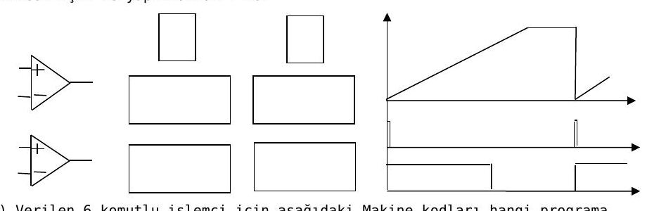

Bu yazı, EEM211 Sayısal Mantık Tasarımı dersinin klasöründe örnek sınav olarak bulunan bir Word belgesidir: bir **"Sayısal Tasarım"** dersinin **10 Ocak 2011** tarihli **1. öğretim** ve **2. öğretim final sınavları**. Belgede hangi üniversiteye ait olduğu yazmıyor; sınavlar "M.Y." imzalı ve her biri 90 dakikalık. Yalnızca sorular var, cevaplar yok. Sorular aşağıda metin olarak verildi; orijinal Word dosyası yazının sonunda indirilebilir.

*Bu içerik üçüncü taraf bir kaynağa aittir; arşiv ve nostalji amacıyla kaynak belirtilerek paylaşılmıştır. Hak sahibinin talebi hâlinde kaldırılır.*

## 1. öğretim final sınavı

1. VEYADEĞİL (NOR) kapıları kullanarak 3 bitlik karşılaştırıcı tasarlayınız. (15 puan)
1. 4 bitlik B sayısı ile 6 değerini çarpıp 1 ekleyecek devreyi tasarlayınız. (20 puan)
1. K = 1 iken birer birer ileri, K = 0 iken ikişer ikişer ileri sayan 3 bitlik sayıcı devreyi T flip-flop kullanarak tasarlayınız. (15 puan) Soruyla birlikte T flip-flopun tablosu verilmiş: T = 0 için Q(t+1) = Q(t), T = 1 için Q(t+1) = Q(t)'.
1. Blok diyagramı verilen sayısal voltmetrede f_clk = 200 Hz, Tx = 0,02 s olduğuna göre göstergede Vx = 1,6 V değeri için görülecek sayı kaçtır? Göstergede doğru değerin görülebilmesi için ne yapılmalıdır? (20 puan)



*Not: Word belgesindeki blok diyagramında blokların içindeki yazılar görünmüyor; şekil belgede olduğu gibi aktarıldı.*

5\. a) Verilen 6 komutlu işlemci için aşağıdaki makine kodları hangi programa karşılık gelmektedir? Assembler dili karşılığını veriniz. (15 puan) b) Programın çalışması nasıl gerçekleşir? Açıklayınız. Program çalıştıktan sonra r saklayıcılarının alacağı son değerleri gösteriniz. (15 puan + 10 puan bonus)

| Komut | Makine kodu biçimi | İşlem |
|---|---|---|
| `MOV Ra, #c` (8 bitlik c sabitini r saklayıcısına kopyala) | 0011 r3r2r1r0 c7…c0 | Ra = c |
| `SUB Ra, Rb, Rc` (Rb'den Rc'yi çıkar, sonucu Ra'ya yaz) | 0100 ra3…ra0 rb3…rb0 rc3…rc0 | Ra = Rb − Rc |
| `JNZ Ra, offset` (Ra sıfırdan farklıysa 8 bit işaretli offset kadar ileri ya da geri zıpla) | 0101 ra3…ra0 o7…o0 | Ra ≠ 0 ise PC = PC + offset |
| `MOV Ra, d` (veri belleğinde d adresindeki değeri Ra'ya kopyala) | 0000 r3r2r1r0 d7…d0 | Ra = data(d) |
| `MOV d, Ra` (Ra'daki değeri veri belleğinde d adresine kopyala) | 0001 r3r2r1r0 d7…d0 | data(d) = Ra |
| `ADD Ra, Rb, Rc` (Rb ile Rc'yi topla, sonucu Ra'ya yaz) | 0010 ra3…ra0 rb3…rb0 rc3…rc0 | Ra = Rb + Rc |

```
Adres   Komut
00      0011 0001 1000 0000
01      0011 0010 0000 0101
02      0011 0011 0000 1010
03      0011 0000 0000 0001
04      0100 0010 0010 0000
05      0101 0010 0000 0011
06      0100 0001 0001 0011
07      0101 0001 1111 1101
08      0001 0001 0000 0101
```

## 2. öğretim final sınavı

1. VEDEĞİL (NAND) kapıları kullanarak T flip-flop tasarlayınız. (10 puan)
1. a, b, c, d, e, f, g gibi 7 girişe sahip bir devrede "1" olan girişlerin toplam sayısını bulan sayısal devreyi tasarlayınız. (20 puan)
1. Ötelemeli kaydedici (shift register) kullanarak 16 bitlik çıkarma işlemini 1 bitlik çıkarma devresiyle gerçekleştirmek istiyoruz. Düzeneği tasarlayarak çalışmasını kısaca açıklayınız. (20 puan)
1. Bisiklet için (00–99 km/s) hız ölçer devresi tasarlamak istiyoruz. Tekerlek bir tur döndüğünde algılayıcıdan devremize 4 saat (clk) darbesi gelmektedir. Tekerlek çevresi 2,5 metredir. Buna göre hazır paralel yüklemeli 4 bitlik BCD sayıcılardan oluşan ölçüm devresinin blok diyagramını çiziniz. Sistem için gerekli zamanlamaları belirleyiniz. (20 puan)
1. a) FPGA sisteminde kullanılan LUT (look-up table), switch matrix ve CLB (configurable logic block) modüllerini en az 2 LUT kullanılacak örnek bir tasarım yardımıyla açıklayınız. (15 puan) b) Verilen FPGA kodlarının her bir satırını açıklayınız ve devrenin blok diyagramını çizerek devrede gerçekleştirilen işlemi belirleyiniz. (15 puan) c) FPGA sistemini alternatif sistemlerle kıyaslayarak FPGA uygulamasının nasıl gerçekleştirildiğini açıklayınız. (15 puan)

5b sorusundaki Verilog kodu:

```verilog
module ma2(a,b,mi, s,do);

input [1:0] a,b;
input mi;
output [1:0] s;
output do ;
wire [1:0] s;
wire do;
wire tel1,tel2,tel3;
ma f1(a[0], b[0], mi, s[0], tel1);
ma f2(a[1], b[1], tel1, s[1], tel2);
endmodule

module ma( in_a, in_b, min, m, dout );
    input   min;
    input    in_a;
    input    in_b;
    output   m;
    output dout;
    reg m, dout;
    always @(in_a or in_b or min)
    begin
    m <= in_a ^ in_b ^ min;
    dout <= (in_b & min) | (in_a & min) | (in_a & in_b);
    end
endmodule
```

Belgenin son sayfasında, 5a sorusuyla ilgili olarak Frank Vahid'in *Digital Design* (2006) kitabının "FPGA Internals: Configurable Logic Blocks (CLBs)" slaytından bir şekil yapıştırılmış.
