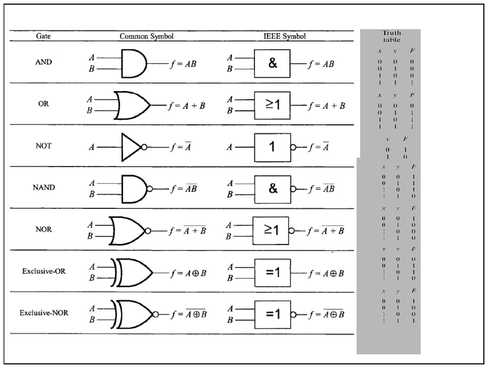
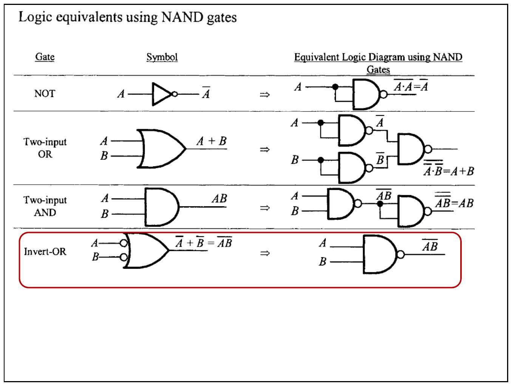
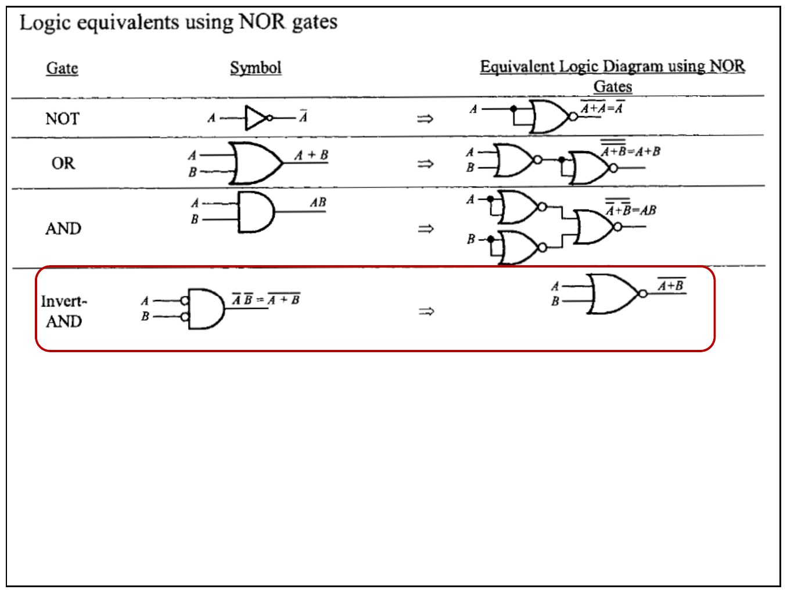
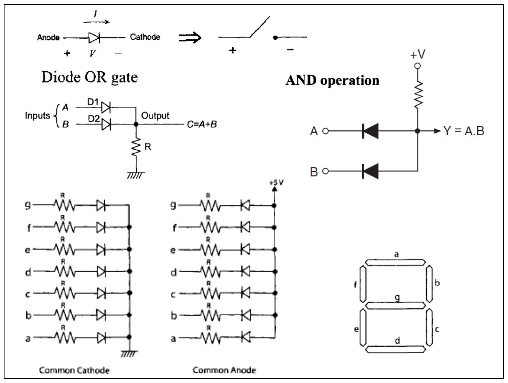
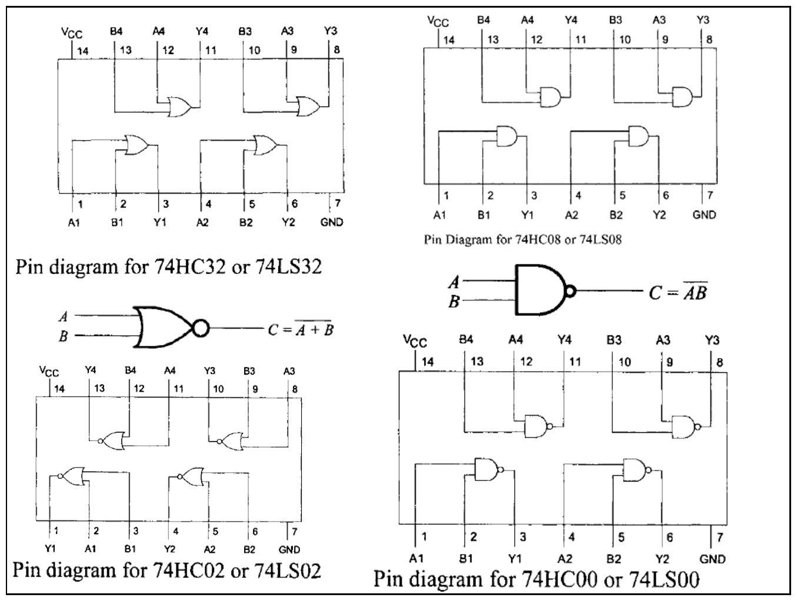
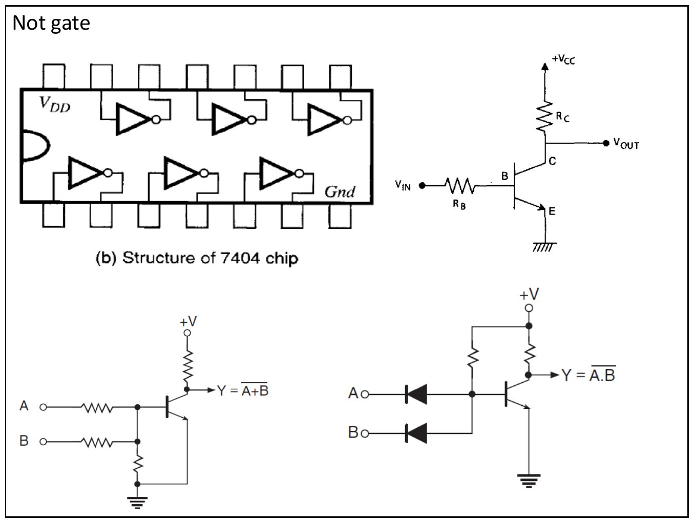
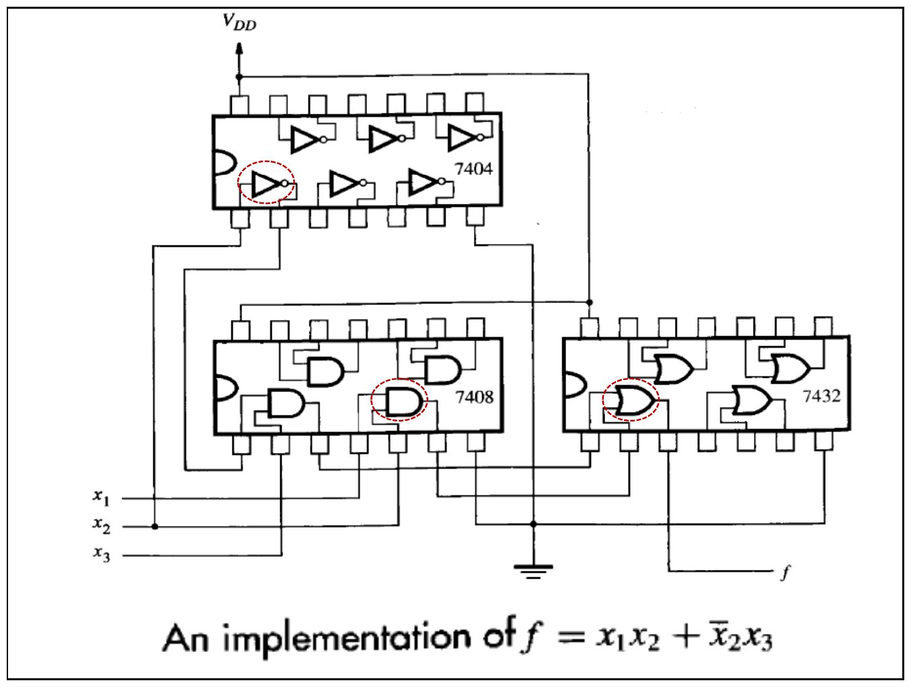
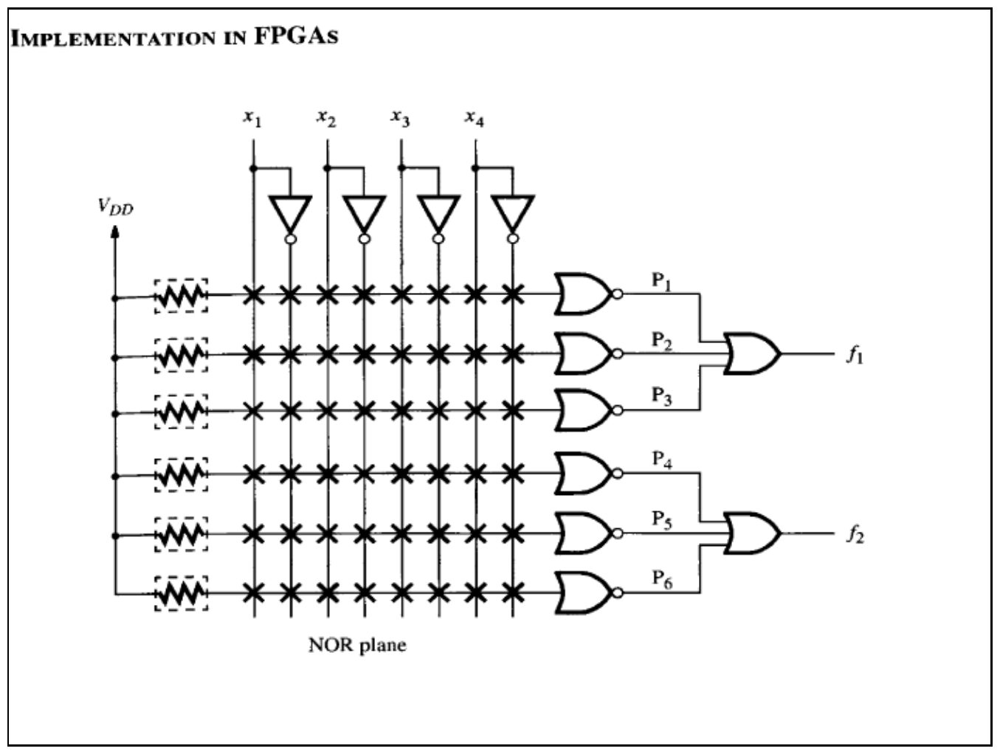

This post is Presentation 1, dated 17 October 2012, of the **EEM211 Digital Logic Design** course at Başkent University; the PDF's author metadata lists the course instructor Hamit Erdem (hamit). The presentation consists of nine slides and is almost entirely figures: the basic logic gates, NAND/NOR equivalents, how gates are built from diodes and transistors, and the pin connections of the 74xx integrated circuits used in the laboratory. The information contained in the figures is also given below as text. The original PDF of the presentation can be downloaded at the end of the post.

## Basic logic gates

The first slide shows the seven basic gates side by side, each with its common symbol and its IEEE symbol. In the IEEE symbol, the function of the gate is indicated by the mark inside the box: `&` for AND, `≥1` for OR, `1` for NOT, and `=1` for XOR; the small circle at the output denotes inversion (negation).

| Gate | Output | IEEE mark |
|---|---|---|
| AND | f = A·B | & |
| OR | f = A + B | ≥1 |
| NOT | f = A' | 1 (circle at output) |
| NAND | f = (A·B)' | & (circle at output) |
| NOR | f = (A + B)' | ≥1 (circle at output) |
| Exclusive-OR (XOR) | f = A ⊕ B | =1 |
| Exclusive-NOR (XNOR) | f = (A ⊕ B)' | =1 (circle at output) |

The truth tables on the right of the slide:

| x | y | AND | OR | NAND | NOR | XOR | XNOR |
|---|---|---|---|---|---|---|---|
| 0 | 0 | 0 | 0 | 1 | 1 | 0 | 1 |
| 0 | 1 | 0 | 1 | 1 | 0 | 1 | 0 |
| 1 | 0 | 0 | 1 | 1 | 0 | 1 | 0 |
| 1 | 1 | 1 | 1 | 0 | 0 | 0 | 1 |

For the NOT gate: if x = 0 then F = 1, and if x = 1 then F = 0.

## Logic equivalents using only NAND gates

The NAND gate is a "universal" gate: all other gates can be built using NAND gates alone.

- **NOT:** The two inputs of the NAND are tied together: (A·A)' = A'
- **Two-input OR:** Each input is inverted by a NAND, and the results are then passed through another NAND: (A'·B')' = A + B
- **Two-input AND:** The NAND output is inverted by a second NAND: ((A·B)')' = A·B
- **Invert-OR:** An OR gate with inverted inputs is simply a NAND gate: A' + B' = (A·B)'

## Logic equivalents using only NOR gates

- **NOT:** The two inputs of the NOR are tied together: (A + A)' = A'
- **OR:** The NOR output is inverted by a second NOR: ((A + B)')' = A + B
- **AND:** Each input is inverted by a NOR, and the results are then passed through another NOR: (A' + B')' = A·B
- **Invert-AND:** An AND gate with inverted inputs is simply a NOR gate: A'·B' = (A + B)'

## Diode gates and the 7-segment display

- A diode conducting from anode to cathode can be thought of as a closed switch.
- **Diode OR gate:** Inputs A and B are connected to the common output through diodes D1 and D2, and the output is pulled to ground through a resistor R: C = A + B.
- **Diode AND operation:** The output is pulled up to +V through a resistor, and inputs A and B are connected to the output through reverse-biased diodes: Y = A·B.
- **7-segment display:** Each of the segments a–g is an LED. In the *common-cathode* type the LED cathodes are connected to ground, and in the *common-anode* type the anodes are connected to +5 V; each segment is driven through a resistor R.

## Pin connections of the 74xx integrated circuits

In the 14-pin TTL/CMOS integrated circuits used in the laboratory, each package contains four two-input gates; pin 14 is VCC and pin 7 is GND.

| Integrated circuit | Gate |
|---|---|
| 74HC32 / 74LS32 | 4 two-input OR gates |
| 74HC08 / 74LS08 | 4 two-input AND gates |
| 74HC02 / 74LS02 | 4 two-input NOR gates, C = (A + B)' |
| 74HC00 / 74LS00 | 4 two-input NAND gates, C = (A·B)' |

 and XNOR (74HC266) integrated circuits")

- **XOR symbol:** C = A ⊕ B; its integrated circuit is the 74HC86 / 74LS86.
- **XNOR gate:** C = (A ⊕ B)'; its integrated circuit is the 74HC266 / 74LS266.

## The NOT gate and transistor gates

- **7404:** One package contains six NOT (inverter) gates.
- Single-transistor inverter: the input V_IN is applied to the base through R_B; the output is taken from the collector (pulled up to VCC through R_C).
- The circuit in which two inputs are connected through resistors to the base of the same transistor gives the NOR function: Y = (A + B)'.
- The circuit that uses a transistor inverter after a diode AND input gives the NAND function: Y = (A·B)'.

## Implementing a function with integrated circuits

The function f = x1·x2 + x2'·x3 is built with three integrated circuits:

- **7404** (NOT): produces x2'.
- **7408** (AND): produces the products x1·x2 and x2'·x3.
- **7432** (OR): adds the two products to give the output f.

## Implementation in programmable logic

The last slide ("Implementation in FPGAs") shows the inputs x1–x4 and their complements connected to a programmable **NOR plane**. The plane produces the terms P1–P6; P1–P3 are combined in one gate to form output **f1**, and P4–P6 are combined in another gate to form output **f2**.
