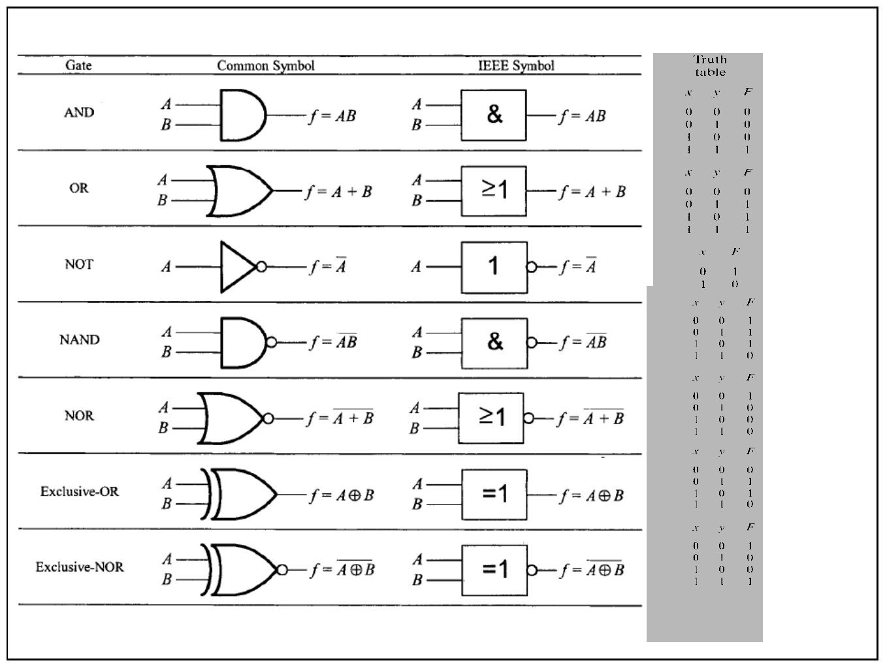
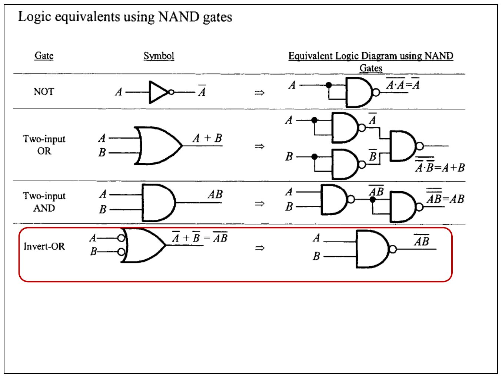
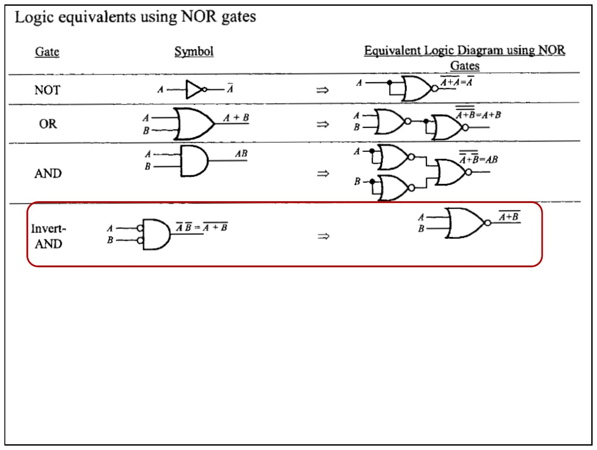
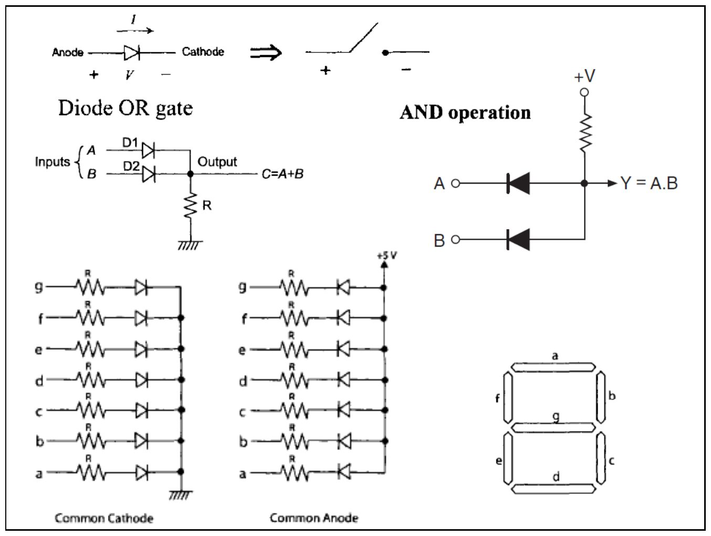
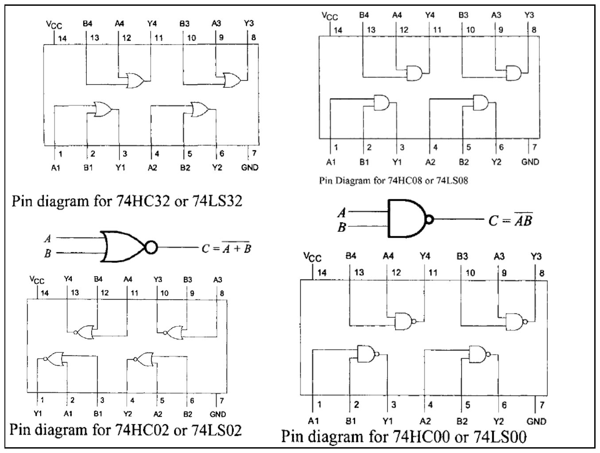
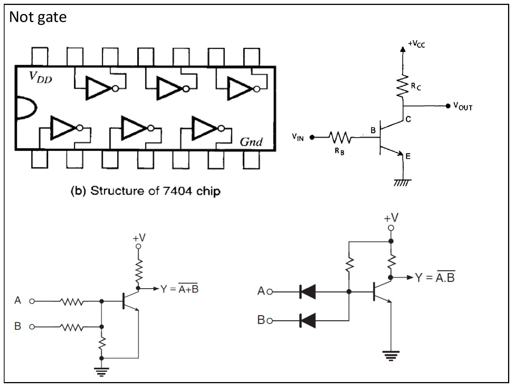
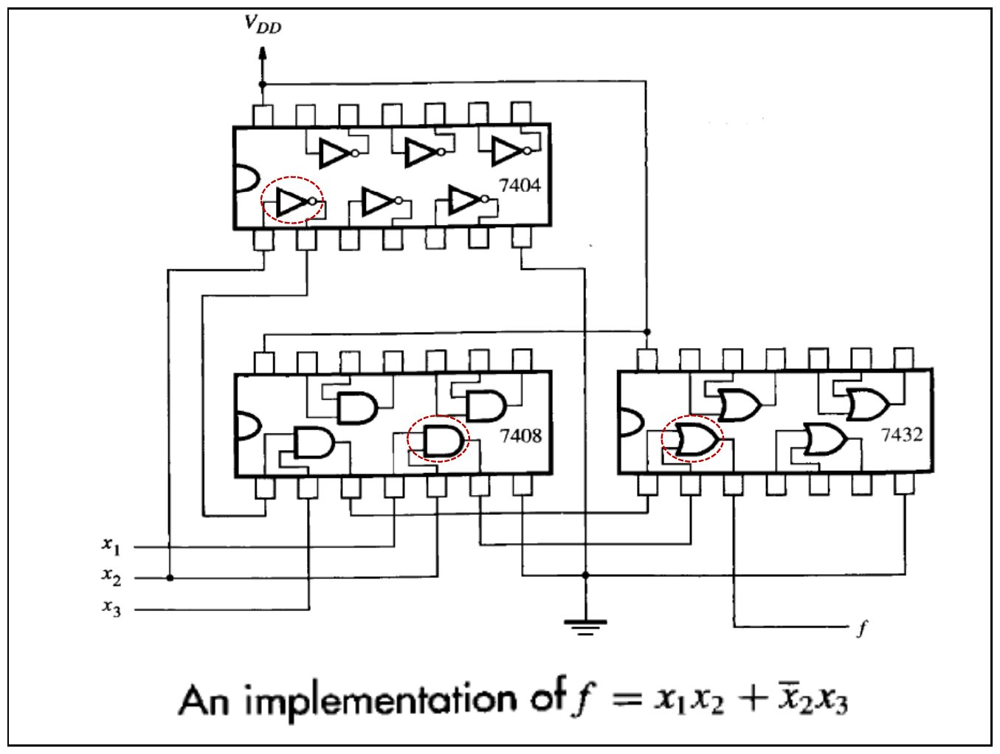
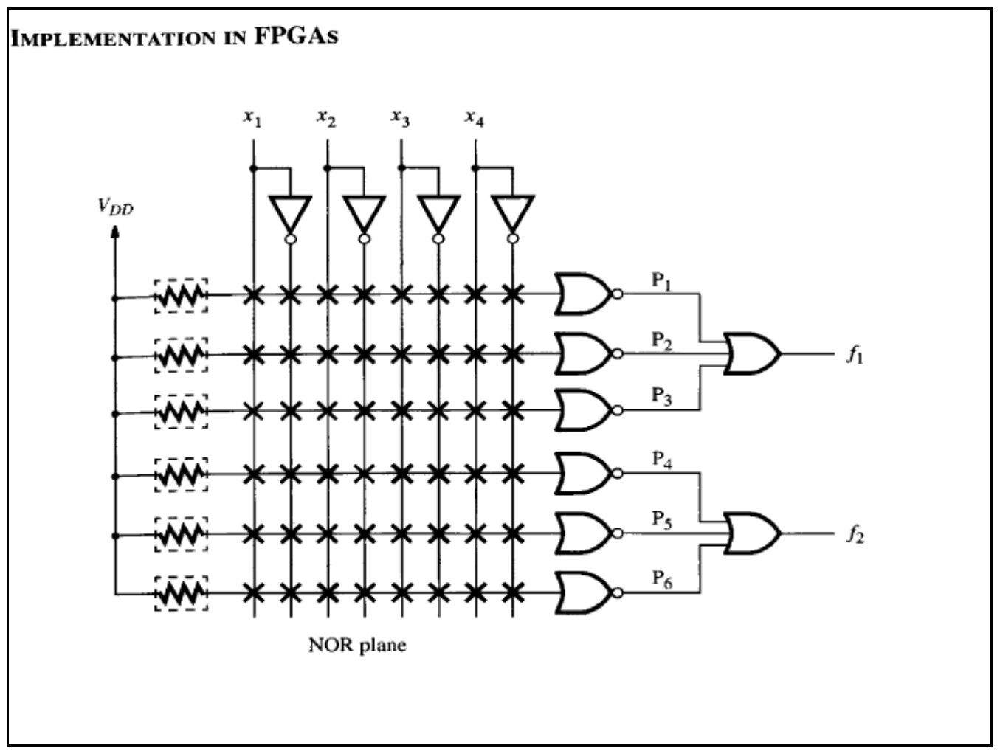

Bu yazı, Başkent Üniversitesi **EEM211 Sayısal Mantık Tasarımı** dersinin 17 Ekim 2012 tarihli 1. sunusudur; PDF'in yazar bilgisinde dersin hocası Hamit Erdem'in adı (hamit) geçiyor. Sunu dokuz slayttan oluşuyor ve neredeyse tamamı şekil: temel mantık kapıları, NAND/NOR eşdeğerleri, kapıların diyot ve transistörlerle yapılışı ve laboratuvarda kullanılan 74xx tümdevrelerinin bacak bağlantıları. Şekillerin içerdiği bilgiler aşağıda metin olarak da verildi. Sununun orijinal PDF'i yazının sonunda indirilebilir.

## Temel mantık kapıları

İlk slayt yedi temel kapıyı, ortak (common) sembolü ve IEEE sembolüyle yan yana gösteriyor. IEEE sembolünde kapının işlevi kutunun içindeki işaretle anlatılır: AND için `&`, OR için `≥1`, NOT için `1`, XOR için `=1`; çıkıştaki küçük daire tersleme (değil) anlamına gelir.

| Kapı | Çıkış | IEEE işareti |
|---|---|---|
| AND | f = A·B | & |
| OR | f = A + B | ≥1 |
| NOT | f = A' | 1 (çıkışta daire) |
| NAND | f = (A·B)' | & (çıkışta daire) |
| NOR | f = (A + B)' | ≥1 (çıkışta daire) |
| Exclusive-OR (XOR) | f = A ⊕ B | =1 |
| Exclusive-NOR (XNOR) | f = (A ⊕ B)' | =1 (çıkışta daire) |

Slaytın sağındaki doğruluk tabloları:

| x | y | AND | OR | NAND | NOR | XOR | XNOR |
|---|---|---|---|---|---|---|---|
| 0 | 0 | 0 | 0 | 1 | 1 | 0 | 1 |
| 0 | 1 | 0 | 1 | 1 | 0 | 1 | 0 |
| 1 | 0 | 0 | 1 | 1 | 0 | 1 | 0 |
| 1 | 1 | 1 | 1 | 0 | 0 | 0 | 1 |

NOT kapısı için: x = 0 ise F = 1, x = 1 ise F = 0.

## Yalnız NAND kapılarıyla mantık eşdeğerleri

NAND kapısı "evrensel" kapıdır: diğer bütün kapılar yalnız NAND ile kurulabilir.

- **NOT:** NAND'ın iki girişi birleştirilir: (A·A)' = A'
- **İki girişli OR:** Her giriş bir NAND ile terslenir, sonra bir NAND'dan geçirilir: (A'·B')' = A + B
- **İki girişli AND:** NAND çıkışı ikinci bir NAND ile terslenir: ((A·B)')' = A·B
- **Invert-OR:** Girişleri terslenmiş OR kapısı, NAND kapısının ta kendisidir: A' + B' = (A·B)'

## Yalnız NOR kapılarıyla mantık eşdeğerleri

- **NOT:** NOR'un iki girişi birleştirilir: (A + A)' = A'
- **OR:** NOR çıkışı ikinci bir NOR ile terslenir: ((A + B)')' = A + B
- **AND:** Her giriş bir NOR ile terslenir, sonra bir NOR'dan geçirilir: (A' + B')' = A·B
- **Invert-AND:** Girişleri terslenmiş AND kapısı, NOR kapısının ta kendisidir: A'·B' = (A + B)'

## Diyotlu kapılar ve 7 parçalı gösterge

- Diyot, anottan katoda doğru iletimdeyken kapalı bir anahtar gibi düşünülebilir.
- **Diyotlu OR kapısı:** A ve B girişleri D1 ve D2 diyotları üzerinden ortak çıkışa bağlanır, çıkış R direnciyle toprağa çekilir: C = A + B.
- **Diyotlu AND işlemi:** Çıkış bir dirençle +V'ye çekilir, A ve B girişleri ters yönlü diyotlarla çıkışa bağlanır: Y = A·B.
- **7 parçalı gösterge:** a–g parçalarının her biri bir LED'dir. *Ortak katot* tipinde LED'lerin katotları toprağa, *ortak anot* tipinde anotları +5 V'a bağlıdır; her parça bir R direnci üzerinden sürülür.

## 74xx tümdevrelerinin bacak bağlantıları

Laboratuvarda kullanılan 14 bacaklı TTL/CMOS tümdevrelerinde her kılıfta dört adet iki girişli kapı vardır; 14. bacak VCC, 7. bacak GND'dir.

| Tümdevre | Kapı |
|---|---|
| 74HC32 / 74LS32 | 4 adet iki girişli OR |
| 74HC08 / 74LS08 | 4 adet iki girişli AND |
| 74HC02 / 74LS02 | 4 adet iki girişli NOR, C = (A + B)' |
| 74HC00 / 74LS00 | 4 adet iki girişli NAND, C = (A·B)' |

 ve XNOR (74HC266) tümdevreleri")

- **XOR sembolü:** C = A ⊕ B; tümdevresi 74HC86 / 74LS86.
- **XNOR kapısı:** C = (A ⊕ B)'; tümdevresi 74HC266 / 74LS266.

## NOT kapısı ve transistörlü kapılar

- **7404:** Bir kılıfta altı adet NOT (tersleyici) kapısı vardır.
- Tek transistörlü tersleyici: giriş V_IN, R_B üzerinden tabana uygulanır; çıkış kollektörden (R_C üzerinden VCC'ye çekili) alınır.
- İki girişin dirençlerle aynı transistörün tabanına bağlandığı devre NOR işlevi verir: Y = (A + B)'.
- Diyotlu AND girişinin ardından transistörlü tersleyici kullanılan devre NAND işlevi verir: Y = (A·B)'.

## Bir fonksiyonun tümdevrelerle gerçekleştirilmesi

f = x1·x2 + x2'·x3 fonksiyonu üç tümdevreyle kurulur:

- **7404** (NOT): x2'yi üretir.
- **7408** (AND): x1·x2 ve x2'·x3 çarpımlarını üretir.
- **7432** (OR): iki çarpımı toplayarak f çıkışını verir.

## Programlanabilir mantıkta gerçekleştirme

Son slayt ("Implementation in FPGAs"), x1–x4 girişlerinin ve tümleyenlerinin programlanabilir bir **NOR düzlemine** bağlandığını gösteriyor. Düzlemde P1–P6 terimleri üretiliyor; P1–P3 bir kapıda birleşerek **f1**, P4–P6 bir başka kapıda birleşerek **f2** çıkışını oluşturuyor.
