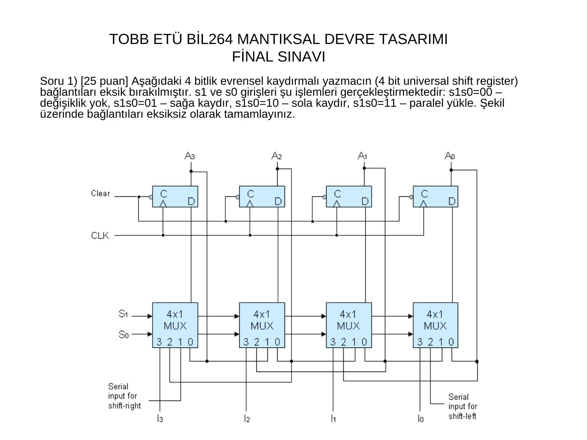
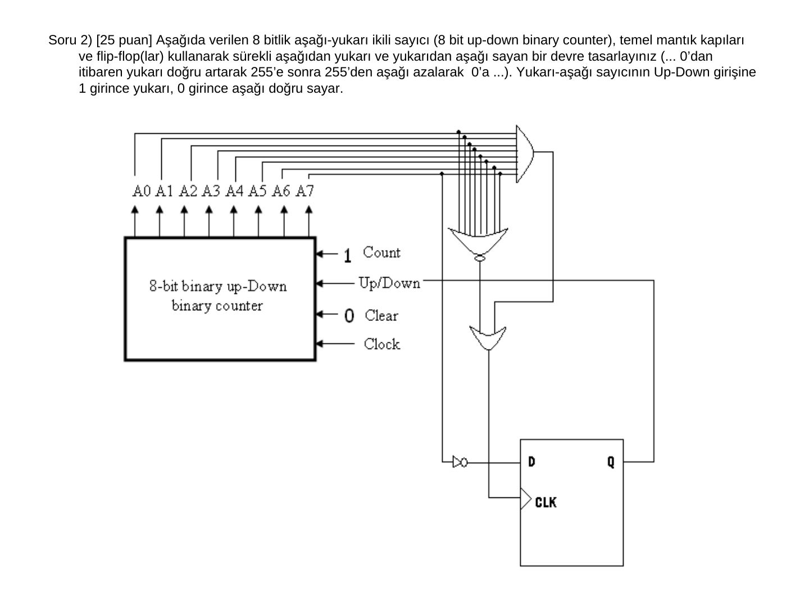
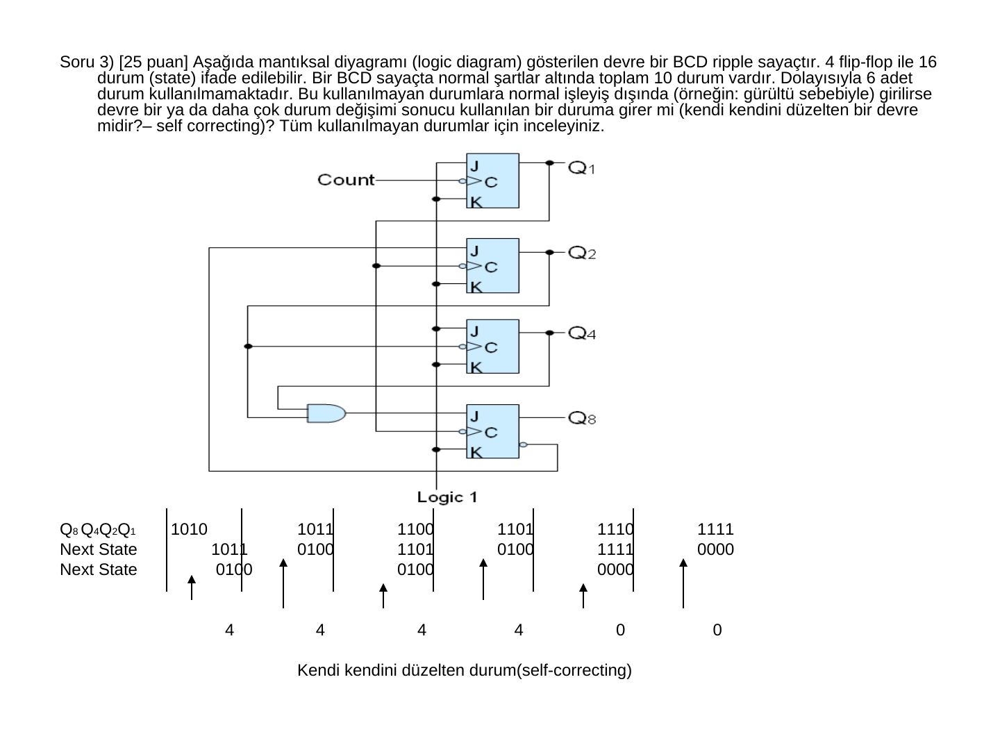
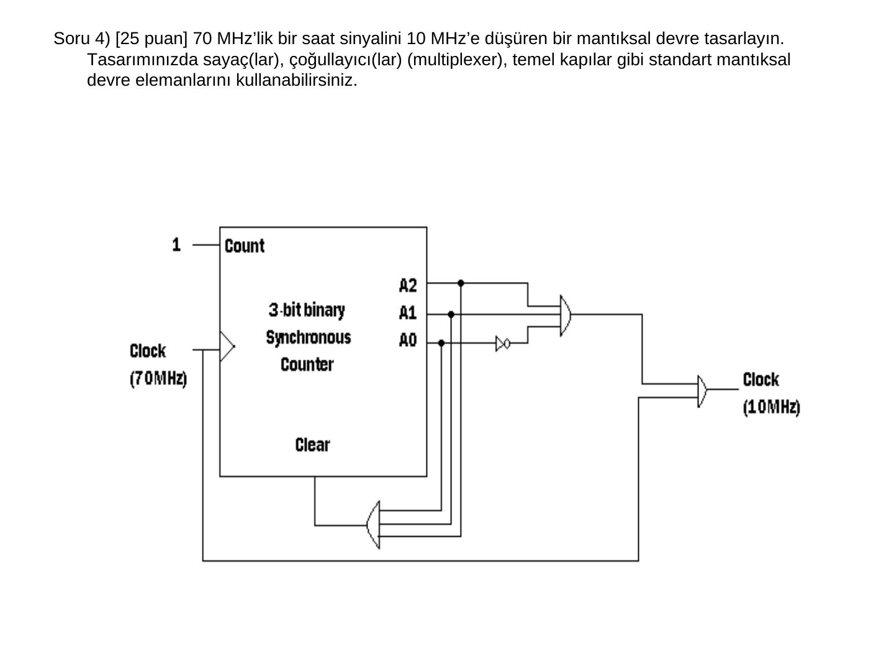
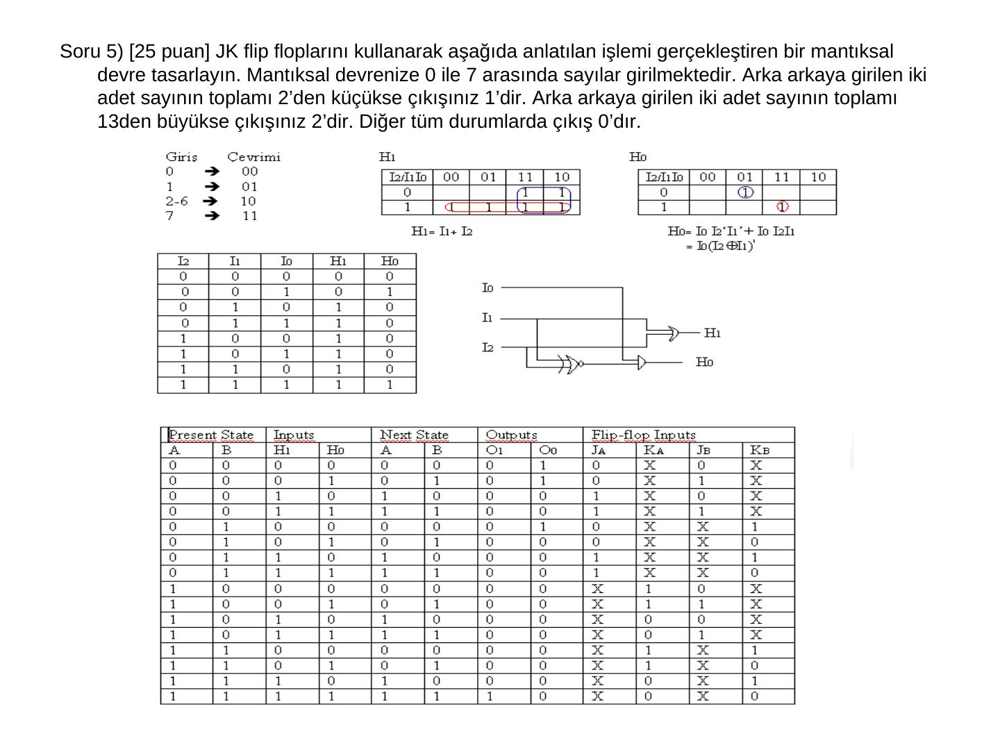
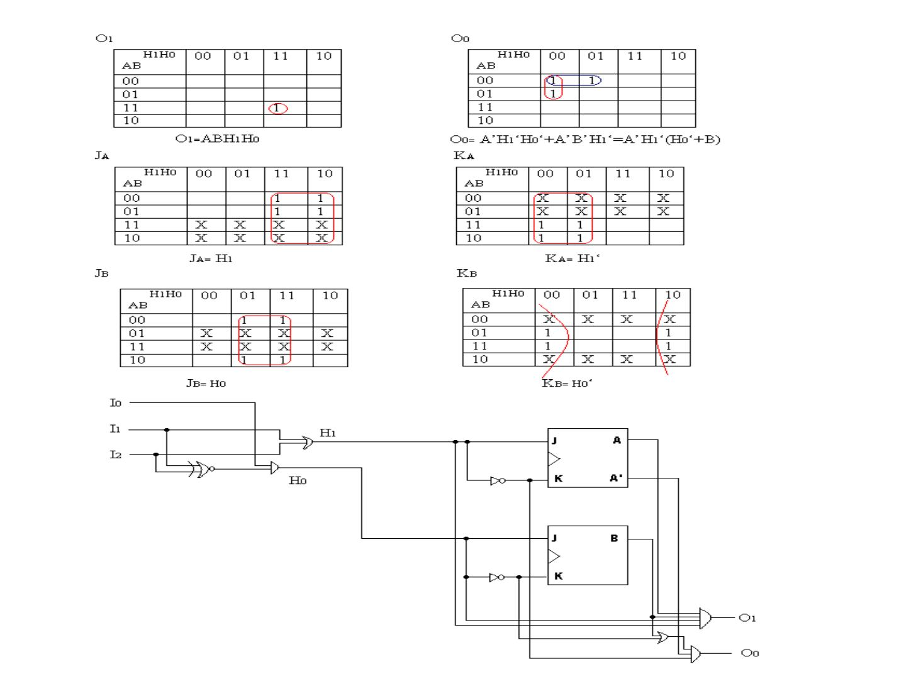

This post is a **final exam** found as a sample exam in the EEM211 Digital Logic Design course folder: the final exam of the **TOBB University of Economics and Technology (TOBB ETÜ) BİL264 Logic Circuit Design** course. The six-slide PowerPoint file contains five questions and their solutions given with drawings; the year of the exam is not written in the document (the file dates from 2007). The questions are presented below as text, and the circuits and solution tables are presented as slide images. The original file can be downloaded at the end of the post.

*This content belongs to a third-party source; it is shared for archival and nostalgic purposes with the source credited. It will be removed upon the request of the rights holder.*

## Question 1: Universal shift register (25 points)

The connections of the following 4-bit universal shift register are left incomplete. The s1 and s0 inputs perform the following operations: s1s0 = 00 no change, s1s0 = 01 shift right, s1s0 = 10 shift left, s1s0 = 11 parallel load. Complete the connections on the figure.

In the drawing on the slide, the connections are completed: in front of each D flip-flop there is a 4x1 MUX; the flip-flop's own output is connected to input 0 of the MUX (no change), the output of its left neighbor to input 1 (shift right; for the leftmost one, "serial input for shift-right"), the output of its right neighbor to input 2 (shift left; for the rightmost one, "serial input for shift-left"), and the parallel input Iᵢ to input 3.

## Question 2: Continuous up-down counter (25 points)

Using basic logic gates and flip-flop(s), design the 8-bit up-down binary counter given below as a circuit that counts continuously from bottom to top and from top to bottom (… counting up from 0 to 255, then counting down from 255 to 0 …). The up-down counter counts up when its Up/Down input is 1 and counts down when it is 0.

In the solution, the counter's A0–A7 outputs are connected to an 8-input AND (is the count 255?) and an 8-input NOR (is the count 0?); the OR of these two signals forms the clock of a D flip-flop that drives the Up/Down input. Since the inverse of the flip-flop's own output is fed to its input, the counting direction reverses each time the counter reaches an end.

## Question 3: Does the BCD ripple counter correct itself? (25 points)

The circuit whose logic diagram is shown below is a BCD ripple counter. 16 states can be represented with 4 flip-flops; a BCD counter normally has a total of 10 states, so 6 states are unused. If one of these unused states is entered outside normal operation (for example, due to noise), does the circuit enter a used state after one or more state changes (is it a self-correcting circuit)? Examine this for all unused states.

Solution (Q8 Q4 Q2 Q1):

| Unused state | Next state | State after that |
|---|---|---|
| 1010 | 1011 | 0100 (4) |
| 1011 | 0100 (4) | |
| 1100 | 1101 | 0100 (4) |
| 1101 | 0100 (4) | |
| 1110 | 1111 | 0000 (0) |
| 1111 | 0000 (0) | |

All unused states return to state 4 or 0 within at most two clock pulses: the circuit is **self-correcting**.

## Question 4: 70 MHz to 10 MHz frequency divider (25 points)

Design a logic circuit that reduces a 70 MHz clock signal to 10 MHz. In your design you may use standard logic circuit elements such as counter(s), multiplexer(s), and basic gates.

In the solution, to divide by 70 / 10 = 7, a 3-bit synchronous binary counter with its Count input tied to 1 and running on the 70 MHz clock is used. The counter's A2, A1, A0 outputs are fed back to the Clear input through a gate so that the counter cycles through seven states; the inverses of A2, A1 and A0 are combined in another gate, and this signal is passed through a final gate together with the 70 MHz clock to obtain the 10 MHz output.

*Note: The gate types in the drawing and the active level of the Clear input are not specified; the solution is transcribed from the figure as it is. The goal is to produce one output pulse per 7 input pulses (70 / 7 = 10 MHz).*

## Question 5: Circuit classifying the sum of consecutive numbers (25 points)

Using JK flip-flops, design a logic circuit that performs the following operation: numbers between 0 and 7 are fed into the circuit. If the sum of two consecutively entered numbers is less than 2, the output is 1; if it is greater than 13, the output is 2; in all other cases the output is 0.

The idea of the solution is to first reduce the entered 3-bit number (I2 I1 I0) to a 2-bit class (H1 H0): 0 → 00, 1 → 01, 2–6 → 10, 7 → 11. If the sum is less than 2, either both numbers are 0 or one is 0 and the other is 1; if the sum is greater than 13, both numbers are 7. The functions of this encoding are:

- H1 = I1 + I2
- H0 = I0·I1'·I2' + I0·I1·I2 = I0·(I1 ⊕ I2)'

The class of the previous number is stored in two JK flip-flops (A, B); the JKs are used like Ds: J_A = H1, K_A = H1', J_B = H0, K_B = H0'. Outputs (O1 O0 = 2-bit binary output):

- O1 = A·B·H1·H0 (previous and current number are 7: sum 14)
- O0 = A'·H1'·H0' + A'·B'·H1' = A'·H1'·(H0' + B') (sum is 0 or 1)

