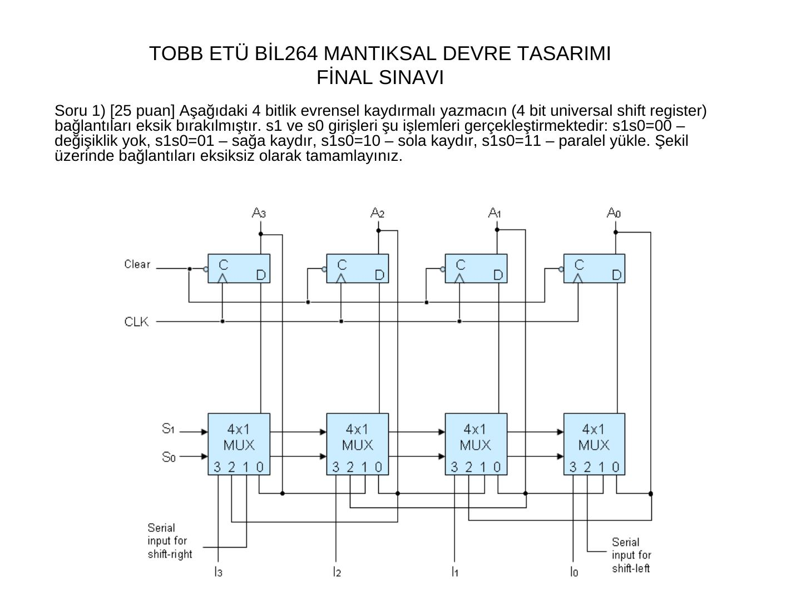
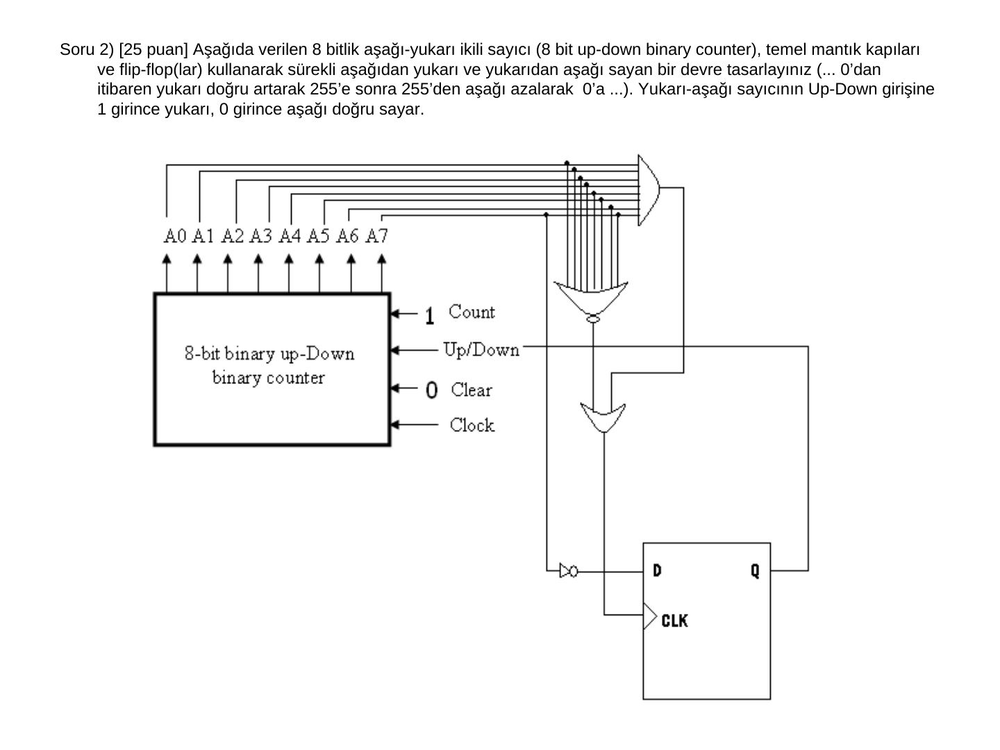
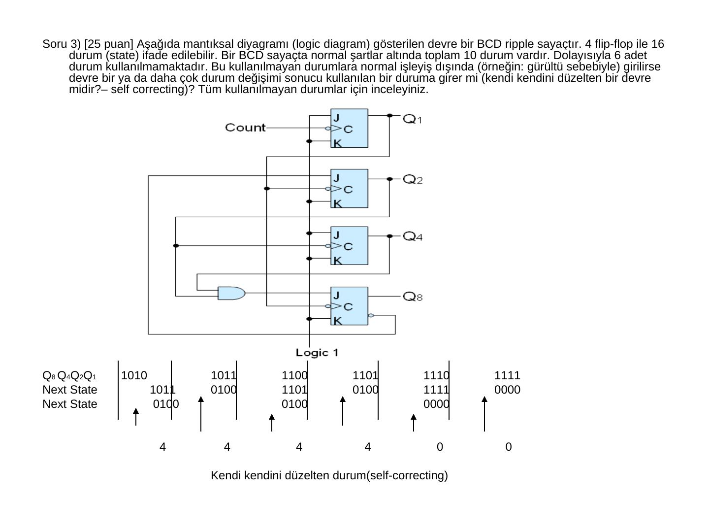
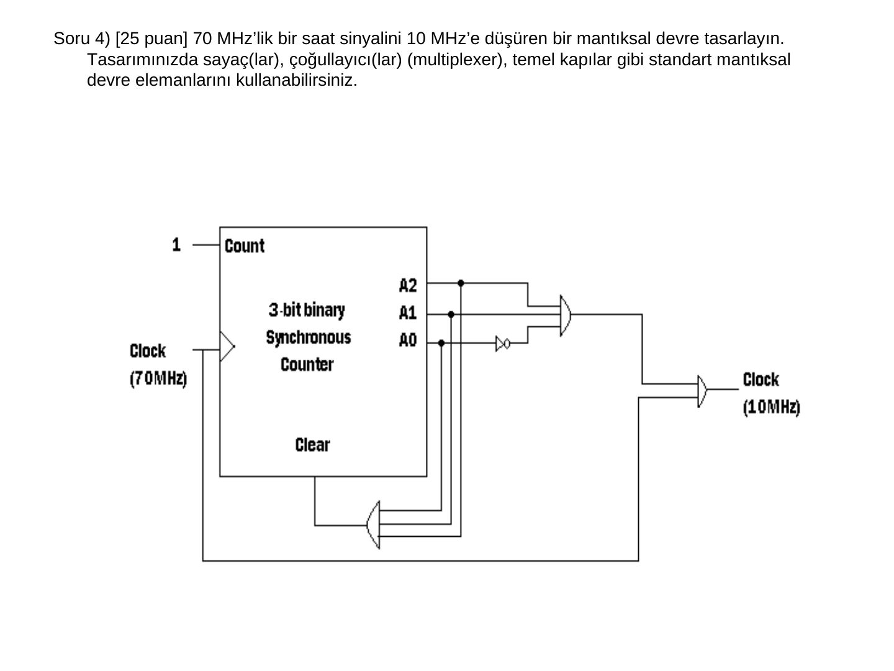
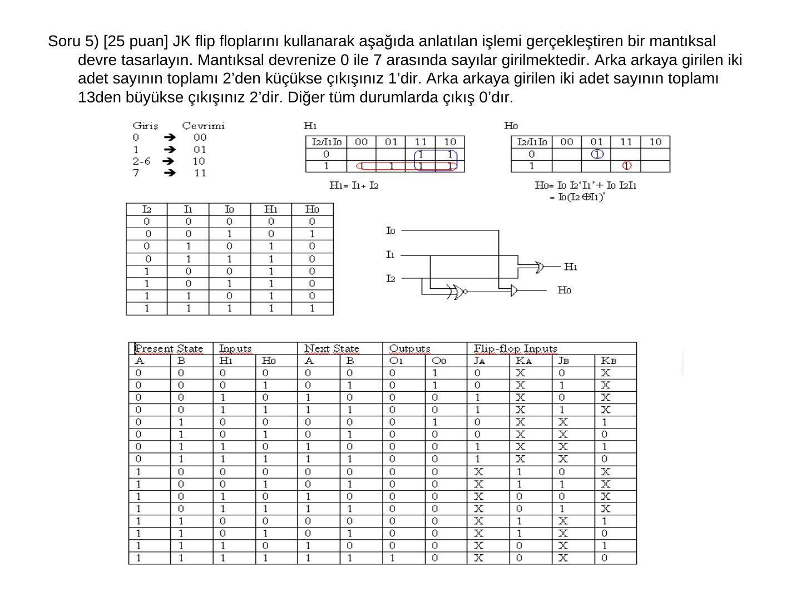
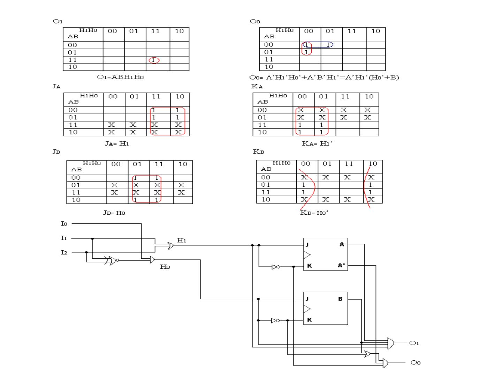

Bu yazı, EEM211 Sayısal Mantık Tasarımı dersinin klasöründe örnek sınav olarak bulunan bir **final sınavıdır**: **TOBB Ekonomi ve Teknoloji Üniversitesi (TOBB ETÜ) BİL264 Mantıksal Devre Tasarımı** dersinin final sınavı. Altı slaytlık PowerPoint dosyasında beş soru ve çizimlerle verilmiş çözümleri var; sınavın yılı belgede yazmıyor (dosya 2007'den kalma). Sorular aşağıda metin olarak, devreler ve çözüm tabloları slayt görselleriyle aktarıldı. Orijinal dosya yazının sonunda indirilebilir.

*Bu içerik üçüncü taraf bir kaynağa aittir; arşiv ve nostalji amacıyla kaynak belirtilerek paylaşılmıştır. Hak sahibinin talebi hâlinde kaldırılır.*

## Soru 1: Evrensel kaydırmalı yazmaç (25 puan)

Aşağıdaki 4 bitlik evrensel kaydırmalı yazmacın (4 bit universal shift register) bağlantıları eksik bırakılmıştır. s1 ve s0 girişleri şu işlemleri gerçekleştirmektedir: s1s0 = 00 değişiklik yok, s1s0 = 01 sağa kaydır, s1s0 = 10 sola kaydır, s1s0 = 11 paralel yükle. Şekil üzerinde bağlantıları eksiksiz olarak tamamlayınız.

Slayttaki çizimde bağlantılar tamamlanmış: her D flip-flopun önünde bir 4x1 MUX var; MUX'un 0 girişine flip-flopun kendi çıkışı (değişiklik yok), 1 girişine soldaki komşusunun çıkışı (sağa kaydırma; en soldakinde "serial input for shift-right"), 2 girişine sağdaki komşusunun çıkışı (sola kaydırma; en sağdakinde "serial input for shift-left"), 3 girişine paralel giriş Iᵢ bağlı.

## Soru 2: Sürekli yukarı-aşağı sayan sayıcı (25 puan)

Aşağıda verilen 8 bitlik aşağı-yukarı ikili sayıcıyı (8 bit up-down binary counter), temel mantık kapıları ve flip-flop(lar) kullanarak sürekli aşağıdan yukarı ve yukarıdan aşağı sayan bir devre olarak tasarlayınız (… 0'dan itibaren yukarı doğru artarak 255'e, sonra 255'ten aşağı azalarak 0'a …). Yukarı-aşağı sayıcının Up/Down girişine 1 girince yukarı, 0 girince aşağı doğru sayar.

Çözümde sayacın A0–A7 çıkışları bir 8 girişli AND'e (sayı 255 mi?) ve bir 8 girişli NOR'a (sayı 0 mı?) bağlanıyor; bu iki sinyalin OR'u, Up/Down girişini süren bir D flip-flopun saatini oluşturuyor. Flip-flopun girişine kendi çıkışının tersi verildiği için sayaç her uca ulaştığında sayma yönü değişiyor.

## Soru 3: BCD ripple sayaç kendi kendini düzeltir mi? (25 puan)

Aşağıda mantıksal diyagramı gösterilen devre bir BCD ripple sayaçtır. 4 flip-flop ile 16 durum ifade edilebilir; bir BCD sayaçta normal şartlarda toplam 10 durum vardır, dolayısıyla 6 durum kullanılmamaktadır. Bu kullanılmayan durumlara normal işleyiş dışında (örneğin gürültü sebebiyle) girilirse devre bir ya da daha çok durum değişimi sonucu kullanılan bir duruma girer mi (kendi kendini düzelten, *self-correcting* bir devre midir)? Tüm kullanılmayan durumlar için inceleyiniz.

Çözüm (Q8 Q4 Q2 Q1):

| Kullanılmayan durum | Sonraki durum | Ondan sonraki durum |
|---|---|---|
| 1010 | 1011 | 0100 (4) |
| 1011 | 0100 (4) | |
| 1100 | 1101 | 0100 (4) |
| 1101 | 0100 (4) | |
| 1110 | 1111 | 0000 (0) |
| 1111 | 0000 (0) | |

Kullanılmayan bütün durumlar en fazla iki saat darbesinde 4 ya da 0 durumuna dönüyor: devre **kendi kendini düzeltir**.

## Soru 4: 70 MHz'ten 10 MHz'e frekans bölücü (25 puan)

70 MHz'lik bir saat sinyalini 10 MHz'e düşüren bir mantıksal devre tasarlayın. Tasarımınızda sayaç(lar), çoğullayıcı(lar), temel kapılar gibi standart mantıksal devre elemanlarını kullanabilirsiniz.

Çözümde 70 / 10 = 7'ye bölmek için Count girişi 1'e bağlı, 70 MHz saatle çalışan 3 bitlik senkron ikili sayaç kullanılıyor. Sayacın A2, A1, A0 çıkışları bir kapıyla Clear girişine geri bağlanarak sayaç yedi durumda döndürülüyor; A2, A1 ve A0'ın tersi bir başka kapıda birleştiriliyor ve bu sinyal 70 MHz'lik saatle birlikte son kapıdan geçirilerek 10 MHz'lik çıkış alınıyor.

*Not: Çizimdeki kapı tipleri ve Clear girişinin etkin seviyesi belirtilmemiş; çözüm şekilden olduğu gibi aktarıldı. Amaç, 7 giriş darbesinde bir çıkış darbesi (70 / 7 = 10 MHz) üretmektir.*

## Soru 5: Ardışık iki sayının toplamını sınıflandıran devre (25 puan)

JK flip-floplarını kullanarak şu işlemi gerçekleştiren bir mantıksal devre tasarlayın: devreye 0 ile 7 arasında sayılar girilmektedir. Arka arkaya girilen iki sayının toplamı 2'den küçükse çıkış 1'dir, 13'ten büyükse çıkış 2'dir; diğer tüm durumlarda çıkış 0'dır.

Çözümün fikri, girilen 3 bitlik sayıyı (I2 I1 I0) önce 2 bitlik bir sınıfa (H1 H0) indirmek: 0 → 00, 1 → 01, 2–6 → 10, 7 → 11. Toplam 2'den küçükse iki sayı da 0 ya da biri 0 diğeri 1'dir; toplam 13'ten büyükse iki sayı da 7'dir. Bu kodlamanın fonksiyonları:

- H1 = I1 + I2
- H0 = I0·I1'·I2' + I0·I1·I2 = I0·(I1 ⊕ I2)'

Önceki sayının sınıfı iki JK flip-flopta (A, B) saklanıyor; JK'ler D gibi kullanılıyor: J_A = H1, K_A = H1', J_B = H0, K_B = H0'. Çıkışlar (O1 O0 = 2'lik ikili çıkış):

- O1 = A·B·H1·H0 (önceki ve şimdiki sayı 7: toplam 14)
- O0 = A'·H1'·H0' + A'·B'·H1' = A'·H1'·(H0' + B') (toplam 0 ya da 1)

