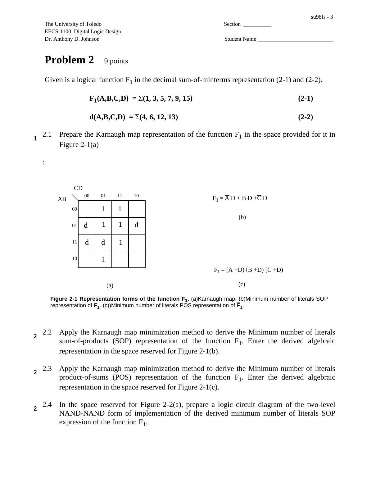
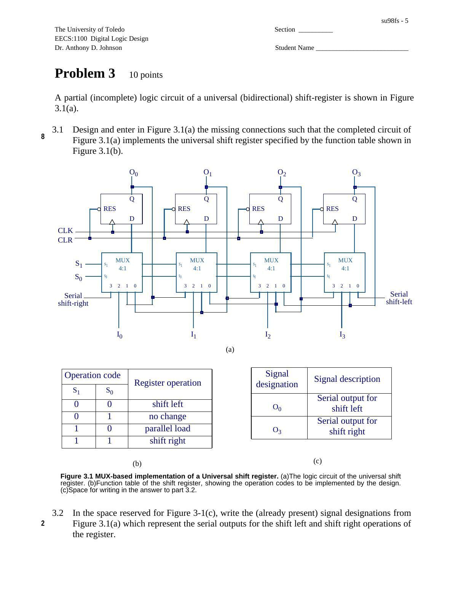
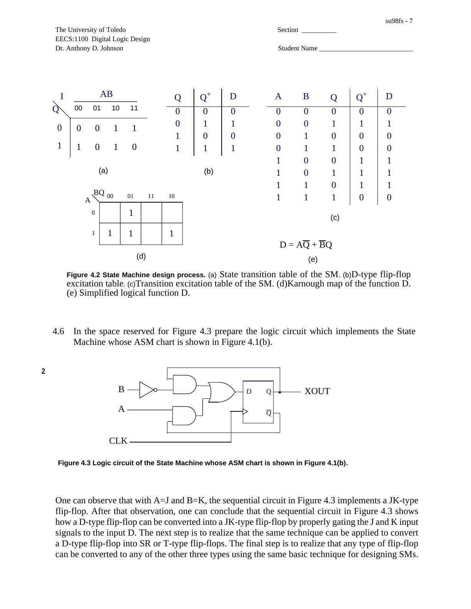

A final exam from the University of Toledo EECS:1100 Digital Logic Design course, signed by Dr. Anthony D. Johnson, with solutions worked out on it. The source file is su98fs.pdf; the PDF was created on 13 February 1998 and last modified on 17 January 1999. The seven-page document can be downloaded at the end of the post. The student information fields are left blank.

*This content belongs to a third-party source; it is shared for archival and nostalgic purposes with attribution. It will be removed at the request of the rights holder.*

## 1. Number bases and two's complement

The first question asks for the decimal equivalent of three numbers, their eight-bit binary representation, and the binary representation of their negatives. Bits are grouped in fours for readability.

| Number in the source | Decimal equivalent | x, 8 bits | −x, 8 bits |
| --- | --- | --- | --- |
| −30 (base 10) | −30 | 1110 0010 | 0001 1110 |
| 134 (base 8) | 92 | 0101 1100 | 1010 0100 |
| −3D (base 16) | −61 | 1100 0011 | 0011 1101 |

The operation x(2)−x(1) is performed using only an adder: 92−(−30)=122. The binary operation 0101 1100 + 0001 1110 gives 0111 1010. The solutions were checked against their decimal equivalents.

## 2. Karnaugh map and two-level implementation

The given function is F1(A,B,C,D)=Σ(1,3,5,7,9,15), with don't-care conditions d(A,B,C,D)=Σ(4,6,12,13). The student is asked to fill in the map, derive the minimum-literal sum-of-products and product-of-sums expressions, and draw the NAND–NAND and NOR–NOR circuits.

The source answer gives F1=A′D+BD+C′D. The product-form expression is for the complement function: F1′=(A+D′)(B′+D′)(C+D′). The overbars were transcribed as ′ marks when converting to text. The results were verified against the six given minterms and six required zeros.

## 3. Universal bidirectional shift register

Four D flip-flops are used, with a 4:1 MUX in front of each flip-flop. The student is asked to complete the missing connections so that the following operation table is satisfied.

| S1 | S0 | Operation |
| --- | --- | --- |
| 0 | 0 | Shift left |
| 0 | 1 | Hold state |
| 1 | 0 | Parallel load |
| 1 | 1 | Shift right |

In the drawing, the serial output of the left shift is given as O0 and the serial output of the right shift as O3. I0–I3 are the parallel inputs; CLK and CLR are common control lines.

## 4. Moore state machine and flip-flop conversion

The machine, with inputs A and B, is implemented with a positive-edge-triggered D flip-flop. The transition table, the D excitation table, the transition-excitation table, and the Karnaugh map are derived from the ASM chart.

| Present Q | AB=00 | AB=01 | AB=10 | AB=11 |
| --- | --- | --- | --- | --- |
| 0 | 0 | 0 | 1 | 1 |
| 1 | 1 | 0 | 1 | 0 |

The values in the table are the next-state Q⁺ values. The D input equation is D=AQ′+B′Q, and the output is XOUT=Q. If A=J and B=K are taken, the circuit exhibits JK flip-flop behavior. It is noted that, with the same state machine design method, conversion between other flip-flop types is possible.

