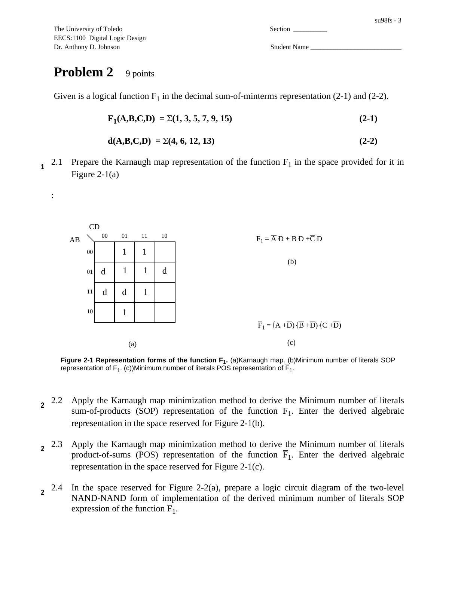
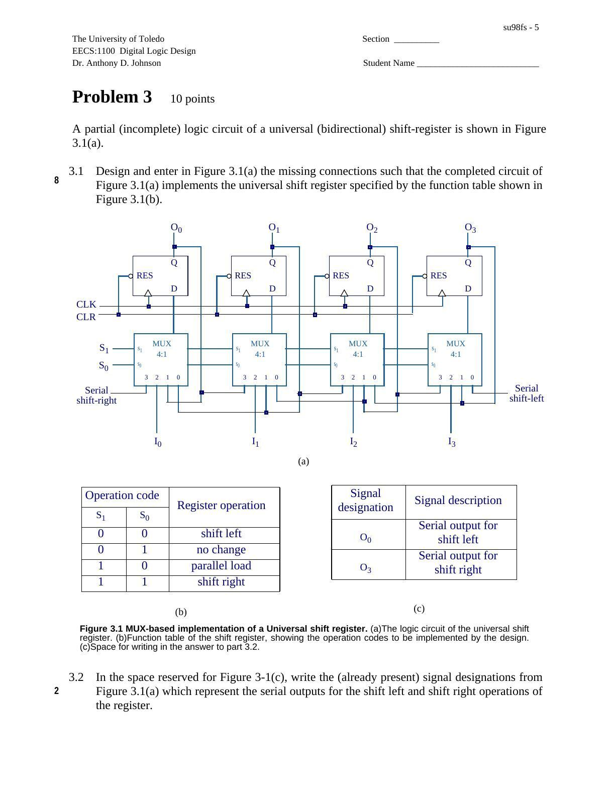
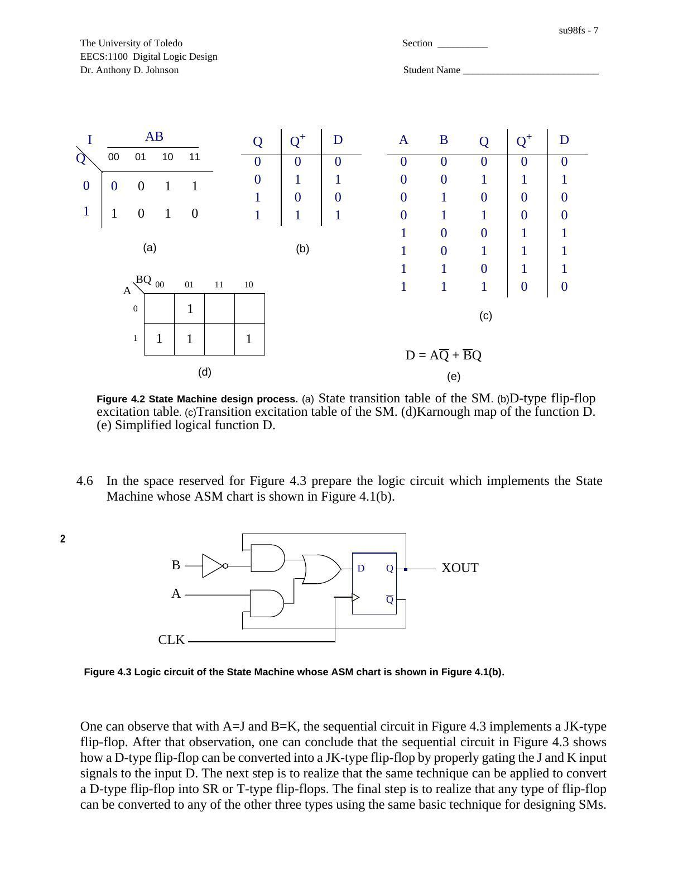

University of Toledo EECS:1100 Digital Logic Design dersinden Dr. Anthony D. Johnson imzalı, çözümleri üzerinde gösterilmiş final sınavı. Kaynak dosya su98fs.pdf; PDF oluşturma tarihi 13 Şubat 1998, son değiştirilme tarihi 17 Ocak 1999. Yedi sayfalık belge yazının sonunda indirilebilir. Öğrenci bilgisi alanları boş bırakılmıştır.

*Bu içerik üçüncü taraf bir kaynağa aittir; arşiv ve nostalji amacıyla kaynak belirtilerek paylaşılmıştır. Hak sahibinin talebi hâlinde kaldırılır.*

## 1. Sayı tabanları ve ikinin tümleyeni

İlk soruda üç sayının onluk karşılığı, sekiz bitlik ikili gösterimi ve negatifinin ikili gösterimi istenir. Okunurluk için bitler dörderli ayrıldı.

| Kaynaktaki sayı | Onluk karşılık | x, 8 bit | −x, 8 bit |
| --- | --- | --- | --- |
| −30 (10 tabanı) | −30 | 1110 0010 | 0001 1110 |
| 134 (8 tabanı) | 92 | 0101 1100 | 1010 0100 |
| −3D (16 tabanı) | −61 | 1100 0011 | 0011 1101 |

Yalnız toplayıcı kullanarak x(2)−x(1) işlemi yapılır: 92−(−30)=122. İkili işlem 0101 1100 + 0001 1110 = 0111 1010 sonucunu verir. Çözümler onluk karşılıklarıyla kontrol edildi.

## 2. Karnaugh haritası ve iki seviyeli gerçekleştirme

Verilen fonksiyon F1(A,B,C,D)=Σ(1,3,5,7,9,15), belirsiz durumlar d(A,B,C,D)=Σ(4,6,12,13). Öğrenciden haritayı doldurması, en az literal içeren toplam-çarpım ve çarpım-toplam ifadelerini elde etmesi, NAND–NAND ve NOR–NOR devrelerini çizmesi istenir.

Kaynak yanıtında F1=A′D+BD+C′D yazılıdır. Çarpım biçimindeki ifade tümleyen fonksiyon içindir: F1′=(A+D′)(B′+D′)(C+D′). Üst çizgiler metne aktarılırken ′ işaretiyle gösterildi. Verilen altı minterm ve altı zorunlu sıfır için sonuçlar doğrulandı.

## 3. Universal bidirectional shift register

Dört D flip-flop ve her flip-flop önünde bir 4:1 MUX kullanılmıştır. Eksik bağlantıların aşağıdaki çalışma tablosunu sağlayacak şekilde tamamlanması istenir.

| S1 | S0 | İşlem |
| --- | --- | --- |
| 0 | 0 | Sola kaydır |
| 0 | 1 | Durumu koru |
| 1 | 0 | Paralel yükle |
| 1 | 1 | Sağa kaydır |

Çizimde sola kaydırmanın seri çıkışı O0, sağa kaydırmanın seri çıkışı O3 olarak verilir. I0–I3 paralel girişlerdir; CLK ve CLR ortak kontrol hatlarıdır.

## 4. Moore durum makinesi ve flip-flop dönüşümü

A ve B girişleri olan makine pozitif kenarda tetiklenen D flip-flop ile gerçekleştirilir. ASM şemasından geçiş tablosu, D uyarma tablosu, geçiş-uyarma tablosu ve Karnaugh haritası çıkarılır.

| Şimdiki Q | AB=00 | AB=01 | AB=10 | AB=11 |
| --- | --- | --- | --- | --- |
| 0 | 0 | 0 | 1 | 1 |
| 1 | 1 | 0 | 1 | 0 |

Tablodaki değerler sonraki durum Q⁺ değerleridir. D giriş denklemi D=AQ′+B′Q, çıkış XOUT=Q olur. A=J ve B=K alınırsa devre JK flip-flop davranışını verir. Aynı durum makinesi tasarım yöntemiyle diğer flip-flop türleri arasında dönüşüm yapılabileceği belirtilir.

