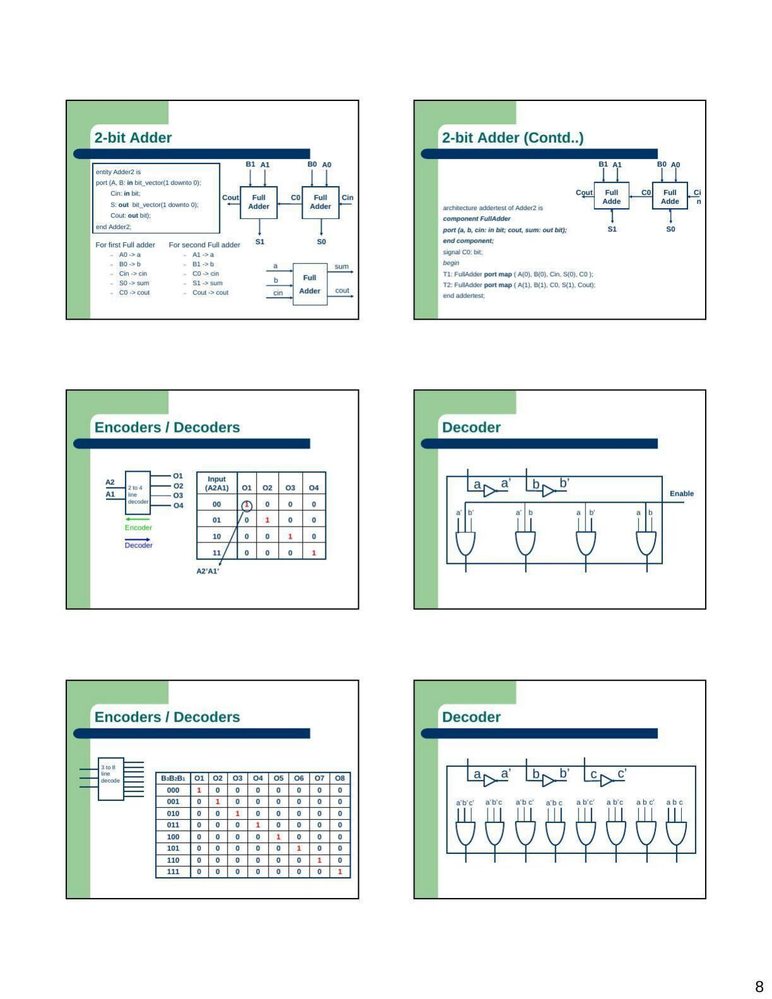

The "VHDL Tutorial" presentation from the Fall 2006 semester of the University of Texas at El Paso (UTEP) EE3109 Computer Aided Digital Design course. The institution was identified from the UTEP mark on the presentation, and the course and semester from the cover page. The PDF is dated 27 October 2006. A copy with the student presentation lists on the last page removed is available for download at the end of the post.

*Note: This content belongs to a third-party source; it is shared for archival and nostalgic purposes with the source credited. It will be removed at the request of the rights holder.*

## VHDL and design units

VHDL is a language used to describe digital hardware. The presentation explains that the language can express concurrent and asynchronous behavior, delays, and different levels of abstraction.

| Design unit | Purpose |
| --- | --- |
| Entity | Defines the external interface, ports, and parameters of the circuit |
| Architecture | Describes a particular implementation of the entity |
| Configuration | Specifies the bindings between entity, architecture, and component |
| Package declaration | Collects common type, function, procedure, and component declarations |
| Package body | Contains the implementations of the functions declared in the package |

Multiple architecture definitions may exist for the same entity. Keeping the interface separate makes it possible to use a behavioral model and a model built from component connections for the same circuit.

## Identifiers, types, and objects

The basic identifier rules in the presentation are: begin with a letter, do not use spaces, do not write two consecutive underscores, and do not use keywords as names. Identifiers are case-insensitive.

Data types are classified as scalar, access, file, and composite types. Integer, real, enumeration, and physical types are covered, along with array and record structures. Physical types use unit information. `bit_vector` represents multi-bit connections.

Objects are explained under the headings constant, variable, signal, and file. Variable assignment is shown with `:=` and signal assignment with `<=`. Signals are used to represent hardware connections between modules and within a module.

## Operators and modeling styles

Logical operators, comparisons, arithmetic operations, and shifts are introduced. Sequential statements within `if`, `case`, loops, and `process` are distinguished from concurrent statements. The behavioral model emphasizes behavior, the dataflow model emphasizes expressions between signals, and the structural model emphasizes component instances and their connections. These approaches can be used together in the same design.

## Full adder example

In the source entity example, `a`, `b`, and `cin` are inputs; `sum` and `cout` are outputs. The internal signal `temp` holds the XOR result of the first two inputs. The relevant part of the code in the presentation is as follows:

```vhdl
P1: temp <= a xor b;
P2: sum <= cin xor temp;
P3: cout <= ( and b) or (a and cin) or (b and cin);
```

*Note: In the source, the first parenthesis of line P3 is missing an operand. Since the full adder relation is cout=ab+a·cin+b·cin, "a and b" is expected here. The erroneous line from the source is preserved above; the example was not compiled.*

## Two-bit structural adder

Two FullAdder components are connected in sequence. The inputs of the first stage are A(0), B(0), and Cin; the inputs of the second stage are A(1), B(1), and the intermediate carry C0. The outputs are S(0), S(1), and Cout.

In the component declaration of the presentation, the last two ports are in the order `cout, sum`; the connection lines, however, use the order `S(0), C0` and `S(1), Cout`.

*Note: This ordering in the positional port mapping does not match the declared port order. The drawing in the source shows the intended direction of the sum and carry connections.*



## Decoders and hierarchical design

In a 2-to-4 decoder, one of the four outputs is activated corresponding to the two-bit input. A 3-to-8 decoder extends the same idea to three inputs. Using an enable input, larger decoders can be built from smaller ones. The task in the last section is to first design the 2-to-4 circuit and create its symbol, then build the 3-to-8 circuit hierarchically and examine the output waveforms.
