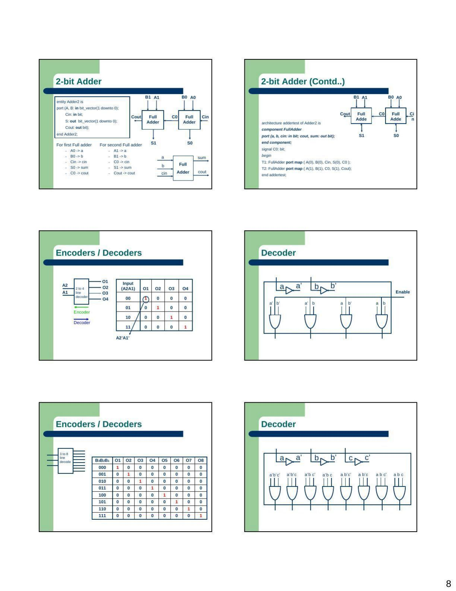

University of Texas at El Paso (UTEP) EE3109 Computer Aided Digital Design dersinin 2006 güz dönemine ait “VHDL Tutorial” sunumu. Kurum bilgisi sunumdaki UTEP işaretinden, ders ve dönem bilgisi kapaktan alındı. PDF tarihi 27 Ekim 2006. Son sayfadaki öğrenci sunum listeleri çıkarılmış kopya yazının sonunda indirilebilir.

*Bu içerik üçüncü taraf bir kaynağa aittir; arşiv ve nostalji amacıyla kaynak belirtilerek paylaşılmıştır. Hak sahibinin talebi hâlinde kaldırılır.*

## VHDL ve tasarım birimleri

VHDL, sayısal donanımı betimlemek için kullanılan bir dildir. Sunum, dilin eşzamanlı ve eşzamansız davranışları, gecikmeleri ve farklı soyutlama düzeylerini ifade edebildiğini anlatır.

| Tasarım birimi | Görevi |
| --- | --- |
| Entity | Devrenin dış arayüzünü, portlarını ve parametrelerini tanımlar |
| Architecture | Entity'nin belirli bir gerçekleştirmesini açıklar |
| Configuration | Entity, architecture ve component bağlarını belirler |
| Package declaration | Ortak tür, fonksiyon, prosedür ve bileşen bildirimlerini toplar |
| Package body | Pakette bildirilen işlevlerin gerçekleştirmesini içerir |

Aynı entity için farklı architecture tanımları bulunabilir. Arayüzün ayrı tutulması, davranışsal model ile bileşen bağlantılarından oluşan modelin aynı devre için kullanılmasına imkân verir.

## Tanımlayıcılar, türler ve nesneler

Sunumdaki temel tanımlayıcı kuralları harfle başlama, boşluk kullanmama, art arda iki alt çizgi yazmama ve anahtar sözcükleri ad olarak kullanmamadır. Büyük/küçük harf ayrımı yapılmaz.

Veri türleri skaler, erişim, dosya ve bileşik türler olarak sınıflandırılır. Tamsayı, gerçek sayı, sıralama ve fiziksel türler; dizi ve record yapıları örneklenir. Fiziksel türlerde birim bilgisi kullanılır. `bit_vector` çok bitli bağlantıları ifade eder.

Nesneler constant, variable, signal ve file başlıklarında açıklanır. Değişken ataması `:=`, sinyal ataması `<=` ile gösterilir. Sinyaller modüller arasındaki ve modül içindeki donanım bağlantılarını ifade etmek için kullanılır.

## İşleçler ve modelleme biçimleri

Mantıksal işleçler, karşılaştırmalar, aritmetik işlemler ve kaydırmalar tanıtılır. `if`, `case`, döngüler ve `process` içindeki sıralı ifadeler ile eşzamanlı ifadeler ayrılır. Davranışsal model davranışı, veri akışı modeli sinyaller arasındaki ifadeleri, yapısal model ise bileşen örnekleri ve bağlantılarını öne çıkarır. Aynı tasarımda bu yaklaşımlar birlikte kullanılabilir.

## Tam toplayıcı örneği

Kaynak entity örneğinde `a`, `b`, `cin` giriş; `sum`, `cout` çıkıştır. İç sinyal `temp`, ilk iki girişin XOR sonucunu tutar. Sunumdaki kodun ilgili kısmı şöyledir:

```vhdl
P1: temp <= a xor b;
P2: sum <= cin xor temp;
P3: cout <= ( and b) or (a and cin) or (b and cin);
```

*Not: Kaynakta P3 satırının ilk parantezinde bir işlenen eksik. Tam toplayıcı bağıntısı cout=ab+a·cin+b·cin olduğundan burada “a and b” beklenir. Kaynağın hatalı satırı yukarıda korunmuştur; örnek derlenmedi.*

## İki bitlik yapısal toplayıcı

İki FullAdder bileşeni ardışık bağlanır. İlk kademenin girişleri A(0), B(0), Cin; ikinci kademenin girişleri A(1), B(1) ve ara elde C0'dır. Çıkışlar S(0), S(1) ve Cout olur.

Sunumun bileşen bildiriminde son iki port `cout, sum` sırasındadır; bağlantı satırları ise `S(0), C0` ve `S(1), Cout` sırasını kullanır.

*Not: Konumsal port eşlemesindeki bu sıralama, bildirilen port sırasıyla uyuşmuyor. Kaynaktaki çizim toplam ve elde bağlantılarının amaçlanan yönünü gösteriyor.*



## Kod çözücüler ve hiyerarşik tasarım

2'den 4'e kod çözücüde iki bitlik girişe karşılık dört çıkıştan biri etkinleşir. 3'ten 8'e kod çözücü aynı fikri üç girişe genişletir. Etkinleştirme girişi kullanılarak küçük kod çözücülerden daha büyükleri kurulabilir. Son bölümün görevi, önce 2'den 4'e devreyi tasarlayıp sembolünü oluşturmak, ardından 3'ten 8'e devreyi hiyerarşik olarak kurmak ve çıkış dalga şekillerini incelemektir.
