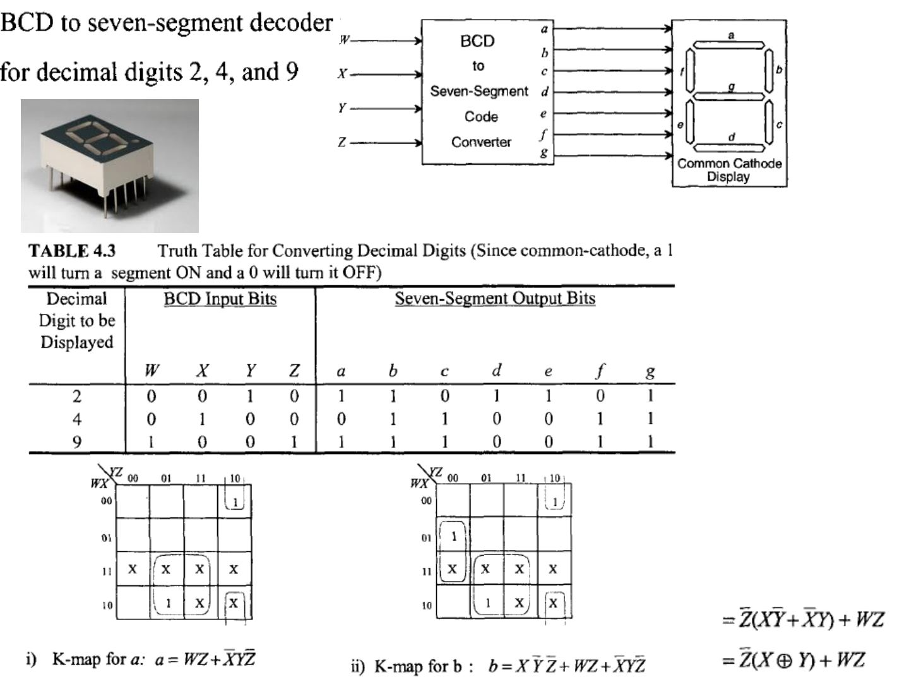
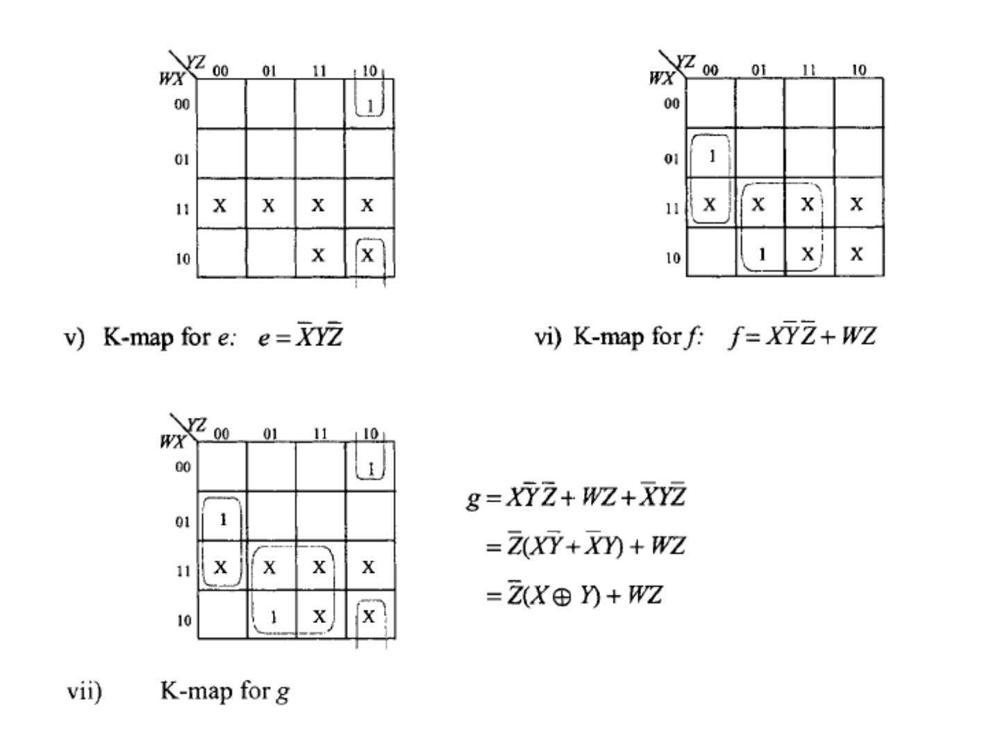
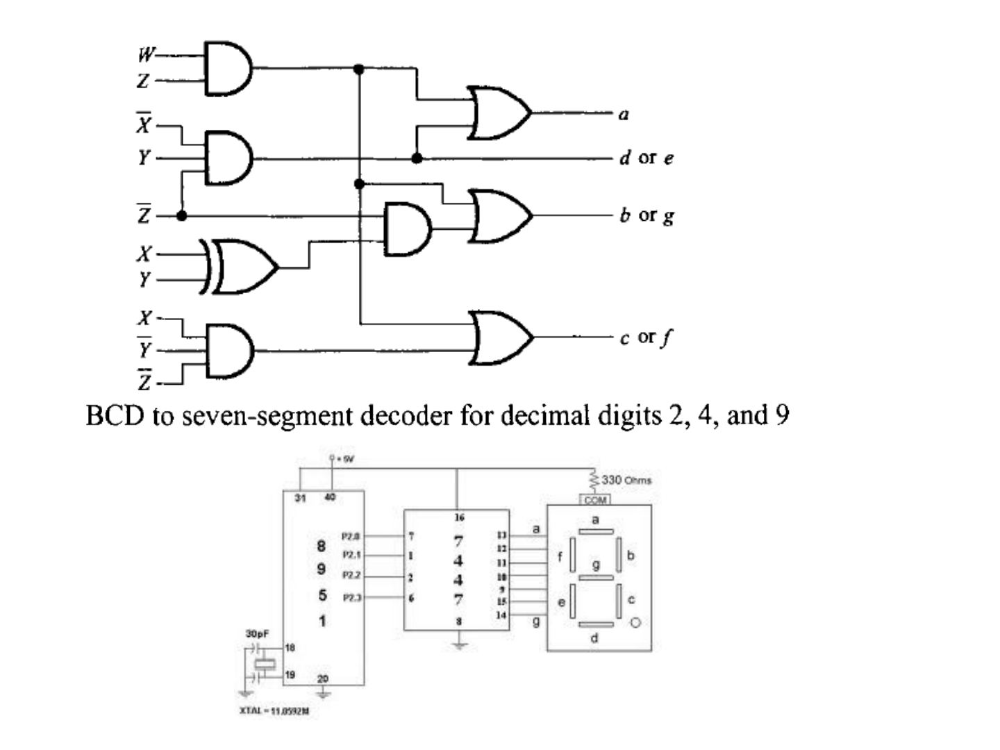

This post is the tutorial presentation for the **EEM211 Digital Logic Design** course at Başkent University, dated **21 November 2012**. The 12-slide presentation, compiled by the course instructor, shows the combinational circuit examples solved in class. Most of the figures on the slides are taken from **M. Morris Mano, *Digital Design*, 3rd edition (Prentice Hall, 2002)** (Figures 4-14, 4-15, 4-16, 4-22, 4-23, 4-29, 4-30, 4-31). The slides contain almost no text; the content is written out below, and the decoder design slides, which are not from the book, have been added as images. The original presentation file can be downloaded at the end of the post.

## BCD adder (Mano, Figure 4-14)

Two BCD digits (the addend and the augend) are added in the first 4-bit binary adder; the adder's output is Z8 Z4 Z2 Z1 and its carry is K. If the sum exceeds 9, a correction is needed. The output carry is:

C = K + Z8·Z4 + Z8·Z2

If C = 1, 0110 (6) is added to the result by the second 4-bit adder; this makes S8 S4 S2 S1 a valid BCD digit, and C is passed on to the next digit as the carry.

## Binary multipliers (Mano, Figures 4-15 and 4-16)

**2-bit × 2-bit multiplier:** In the product B1B0 × A1A0, the partial products are generated with AND gates and added with two half adders (HA):

- C0 = A0B0
- C1 = A0B1 ⊕ A1B0 (the sum of the first HA)
- C2 = the sum of the carry of the first HA and A1B1 (the second HA)
- C3 = the carry of the second HA

**4-bit × 3-bit multiplier:** For B3B2B1B0 × A2A1A0, the ANDs of A0, A1 and A2 with the B bits form three rows of partial products; these are added with two 4-bit adders to obtain the product C6…C0.

## 4-input priority encoder (Mano, Figures 4-22 and 4-23)

From the Karnaugh maps of the four-input priority encoder, with D3 having the highest priority:

- x = D2 + D3
- y = D3 + D1·D2'
- V = D0 + D1 + D2 + D3 (valid input indicator; when all inputs are 0, V = 0 and the outputs are X)

## Three-state gates and multiplexers (Mano, Figures 4-29, 4-30, 4-31)

Three-state buffer: when the control input C = 1, the output is Y = A; when C = 0, the output is in the high-impedance state. With these gates:

- **2-to-1 MUX:** the outputs of two buffers are tied together; the select signal enables one of them directly and the other through its complement.
- **4-to-1 MUX:** the control inputs of four buffers are driven by the outputs of a 2×4 decoder with an Enable input.

The four three-state gate primitives in Verilog are also shown: `bufif1` (passes when control is 1), `bufif0` (passes when control is 0), `notif1` and `notif0` (their counterparts that pass the complement).

## BCD-to-7-segment decoder (digits 2, 4 and 9 only)

A BCD-to-7-segment decoder is designed to display only the digits **2, 4 and 9** on a common-cathode 7-segment display (on a common cathode, 1 lights a segment and 0 turns it off). The other BCD inputs and the combinations from 10 to 15 are taken as "X" (don't care).

| Digit | W | X | Y | Z | a | b | c | d | e | f | g |
|---|---|---|---|---|---|---|---|---|---|---|---|
| 2 | 0 | 0 | 1 | 0 | 1 | 1 | 0 | 1 | 1 | 0 | 1 |
| 4 | 0 | 1 | 0 | 0 | 0 | 1 | 1 | 0 | 0 | 1 | 1 |
| 9 | 1 | 0 | 0 | 1 | 1 | 1 | 1 | 0 | 0 | 1 | 1 |

The segment functions obtained from the Karnaugh maps:

- a = WZ + X'YZ'
- b = XY'Z' + WZ + X'YZ' = Z'(XY' + X'Y) + WZ = Z'(X ⊕ Y) + WZ
- c = XY'Z' + WZ
- d = X'YZ'
- e = X'YZ'
- f = XY'Z' + WZ
- g = XY'Z' + WZ + X'YZ' = Z'(X ⊕ Y) + WZ

Accordingly, d and e, b and g, and c and f are identical functions; the circuit can be built with a few AND gates, one XOR gate and OR gates.

## Pushbutton and switch symbols

The last slides show the schematic symbols of normally open (NO) and normally closed (NC) limit switches, a momentary contact pushbutton, a pressure switch and a manually operated switch, along with photographs of the small pushbuttons and a toggle switch used in the laboratory. The presentation ends with a link to a video titled "Experiment 4.4: BCD counter with 7-segment display".
