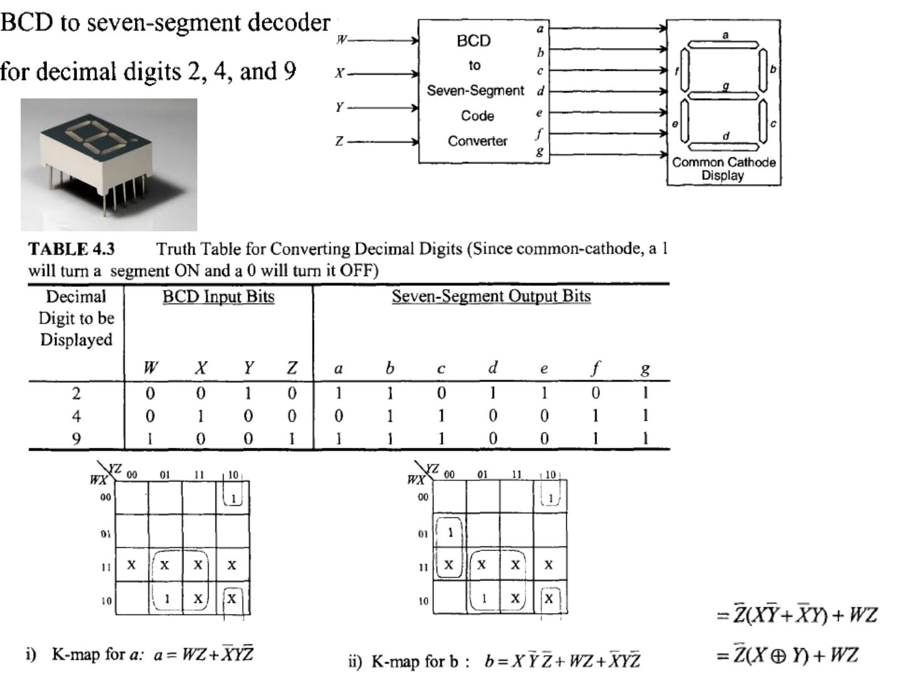
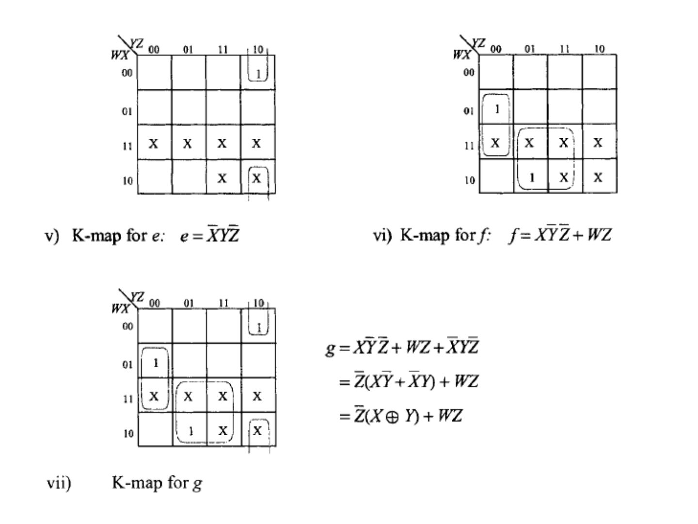
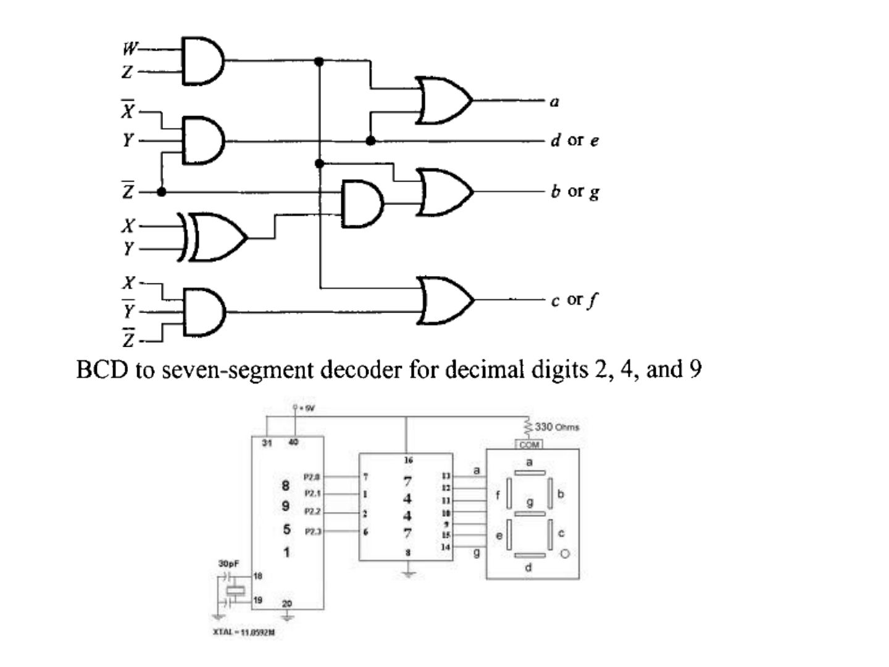

Bu yazı, Başkent Üniversitesi **EEM211 Sayısal Mantık Tasarımı** dersinin **21 Kasım 2012** tarihli uygulama sunusudur. Dersin hocasının derlediği 12 slaytlık sunu, derste çözülen birleşik devre örneklerini gösteriyor. Slaytların çoğundaki şekiller **M. Morris Mano, *Digital Design*, 3. baskı (Prentice Hall, 2002)** kitabından alınmış (Şekil 4-14, 4-15, 4-16, 4-22, 4-23, 4-29, 4-30, 4-31). Slaytlarda metin neredeyse yok; içerik aşağıda yazıya döküldü ve kitaptan olmayan kod çözücü tasarımı slaytları görsel olarak eklendi. Sununun orijinal dosyası yazının sonunda indirilebilir.

## BCD toplayıcı (Mano, Şekil 4-14)

İki BCD rakamı (Addend ve Augend) birinci 4 bitlik ikili toplayıcıda toplanır; toplayıcının çıkışı Z8 Z4 Z2 Z1 ve elde K olur. Toplam 9'u geçiyorsa düzeltme gerekir. Çıkış eldesi:

C = K + Z8·Z4 + Z8·Z2

C = 1 ise ikinci 4 bitlik toplayıcıyla sonuca 0110 (6) eklenir; böylece S8 S4 S2 S1 geçerli bir BCD rakamı olur ve C bir sonraki basamağa elde olarak aktarılır.

## İkili çarpıcılar (Mano, Şekil 4-15 ve 4-16)

**2 bit × 2 bit çarpıcı:** B1B0 × A1A0 çarpımında kısmi çarpımlar AND kapılarıyla üretilir ve iki yarım toplayıcıyla (HA) toplanır:

- C0 = A0B0
- C1 = A0B1 ⊕ A1B0 (birinci HA'nın toplamı)
- C2 = birinci HA'nın eldesi ile A1B1'in toplamı (ikinci HA)
- C3 = ikinci HA'nın eldesi

**4 bit × 3 bit çarpıcı:** B3B2B1B0 × A2A1A0 için A0, A1 ve A2 ile B bitlerinin AND'leri üç satır kısmi çarpım oluşturur; bunlar iki adet 4 bitlik toplayıcıyla toplanarak C6…C0 çarpımı elde edilir.

## 4 girişli öncelikli kodlayıcı (Mano, Şekil 4-22 ve 4-23)

D3 en yüksek öncelikli olmak üzere dört girişli öncelikli kodlayıcının Karnaugh haritalarından:

- x = D2 + D3
- y = D3 + D1·D2'
- V = D0 + D1 + D2 + D3 (geçerli giriş göstergesi; bütün girişler 0 iken V = 0, çıkış X)

## Üç durumlu kapılar ve çoklayıcılar (Mano, Şekil 4-29, 4-30, 4-31)

Üç durumlu tampon: denetim girişi C = 1 iken çıkış Y = A, C = 0 iken çıkış yüksek empedanstadır. Bu kapılarla:

- **2'ye 1 MUX:** iki tamponun çıkışları birleştirilir; seçme sinyali birini doğrudan, diğerini tümleyerek etkinleştirir.
- **4'e 1 MUX:** dört tamponun denetim girişleri, Enable girişli bir 2×4 kod çözücünün çıkışlarıyla sürülür.

Ayrıca Verilog'daki dört üç durumlu kapı ilkeli gösteriliyor: `bufif1` (denetim 1 iken geçirir), `bufif0` (denetim 0 iken geçirir), `notif1` ve `notif0` (tümleyerek geçiren karşılıkları).

## BCD-7 segment kod çözücü (yalnızca 2, 4 ve 9 rakamları)

Ortak katotlu bir 7 segment göstergede yalnızca **2, 4 ve 9** rakamlarını gösterecek BCD-7 segment kod çözücü tasarlanıyor (ortak katotta 1 segmenti yakar, 0 söndürür). Diğer BCD girişleri ve 10–15 arası birleşimler "X" (keyfi) alınıyor.

| Rakam | W | X | Y | Z | a | b | c | d | e | f | g |
|---|---|---|---|---|---|---|---|---|---|---|---|
| 2 | 0 | 0 | 1 | 0 | 1 | 1 | 0 | 1 | 1 | 0 | 1 |
| 4 | 0 | 1 | 0 | 0 | 0 | 1 | 1 | 0 | 0 | 1 | 1 |
| 9 | 1 | 0 | 0 | 1 | 1 | 1 | 1 | 0 | 0 | 1 | 1 |

Karnaugh haritalarından elde edilen segment fonksiyonları:

- a = WZ + X'YZ'
- b = XY'Z' + WZ + X'YZ' = Z'(XY' + X'Y) + WZ = Z'(X ⊕ Y) + WZ
- c = XY'Z' + WZ
- d = X'YZ'
- e = X'YZ'
- f = XY'Z' + WZ
- g = XY'Z' + WZ + X'YZ' = Z'(X ⊕ Y) + WZ

Buna göre d ile e, b ile g, c ile f aynı fonksiyonlardır; devre birkaç AND, bir XOR ve OR kapılarıyla kurulabiliyor.

## Buton ve anahtar sembolleri

Son slaytlarda normalde açık (NO) ve normalde kapalı (NC) sınır anahtarı (limit switch), anlık kontaklı buton (momentary contact pushbutton), basınç anahtarı ve elle kumandalı anahtarın şema sembolleri, laboratuvarda kullanılan küçük butonların ve bir açma-kapama anahtarının fotoğrafları var. Sunu, "Deney 4.4: 7 segment göstergeli BCD sayıcı" başlıklı bir video bağlantısıyla bitiyor.
