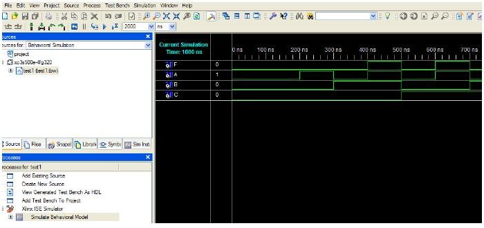

This post presents two supporting documents used in the **EEM211 Digital Logic Design** laboratory at Başkent University in the fall semester of 2011: the "Verilog" presentation prepared by **Assoc. Prof. Dr. Hamit Erdem** and **Res. Asst. Gencer Tulay** (October 2011), and the "Preparing a Project with the Xilinx Program" guide prepared by **Res. Asst. Evren Emekdaş** and **Res. Asst. Gencer Tulay** (October 2011). The guide consists of step-by-step screenshots; the steps are given below as text. Both PDFs can be downloaded as a ZIP at the end of the post.

## Verilog

### What is HDL?

**HDL** (Hardware Description Language), called **DTD** (Donanım Tanımlama Dili) in Turkish, is the name given to the class of computer languages used to describe digital circuits. An HDL makes it possible to design the operation a circuit performs and to verify it through simulation. The best-known HDLs are **Verilog** and **VHDL**; others include ABEL, AHDL, Hardware Join Java, Lola, MyHDL, and Ruby.

A digital system can be described at three different levels:

1. **Switch level:** elements such as wires, resistors, and transistors.
1. **Gate level:** logic gates and flip-flops.
1. **Register transfer level (RTL):** registers and the signal flow between registers.

### Verilog and VHDL

Verilog is a language used to describe hardware; it was released in 1985 by Gateway Design Corporation and is today a product of Cadence Design Systems. In this course it is used in the Xilinx development environment.

- Verilog is close to C, while VHDL is close to Ada.
- VHDL is common in Europe, while Verilog is common in America and the Far East.
- Verilog is more convenient for designs at the switch and gate levels.
- Verilog is case-sensitive, whereas VHDL is not.

### Why is it used?

To create designs and test them through simulation. If an electronic design is not modeled and checked with various tests, unforeseen errors may be encountered during operation; this means a financial loss, and if the mass-production volume is high, it leads to major monetary damage.

### Design methods

Structural, behavioral, and physical design. The structural and behavioral descriptions of the same circuit (X = AB + C', Y = C'):

```verilog
// Yapısal tasarım
module cct(X,Y,A,B,C);
output X,Y;
input A,B,C;
wire e;
and a1(e,A,B);
not i1(Y,C);
or o1(X,e,Y);
endmodule
```

```verilog
// Davranışsal tasarım
module cct(X,Y,A,B,C);
output X,Y;
input A,B,C;
assign Y=~C;
assign X=(A&B)|Y;
endmodule
```

*Note: In the presentation, the `module cct(X,Y,A,B,C)` lines have no semicolon at the end; in Verilog the module header must end with `;`, so it has been added above.*

Sources: www.fpgarelated.com, www.asic-world.com, www.verilog.com, www.verilog.net.

## Preparing a project with the Xilinx program

### Creating a project

When Xilinx ISE opens, it continues from the most recently worked-on project. Therefore, when starting a new piece of work, first close the open project with **File → Close Project**, then create a new project with **File → New Project**; choose where the files will be saved and give the project a name. In the *New Project Wizard – Device Properties* window, make the following settings:

| Setting | Value |
|---|---|
| Family | Spartan3E |
| Device | XC3S500E |
| Package | FG320 |
| Speed | -4 |
| Simulator | ISE Simulator (VHDL/Verilog) |

In the following *Create New Source* and *Add Existing Sources* windows, click Next; in the *Project Summary* window, check the settings and click Finish.

### Creating a schematic file

In the *Sources* window on the left, right-click on the chip model and select **New Source**. In the *Select Source Type* window, check **Schematic**, type the file name, and click Next and Finish. On the page that opens, prepare your design as a schematic and save it.

### Creating a Verilog file

Again right-click on the chip model and select **New Source** → **Verilog Module**, and give the file name. After the input-output definition screen, clicking Finish opens the editor in which you will write the Verilog code; write your code and save it.

### Creating a test file

Right-click on the source file and select **New Source** → **Test Bench Waveform**, and give the file name. After Finish, in the *Initial Timing and Clock Wizard – Initialize Timing* window that opens, check the **Combinatorial (or internal clock)** option in the *Clock Information* section. In the `.tbw` test file that opens, enter input values suitable for simulation and save it.

### Simulation with Xilinx ISE Simulator

Set the *Sources for* option to **Behavioral Simulation**, open your test file, and double-click **Simulate Behavioral Model** in the *Processes* section. Compare the simulation results with the results you expect from your design; if there is a difference, go back to the design stage.



### Defining pin connections

In the *Processes* section, double-click **User Constraints → Floorplan Area/IO/Logic – Post-Synthesis** and click Yes in the window that appears. In the **Xilinx PACE** window that opens, a constraints file with the `.ucf` extension is created; here, define the pin connections you will use on the **Nexys2** board according to the values printed on the board (for example, G18 for SW0 and J14 for LD0). Save the file.

Then right-click **Generate Programming File** and open *Properties*; in the *Startup Options* category, set **FPGA Start-Up Clock** to **JTAG Clock**. Then right-click Generate Programming File again and select **Run**. When the process finishes, the `.bit` file to be loaded onto the Nexys2 board is generated.

### Loading the program onto the board

From the Programs menu, run **Digilent → Adept → Adept**. When the computer detects the Nexys2 board over USB, in the window that opens, select the `.bit` file with Browse on the **FPGA XC3S500E** line and click **Program**. If the loading was done correctly, a *Programming Successful* message appears. Use the buttons and LEDs on the board to see whether your design works correctly in hardware.
