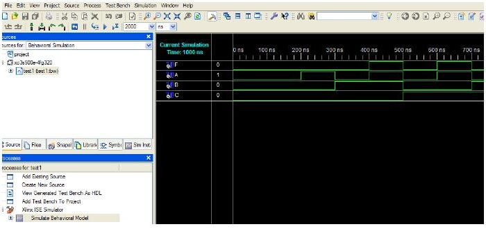

Bu yazı, Başkent Üniversitesi **EEM211 Sayısal Mantık Tasarımı** laboratuvarında 2011 güz döneminde kullanılan iki yardımcı belgeyi aktarıyor: **Doç. Dr. Hamit Erdem** ve **Araş. Gör. Gencer Tulay**'ın hazırladığı "Verilog" sunusu (Ekim 2011) ve **Araş. Gör. Evren Emekdaş** ile **Araş. Gör. Gencer Tulay**'ın hazırladığı "Xilinx Programı ile Proje Hazırlanması" kılavuzu (Ekim 2011). Kılavuz adım adım ekran görüntülerinden oluşuyor; adımlar aşağıda metin olarak verildi. İki PDF yazının sonunda ZIP olarak indirilebilir.

## Verilog

### HDL nedir?

**HDL** (Hardware Description Language), Türkçesiyle **DTD** (Donanım Tanımlama Dili), sayısal devrelerin tanımlanması amacıyla kullanılan bilgisayar dillerinin sınıfına verilen addır. DTD, devrenin yürüttüğü işlemin tasarımını ve benzetim yoluyla doğrulanmasını sağlar. En çok bilinen DTD'ler **Verilog** ve **VHDL**'dir; diğerleri arasında ABEL, AHDL, Hardware Join Java, Lola, MyHDL ve Ruby sayılıyor.

Bir sayısal sistem üç farklı seviyede tanımlanabilir:

1. **Anahtar seviyesi (switch level):** kablo, direnç, transistör vb. elemanlar.
1. **Kapı seviyesi (gate level):** mantıksal kapılar, flip-floplar.
1. **Yazmaç aktarım seviyesi (register transfer level, RTL):** yazmaçlar ve yazmaçlar arasındaki sinyal akışı.

### Verilog ve VHDL

Verilog, donanım tanımlamak için kullanılan bir dildir; 1985'te Gateway Design Corporation tarafından çıkarılmış, bugün Cadence Design Systems'in ürünüdür. Ders kapsamında Xilinx program geliştirme ortamında kullanılıyor.

- Verilog C'ye, VHDL Ada'ya yakındır.
- Avrupa'da VHDL, Amerika ve Uzak Doğu'da Verilog yaygındır.
- Anahtar ve kapı seviyesindeki tasarımlarda Verilog daha kullanışlıdır.
- Verilog büyük/küçük harfe duyarlıdır, VHDL değildir.

### Niçin kullanılır?

Tasarım oluşturmak ve benzetim (simulation) yoluyla test etmek için. Bir elektronik tasarım modellenip çeşitli testlerle denetlenmezse, çalışma sırasında öngörülemeyen hatalarla karşılaşılabilir; bu da maliyet olarak zarar demektir ve seri üretim hacmi yüksekse büyük maddi kayba yol açar.

### Tasarım yöntemleri

Yapısal (structural), davranışsal (behavioral) ve fiziksel (physical) tasarım. Aynı devrenin (X = AB + C', Y = C') yapısal ve davranışsal tanımı:

```verilog
// Yapısal tasarım
module cct(X,Y,A,B,C);
output X,Y;
input A,B,C;
wire e;
and a1(e,A,B);
not i1(Y,C);
or o1(X,e,Y);
endmodule
```

```verilog
// Davranışsal tasarım
module cct(X,Y,A,B,C);
output X,Y;
input A,B,C;
assign Y=~C;
assign X=(A&B)|Y;
endmodule
```

*Not: Sunuda `module cct(X,Y,A,B,C)` satırlarının sonunda noktalı virgül yok; Verilog'da modül başlığı `;` ile bitmelidir, yukarıda eklendi.*

Kaynaklar: www.fpgarelated.com, www.asic-world.com, www.verilog.com, www.verilog.net.

## Xilinx programı ile proje hazırlanması

### Proje oluşturma

Xilinx ISE açıldığında en son çalışılan proje üzerinden devam eder. Bu yüzden yeni bir çalışmaya başlarken önce **File → Close Project** ile açık projeyi kapatıp **File → New Project** ile yeni proje oluşturun; dosyaların kaydedileceği yeri seçip projeye isim verin. *New Project Wizard – Device Properties* penceresinde şu ayarları yapın:

| Ayar | Değer |
|---|---|
| Family | Spartan3E |
| Device | XC3S500E |
| Package | FG320 |
| Speed | -4 |
| Simulator | ISE Simulator (VHDL/Verilog) |

Sonraki *Create New Source* ve *Add Existing Sources* pencerelerinde Next'e basın, *Project Summary* penceresinde ayarları denetleyip Finish'e basın.

### Şematik dosyası oluşturma

Soldaki *Sources* penceresinde çip modelinin üstüne sağ tıklayıp **New Source**'u seçin. *Select Source Type* penceresinde **Schematic**'i işaretleyip dosya adını yazın, Next ve Finish'e basın. Açılan sayfada çalışmanızı şema olarak hazırlayıp kaydedin.

### Verilog dosyası oluşturma

Yine çip modeline sağ tıklayıp **New Source** → **Verilog Module** seçin, dosya adını verin. Giriş-çıkış tanımı ekranından sonra Finish'e basınca Verilog kodunu yazacağınız düzenleyici açılır; kodunuzu yazıp kaydedin.

### Test dosyası oluşturma

Kaynak dosyası üzerine sağ tıklayıp **New Source** → **Test Bench Waveform** seçin ve dosya adını verin. Finish'ten sonra açılan *Initial Timing and Clock Wizard – Initialize Timing* penceresinde, *Clock Information* bölümünde **Combinatorial (or internal clock)** seçeneğini işaretleyin. Açılan `.tbw` uzantılı test dosyasına benzetim için uygun giriş değerlerini girip kaydedin.

### Xilinx ISE Simulator ile benzetim

*Sources for* seçeneğini **Behavioral Simulation** yapın, test dosyanızı açın ve *Processes* bölümünde **Simulate Behavioral Model**'e çift tıklayın. Benzetim sonuçlarını tasarımınızdan beklediğiniz sonuçlarla karşılaştırın; fark varsa tasarım aşamasına geri dönün.



### Pin bağlantılarının tanımlanması

*Processes* bölümünde **User Constraints → Floorplan Area/IO/Logic – Post-Synthesis** seçeneğine çift tıklayın ve çıkan pencerede Yes'e basın. Açılan **Xilinx PACE** penceresinde `.ucf` uzantılı kısıt dosyası oluşur; burada **Nexys2** kartında kullanacağınız pin bağlantılarını, kart üzerinde yazılı değerlere göre tanımlayın (örneğin SW0 için G18, LD0 için J14). Dosyayı kaydedin.

Ardından **Generate Programming File** seçeneğine sağ tıklayıp *Properties*'i açın; *Startup Options* kategorisinde **FPGA Start-Up Clock**'u **JTAG Clock** yapın. Sonra Generate Programming File'a sağ tıklayıp **Run** deyin. İşlem bitince Nexys2 kartına yüklenecek `.bit` uzantılı dosya üretilir.

### Karta program yükleme

Programlar menüsünden **Digilent → Adept → Adept**'i çalıştırın. Bilgisayar Nexys2 kartını USB üzerinden gördüğünde açılan pencerede, **FPGA XC3S500E** satırında Browse ile `.bit` dosyasını seçip **Program**'a basın. Yükleme doğru yapıldıysa *Programming Successful* mesajı çıkar. Kart üzerindeki buton ve LED'lerle tasarımınızın donanımda doğru çalışıp çalışmadığını görün.
