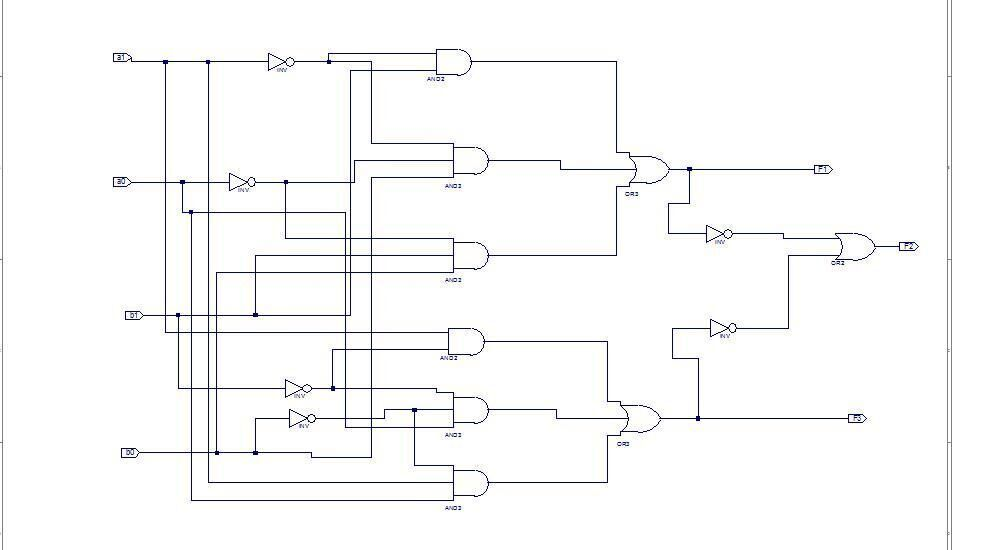

Arkadaşların hazırladığı Xilinx ISE laboratuvar şemalarının kaynak dosyaları. Örnekler temel kapıları, toplayıcıları, MUX/kod çözücüleri, flip-flopları, sayıcıları ve gösterge bağlantılarını kapsıyor. Kişisel dosya ve klasör adları kaldırıldı. Kaynaklar ZIP olarak yazının sonunda indirilebilir.

## Şemalar nasıl okunur?

SCH dosyasındaki NETLIST bölümü, giriş/çıkış portlarını ve bileşenlerin pin bağlantılarını tanımlar. Aşağıda çizim koordinatları yerine bu bağlantılar aranabilir metin olarak verildi. `BLOCK` satırı bileşen örneğini ve türünü; `PIN` satırı uç adını ve bağlı sinyali gösterir. Bağlantı değeri olmayan uçlar kaynakta da boştur.

AND/OR/INV blokları temel mantık kapılarıdır. `fd` D flip-flop, `fjkc` JK flip-flop, `m2_1` ve `m4_1e` çoğullayıcı, `d2_4e` kod çözücü, `cb8ce` sekiz bitlik sayıcı bloklarıdır. `SSdriver`, `tamtoplayici` ve `tamtoplayici4` kullanıcı tanımlı alt modüllere başvurur.

*Not: Bunlar tam ve doğrulanmış bir proje paketi değildir. Bazı şemalar ayrı Verilog alt modüllerine ihtiyaç duyar; derleme çıktıları ve proje yedekleri pakete eklenmedi. Kaynaklar çalıştırılmadı.*

## Karşılaştırıcı ekran görüntüsü

Aynı klasördeki iki bitlik girişleri karşılaştıran kapı şemasının yalnız devre alanı korunmuştur. F1, F2 ve F3 çıkışlarını üreten AND, OR ve NOT bağlantıları görülebilir.



## Dosyalar ve bileşenler

| ZIP içi dosya | Bileşen türleri |
| --- | --- |
| sema-01/asdf.sch | SSdriver × 1, pullup × 1, ibuf × 1, and2 × 1, cb8ce × 1 |
| sema-02/sema1.sch | fd × 2, and2 × 3, or3 × 1, and3 × 2, or2 × 1, inv × 2 |
| sema-03/lab8.sch | fd × 1, inv × 1 |
| sema-04/lab8_2.sch | fjkc × 4, pullup × 1, pulldown × 1 |
| sema-05/lab8_3.sch | fjkc × 4, pulldown × 1, pullup × 1, inv × 4 |
| sema-06/asd.sch | SSdriver × 1, decoder × 1, anode_decoder × 1, clkdiv × 1 |
| sema-07/soru2.sch | cb8ce × 1, SSdriver × 1, pullup × 1, and2 × 1, ibuf × 1 |
| sema-08/soru3.sch | SSdriver × 1, pullup × 1, ibuf × 1, cb8ce × 1, pulldown × 1 |
| sema-09/soru2.sch | SSdriver × 1, cb8ce × 1, and2 × 1, pullup × 1, ibuf × 1 |
| sema-10/soru3.sch | SSdriver × 1, pullup × 1, cb8ce × 1, pulldown × 1, ibuf × 1 |
| sema-11/test.sch | SSdriver × 1, pullup × 1, ibuf × 1, and2 × 1, cb8ce × 1 |
| sema-12/deney2.sch | SSdriver × 1, cb8ce × 1, pullup × 1, ibuf × 1, and2 × 1 |
| sema-13/mantik-devresi.sch | and2 × 2, inv × 1, or2 × 1 |
| sema-14/sematik1.sch | fd × 1, inv × 1 |
| sema-15/sematik02.sch | fjkc × 4, pullup × 1, pulldown × 1 |
| sema-16/sematik03.sch | pulldown × 1, fjkc × 3, pullup × 1, inv × 3 |
| sema-17/sh9.sch | SSdriver × 1, pullup × 1, ibuf × 1, and2 × 1, cb8ce × 1 |
| sema-18/soru2.sch | cb8ce × 1, SSdriver × 1, pullup × 1, ibuf × 1, and2 × 1 |
| sema-19/sema1.sch | and3 × 3, or2 × 3, inv × 5, nand2 × 2 |
| sema-20/sema2.sch | inv × 5, and3 × 4, and2 × 2, or3 × 2, or2 × 1 |
| sema-21/sema.sch | tamtoplayici × 1 |
| sema-22/sema.sch | tamtoplayici4 × 1 |
| sema-23/sematik1.sch | nor3 × 1, and2 × 3, inv × 2 |
| sema-24/MUX.sch | m2_1 × 3, or3 × 1, pulldown × 1, inv × 2 |
| sema-25/samatik.sch | m2_1 × 3, pullup × 1, pulldown × 1, inv × 1, and2 × 1 |
| sema-26/sematik.sch | d2_4e × 1, m4_1e × 1, pullup × 1 |
| sema-27/sema1.sch | and2 × 4, or2 × 2, inv × 3 |
| sema-28/sema2.sch | m2_1 × 3, inv × 2, or3 × 1, pulldown × 1 |
| sema-29/sema3.sch | d2_4e × 1, m4_1e × 1, pullup × 1 |
| sema-30/deny3sema.sch | and2 × 2, or2 × 1, inv × 1 |
| sema-31/aaa.sch | and2 × 2, inv × 1, or2 × 1 |
| sema-32/Sema1.sch | inv × 5, and3 × 3, or2 × 3, nand2 × 2 |
| sema-33/Sema2.sch | inv × 5, and2 × 2, and3 × 4, or3 × 2, or2 × 1 |
| sema-34/soru1.sch | inv × 2, or2 × 1, and2 × 3, and3 × 2, or3 × 1, fd × 2 |
| sema-35/sema01.sch | fd × 1, inv × 1 |
| sema-36/sema02.sch | fjkc × 4, pulldown × 1, pullup × 1 |
| sema-37/sema03.sch | fjkc × 3, pulldown × 1, pullup × 1, inv × 3 |

## Bağlantı dökümleri

### sema-01/asdf.sch

```
PORT Input BTN0
PORT Input mclk
PORT Output SS(7:0)
PORT Output AN(3:0)
BLOCK XLXI_1 SSdriver
  PIN mclk mclk
  PIN S1(3:0) Q(3:0)
  PIN S2(3:0) Q(7:4)
  PIN S3(3:0)
  PIN S4(3:0)
  PIN SS(7:0) SS(7:0)
  PIN AN(3:0) AN(3:0)

BLOCK XLXI_2 pullup
  PIN O XLXN_1

BLOCK XLXI_3 ibuf
  PIN I BTN0
  PIN O XLXN_13

BLOCK XLXI_4 and2
  PIN I0 Q(1)
  PIN I1 Q(3)
  PIN O XLXN_14

BLOCK XLXI_6 cb8ce
  PIN C XLXN_13
  PIN CE XLXN_1
  PIN CLR XLXN_14
  PIN CEO
  PIN Q(7:0) Q(7:0)
  PIN TC
```

### sema-02/sema1.sch

```
PORT Input BTN0
PORT Input BTN1
PORT Output LD0
BLOCK XLXI_1 fd
  PIN C BTN0
  PIN D XLXN_1
  PIN Q XLXN_18

BLOCK XLXI_2 fd
  PIN C BTN0
  PIN D XLXN_3
  PIN Q XLXN_16

BLOCK XLXI_11 and2
  PIN I0 BTN1
  PIN I1 XLXN_7
  PIN O XLXN_1

BLOCK XLXI_4 or3
  PIN I0 XLXN_6
  PIN I1 XLXN_5
  PIN I2 XLXN_4
  PIN O XLXN_3

BLOCK XLXI_5 and3
  PIN I0 XLXN_15
  PIN I1 BTN1
  PIN I2 XLXN_11
  PIN O XLXN_4

BLOCK XLXI_6 and2
  PIN I0 XLXN_18
  PIN I1 XLXN_16
  PIN O XLXN_5

BLOCK XLXI_7 and2
  PIN I0 XLXN_18
  PIN I1 BTN1
  PIN O XLXN_6

BLOCK XLXI_3 or2
  PIN I0 XLXN_16
  PIN I1 XLXN_18
  PIN O XLXN_7

BLOCK XLXI_9 inv
  PIN I XLXN_18
  PIN O XLXN_11

BLOCK XLXI_10 inv
  PIN I XLXN_16
  PIN O XLXN_15

BLOCK XLXI_8 and3
  PIN I0 BTN1
  PIN I1 XLXN_15
  PIN I2 XLXN_18
  PIN O LD0
```

### sema-03/lab8.sch

```
PORT Input mclk
PORT Output F
BLOCK XLXI_1 fd
  PIN C mclk
  PIN D F
  PIN Q XLXN_2

BLOCK XLXI_2 inv
  PIN I XLXN_2
  PIN O F
```

### sema-04/lab8_2.sch

```
PORT Input mclk
PORT Output Q(3:0)
BLOCK XLXI_1 fjkc
  PIN C mclk
  PIN CLR XLXN_13
  PIN J XLXN_7
  PIN K XLXN_7
  PIN Q Q(0)

BLOCK XLXI_2 fjkc
  PIN C Q(0)
  PIN CLR XLXN_13
  PIN J XLXN_7
  PIN K XLXN_7
  PIN Q Q(1)

BLOCK XLXI_3 fjkc
  PIN C Q(1)
  PIN CLR XLXN_13
  PIN J XLXN_7
  PIN K XLXN_7
  PIN Q Q(2)

BLOCK XLXI_4 fjkc
  PIN C Q(2)
  PIN CLR XLXN_13
  PIN J XLXN_7
  PIN K XLXN_7
  PIN Q Q(3)

BLOCK XLXI_5 pullup
  PIN O XLXN_7

BLOCK XLXI_6 pulldown
  PIN O XLXN_13
```

### sema-05/lab8_3.sch

```
PORT Input mclk
PORT Output Q(3:0)
BLOCK XLXI_1 fjkc
  PIN C mclk
  PIN CLR XLXN_13
  PIN J XLXN_3
  PIN K XLXN_3
  PIN Q XLXN_16

BLOCK XLXI_2 fjkc
  PIN C XLXN_16
  PIN CLR XLXN_13
  PIN J XLXN_3
  PIN K XLXN_3
  PIN Q XLXN_24

BLOCK XLXI_3 fjkc
  PIN C XLXN_24
  PIN CLR XLXN_13
  PIN J XLXN_3
  PIN K XLXN_3
  PIN Q XLXN_21

BLOCK XLXI_4 fjkc
  PIN C XLXN_21
  PIN CLR XLXN_13
  PIN J XLXN_3
  PIN K XLXN_3
  PIN Q XLXN_27

BLOCK XLXI_6 pulldown
  PIN O XLXN_13

BLOCK XLXI_11 pullup
  PIN O XLXN_3

BLOCK XLXI_12 inv
  PIN I XLXN_16
  PIN O Q(0)

BLOCK XLXI_13 inv
  PIN I XLXN_24
  PIN O Q(1)

BLOCK XLXI_14 inv
  PIN I XLXN_21
  PIN O Q(2)

BLOCK XLXI_15 inv
  PIN I XLXN_27
  PIN O Q(3)
```

### sema-06/asd.sch

```
BLOCK XLXI_1 SSdriver
  PIN mclk
  PIN S1(3:0)
  PIN S2(3:0)
  PIN S3(3:0)
  PIN S4(3:0)
  PIN SS(7:0)
  PIN AN(3:0)

BLOCK XLXI_2 decoder
  PIN S(3:0)
  PIN SS(7:0)

BLOCK XLXI_3 anode_decoder
  PIN cnt(1:0)
  PIN AN(3:0)

BLOCK XLXI_4 clkdiv
  PIN mclk
  PIN clk
```

### sema-07/soru2.sch

```
PORT Input mclk
PORT Input BTN0
PORT Output SS(7:0)
PORT Output AN(3:0)
BLOCK XLXI_1 cb8ce
  PIN C XLXN_3
  PIN CE XLXN_2
  PIN CLR XLXN_5
  PIN CEO
  PIN Q(7:0) Q(7:0)
  PIN TC

BLOCK XLXI_2 SSdriver
  PIN mclk mclk
  PIN S1(3:0) Q(3:0)
  PIN S2(3:0) Q(7:4)
  PIN S3(3:0)
  PIN S4(3:0)
  PIN SS(7:0) SS(7:0)
  PIN AN(3:0) AN(3:0)

BLOCK XLXI_3 pullup
  PIN O XLXN_2

BLOCK XLXI_4 and2
  PIN I0 Q(1)
  PIN I1 Q(3)
  PIN O XLXN_5

BLOCK XLXI_5 ibuf
  PIN I BTN0
  PIN O XLXN_3
```

### sema-08/soru3.sch

```
PORT Input mclk
PORT Input BTN0
PORT Output SS(7:0)
PORT Output AN(3:0)
BLOCK XLXI_2 SSdriver
  PIN mclk mclk
  PIN S1(3:0) Q(3:0)
  PIN S2(3:0) Q(7:4)
  PIN S3(3:0)
  PIN S4(3:0)
  PIN SS(7:0) SS(7:0)
  PIN AN(3:0) AN(3:0)

BLOCK XLXI_3 pullup
  PIN O XLXN_2

BLOCK XLXI_5 ibuf
  PIN I BTN0
  PIN O XLXN_3

BLOCK XLXI_1 cb8ce
  PIN C XLXN_3
  PIN CE XLXN_2
  PIN CLR XLXN_15
  PIN CEO
  PIN Q(7:0) Q(7:0)
  PIN TC

BLOCK XLXI_7 pulldown
  PIN O XLXN_15
```

### sema-09/soru2.sch

```
PORT Input mclk
PORT Output SS(7:0)
PORT Output AN(3:0)
PORT Input BTN0
BLOCK XLXI_2 SSdriver
  PIN mclk mclk
  PIN S1(3:0) XLXN_23(3:0)
  PIN S2(3:0) XLXN_24(3:0)
  PIN S3(3:0)
  PIN S4(3:0)
  PIN SS(7:0) SS(7:0)
  PIN AN(3:0) AN(3:0)

BLOCK XLXI_1 cb8ce
  PIN C XLXN_25
  PIN CE XLXN_29
  PIN CLR XLXN_30
  PIN CEO
  PIN Q(7:0) XLXN_28(7:0)
  PIN TC

BLOCK XLXI_8 and2
  PIN I0 XLXN_26
  PIN I1 XLXN_27
  PIN O XLXN_30

BLOCK XLXI_9 pullup
  PIN O XLXN_29

BLOCK XLXI_10 ibuf
  PIN I BTN0
  PIN O XLXN_25
```

### sema-10/soru3.sch

```
PORT Input mclk
PORT Output SS(7:0)
PORT Output AN(3:0)
PORT Input BTN0
BLOCK XLXI_13 SSdriver
  PIN mclk mclk
  PIN S1(3:0) XLXN_23(3:0)
  PIN S2(3:0) XLXN_24(3:0)
  PIN S3(3:0)
  PIN S4(3:0)
  PIN SS(7:0) SS(7:0)
  PIN AN(3:0) AN(3:0)

BLOCK XLXI_9 pullup
  PIN O XLXN_29

BLOCK XLXI_16 cb8ce
  PIN C XLXN_25
  PIN CE XLXN_29
  PIN CLR XLXN_41
  PIN CEO
  PIN Q(7:0) XLXN_39(7:0)
  PIN TC

BLOCK XLXI_7 pulldown
  PIN O XLXN_41

BLOCK XLXI_18 ibuf
  PIN I BTN0
  PIN O XLXN_25
```

### sema-11/test.sch

```
PORT Input BTN0
PORT Output SS(7:0)
PORT Output AN(3:0)
PORT Input mclk
BLOCK XLXI_1 SSdriver
  PIN mclk mclk
  PIN S1(3:0) Q(3:0)
  PIN S2(3:0) Q(7:4)
  PIN S3(3:0)
  PIN S4(3:0)
  PIN SS(7:0) SS(7:0)
  PIN AN(3:0) AN(3:0)

BLOCK XLXI_3 pullup
  PIN O XLXN_2

BLOCK XLXI_4 ibuf
  PIN I BTN0
  PIN O XLXN_13

BLOCK XLXI_5 and2
  PIN I0 Q(1)
  PIN I1 Q(3)
  PIN O XLXN_14

BLOCK XLXI_6 cb8ce
  PIN C XLXN_13
  PIN CE XLXN_2
  PIN CLR XLXN_14
  PIN CEO
  PIN Q(7:0) Q(7:0)
  PIN TC
```

### sema-12/deney2.sch

```
PORT Input BTN0
PORT Input mclk
PORT Output SS(7:0)
PORT Output AN(3:0)
BLOCK XLXI_1 SSdriver
  PIN mclk mclk
  PIN S1(3:0) Q(3:0)
  PIN S2(3:0) Q(7:4)
  PIN S3(3:0)
  PIN S4(3:0)
  PIN SS(7:0) SS(7:0)
  PIN AN(3:0) AN(3:0)

BLOCK XLXI_2 cb8ce
  PIN C XLXN_1
  PIN CE XLXN_10
  PIN CLR XLXN_9
  PIN CEO
  PIN Q(7:0) Q(7:0)
  PIN TC

BLOCK XLXI_3 pullup
  PIN O XLXN_10

BLOCK XLXI_4 ibuf
  PIN I BTN0
  PIN O XLXN_1

BLOCK XLXI_5 and2
  PIN I0 Q(3)
  PIN I1 Q(1)
  PIN O XLXN_9
```

### sema-13/mantik-devresi.sch

```
PORT Input A
PORT Input C
PORT Input B
PORT Output F
BLOCK XLXI_1 and2
  PIN I0 B
  PIN I1 A
  PIN O XLXN_8

BLOCK XLXI_2 and2
  PIN I0 C
  PIN I1 XLXN_4
  PIN O XLXN_9

BLOCK XLXI_4 inv
  PIN I B
  PIN O XLXN_4

BLOCK XLXI_5 or2
  PIN I0 XLXN_9
  PIN I1 XLXN_8
  PIN O F
```

### sema-14/sematik1.sch

```
PORT Input mclk
PORT Output F
BLOCK XLXI_1 fd
  PIN C mclk
  PIN D F
  PIN Q XLXN_3

BLOCK XLXI_2 inv
  PIN I XLXN_3
  PIN O F
```

### sema-15/sematik02.sch

```
PORT Output Q(3:0)
PORT Input mclk
BLOCK XLXI_1 fjkc
  PIN C mclk
  PIN CLR XLXN_14
  PIN J XLXN_3
  PIN K XLXN_3
  PIN Q Q(0)

BLOCK XLXI_2 fjkc
  PIN C Q(0)
  PIN CLR XLXN_14
  PIN J XLXN_3
  PIN K XLXN_3
  PIN Q Q(1)

BLOCK XLXI_3 fjkc
  PIN C Q(1)
  PIN CLR XLXN_14
  PIN J XLXN_3
  PIN K XLXN_3
  PIN Q Q(2)

BLOCK XLXI_4 fjkc
  PIN C Q(2)
  PIN CLR XLXN_14
  PIN J XLXN_3
  PIN K XLXN_3
  PIN Q Q(3)

BLOCK XLXI_5 pullup
  PIN O XLXN_3

BLOCK XLXI_6 pulldown
  PIN O XLXN_14
```

### sema-16/sematik03.sch

```
PORT Output Q(2:0)
PORT Input mclk
BLOCK XLXI_24 pulldown
  PIN O XLXN_105

BLOCK XLXI_22 fjkc
  PIN C XLXN_92
  PIN CLR XLXN_105
  PIN J XLXN_102
  PIN K XLXN_102
  PIN Q XLXN_93

BLOCK XLXI_21 fjkc
  PIN C XLXN_89
  PIN CLR XLXN_105
  PIN J XLXN_102
  PIN K XLXN_102
  PIN Q XLXN_92

BLOCK XLXI_20 fjkc
  PIN C mclk
  PIN CLR XLXN_105
  PIN J XLXN_102
  PIN K XLXN_102
  PIN Q XLXN_89

BLOCK XLXI_28 pullup
  PIN O XLXN_102

BLOCK XLXI_29 inv
  PIN I XLXN_89
  PIN O Q(0)

BLOCK XLXI_30 inv
  PIN I XLXN_92
  PIN O Q(1)

BLOCK XLXI_31 inv
  PIN I XLXN_93
  PIN O Q(2)
```

### sema-17/sh9.sch

```
PORT Input BTN_0
PORT Input mclk
PORT Output SS(7:0)
PORT Output AN(3:0)
BLOCK XLXI_1 SSdriver
  PIN mclk mclk
  PIN S1(3:0) Q(3:0)
  PIN S2(3:0) Q(7:4)
  PIN S3(3:0)
  PIN S4(3:0)
  PIN SS(7:0) SS(7:0)
  PIN AN(3:0) AN(3:0)

BLOCK XLXI_2 pullup
  PIN O XLXN_1

BLOCK XLXI_3 ibuf
  PIN I BTN_0
  PIN O XLXN_2

BLOCK XLXI_4 and2
  PIN I0 Q(1)
  PIN I1 Q(3)
  PIN O XLXN_3

BLOCK XLXI_5 cb8ce
  PIN C XLXN_2
  PIN CE XLXN_1
  PIN CLR XLXN_3
  PIN CEO
  PIN Q(7:0) Q(7:0)
  PIN TC
```

### sema-18/soru2.sch

```
PORT Input BTN0
PORT Input mclk
PORT Output SS(7:0)
PORT Output AN(3:0)
BLOCK XLXI_1 cb8ce
  PIN C XLXN_2
  PIN CE XLXN_1
  PIN CLR XLXN_4
  PIN CEO
  PIN Q(7:0) XLXN_14(7:0)
  PIN TC

BLOCK XLXI_2 SSdriver
  PIN mclk mclk
  PIN S1(3:0) XLXN_12(3:0)
  PIN S2(3:0) XLXN_13(3:0)
  PIN S3(3:0)
  PIN S4(3:0)
  PIN SS(7:0) SS(7:0)
  PIN AN(3:0) AN(3:0)

BLOCK XLXI_3 pullup
  PIN O XLXN_1

BLOCK XLXI_4 ibuf
  PIN I BTN0
  PIN O XLXN_2

BLOCK XLXI_5 and2
  PIN I0 Q(1)
  PIN I1 Q(3)
  PIN O XLXN_4
```

### sema-19/sema1.sch

```
PORT Input SW0
PORT Input SW1
PORT Input SW2
PORT Input SW3
PORT Output XLXN_44
BLOCK XLXI_1 and3
  PIN I0 SW3
  PIN I1 SW2
  PIN I2 XLXN_37
  PIN O XLXN_4

BLOCK XLXI_2 and3
  PIN I0 SW2
  PIN I1 XLXN_14
  PIN I2 XLXN_37
  PIN O XLXN_6

BLOCK XLXI_7 or2
  PIN I0 XLXN_6
  PIN I1 XLXN_4
  PIN O XLXN_5

BLOCK XLXI_8 or2
  PIN I0 XLXN_8
  PIN I1 XLXN_5
  PIN O XLXN_44

BLOCK XLXI_9 or2
  PIN I0 XLXN_7
  PIN I1 XLXN_11
  PIN O XLXN_8

BLOCK XLXI_10 inv
  PIN I XLXN_10
  PIN O XLXN_11

BLOCK XLXI_11 nand2
  PIN I0 SW3
  PIN I1 XLXN_12
  PIN O XLXN_10

BLOCK XLXI_3 and3
  PIN I0 SW3
  PIN I1 XLXN_3
  PIN I2 SW1
  PIN O XLXN_7

BLOCK XLXI_12 inv
  PIN I XLXN_13
  PIN O XLXN_12

BLOCK XLXI_13 nand2
  PIN I0 SW2
  PIN I1 XLXN_14
  PIN O XLXN_13

BLOCK XLXI_5 inv
  PIN I SW1
  PIN O XLXN_14

BLOCK XLXI_6 inv
  PIN I SW2
  PIN O XLXN_3

BLOCK XLXI_4 inv
  PIN I SW0
  PIN O XLXN_37
```

### sema-20/sema2.sch

```
PORT Input SW0
PORT Input SW1
PORT Input SW2
PORT Input SW3
PORT Output LD2
PORT Output LD0
PORT Output LD1
BLOCK XLXI_1 inv
  PIN I SW0
  PIN O XLXN_19

BLOCK XLXI_2 inv
  PIN I SW1
  PIN O XLXN_22

BLOCK XLXI_3 inv
  PIN I SW2
  PIN O XLXN_20

BLOCK XLXI_4 inv
  PIN I SW3
  PIN O XLXN_18

BLOCK XLXI_5 and3
  PIN I0 XLXN_22
  PIN I1 SW3
  PIN I2 XLXN_19
  PIN O XLXN_33

BLOCK XLXI_6 and3
  PIN I0 XLXN_18
  PIN I1 SW1
  PIN I2 SW0
  PIN O XLXN_29

BLOCK XLXI_9 and2
  PIN I0 XLXN_20
  PIN I1 XLXN_19
  PIN O XLXN_32

BLOCK XLXI_7 and3
  PIN I0 XLXN_18
  PIN I1 XLXN_20
  PIN I2 SW1
  PIN O XLXN_30

BLOCK XLXI_8 and3
  PIN I0 SW3
  PIN I1 SW2
  PIN I2 XLXN_22
  PIN O XLXN_34

BLOCK XLXI_11 or3
  PIN I0 XLXN_31
  PIN I1 XLXN_30
  PIN I2 XLXN_29
  PIN O LD2

BLOCK XLXI_10 and2
  PIN I0 SW0
  PIN I1 XLXN_20
  PIN O XLXN_31

BLOCK XLXI_12 or3
  PIN I0 XLXN_34
  PIN I1 XLXN_33
  PIN I2 XLXN_32
  PIN O LD0

BLOCK XLXI_27 inv
  PIN I XLXN_63
  PIN O LD1

BLOCK XLXI_28 or2
  PIN I0 LD0
  PIN I1 LD2
  PIN O XLXN_63
```

### sema-21/sema.sch

```
BLOCK XLXI_1 tamtoplayici
  PIN SW0
  PIN SW1
  PIN BTN0
  PIN LD0
  PIN LD1
```

### sema-22/sema.sch

```
BLOCK XLXI_1 tamtoplayici4
  PIN BTN0
  PIN SW(7:0)
  PIN LD(4:0)
```

### sema-23/sematik1.sch

```
PORT Input d
PORT Input a
PORT Input c
PORT Input b
PORT Output F
BLOCK XLXI_1 nor3
  PIN I0 XLXN_11
  PIN I1 XLXN_9
  PIN I2 XLXN_8
  PIN O F

BLOCK XLXI_2 and2
  PIN I0 c
  PIN I1 XLXN_1
  PIN O XLXN_8

BLOCK XLXI_3 and2
  PIN I0 XLXN_3
  PIN I1 b
  PIN O XLXN_9

BLOCK XLXI_4 and2
  PIN I0 XLXN_3
  PIN I1 a
  PIN O XLXN_11

BLOCK XLXI_5 inv
  PIN I d
  PIN O XLXN_3

BLOCK XLXI_6 inv
  PIN I a
  PIN O XLXN_1
```

### sema-24/MUX.sch

```
PORT Input a
PORT Input d
PORT Input c
PORT Input b
PORT Output F
BLOCK XLXI_1 m2_1
  PIN D0 a
  PIN D1 XLXN_6
  PIN S0 b
  PIN O XLXN_9

BLOCK XLXI_2 m2_1
  PIN D0 XLXN_12
  PIN D1 XLXN_6
  PIN S0 c
  PIN O XLXN_10

BLOCK XLXI_3 m2_1
  PIN D0 XLXN_6
  PIN D1 XLXN_13
  PIN S0 d
  PIN O XLXN_11

BLOCK XLXI_4 or3
  PIN I0 XLXN_11
  PIN I1 XLXN_10
  PIN I2 XLXN_9
  PIN O F

BLOCK XLXI_6 pulldown
  PIN O XLXN_6

BLOCK XLXI_7 inv
  PIN I b
  PIN O XLXN_12

BLOCK XLXI_8 inv
  PIN I c
  PIN O XLXN_13
```

### sema-25/samatik.sch

```
PORT Input a
PORT Input c
PORT Input b
PORT Output F
PORT Input d
BLOCK XLXI_1 m2_1
  PIN D0 XLXN_23
  PIN D1 XLXN_7
  PIN S0 a
  PIN O XLXN_15

BLOCK XLXI_2 m2_1
  PIN D0 XLXN_22
  PIN D1 XLXN_9
  PIN S0 a
  PIN O XLXN_21

BLOCK XLXI_3 m2_1
  PIN D0 XLXN_15
  PIN D1 XLXN_21
  PIN S0 b
  PIN O F

BLOCK XLXI_4 pullup
  PIN O XLXN_7

BLOCK XLXI_5 pulldown
  PIN O XLXN_9

BLOCK XLXI_6 inv
  PIN I c
  PIN O XLXN_23

BLOCK XLXI_7 and2
  PIN I0 d
  PIN I1 XLXN_23
  PIN O XLXN_22
```

### sema-26/sematik.sch

```
PORT Input a
PORT Input b
PORT Input d
PORT Input c
PORT Output F
BLOCK XLXI_1 d2_4e
  PIN A0 b
  PIN A1 a
  PIN E XLXN_6
  PIN D0 XLXN_7
  PIN D1 XLXN_8
  PIN D2 XLXN_9
  PIN D3 XLXN_10

BLOCK XLXI_2 m4_1e
  PIN D0 XLXN_7
  PIN D1 XLXN_8
  PIN D2 XLXN_9
  PIN D3 XLXN_10
  PIN E XLXN_6
  PIN S0 d
  PIN S1 c
  PIN O F

BLOCK XLXI_3 pullup
  PIN O XLXN_6
```

### sema-27/sema1.sch

```
PORT Input d
PORT Input a
PORT Input b
PORT Input c
PORT Output F
BLOCK XLXI_1 and2
  PIN I0 d
  PIN I1 a
  PIN O XLXN_10

BLOCK XLXI_2 and2
  PIN I0 XLXN_12
  PIN I1 d
  PIN O XLXN_11

BLOCK XLXI_3 and2
  PIN I0 XLXN_1
  PIN I1 XLXN_12
  PIN O XLXN_7

BLOCK XLXI_4 and2
  PIN I0 XLXN_4
  PIN I1 XLXN_7
  PIN O XLXN_8

BLOCK XLXI_5 or2
  PIN I0 XLXN_11
  PIN I1 XLXN_10
  PIN O XLXN_9

BLOCK XLXI_6 or2
  PIN I0 XLXN_8
  PIN I1 XLXN_9
  PIN O F

BLOCK XLXI_8 inv
  PIN I c
  PIN O XLXN_12

BLOCK XLXI_9 inv
  PIN I b
  PIN O XLXN_1

BLOCK XLXI_7 inv
  PIN I a
  PIN O XLXN_4
```

### sema-28/sema2.sch

```
PORT Input a
PORT Input d
PORT Input c
PORT Input b
PORT Output F
BLOCK XLXI_1 m2_1
  PIN D0 XLXN_11
  PIN D1 XLXN_13
  PIN S0 c
  PIN O XLXN_14

BLOCK XLXI_2 m2_1
  PIN D0 XLXN_13
  PIN D1 XLXN_19
  PIN S0 d
  PIN O XLXN_15

BLOCK XLXI_3 m2_1
  PIN D0 a
  PIN D1 XLXN_13
  PIN S0 b
  PIN O XLXN_16

BLOCK XLXI_6 inv
  PIN I b
  PIN O XLXN_11

BLOCK XLXI_8 or3
  PIN I0 XLXN_16
  PIN I1 XLXN_15
  PIN I2 XLXN_14
  PIN O F

BLOCK XLXI_4 pulldown
  PIN O XLXN_13

BLOCK XLXI_9 inv
  PIN I c
  PIN O XLXN_19
```

### sema-29/sema3.sch

```
PORT Input a
PORT Input b
PORT Input c
PORT Input d
PORT Output F
BLOCK XLXI_1 d2_4e
  PIN A0 a
  PIN A1 b
  PIN E XLXN_5
  PIN D0 XLXN_1
  PIN D1 XLXN_2
  PIN D2 XLXN_3
  PIN D3 XLXN_4

BLOCK XLXI_2 m4_1e
  PIN D0 XLXN_1
  PIN D1 XLXN_2
  PIN D2 XLXN_3
  PIN D3 XLXN_4
  PIN E XLXN_5
  PIN S0 c
  PIN S1 d
  PIN O F

BLOCK XLXI_3 pullup
  PIN O XLXN_5
```

### sema-30/deny3sema.sch

```
PORT Input a
PORT Input b
PORT Input c
PORT Output F
BLOCK XLXI_1 and2
  PIN I0 b
  PIN I1 a
  PIN O XLXN_1

BLOCK XLXI_2 and2
  PIN I0 c
  PIN I1 XLXN_2
  PIN O XLXN_3

BLOCK XLXI_3 or2
  PIN I0 XLXN_3
  PIN I1 XLXN_1
  PIN O F

BLOCK XLXI_4 inv
  PIN I b
  PIN O XLXN_2
```

### sema-31/aaa.sch

```
PORT Input A
PORT Output F
PORT Input C
PORT Input B
BLOCK XLXI_1 and2
  PIN I0 B
  PIN I1 A
  PIN O XLXN_4

BLOCK XLXI_2 and2
  PIN I0 C
  PIN I1 XLXN_8
  PIN O XLXN_6

BLOCK XLXI_4 inv
  PIN I B
  PIN O XLXN_8

BLOCK XLXI_5 or2
  PIN I0 XLXN_6
  PIN I1 XLXN_4
  PIN O F
```

### sema-32/Sema1.sch

```
PORT Input SW0
PORT Input SW1
PORT Input SW2
PORT Input SW3
PORT Output LD0
BLOCK XLXI_1 inv
  PIN I SW0
  PIN O XLXN_2

BLOCK XLXI_2 inv
  PIN I SW1
  PIN O XLXN_3

BLOCK XLXI_3 inv
  PIN I SW2
  PIN O XLXN_13

BLOCK XLXI_4 and3
  PIN I0 SW2
  PIN I1 XLXN_3
  PIN I2 XLXN_2
  PIN O XLXN_21

BLOCK XLXI_5 and3
  PIN I0 SW3
  PIN I1 XLXN_13
  PIN I2 SW1
  PIN O XLXN_23

BLOCK XLXI_6 and3
  PIN I0 SW3
  PIN I1 SW2
  PIN I2 XLXN_2
  PIN O XLXN_20

BLOCK XLXI_7 or2
  PIN I0 XLXN_23
  PIN I1 XLXN_21
  PIN O XLXN_19

BLOCK XLXI_8 or2
  PIN I0 XLXN_17
  PIN I1 XLXN_20
  PIN O XLXN_18

BLOCK XLXI_9 or2
  PIN I0 XLXN_18
  PIN I1 XLXN_19
  PIN O LD0

BLOCK XLXI_10 nand2
  PIN I0 SW2
  PIN I1 XLXN_3
  PIN O XLXN_11

BLOCK XLXI_11 nand2
  PIN I0 SW3
  PIN I1 XLXN_15
  PIN O XLXN_16

BLOCK XLXI_12 inv
  PIN I XLXN_11
  PIN O XLXN_15

BLOCK XLXI_13 inv
  PIN I XLXN_16
  PIN O XLXN_17
```

### sema-33/Sema2.sch

```
PORT Input SW1
PORT Input SW0
PORT Input SW3
PORT Input SW2
PORT Output LD2
PORT Output LD0
PORT Output LD1
BLOCK XLXI_1 inv
  PIN I SW1
  PIN O XLXN_5

BLOCK XLXI_2 inv
  PIN I SW0
  PIN O XLXN_13

BLOCK XLXI_3 inv
  PIN I SW3
  PIN O XLXN_28

BLOCK XLXI_4 inv
  PIN I SW2
  PIN O XLXN_26

BLOCK XLXI_5 and2
  PIN I0 SW3
  PIN I1 XLXN_5
  PIN O XLXN_7

BLOCK XLXI_6 and3
  PIN I0 SW2
  PIN I1 XLXN_5
  PIN I2 XLXN_13
  PIN O XLXN_8

BLOCK XLXI_7 and3
  PIN I0 SW2
  PIN I1 SW3
  PIN I2 XLXN_13
  PIN O XLXN_9

BLOCK XLXI_8 or3
  PIN I0 XLXN_9
  PIN I1 XLXN_8
  PIN I2 XLXN_7
  PIN O LD0

BLOCK XLXI_9 or3
  PIN I0 XLXN_19
  PIN I1 XLXN_18
  PIN I2 XLXN_17
  PIN O LD2

BLOCK XLXI_10 or2
  PIN I0 LD2
  PIN I1 LD0
  PIN O XLXN_16

BLOCK XLXI_11 and2
  PIN I0 SW1
  PIN I1 XLXN_28
  PIN O XLXN_17

BLOCK XLXI_12 and3
  PIN I0 SW0
  PIN I1 SW1
  PIN I2 XLXN_26
  PIN O XLXN_18

BLOCK XLXI_13 and3
  PIN I0 SW0
  PIN I1 XLXN_28
  PIN I2 XLXN_26
  PIN O XLXN_19

BLOCK XLXI_14 inv
  PIN I XLXN_16
  PIN O LD1
```

### sema-34/soru1.sch

```
PORT Output LD0
PORT Input BTN1
PORT Input BTN0
BLOCK XLXI_1 inv
  PIN I XLXN_13
  PIN O XLXN_4

BLOCK XLXI_2 inv
  PIN I XLXN_20
  PIN O XLXN_14

BLOCK XLXI_3 or2
  PIN I0 XLXN_20
  PIN I1 XLXN_13
  PIN O XLXN_15

BLOCK XLXI_4 and2
  PIN I0 XLXN_13
  PIN I1 BTN1
  PIN O XLXN_3

BLOCK XLXI_5 and3
  PIN I0 BTN1
  PIN I1 XLXN_14
  PIN I2 XLXN_13
  PIN O LD0

BLOCK XLXI_6 and2
  PIN I0 XLXN_13
  PIN I1 XLXN_20
  PIN O XLXN_5

BLOCK XLXI_7 and3
  PIN I0 XLXN_14
  PIN I1 BTN1
  PIN I2 XLXN_4
  PIN O XLXN_2

BLOCK XLXI_8 and2
  PIN I0 BTN1
  PIN I1 XLXN_15
  PIN O XLXN_9

BLOCK XLXI_9 or3
  PIN I0 XLXN_3
  PIN I1 XLXN_5
  PIN I2 XLXN_2
  PIN O XLXN_1

BLOCK XLXI_10 fd
  PIN C BTN0
  PIN D XLXN_1
  PIN Q XLXN_20

BLOCK XLXI_11 fd
  PIN C BTN0
  PIN D XLXN_9
  PIN Q XLXN_13
```

### sema-35/sema01.sch

```
PORT Output F
PORT Input mclk
BLOCK XLXI_1 fd
  PIN C mclk
  PIN D F
  PIN Q XLXN_1

BLOCK XLXI_2 inv
  PIN I XLXN_1
  PIN O F
```

### sema-36/sema02.sch

```
PORT Input mclk
PORT Output Q(3:0)
BLOCK XLXI_2 fjkc
  PIN C mclk
  PIN CLR XLXN_3
  PIN J XLXN_19
  PIN K XLXN_19
  PIN Q Q(0)

BLOCK XLXI_3 fjkc
  PIN C Q(0)
  PIN CLR XLXN_3
  PIN J XLXN_19
  PIN K XLXN_19
  PIN Q Q(1)

BLOCK XLXI_4 fjkc
  PIN C Q(1)
  PIN CLR XLXN_3
  PIN J XLXN_19
  PIN K XLXN_19
  PIN Q Q(2)

BLOCK XLXI_5 fjkc
  PIN C Q(2)
  PIN CLR XLXN_3
  PIN J XLXN_19
  PIN K XLXN_19
  PIN Q Q(3)

BLOCK XLXI_6 pulldown
  PIN O XLXN_3

BLOCK XLXI_7 pullup
  PIN O XLXN_19
```

### sema-37/sema03.sch

```
PORT Input mclk
PORT Output Q(2:0)
BLOCK XLXI_1 fjkc
  PIN C mclk
  PIN CLR XLXN_39
  PIN J XLXN_24
  PIN K XLXN_24
  PIN Q XLXN_22

BLOCK XLXI_2 fjkc
  PIN C XLXN_22
  PIN CLR XLXN_39
  PIN J XLXN_24
  PIN K XLXN_24
  PIN Q XLXN_34

BLOCK XLXI_3 fjkc
  PIN C XLXN_34
  PIN CLR XLXN_39
  PIN J XLXN_24
  PIN K XLXN_24
  PIN Q XLXN_31

BLOCK XLXI_5 pulldown
  PIN O XLXN_39

BLOCK XLXI_7 pullup
  PIN O XLXN_24

BLOCK XLXI_11 inv
  PIN I XLXN_22
  PIN O Q(0)

BLOCK XLXI_12 inv
  PIN I XLXN_34
  PIN O Q(1)

BLOCK XLXI_13 inv
  PIN I XLXN_31
  PIN O Q(2)
```


## Kart pin atamaları

UCF dosyaları mantıksal portları kart üzerindeki FPGA uçlarına bağlar. Bu atamalar kaynak kart içindir; başka karta doğrudan uygulanacağı varsayılmamalı. Beş kaynak da ZIP içinde ayrı klasörlerdedir.

### pin-atamalari/01/ssdriver.ucf

```
NET "AN<0>"  LOC = "P60"  ; 
NET "AN<1>"  LOC = "P69"  ; 
NET "AN<2>"  LOC = "P71"  ; 
NET "AN<3>"  LOC = "P75"  ; 
NET "BTN0"  LOC = "P59"  ;
NET "SS<0>"  LOC = "P63"  ; 
NET "SS<1>"  LOC = "P62"  ; 
NET "SS<2>"  LOC = "P61"  ; 
NET "SS<3>"  LOC = "P73"  ; 
NET "SS<4>"  LOC = "P74"  ; 
NET "SS<5>"  LOC = "P70"  ; 
NET "SS<6>"  LOC = "P67"  ; 
NET "SS<7>"  LOC = "P68"  ; 
```

### pin-atamalari/02/pins.ucf

```
NET "a"  LOC = "P89"  ;
NET "b"  LOC = "P88"  ;
NET "c"  LOC = "P87"  ;
NET "d"  LOC = "P86"  ;
NET "F"  LOC = "P46"  ; 
```

### pin-atamalari/03/aaa.ucf

```
NET "A"  LOC = "p87"  ;
NET "B"  LOC = "p88"  ;
NET "C"  LOC = "p89"  ;
NET "F"  LOC = "p46"  ;
```

### pin-atamalari/04/pegasus.ucf

```
NET "BTN0"  LOC = "P59" | IOSTANDARD = LVTTL | SLEW = SLOW ; 
NET "BTN1"  LOC = "P58" | IOSTANDARD = LVTTL | SLEW = SLOW ; 
NET "BTN2"  LOC = "P57" | IOSTANDARD = LVTTL | SLEW = SLOW ;
NET "BTN3"  LOC = "P154" | IOSTANDARD = LVTTL | SLEW = SLOW ;
NET "LD0"  LOC = "P46" | IOSTANDARD = LVTTL  | SLEW = SLOW ; 
NET "LD1"  LOC = "P45" | IOSTANDARD = LVTTL  | SLEW = SLOW ; 
NET "LD2"  LOC = "P44" | IOSTANDARD = LVTTL  | SLEW = SLOW ; 
NET "LD3"  LOC = "P43" | IOSTANDARD = LVTTL  | SLEW = SLOW ; 
NET "LD4"  LOC = "P42" | IOSTANDARD = LVTTL  | SLEW = SLOW ; 
NET "SW0"  LOC = "P89" | IOSTANDARD = LVTTL ; 
NET "SW1"  LOC = "P88" | IOSTANDARD = LVTTL ; 
NET "SW2"  LOC = "P87" | IOSTANDARD = LVTTL ; 
NET "SW3"  LOC = "P86" | IOSTANDARD = LVTTL ; 
NET "SW4"  LOC = "P84" | IOSTANDARD = LVTTL ; 
NET "SW5"  LOC = "P83" | IOSTANDARD = LVTTL ; 
NET "SW6"  LOC = "P82" | IOSTANDARD = LVTTL ; 
NET "SW7"  LOC = "P81" | IOSTANDARD = LVTTL ; 
```

### pin-atamalari/05/pins.ucf

```
NET "A<0>"  LOC = "P89"  ; 
NET "A<1>"  LOC = "P88"  ; 
NET "A<2>"  LOC = "P87"  ; 
NET "A<3>"  LOC = "P86"  ; 
NET "B<0>"  LOC = "P84"  ; 
NET "B<1>"  LOC = "P83"  ; 
NET "B<2>"  LOC = "P82"  ; 
NET "B<3>"  LOC = "P81"  ; 
NET "cin"   LOC = "P59"  ; 
NET "cout"  LOC = "P42"  ; 
NET "S<0>"  LOC = "P46"  ; 
NET "S<1>"  LOC = "P45"  ; 
NET "S<2>"  LOC = "P44"  ; 
NET "S<3>"  LOC = "P43"  ; 
```
