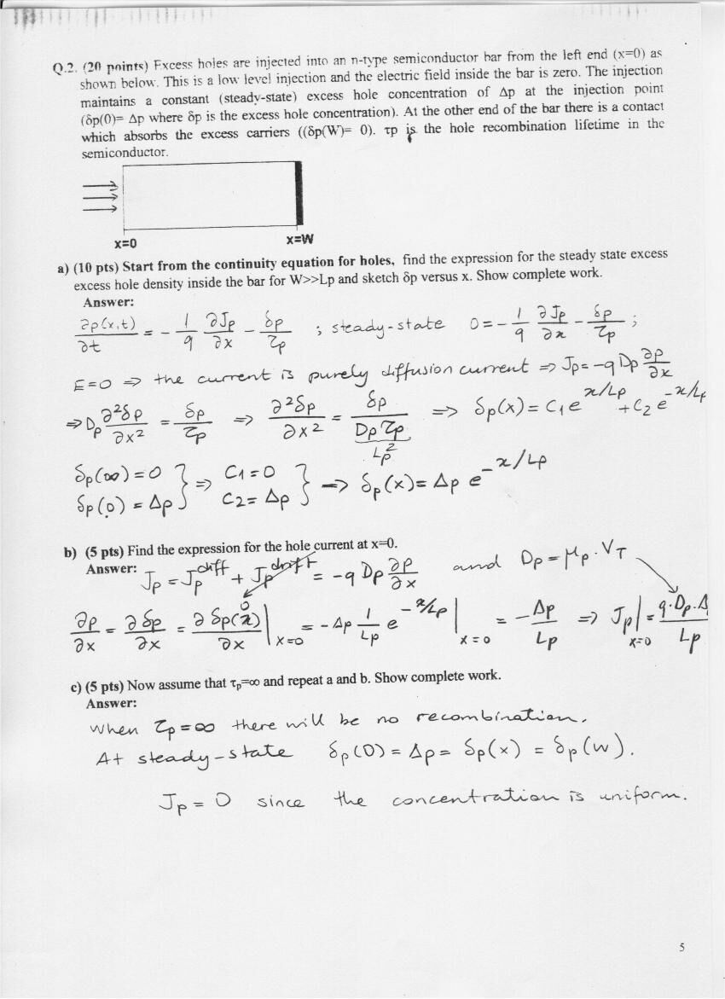
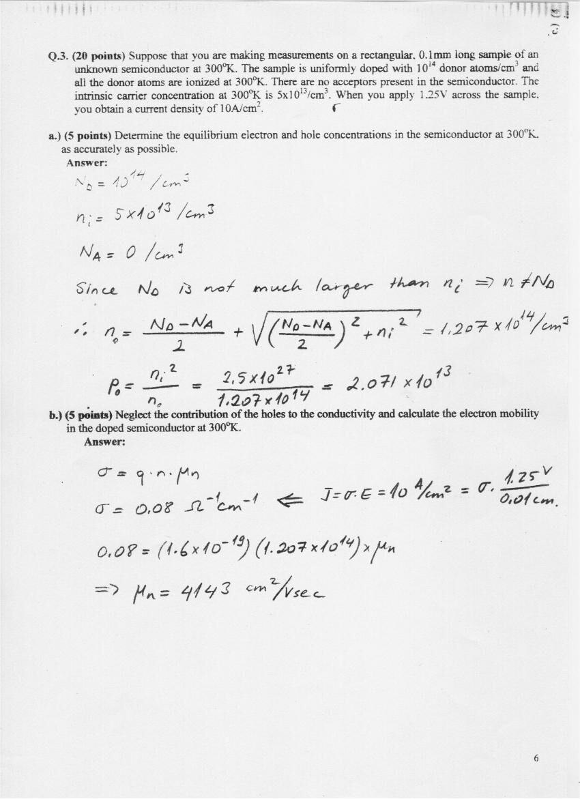
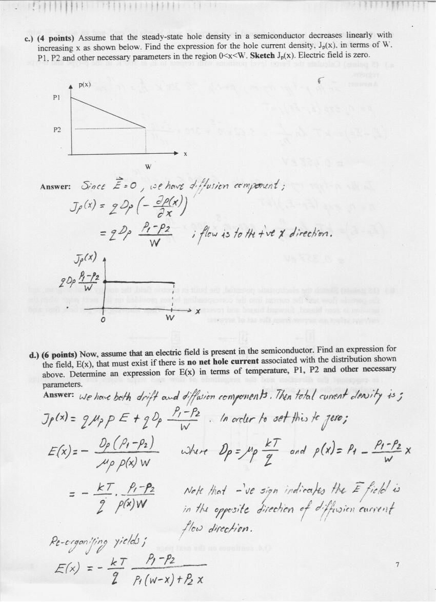
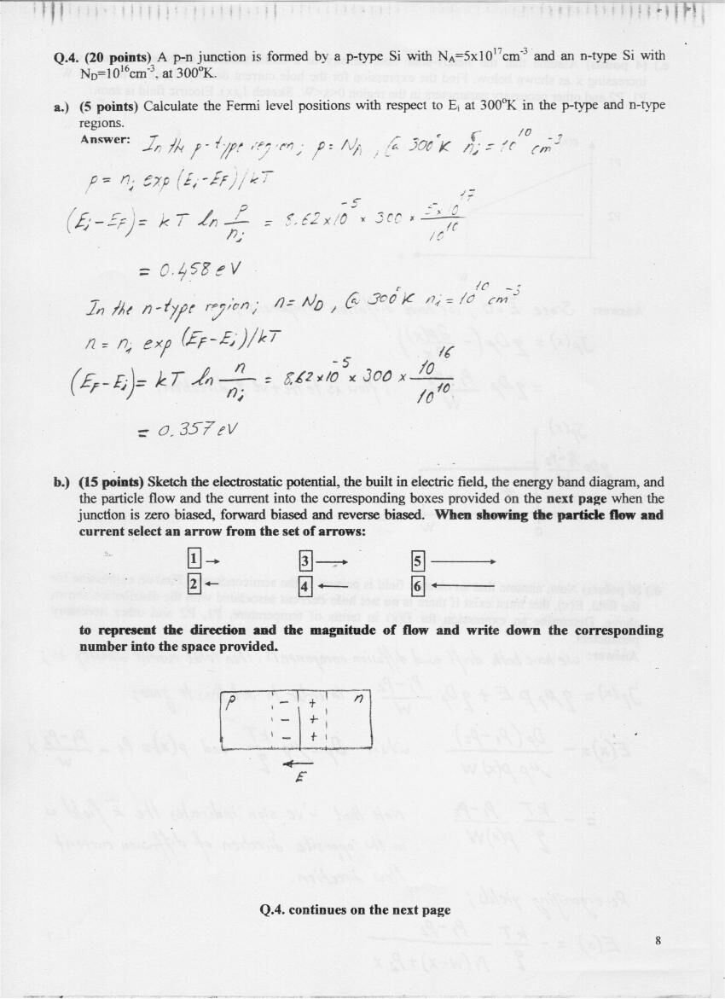
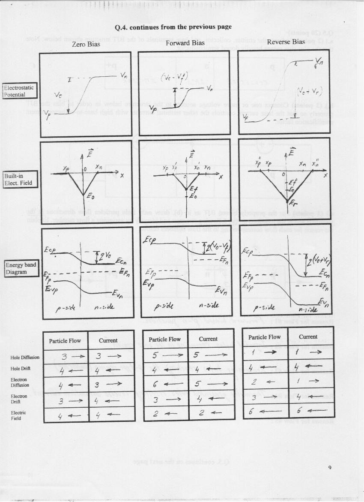
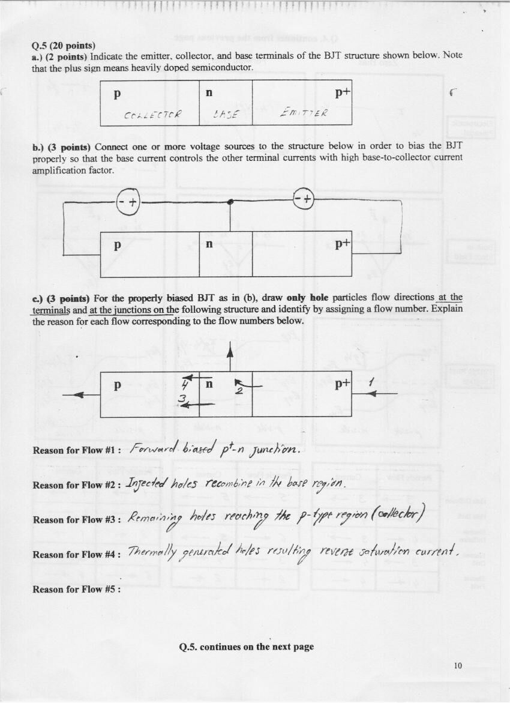
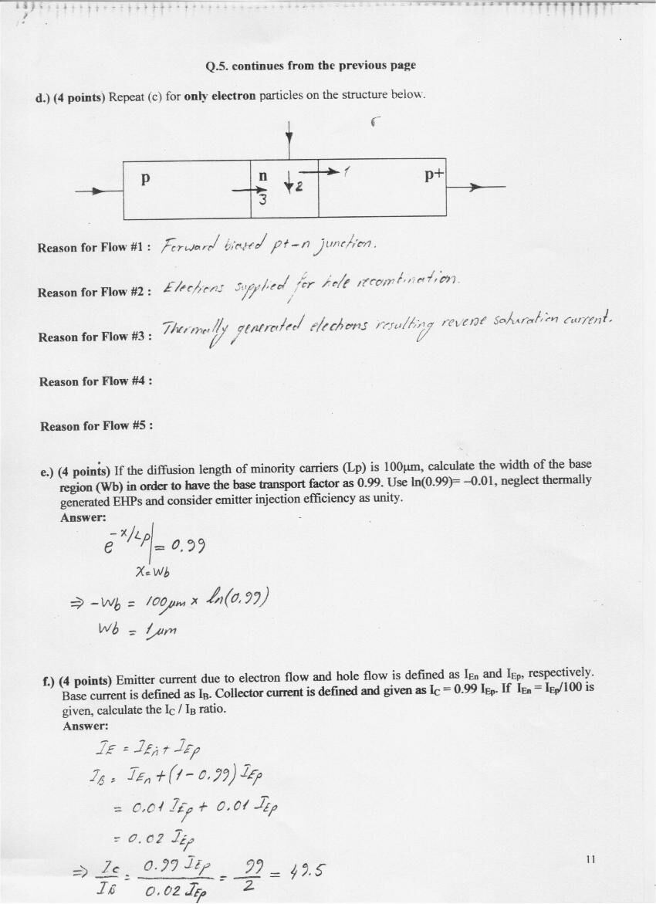

Bu yazı, Başkent Üniversitesi **EEM214 Elektronik I** dersinin 2005–2006 bahar dönemi ara sınavını (14 Nisan 2006, 110 dakika, beş soru) çözümleriyle birlikte veriyor. Çözümler sınav kâğıdının üzerine el yazısıyla yazılmış; soru metinleri, ana denklemler ve sonuçlar metin olarak aktarıldı, el yazısı sayfalar görsel olarak eklendi. Yazının sonunda, aynı dersin 2000–2001 bahar dönemine ait, çözümsüz bir örnek ara sınavın soruları da var. Orijinal çözüm PDF'i parolalıydı; yazının sonundaki ZIP dosyasında parolası kaldırılmış kopyası ve örnek sınavın Word dosyası bulunuyor.

## Sınav bilgileri

Başkent University, Department of Electrical and Electronics Engineering, EEM 214 Electronics, Spring 2005-06 Midterm Exam. Date: April 14, 2006, Hour: 11:00, Duration: 110 minutes. There are five questions (20 points each), attempt all. Show complete work for full credit, include units in your answers. If you are asked to DERIVE an expression, you must derive it starting from the basic laws.

**Useful material:** k = 1.38×10⁻²³ J/K = 8.62×10⁻⁵ eV/K; q = 1.6×10⁻¹⁹ C; room temperature kT = 0.0259 eV; 1 eV = 1.6×10⁻¹⁹ J; n_i = 10¹⁰ cm⁻³ at 300 K; h = 6.626×10⁻³⁴ J·s; c = 3×10⁸ m/s. Band gaps: carbon 5.47 eV, silicon 1.12 eV, germanium 0.66 eV, gallium arsenide 1.42 eV.

- n_i² = B·T³·e^(−E_g/kT)
- (N_D > N_A) ⇒ n = [(N_D − N_A) ± √((N_D − N_A)² + 4n_i²)]/2; (N_A > N_D) ⇒ p = [(N_A − N_D) ± √((N_A − N_D)² + 4n_i²)]/2
- n = n_i·e^((E_F − E_i)/kT), p = n_i·e^((E_i − E_F)/kT)
- qV₀ = q·(kT/q)·ln(N_a·N_d/n_i²)
- ∂p(x,t)/∂t = −(1/q)·∂J_p/∂x − δ_p/τ_p, ∂n(x,t)/∂t = (1/q)·∂J_n/∂x − δ_n/τ_n

## Q.1 (20 pts) Çoktan seçmeli

Circle your answer (4 false answers cancel 1 correct answer). Çözümde işaretlenen şıklar kalın yazıldı.

1. For an intrinsic semiconductor, which one is **wrong**? (a) there are no charge carriers at 0 K; (b) the number of charge carriers is a function of temperature; (c) electron concentration in the conduction band is equal to the concentration of holes in the valence band; **(d) the energy required to break the covalent bond is less than the band gap energy.**
1. Which one is **wrong**? (a) Column V elements behave as donors in Si; (b) Column III elements behave as acceptors in Si; (c) compensation decreases the free carrier density; **(d) n_i² = n·p is valid during carrier injection.**
1. Which one is **wrong**? (a) Fermi level has a probability of ½ of being occupied by an electron, if no forbidden band exists; (b) at 0 K every available state up to E_F is filled with electrons and all states above E_F are empty; (c) the probability that a state ΔE above E_F is filled is equal to the probability that a state ΔE below E_F is empty; **(d) as the temperature increases, the Fermi level approaches the conduction band and the number of electrons in the conduction band increases.**
1. Consider a semiconductor at thermal equilibrium. Which one **does not occur** when the temperature is increased? (a) thermal energy increases; (b) generation rate increases; **(c) recombination rate decreases;** (d) conductivity increases.
1. When an intrinsic semiconductor is heated, the Fermi level: (a) moves closer to the conduction band by an amount equal to the thermal energy; (b) moves closer to the valence band by an amount equal to the thermal energy; **(c) location remains the same with respect to conduction and valence bands;** (d) moves above the conduction band.
1. Which one is **wrong**? Applied voltage on a diode changes (a) the electrostatic potential barrier and the electric field within the depletion region; **(b) the doping concentrations;** (c) the current components at the junctions; (d) energy band separation within the depletion region.
1. Which one is **wrong**? (a) electron movement due to diffusion is in the opposite direction of the concentration gradient; (b) hole current due to diffusion is in the opposite direction of the concentration gradient; (c) the electron drift current is in the opposite direction of the potential gradient; **(d) the hole drift current is in the direction of the potential gradient.**
1. Reverse saturation current of a pn-junction diode is independent of the applied voltage because (a) the electric field at the junction does not change; (b) the mobility of electrons increases in proportion to the electric field; **(c) the drift currents in the depletion region are proportional to the minority carrier concentrations that are constant for a given temperature;** (d) the electrostatic potential barrier does not change.
1. Considering a pn-junction at equilibrium (no external bias), which one is **wrong**? (a) drift and diffusion currents for electrons cancel each other; (b) Fermi level is constant; **(c) neutral p and n sides of the diode are at the same electrostatic potential;** (d) the electrostatic potential barrier does not change.
1. Which one is not one of the **three dominant mechanisms for the base current** of a forward biased pnp transistor? (a) electrons lost to recombination in the base are supplied through the base contact; (b) electrons injected into the collector junction are supplied by the thermal generation in the base; (c) electrons injected into the forward biased emitter junction are supplied by the base contact; **(d) thermally generated electrons in the collector are swept into the base by the reverse biased collector junction.**

*Not: 10. sorunun işaretli cevabı tartışmalı. Streetman'ın sıraladığı üç baz akımı mekanizması rekombinasyon (a), emetör eklemine enjekte edilen elektronlar (c) ve kolektördeki ısıl üretilmiş elektronların ters kutuplu kolektör eklemiyle baza süpürülmesidir (d); bu durumda mekanizmalardan biri olmayan şık (b) olmalıdır. Nitekim aynı çözümün 5. sorusunda da ısıl üretilmiş taşıyıcılardan doğan ters doyma akımı bir akış olarak sayılıyor.*

## Q.2 (20 pts) Fazla delik enjeksiyonu

Excess holes are injected into an n-type semiconductor bar from the left end (x = 0). This is a low level injection and the electric field inside the bar is zero. The injection maintains a constant (steady-state) excess hole concentration δp(0) = Δp. At the other end of the bar there is a contact which absorbs the excess carriers, δp(W) = 0. τ_p is the hole recombination lifetime.

**a) (10 pts)** Start from the continuity equation for holes, find the expression for the steady-state excess hole density inside the bar for W ≫ L_p and sketch δp versus x.

Steady state: 0 = −(1/q)·∂J_p/∂x − δp/τ_p. E = 0 ⇒ pure diffusion current, J_p = −q·D_p·∂p/∂x ⇒ D_p·∂²δp/∂x² = δp/τ_p, L_p² = D_p·τ_p ⇒ δp(x) = C₁·e^(x/L_p) + C₂·e^(−x/L_p). δp(∞) = 0 ⇒ C₁ = 0, δp(0) = Δp ⇒ C₂ = Δp:

δp(x) = Δp·e^(−x/L_p)

**b) (5 pts)** Hole current at x = 0: J_p = −q·D_p·∂p/∂x, ∂δp/∂x at x = 0 is −Δp/L_p ⇒ J_p(0) = q·D_p·Δp/L_p (with D_p = μ_p·V_T).

**c) (5 pts)** Now assume τ_p = ∞ and repeat a and b. Çözüm: rekombinasyon olmaz; kararlı durumda δp(0) = Δp = δp(x) = δp(W), yoğunluk düzgün olduğundan J_p = 0.

*Not: c şıkkının çözümü sınır koşuluyla çelişiyor: δp(W) = 0 verildiği için yoğunluk düzgün olamaz. τ_p = ∞ iken süreklilik denklemi d²δp/dx² = 0'a indirgenir ve δp(x) = Δp·(1 − x/W) doğrusal profili, J_p = q·D_p·Δp/W sabit akımı bulunur.*

## Q.3 (20 pts) Bilinmeyen bir yarıiletken

Suppose that you are making measurements on a rectangular, 0.1 mm long sample of an unknown semiconductor at 300 K. The sample is uniformly doped with 10¹⁴ donor atoms/cm³ and all donors are ionized. There are no acceptors. The intrinsic carrier concentration at 300 K is 5×10¹³/cm³. When you apply 1.25 V across the sample, you obtain a current density of 10 A/cm².

**a) (5 pts)** Equilibrium electron and hole concentrations: since N_D is not much larger than n_i, n ≠ N_D:

n₀ = (N_D − N_A)/2 + √(((N_D − N_A)/2)² + n_i²) = 1.207×10¹⁴/cm³, p₀ = n_i²/n₀ = 2.5×10²⁷/1.207×10¹⁴ = 2.071×10¹³/cm³

**b) (5 pts)** Neglect the holes' contribution and calculate the electron mobility: J = σ·E ⇒ 10 A/cm² = σ·(1.25 V/0.01 cm) ⇒ σ = 0.08 (Ω·cm)⁻¹. σ = q·n·μ_n ⇒ 0.08 = 1.6×10⁻¹⁹·1.207×10¹⁴·μ_n ⇒ μ_n = 4143 cm²/V·s.

**c) (4 pts)** The steady-state hole density decreases linearly from P1 at x = 0 to P2 at x = W; E = 0. Find J_p(x) for 0 < x < W and sketch it. Since E = 0 there is only a diffusion component:

J_p(x) = q·D_p·(−∂p/∂x) = q·D_p·(P1 − P2)/W (constant, flowing in the +x direction)

**d) (6 pts)** What electric field E(x) must exist if there is no net hole current for the same distribution? J_p = q·μ_p·p·E + q·D_p·(P1 − P2)/W = 0, with D_p = μ_p·kT/q and p(x) = P1 − (P1 − P2)·x/W:

E(x) = −(kT/q)·(P1 − P2)/(p(x)·W) = −(kT/q)·(P1 − P2)/(P1·(W − x) + P2·x)

The negative sign indicates that the field is opposite to the diffusion current direction.

## Q.4 (20 pts) P-N eklemi

A p-n junction is formed by p-type Si with N_A = 5×10¹⁷ cm⁻³ and n-type Si with N_D = 10¹⁶ cm⁻³ at 300 K.

**a) (5 pts)** Fermi level positions with respect to E_i:

- p-type: E_i − E_F = kT·ln(p/n_i) = 8.62×10⁻⁵·300·ln(5×10¹⁷/10¹⁰) = 0.458 eV
- n-type: E_F − E_i = kT·ln(n/n_i) = 8.62×10⁻⁵·300·ln(10¹⁶/10¹⁰) = 0.357 eV

**b) (15 pts)** Sketch the electrostatic potential, the built-in electric field, the energy band diagram, and the particle flow and current for zero, forward and reverse bias, choosing arrows 1–6 for direction and magnitude. Çözümdeki tablolar:

| | Zero bias: particle / current | Forward bias: particle / current | Reverse bias: particle / current |
|---|---|---|---|
| Hole diffusion | 3 → / 3 → | 5 → / 5 → | 1 → / 1 → |
| Hole drift | 4 ← / 4 ← | 4 ← / 4 ← | 4 ← / 4 ← |
| Electron diffusion | 4 ← / 3 → | 6 ← / 5 → | 2 ← / 1 → |
| Electron drift | 3 → / 4 ← | 3 → / 4 ← | 3 → / 4 ← |
| Electric field | 4 ← / 4 ← | 2 ← / 2 ← | 6 ← / 6 ← |

(1, 3, 5 sağa; 2, 4, 6 sola; numara büyüdükçe ok uzuyor.)

## Q.5 (20 pts) PNP BJT

**a) (2 pts)** For the p | n | p+ structure (plus means heavily doped): p = collector, n = base, p+ = emitter.

**b) (3 pts)** Bias the BJT so that the base current controls the other terminal currents with high current amplification: emitter-base junction forward biased, collector-base junction reverse biased.

**c) (3 pts)** Hole flows: #1 forward biased p⁺-n junction (holes injected from the emitter); #2 injected holes recombine in the base region; #3 remaining holes reach the p-type region (collector); #4 thermally generated holes resulting in reverse saturation current.

**d) (4 pts)** Electron flows: #1 forward biased p⁺-n junction; #2 electrons supplied for hole recombination; #3 thermally generated electrons resulting in reverse saturation current.

**e) (4 pts)** If the diffusion length of minority carriers is L_p = 100 µm, calculate the base width W_b for a base transport factor of 0.99 (use ln(0.99) = −0.01, emitter injection efficiency unity): e^(−W_b/L_p) = 0.99 ⇒ W_b = −100 µm·ln(0.99) = 1 µm.

**f) (4 pts)** Emitter current due to electron and hole flow are I_En and I_Ep; collector current I_C = 0.99·I_Ep. If I_En = I_Ep/100, calculate I_C/I_B: I_E = I_En + I_Ep, I_B = I_En + (1 − 0.99)·I_Ep = 0.01·I_Ep + 0.01·I_Ep = 0.02·I_Ep ⇒ I_C/I_B = 0.99/0.02 = 49.5.

## Örnek ara sınav: EE 214 Electronics, Spring 2000-01

Midterm Exam I, April 10, 2001, 9:00, duration 100 minutes. Four questions (25 points each). Aynı "Useful Material" sayfası ve bant aralığı tablosu verilmiş. Bu sınavın çözümü dosyada yok.

**Q.1** a) (4 pts) If n_i = 10¹⁰ cm⁻³ for Si at T = 300 K, calculate the intrinsic carrier concentration for Si at T = 400 K. b) (5 pts) Calculate electron and hole concentration for a Si semiconductor doped with N_D = 10¹⁰ cm⁻³ at T = 300 K. Is this an n-type, a p-type or an intrinsic semiconductor material? Explain your reasoning. c) (5 pts) Without any calculation, estimate n and p for Si at T = 400 K doped with N_D = 10¹⁰ cm⁻³. Is this n-type, p-type or intrinsic? d) (7 pts) If μ_n = 0.135 m²/V·s for Si at 300 K and does not change with N_D, calculate the N_D required to achieve a drift current density of j_drift = 100 mA/cm² under an electric field of E = 1 V/cm (assume μ_n·n ≫ μ_p·p and n ≈ N_D). e) (4 pts) If in part (d) μ_n were not constant but had a non-linear dependency on N_D, describe qualitatively how you would solve for N_D.

**Q.2** A p-n junction is formed by p-type Si with N_A = 5×10¹⁷ cm⁻³ and n-type Si with N_D = 10¹⁶ cm⁻³ at 300 K. a) (5 pts) Calculate the Fermi level positions with respect to E_i in the p-type and n-type regions. b) (20 pts) Sketch the electrostatic potential, the built-in electric field, the energy band diagram, and the particle flow and current for zero, forward and reverse bias (using arrows 1–6).

**Q.3** Excess holes are injected into an n-type semi-infinite semiconductor bar at x = 0 continuously (injection occurs only at x = 0). Hole injection maintains a constant steady-state excess hole concentration of Δp at x = 0. This is a low level injection and the electric field is zero everywhere. Hole recombination lifetime is τ_p and the diffusion coefficient for holes is D_p. a) (12 pts) Modify the continuity equation for this problem and derive the expression for the steady-state excess hole concentration δ_p(x), for x > 0, in terms of the diffusion length of holes. Sketch δ_p(x) versus x. b) (13 pts) Now assume that the length of the bar is w. The excess minority carrier concentration at the ohmic contact is zero. Derive δ_p(x) for x > 0 in terms of the diffusion length and sketch it.

**Q.4** a) (7 pts) Draw the output voltage waveform v_o of a series capacitor – shunt diode circuit in response to a ±5 V triangular input. The diode and the capacitor are ideal, the initial capacitor voltage is zero and the source is switched on at t = 0. b) (8 pts) Draw the output voltage waveform of the two-diode, two-capacitor circuit (D1, D2, C1, C2) for v_i = V_p·sin(ωt); ideal elements, initial capacitor voltages zero. c) (10 pts) We would like to manufacture a photo-diode sensitive to light with a wavelength of λ = 5 µm. List the suitable semiconductor materials from the table (Ge 0.66 eV, GaAs 1.43 eV, InSb 0.22 eV, Si 1.12 eV, InP 1.35 eV). Draw a circuit using this photo-diode as a photo-detector with a 5 V supply and a resistor. The diode current is 100 µA under illumination and the dark current is 10 µA. Mark the output terminals. What resistor value gives an output voltage of 2 V under illumination? Find the output voltage with no illumination using that resistor.

, Q.4a–b")
