This post brings together the scanned pages found in the "exam" folder of EEM214 Electronics I: the handwritten answer key of the **midterm exam** (11 April 2008, four questions) from the Spring 2007–08 semester, the solutions of two groups of a **quiz** given in the laboratory, the solutions of two groups of another quiz, and two **practice problems**. The questions and the main steps of the solutions are written out as text; the scanned pages are also included as images. The originals of the pages can be downloaded as a ZIP at the end of the post.

## Midterm exam (April 2008)

The **Useful Material** sheet provided with the exam: k = 1.38 × 10⁻²³ J/K = 8.62 × 10⁻⁵ eV/K, q = 1.6 × 10⁻¹⁹ C, kT = 0.0259 eV at room temperature, n_i = 10¹⁰ cm⁻³ (300 K), h = 6.626 × 10⁻³⁴ J·s, c = 3 × 10⁸ m/s; band gaps: carbon 5.47, silicon 1.12, germanium 0.66, gallium arsenide 1.42 eV; n_i² = BT³e^(−E_g/kT); for N_D > N_A, n = [(N_D − N_A) + √((N_D − N_A)² + 4n_i²)]/2 (symmetric for p); n = n_i·e^((E_F − E_i)/kT), p = n_i·e^((E_i − E_F)/kT); f(E) = 1/(1 + e^((E − E_F)/kT)); qV₀ = kT·ln(N_aN_d/n_i²); continuity equations ∂p/∂t = −(1/q)∂J_p/∂x − δp/τ_p and ∂n/∂t = (1/q)∂J_n/∂x − δn/τ_n.

### Q.1 (30 points): Infinite Si bar illuminated by light

The x ≤ 0 part of an infinite semiconductor bar is illuminated by light, and electron–hole pairs are generated uniformly in the x < 0 region at g_op = 10¹⁵ pairs/cm³·s; for x > 0, g_op = 0. The bar is Si, uniformly doped with N_D = 10¹⁸ cm⁻³, τ_p = 10⁻⁶ s, T = 300 K, D_p = 3 cm²/s, steady state.

- **a) Total hole density at x = −∞:** p₀ = n_i²/N_D = 10² cm⁻³. In steady state and with uniform illumination, ∂²δp/∂x² = 0, so 0 = −δp/τ_p + g_op ⇒ δp(−∞) = τ_p·g_op = 10⁻⁶ × 10¹⁵ = 10⁹ cm⁻³; **p(−∞) = 10² + 10⁹ ≅ 10⁹ cm⁻³**.
- **b) At x = +∞:** There is no optical excitation for x > 0; the excess holes diffusing to the right from x = 0 are lost through recombination, and as x → ∞ the excess hole density goes to zero: **p(+∞) = p₀ = 10² cm⁻³**.
- **c) Is there low-level injection?** For x ≤ 0, δp = δn = 10⁹ cm⁻³ << 10¹⁸ cm⁻³; **yes, the low-level injection condition is satisfied**.
- **d) Expression for δp(x):** There is no field, the doping is uniform, and the injection is low-level, so the drift current is zero. For x ≤ 0, δp = g_op·τ_p = 10⁹ cm⁻³. For x > 0, D_p·∂²δp/∂x² = δp/τ_p ⇒ δp(x) = A·e^(x/L_p) + B·e^(−x/L_p); δp(∞) = 0 ⇒ A = 0, δp(0⁺) = Δp ⇒ B = Δp: **δp(x) = 10⁹·e^(−x/L_p) cm⁻³** (L_p = √(D_pτ_p)). In the graph, δp is constant at 10⁹ for x ≤ 0 and decays exponentially for x > 0.

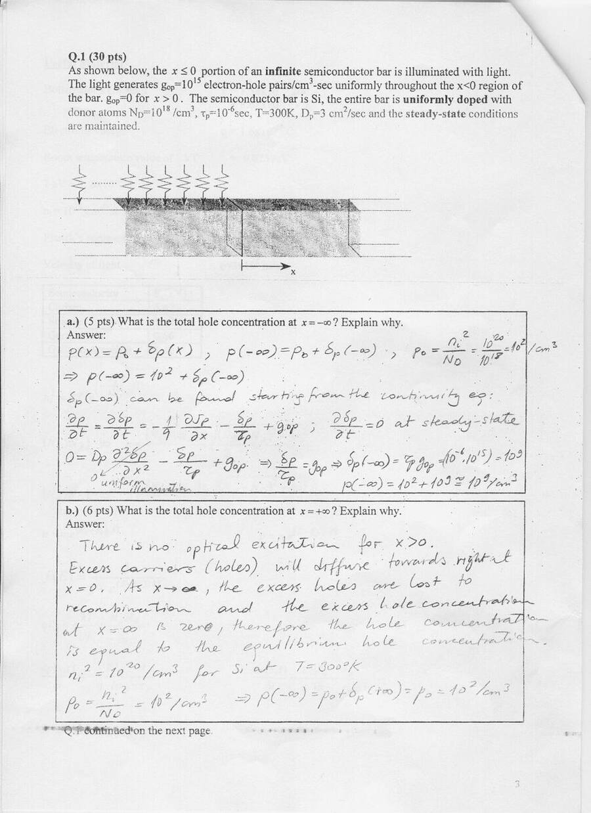

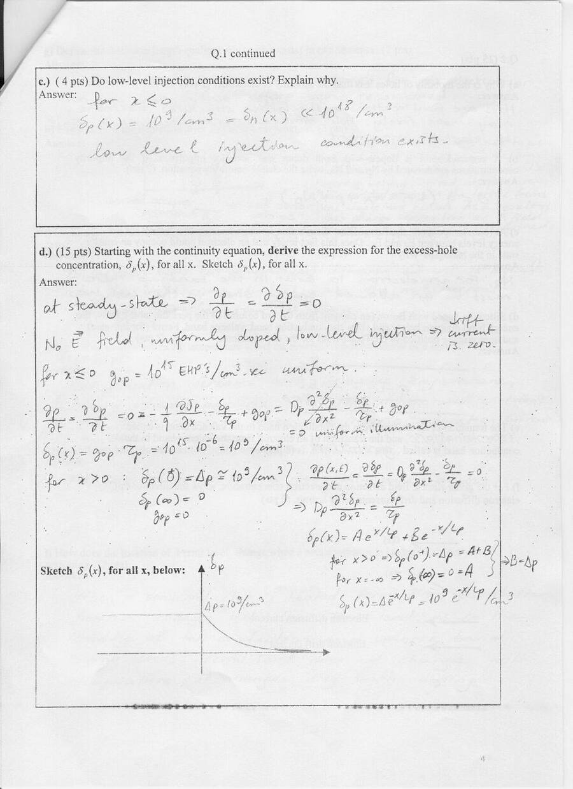

### Q.2 (25 points): Short questions

- a) Why is the mobility of holes lower than that of electrons? *Answer:* hole motion results from electrons hopping from bond to bond; electrons move more freely.
- b) Charge neutrality in a semiconductor doped with both donors and acceptors: **0 = q(−n − N_A + p + N_D)**.
- c) At room temperature the Fermi–Dirac distribution takes nonzero values between E_F and E_C; does this mean an electron can occupy a state in the band gap? *Answer:* no; for an electron to be found in the band gap, there must be an allowed energy state there.
- d) Band diagram of boron-doped silicon: E_F lies below E_i, close to the valence band.
- e) The transition from the conduction band to the valence band is **recombination**, and the reverse is **generation**.
- f) Directions of the electron diffusion and drift currents for the given direction of E(x) and slope of n(x).
- g) Diffusion length: the average distance an electron or hole can diffuse before recombining.
- h) Depletion region: electrons diffuse from n to p and holes from p to n, leaving behind ionized donor and acceptor atoms; these fixed charges form the depletion region and an electric field.
- i) At zero bias, the diffusion current equals the drift current at equilibrium, so the net current is zero.
- j) As temperature increases, electron–hole pair generation and minority carriers increase, contributing to the drift current and increasing the reverse saturation current.
- k) Zener breakdown does not occur in lightly doped diodes; it occurs in heavily doped diodes.
- l) How does the Fermi level change when heated? The answer key states: "The Fermi–Dirac distribution changes but the Fermi level does not change with temperature, only with doping."

*Note: The answer in Q.2 l is not correct for a doped semiconductor: as temperature increases, n_i grows rapidly and E_F − E_i = kT·ln(n/n_i) decreases; that is, the Fermi level approaches the intrinsic level (E_i), and at very high temperature the semiconductor behaves as intrinsic. Only in an intrinsic semiconductor does E_F stay approximately at the middle of the band gap.*

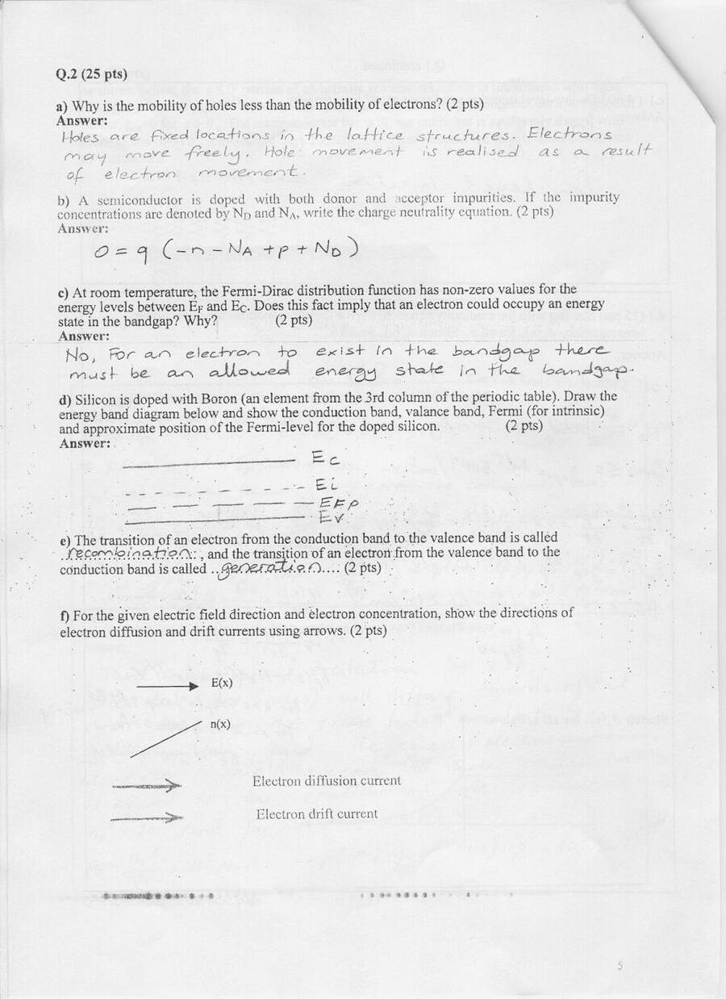

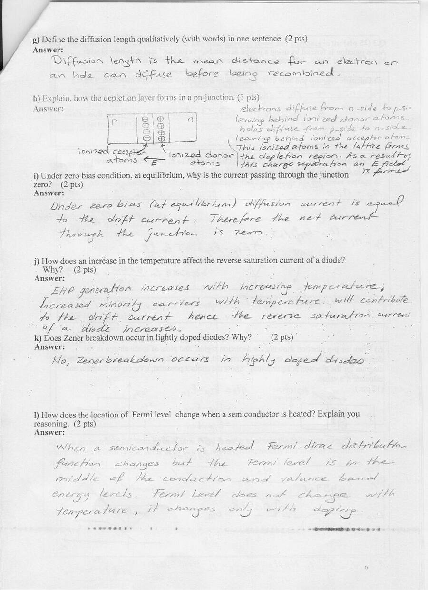

### Q.3 (25 points): p-n junction

A p-n junction with p-type Si at N_A = 5 × 10¹⁷ cm⁻³ and n-type Si at N_D = 10¹⁶ cm⁻³, 300 K, n_i = 10¹⁰ cm⁻³.

- a) In the n region, n_n ≅ 10¹⁶ cm⁻³, p_n = 10²⁰/10¹⁶ = 10⁴ cm⁻³; in the p region, p_p ≅ 5 × 10¹⁷ cm⁻³, n_p = 10²⁰/(5 × 10¹⁷) = 200 cm⁻³.
- b) E_Fn − E_in = kT·ln(n_n/n_i) = 0.0259·ln(10⁶) = **0.3578 eV**; E_ip − E_Fp = kT·ln(p_p/n_i) = 0.0259·ln(5 × 10⁷) = **0.459 eV**; at equilibrium E_Fn = E_Fp = E_F.
- c) Sketches of the depletion region, charge density, electric field, potential, and band diagram; **qV₀ = 0.459 + 0.3578 = 0.8168 eV** (or V₀ = (kT/q)·ln(N_AN_D/n_i²) = 0.0259·ln(5 × 10¹⁷ × 10¹⁶ / 10²⁰) ≅ 0.8169 V).
- d) Table: hole diffusion and electron drift particle flow from p to n (→), hole drift and electron diffusion particle flow from n to p (←); current directions: hole diffusion →, hole drift ←, electron diffusion →, electron drift ←.

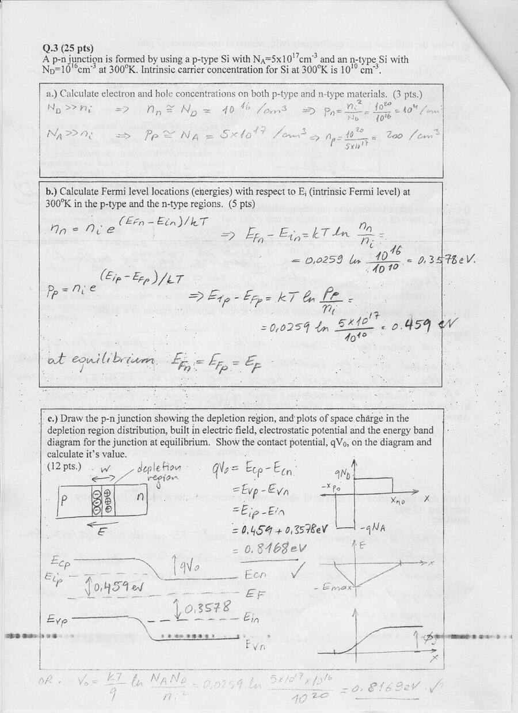

### Q.4 (20 points): Transfer characteristic with diodes and Zener

In a circuit with a 1 kΩ series resistor, there are two branches in parallel at the output: a diode with a Zener connected in reverse series with it, and two diodes in series. The diode turn-on voltage is 1 V and the Zener voltage is 5 V.

- a) Transfer characteristic: for −6 V < V_in < 2 V, V_out = V_in; for V_in > 2 V, **V_out = 2 V** (two diodes); for V_in < −6 V, **V_out = −6 V** (diode + Zener).
- b) Circuit to clip a triangular-wave input at +3 V and −1 V: a single reverse-connected diode for −1 V, and three series diodes for +3 V.

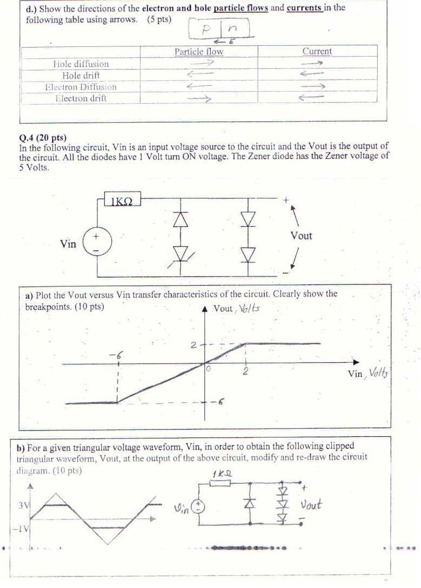

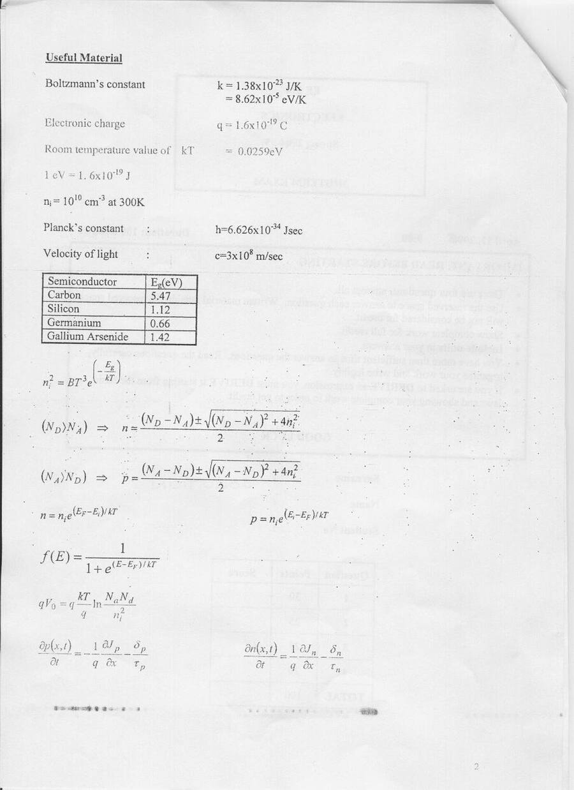

## Laboratory quiz (Group I and II)

Solutions written on the EEM-214 Electronics Laboratory Quiz-1 papers:

- **Group I:** A Zener regulator with V_i = 20 V, R = 1 kΩ, V_Z = 10 V, and R_L = 4 kΩ. i_L = 10 V / 4 kΩ = 2.5 mA, i_R = (20 − 10)/1 kΩ = 10 mA, i_Z = 10 − 2.5 = **7.5 mA**, P_Z = 10 V × 7.5 mA = **75 mW**.
- **Group II:** Two Si diodes (V_diode = 0.7 V) with their anodes connected to the V_o node, and V_o connected to +5 V through 1 kΩ. With V₁ = V₂ = 0 V: V_o = 0.7 V, I_o = (5 − 0.7)/1 kΩ = 4.3 mA; when one of the inputs is 10 V, that diode is reverse biased and the result is the same (0.7 V, 4.3 mA); when both are 10 V, both diodes are cut off, **V_o = 5 V, I_o = 0**. When the table is converted to logic levels, the circuit works like an **AND gate**.

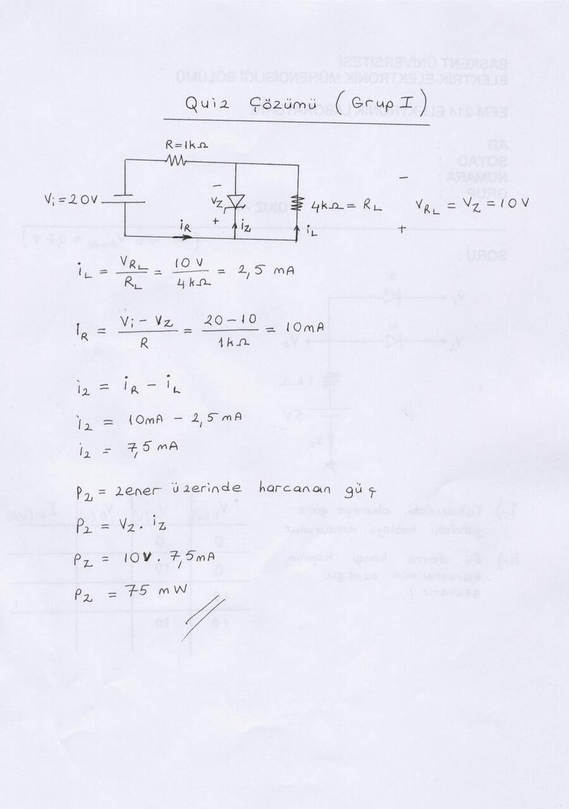

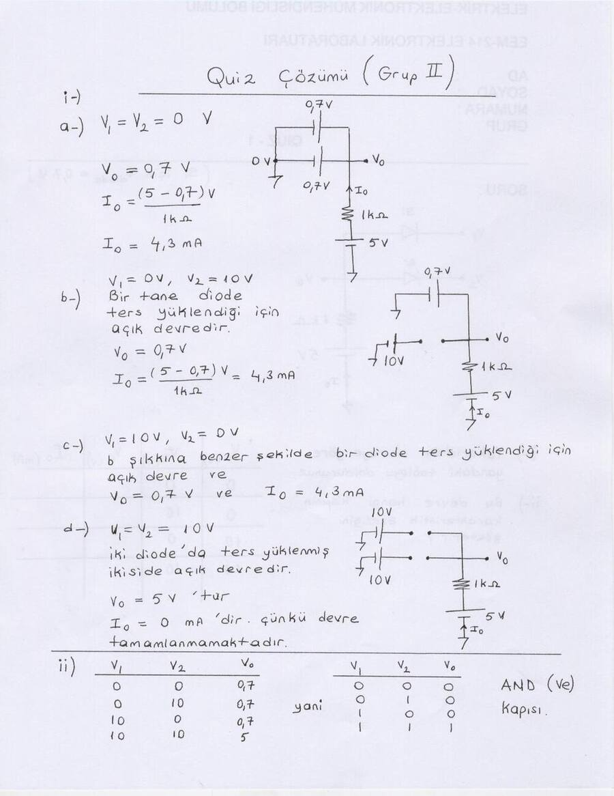

## Quiz I (Group 3 and 4)

Two circuits in which the diode states are found by the assume-and-verify method:

- **Group 3:** First, both diodes are assumed to be off; since V_D1 = 10/3 V > 0, D1 must be on. With D1 on and D2 off assumed, the node equation (V₁ − 9.3)/1k + (V₁ − 5)/1k + V₁/2k = 0 ⇒ V₁ = 5.72 V; i_D1 = 3.58 mA > 0 (D1 on), V_D2 = −2.86 V < 0 (D2 off); **V_o = 2.86 V**.
- **Group 4:** Similarly, D1 on and D2 off; (V₁ − 10)/2k + (V₁ − 5.7)/1k + V₁/8k = 0 ⇒ V₁ = 6.58 V; i_D1 = 0.885 mA, V_D2 = −0.3 V; **V_o = 3.3 V**.

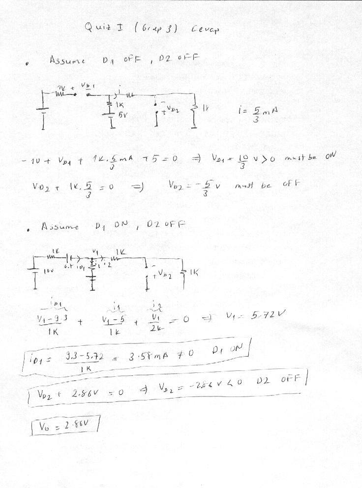

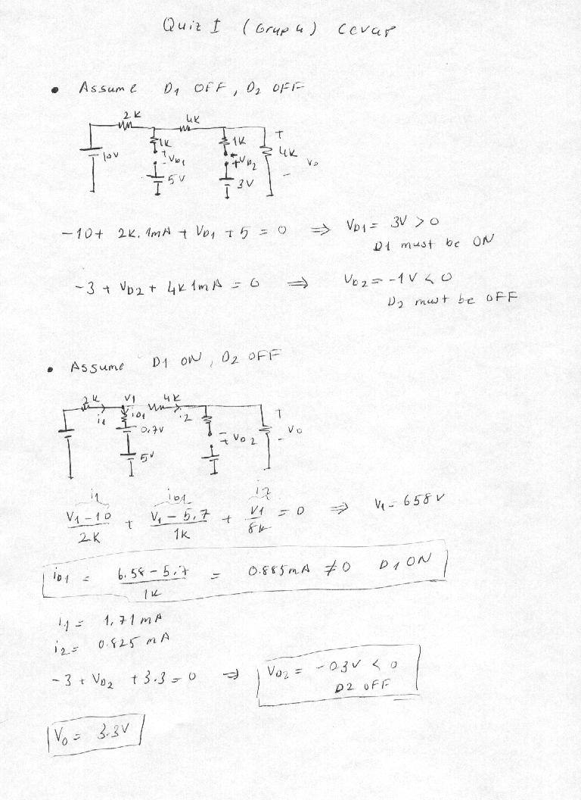

## Practice problems

1. Draw the AC equivalent circuit of the circuit shown (a two-transistor amplifier fed by a current mirror) and derive the expression for v_o/v_i = A_v.
1. Draw the AC equivalent circuit of the circuit below (Q1–Q2 differential pair, Q3–Q4 current-mirror active load) and derive the expression for the voltage gain.

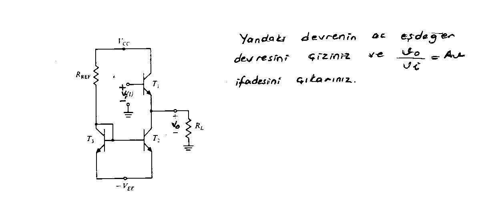

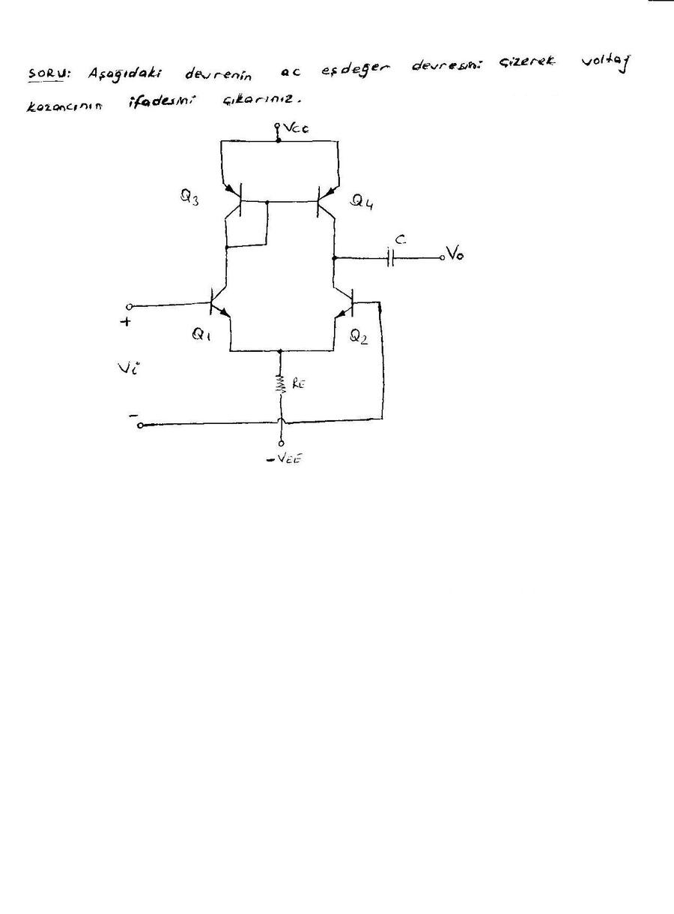

## Download

The ZIP file contains seven scanned pages of the midterm, four pages of the quizzes, and two images of the practice problems.
