Bu yazı, EEM214 Elektronik I dersinin "sınav" klasöründe bulunan taranmış sayfaları bir araya getiriyor: Spring 2007–08 dönemine ait **ara sınavın** (11 Nisan 2008, dört soru) el yazısıyla cevaplanmış anahtarı, laboratuvarda yapılan bir **quizin** iki grubunun çözümü, başka bir quizin iki grubunun çözümü ve iki **çalışma sorusu**. Sorular ve çözümlerin ana adımları metin olarak yazıldı; taranmış sayfalar da görsel olarak eklendi. Sayfaların orijinalleri yazının sonunda ZIP olarak indirilebilir.

## Ara sınav (Nisan 2008)

Sınavla birlikte verilen **Useful Material** sayfası: k = 1.38 × 10⁻²³ J/K = 8.62 × 10⁻⁵ eV/K, q = 1.6 × 10⁻¹⁹ C, oda sıcaklığında kT = 0.0259 eV, n_i = 10¹⁰ cm⁻³ (300 K), h = 6.626 × 10⁻³⁴ J·s, c = 3 × 10⁸ m/s; bant aralıkları: karbon 5.47, silisyum 1.12, germanyum 0.66, galyum arsenit 1.42 eV; n_i² = BT³e^(−E_g/kT); N_D > N_A için n = [(N_D − N_A) + √((N_D − N_A)² + 4n_i²)]/2 (p için simetrik); n = n_i·e^((E_F − E_i)/kT), p = n_i·e^((E_i − E_F)/kT); f(E) = 1/(1 + e^((E − E_F)/kT)); qV₀ = kT·ln(N_aN_d/n_i²); süreklilik denklemleri ∂p/∂t = −(1/q)∂J_p/∂x − δp/τ_p ve ∂n/∂t = (1/q)∂J_n/∂x − δn/τ_n.

### Q.1 (30 puan): Işıkla aydınlatılan sonsuz Si çubuk

Sonsuz bir yarıiletken çubuğun x ≤ 0 kısmı ışıkla aydınlatılıyor ve x < 0 bölgesinde düzgün olarak g_op = 10¹⁵ elektron–delik çifti/cm³·s üretiliyor; x > 0'da g_op = 0. Çubuk Si, N_D = 10¹⁸ cm⁻³ ile düzgün katkılı, τ_p = 10⁻⁶ s, T = 300 K, D_p = 3 cm²/s, kararlı durum.

- **a) x = −∞'da toplam delik yoğunluğu:** p₀ = n_i²/N_D = 10² cm⁻³. Kararlı durumda ve düzgün aydınlatmada ∂²δp/∂x² = 0 olduğundan 0 = −δp/τ_p + g_op ⇒ δp(−∞) = τ_p·g_op = 10⁻⁶ × 10¹⁵ = 10⁹ cm⁻³; **p(−∞) = 10² + 10⁹ ≅ 10⁹ cm⁻³**.
- **b) x = +∞'da:** x > 0'da optik uyarım yok; fazla delikler x = 0'dan sağa doğru difüze olurken yeniden birleşmeyle kaybolur, x → ∞'da fazla delik yoğunluğu sıfır: **p(+∞) = p₀ = 10² cm⁻³**.
- **c) Düşük düzey enjeksiyon var mı?** x ≤ 0'da δp = δn = 10⁹ cm⁻³ << 10¹⁸ cm⁻³; **evet, düşük düzey enjeksiyon koşulu sağlanıyor**.
- **d) δp(x) ifadesi:** Alan yok, düzgün katkılı ve düşük düzey enjeksiyon olduğundan sürüklenme akımı sıfır. x ≤ 0'da δp = g_op·τ_p = 10⁹ cm⁻³. x > 0'da D_p·∂²δp/∂x² = δp/τ_p ⇒ δp(x) = A·e^(x/L_p) + B·e^(−x/L_p); δp(∞) = 0 ⇒ A = 0, δp(0⁺) = Δp ⇒ B = Δp: **δp(x) = 10⁹·e^(−x/L_p) cm⁻³** (L_p = √(D_pτ_p)). Grafikte x ≤ 0'da sabit 10⁹, x > 0'da üstel azalma.

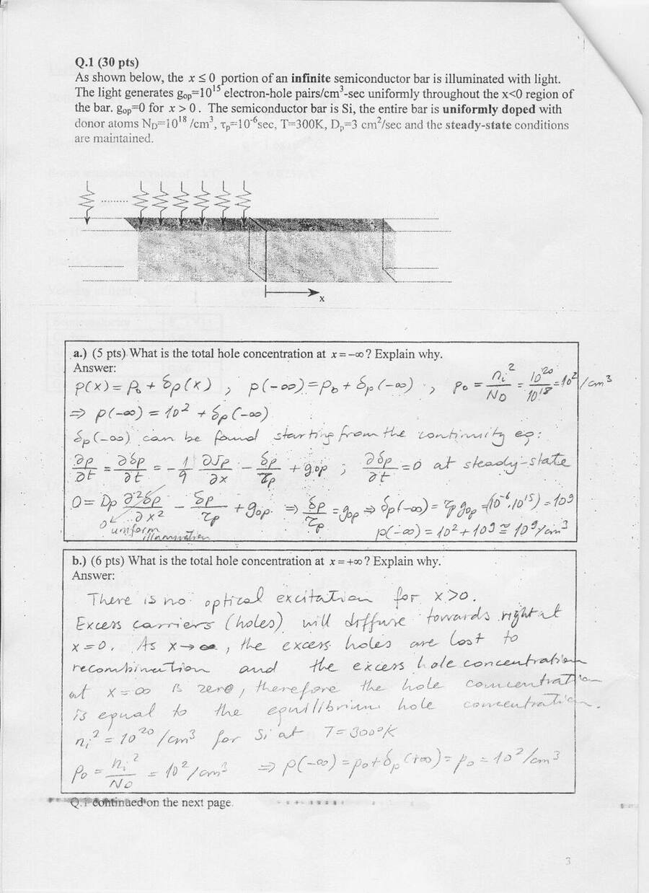

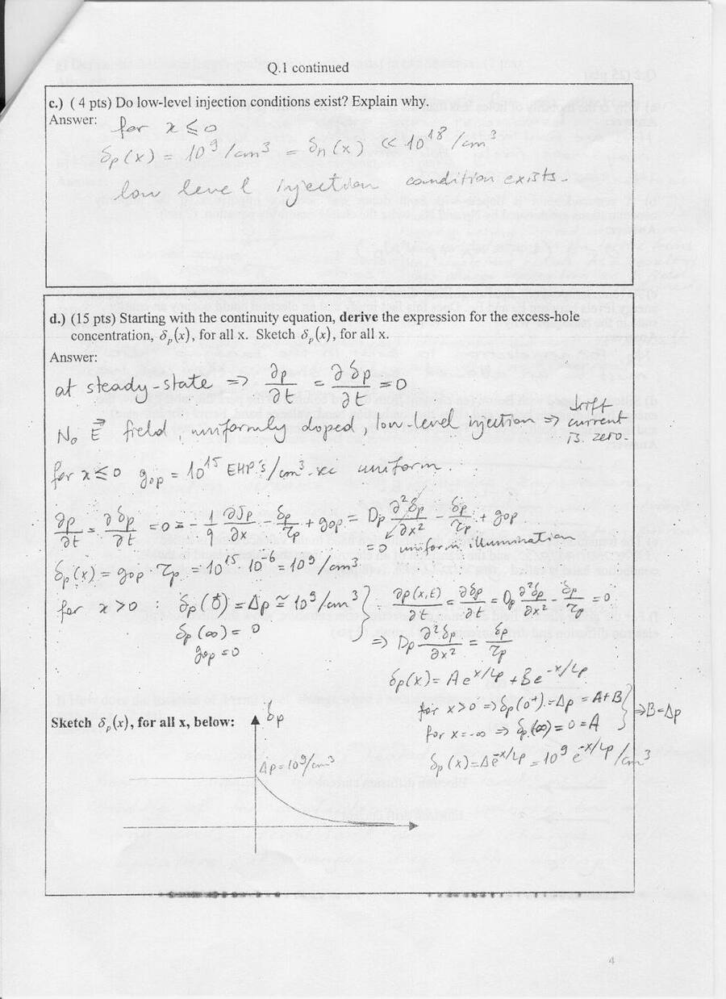

### Q.2 (25 puan): Kısa sorular

- a) Deliklerin hareketliliği neden elektronlarınkinden düşüktür? *Cevap:* delik hareketi elektronların bağdan bağa geçmesinin sonucudur; elektronlar daha serbest hareket eder.
- b) Hem donör hem akseptör katkılı yarıiletkende yük nötrlüğü: **0 = q(−n − N_A + p + N_D)**.
- c) Oda sıcaklığında Fermi–Dirac dağılımı E_F ile E_C arasında sıfırdan farklı değerler alır; bu, bir elektronun bant aralığındaki bir durumu işgal edebileceği anlamına gelir mi? *Cevap:* hayır; bant aralığında elektron bulunması için orada izinli bir enerji durumu olmalı.
- d) Bor katkılı silisyumun bant diyagramı: E_F, E_i'nin altında, değerlik bandına yakın.
- e) İletim bandından değerlik bandına geçiş **yeniden birleşme (recombination)**, tersi **üretim (generation)**.
- f) Verilen E(x) yönü ve n(x) eğimi için elektron difüzyon ve sürüklenme akımlarının yönleri.
- g) Difüzyon uzunluğu: bir elektronun ya da deliğin yeniden birleşmeden önce difüze olabildiği ortalama mesafe.
- h) Boşaltılmış bölge: elektronlar n'den p'ye, delikler p'den n'ye difüze olarak geride iyonlaşmış donör ve akseptör atomları bırakır; bu sabit yükler boşaltılmış bölgeyi ve bir elektrik alanı oluşturur.
- i) Sıfır kutuplamada dengede difüzyon akımı sürüklenme akımına eşit olduğundan net akım sıfırdır.
- j) Sıcaklık artınca elektron–delik çifti üretimi ve azınlık taşıyıcılar artar, sürüklenme akımına katkı yaparak ters doyma akımını artırır.
- k) Zener kırılması hafif katkılı diyotlarda olmaz; yoğun katkılı diyotlarda olur.
- l) Isıtılınca Fermi seviyesi nasıl değişir? Cevap anahtarında "Fermi–Dirac dağılımı değişir ama Fermi seviyesi sıcaklıkla değişmez, yalnız katkıyla değişir" yazılmış.

*Not: Q.2 l'deki cevap katkılı yarıiletken için doğru değildir: sıcaklık arttıkça n_i hızla büyür ve E_F − E_i = kT·ln(n/n_i) küçülür; yani Fermi seviyesi içsel seviyeye (E_i) doğru yaklaşır, çok yüksek sıcaklıkta yarıiletken içsel gibi davranır. Yalnızca içsel yarıiletkende E_F yaklaşık olarak bant aralığının ortasında kalır.*

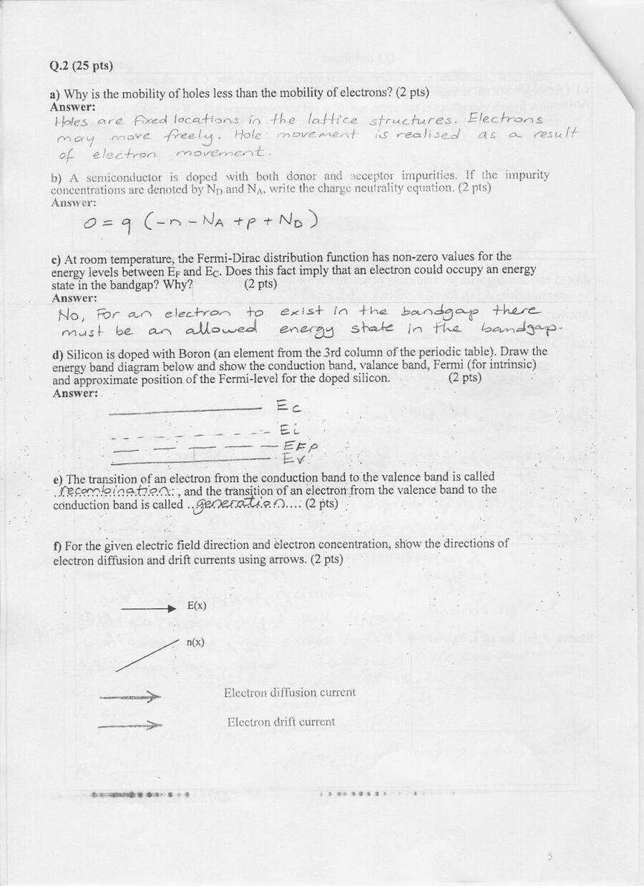

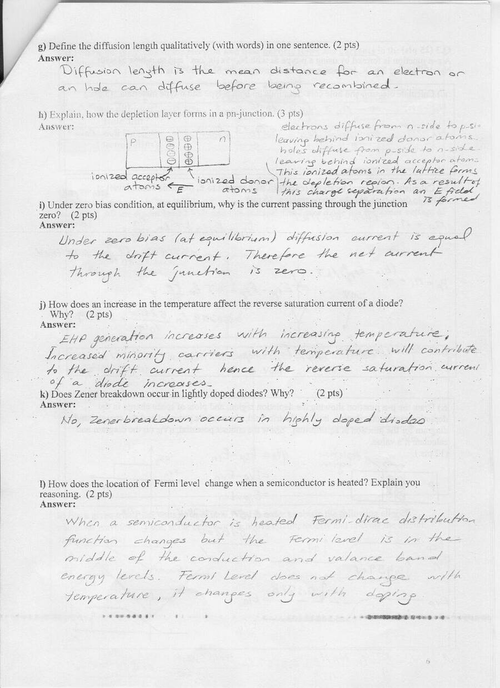

### Q.3 (25 puan): p-n eklemi

p tipi Si N_A = 5 × 10¹⁷ cm⁻³ ve n tipi Si N_D = 10¹⁶ cm⁻³ ile bir p-n eklemi, 300 K, n_i = 10¹⁰ cm⁻³.

- a) n bölgesinde n_n ≅ 10¹⁶ cm⁻³, p_n = 10²⁰/10¹⁶ = 10⁴ cm⁻³; p bölgesinde p_p ≅ 5 × 10¹⁷ cm⁻³, n_p = 10²⁰/(5 × 10¹⁷) = 200 cm⁻³.
- b) E_Fn − E_in = kT·ln(n_n/n_i) = 0.0259·ln(10⁶) = **0.3578 eV**; E_ip − E_Fp = kT·ln(p_p/n_i) = 0.0259·ln(5 × 10⁷) = **0.459 eV**; dengede E_Fn = E_Fp = E_F.
- c) Boşaltılmış bölge, yük yoğunluğu, elektrik alan, potansiyel ve bant diyagramı çizimleri; **qV₀ = 0.459 + 0.3578 = 0.8168 eV** (ya da V₀ = (kT/q)·ln(N_AN_D/n_i²) = 0.0259·ln(5 × 10¹⁷ × 10¹⁶ / 10²⁰) ≅ 0.8169 V).
- d) Tablo: delik difüzyonu ve elektron sürüklenmesi parçacık akışı p'den n'ye (→), delik sürüklenmesi ve elektron difüzyonu parçacık akışı n'den p'ye (←); akım yönleri: delik difüzyonu →, delik sürüklenmesi ←, elektron difüzyonu →, elektron sürüklenmesi ←.

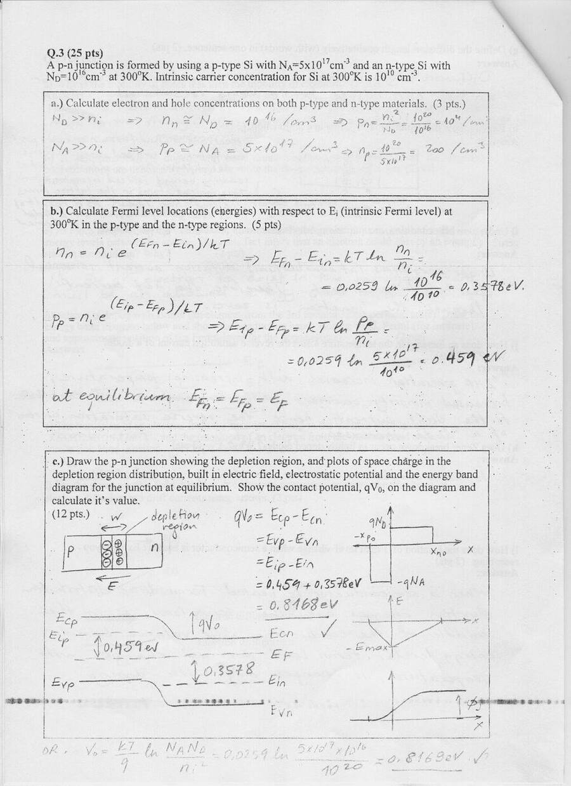

### Q.4 (20 puan): Diyot ve Zener'li transfer karakteristiği

1 kΩ seri dirençli devrede çıkışa paralel iki kol var: bir diyot ve ona ters seri bağlı bir Zener, ve seri iki diyot. Diyotların iletim gerilimi 1 V, Zener gerilimi 5 V.

- a) Transfer karakteristiği: −6 V < V_in < 2 V arasında V_out = V_in; V_in > 2 V için **V_out = 2 V** (iki diyot), V_in < −6 V için **V_out = −6 V** (diyot + Zener).
- b) Üçgen dalga girişini +3 V ve −1 V'ta kırpmak için devre: −1 V için tek ters diyot, +3 V için seri üç diyot.

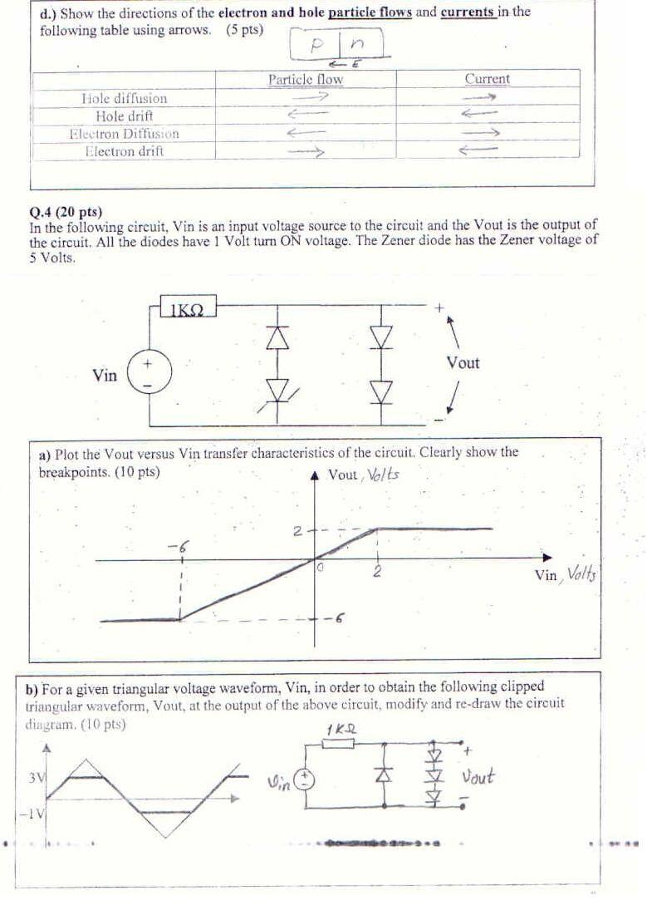

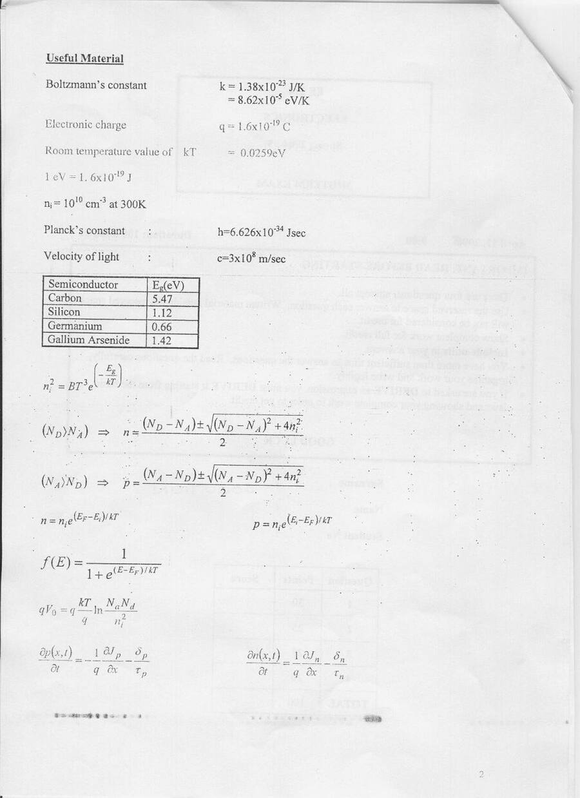

## Laboratuvar quizi (Grup I ve II)

EEM-214 Elektronik Laboratuvarı Quiz-1 kâğıtlarının üzerine yazılmış çözümler:

- **Grup I:** V_i = 20 V, R = 1 kΩ, V_Z = 10 V ve R_L = 4 kΩ'luk Zener regülatörü. i_L = 10 V / 4 kΩ = 2.5 mA, i_R = (20 − 10)/1 kΩ = 10 mA, i_Z = 10 − 2.5 = **7.5 mA**, P_Z = 10 V × 7.5 mA = **75 mW**.
- **Grup II:** Anotları V_o düğümüne bağlı iki Si diyot (V_diyot = 0.7 V), V_o 1 kΩ üzerinden +5 V'a bağlı. V₁ = V₂ = 0 V: V_o = 0.7 V, I_o = (5 − 0.7)/1 kΩ = 4.3 mA; girişlerden biri 10 V iken o diyot ters kutuplanır, sonuç aynı (0.7 V, 4.3 mA); ikisi de 10 V iken iki diyot da kesimde, **V_o = 5 V, I_o = 0**. Tablo mantık seviyelerine çevrilince devre **VE (AND) kapısı** gibi çalışıyor.

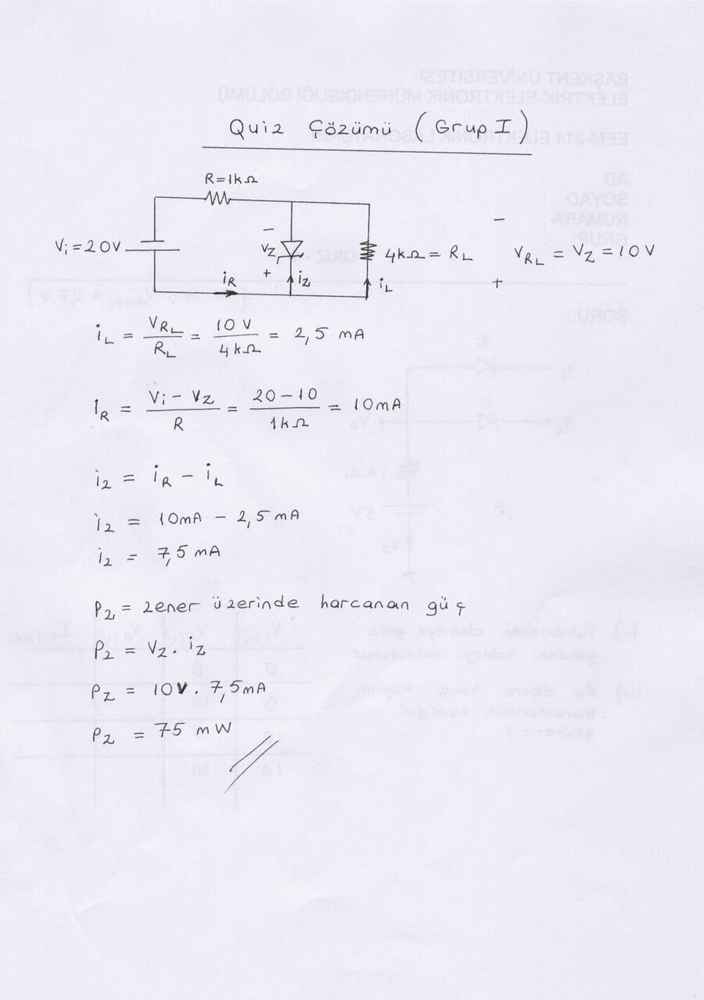

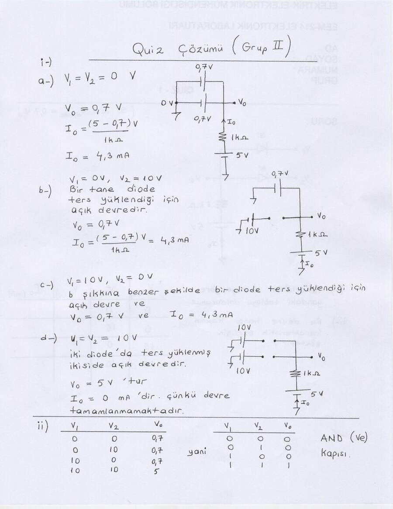

## Quiz I (Grup 3 ve 4)

Diyot durumlarının varsay-doğrula yöntemiyle bulunduğu iki devre:

- **Grup 3:** Önce iki diyot da kesimde varsayılıyor; V_D1 = 10/3 V > 0 çıktığından D1 iletimde olmalı. D1 açık, D2 kapalı varsayımıyla düğüm denklemi (V₁ − 9.3)/1k + (V₁ − 5)/1k + V₁/2k = 0 ⇒ V₁ = 5.72 V; i_D1 = 3.58 mA > 0 (D1 açık), V_D2 = −2.86 V < 0 (D2 kapalı); **V_o = 2.86 V**.
- **Grup 4:** Benzer şekilde D1 açık, D2 kapalı; (V₁ − 10)/2k + (V₁ − 5.7)/1k + V₁/8k = 0 ⇒ V₁ = 6.58 V; i_D1 = 0.885 mA, V_D2 = −0.3 V; **V_o = 3.3 V**.

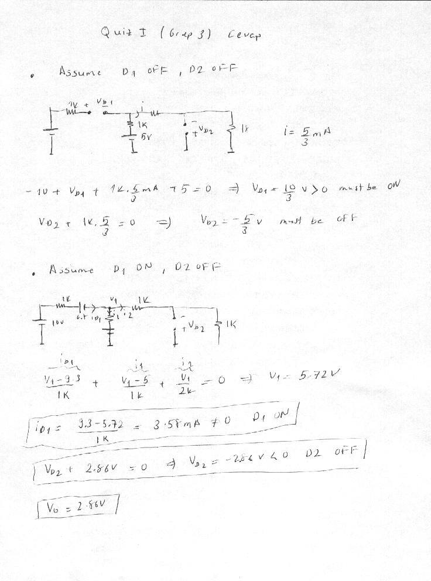

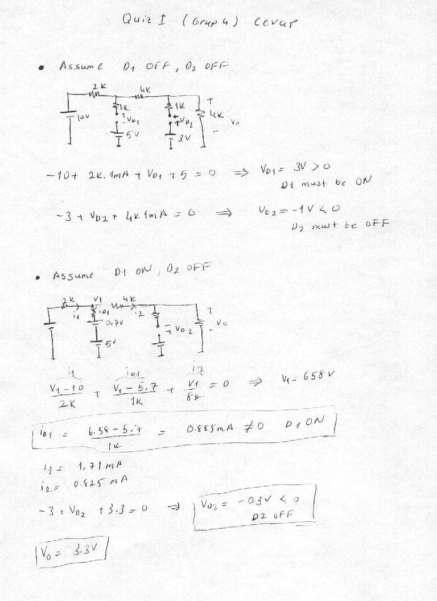

## Çalışma soruları

1. Yandaki devrenin (akım aynası beslemeli, iki transistörlü yükselteç) AC eşdeğer devresini çiziniz ve v_o/v_i = A_v ifadesini çıkarınız.
1. Aşağıdaki devrenin (Q1–Q2 fark çifti, Q3–Q4 akım aynası aktif yükü) AC eşdeğer devresini çizerek gerilim kazancının ifadesini çıkarınız.

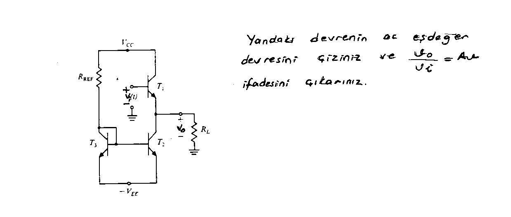

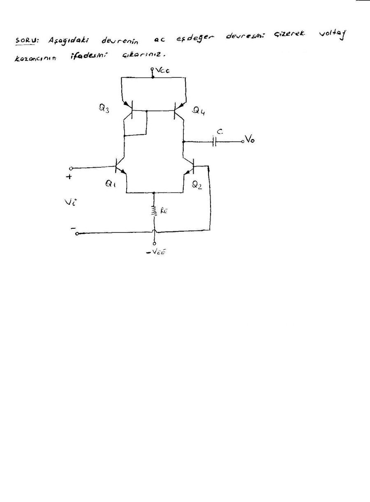

## İndirme

ZIP dosyasında ara sınavın yedi, quizlerin dört taranmış sayfası ve iki çalışma sorusu görseli bulunuyor.
