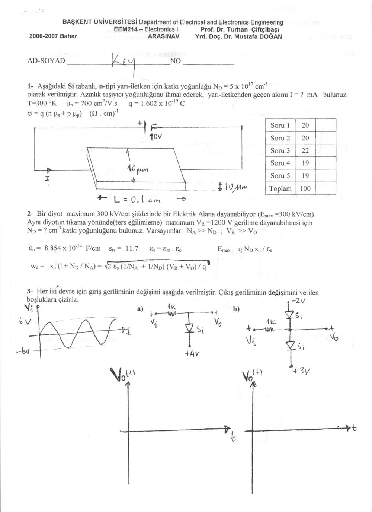
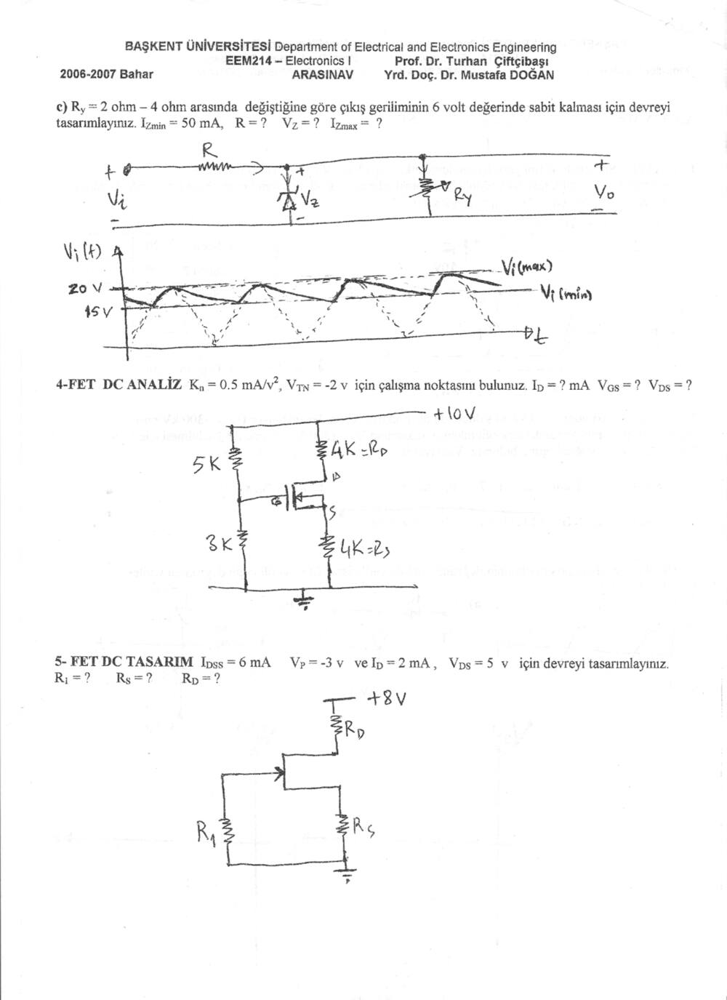
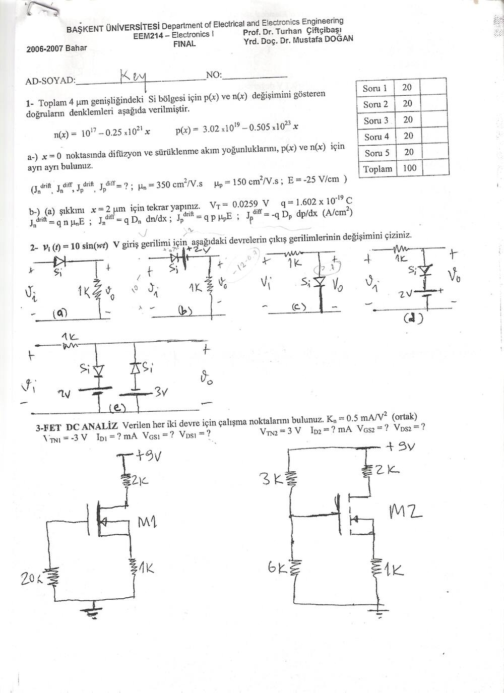
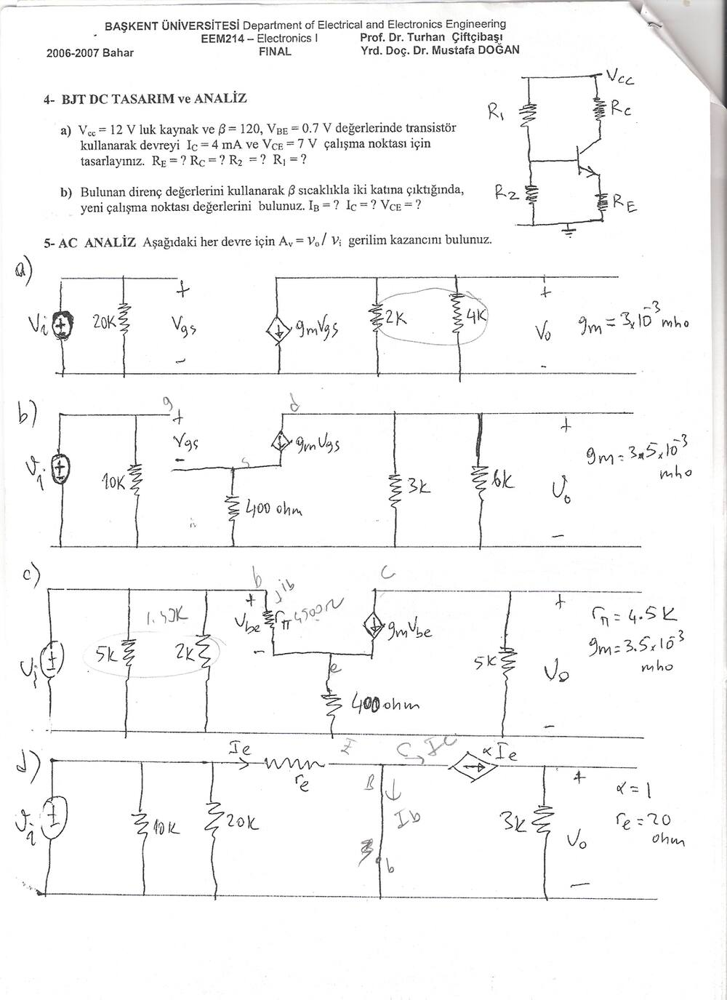
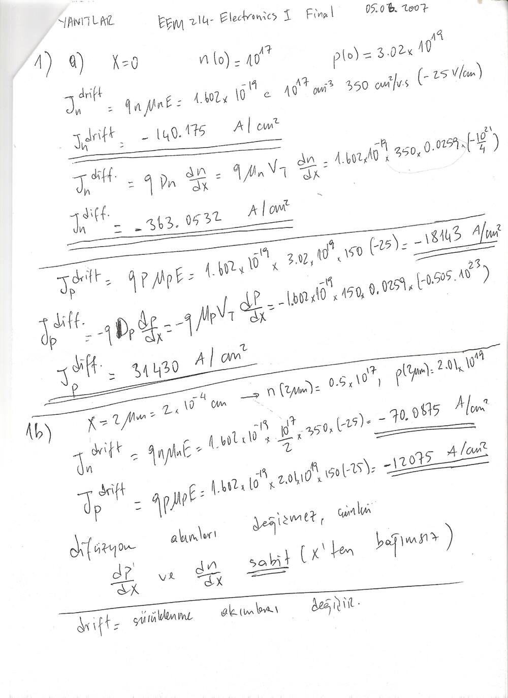
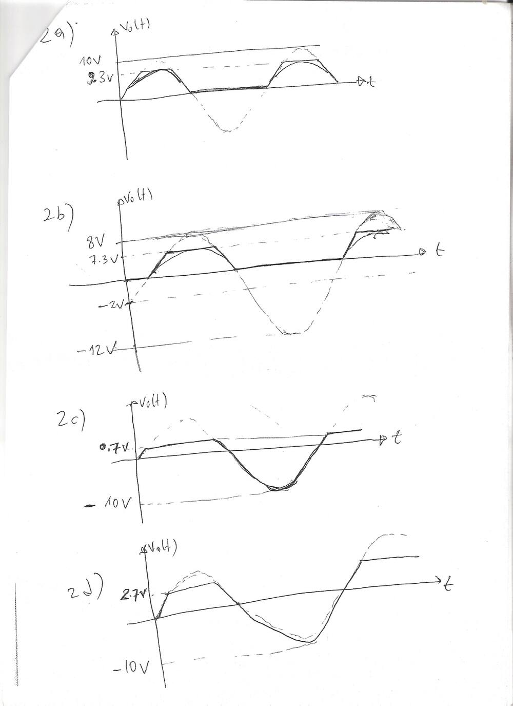
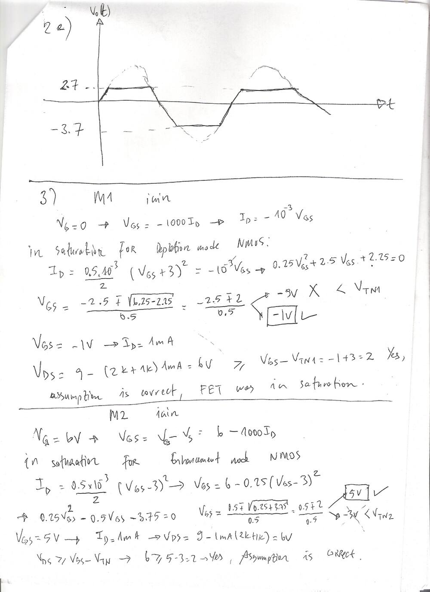
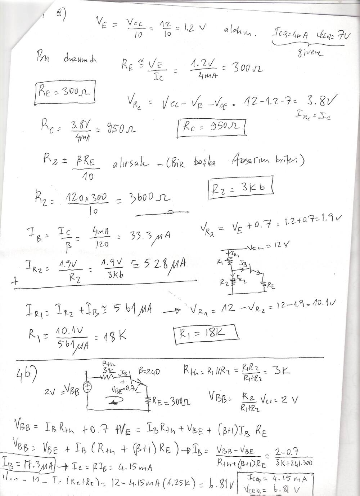
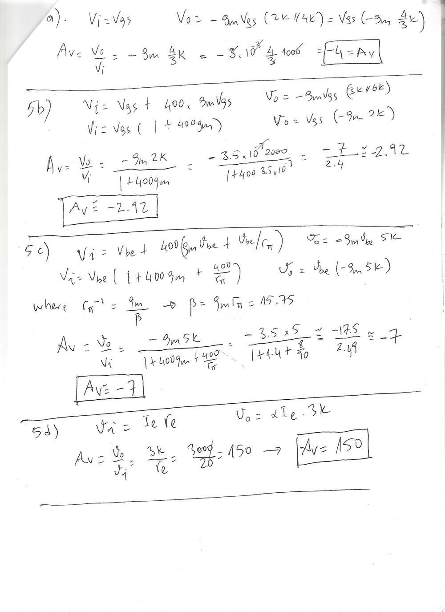
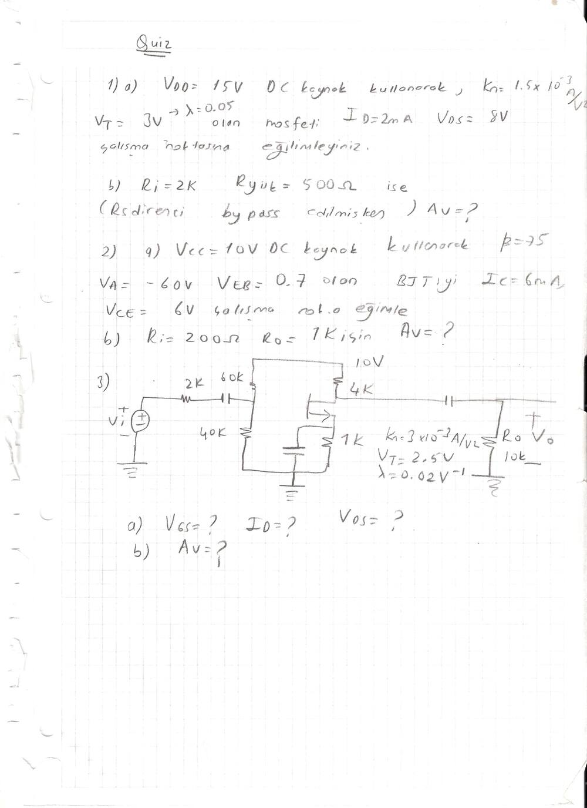

This post presents the midterm and final exam of Başkent University's **EEM214 Electronics I** course for the **2006–2007 spring** semester (instructors **Prof. Dr. Turhan Çiftçibaşı** and **Asst. Prof. Dr. Mustafa Doğan**), together with the answer keys. The documents are scanned pages: "Key" is written in the "Name-Surname" field of the exam papers and handwritten solutions are added (the final answer key is dated 05.06.2007). The questions and results have been typed out as text, and the scanned pages are also included as images. At the end, there is a quiz question page written by hand on notebook paper. The originals of the scans can be downloaded as a ZIP at the end of the post.

## Midterm (2006–2007 Spring)

Grading: Question 1 – 20, Question 2 – 20, Question 3 – 22, Question 4 – 19, Question 5 – 19 (total 100).

**1.** The doping density of an Si-based n-type semiconductor is N_D = 5 × 10¹⁷ cm⁻³. Neglecting the minority carrier density, find the current (mA) flowing through the semiconductor. T = 300 K, µ_n = 700 cm²/V·s, q = 1.602 × 10⁻¹⁹ C, σ = q(nµ_n + pµ_p). Bar: L = 0.1 cm, cross-section 10 µm × 10 µm, 10 V applied across its ends.

*Answer:* σ ≅ qµ_nN_D = 56.07 (Ω·cm)⁻¹; A = 10⁻³ cm × 10⁻³ cm = 10⁻⁶ cm²; R = L/(σA) = 10⁵/56.07 ≅ 1783 Ω; **I = 10 V / 1783 Ω ≅ 5.6 mA**.

**2.** A diode can withstand a maximum electric field of E_max = 300 kV/cm. What must N_D be so that the same diode can withstand a maximum reverse voltage of V_R = 1200 V? (N_A >> N_D, V_R >> V_0; ε₀ = 8.854 × 10⁻¹⁴ F/cm, ε_rs = 11.7, E_max = qN_Dx_n/ε_s, w_d = x_n(1 + N_D/N_A) = √[2ε_s(1/N_A + 1/N_D)(V_R + V_0)/q])

*Answer:* For N_A >> N_D, w_d ≅ x_n = √(2ε_sV_R/(qN_D)); E_max² = 2qN_DV_R/ε_s ⇒ N_D = E_max²·ε_s/(2qV_R) = (3 × 10⁵)² × 11.7 × 8.854 × 10⁻¹⁴ / (2 × 1.602 × 10⁻¹⁹ × 1200) ≅ **2.42 × 10¹⁴ cm⁻³** (w_d = 2V_R/E_max = 8 × 10⁻³ cm).

**3.** The input is a sine wave with a 6 V peak. a) Series 1 kΩ, with an Si diode and a +4 V source in parallel with the output: the output is clipped at **4.7 V**, and the negative half-cycle passes down to −6 V. b) Series 1 kΩ, with two Si diodes at the output, one connected to −2 V and the other to +3 V: the output is limited between **3.7 V** and **−2.7 V**. c) A rectifier output where V_i fluctuates between 15 V and 20 V; while the load R_y varies between 2–4 Ω, the output is to remain constant at 6 V (I_Zmin = 50 mA). R, V_Z, I_Zmax = ?

*Answer (3c):* V_Z = 6 V; i_Ymax = 6/2 = 3 A, i_R = I_Zmin + i_Ymax = 3.05 A; R = (V_i(min) − V_Z)/i_R = (15 − 6)/3.05 **≅ 3 Ω**. For I_Zmax, with V_i(max) and i_Ymin = 6/4 = 1.5 A: i_R = (20 − 6)/3 = 4.7 A, **I_Zmax = 4.7 − 1.5 = 3.2 A**.

**4. FET DC analysis:** K_n = 0.5 mA/V², V_TN = −2 V. +10 V, 5 kΩ/3 kΩ divider, R_D = 4 kΩ, R_S = 4 kΩ. I_D, V_GS, V_DS = ?

*Answer:* V_G = 3·10/8 = 3.75 V, V_GS = 3.75 − 4I_D (mA). Assuming the depletion-type NMOS is in saturation, I_D = (K_n/2)(V_GS + 2)²; V_GS² + 5V_GS + 0.25 = 0 ⇒ V_GS ≈ −0.05 V (the other root, −4.95 V < V_TN, is cutoff). **V_GS ≅ −0.05 V, I_D ≅ 0.95 mA, V_DS = 10 − 8k × 0.95 mA ≅ 2.4 V**; since V_DS > V_GS − V_TN = 1.95 V, the assumption is correct.

**5. FET DC design:** I_DSS = 6 mA, V_P = −3 V, I_D = 2 mA, V_DS = 5 V, +8 V supply, gate connected to ground through R1, R_S at the source. R1, R_S, R_D = ?

*Answer:* n-channel JFET in saturation: 2 = 6(1 + V_GS/3)² ⇒ V_GS ≅ −1.3 V; **R_S = 1.3 V / 2 mA = 650 Ω**; V_RD = 8 − 5 − 1.3 = 1.7 V ⇒ **R_D = 850 Ω**; **R1 ≥ 10 kΩ** (no gate current, so it is chosen large).

")

: question 4")

: question 5")

## Final (2006–2007 Spring)

Grading: 20 points per question.

**1.** In a Si region with a total width of 4 µm, n(x) = 10¹⁷ − 0.25 × 10²¹·x and p(x) = 3.02 × 10¹⁹ − 0.505 × 10²³·x (cm⁻³, x in cm). µ_n = 350 cm²/V·s, µ_p = 150 cm²/V·s, E = −25 V/cm, V_T = 0.0259 V. a) Find the diffusion and drift current densities at x = 0. b) Repeat for x = 2 µm.

*Answer:* a) J_n^drift = qnµ_nE = **−140.175 A/cm²**, J_n^diff = qµ_nV_T·dn/dx = **−363.05 A/cm²**, J_p^drift = qpµ_pE = **−18 143 A/cm²**, J_p^diff = −qµ_pV_T·dp/dx = **31 430 A/cm²**. b) At x = 2 µm, n = 0.5 × 10¹⁷, p = 2.01 × 10¹⁹: J_n^drift = **−70.09 A/cm²**, J_p^drift = **−12 075 A/cm²**; since dn/dx and dp/dx are constant (independent of x), the diffusion currents do not change; only the drift currents change.

**2.** Sketch the outputs for v_i(t) = 10 sin(ωt) V. Results in the answer key: a) series Si diode and 1 kΩ: positive half-cycle only, peak **9.3 V**; b) series diode and +2 V source: peak **7.3 V** (10 − 2 − 0.7), 0 in the negative half-cycle; c) Si diode in parallel with the output: clipped at **0.7 V** in the positive half-cycle, falls to −10 V in the negative half-cycle; d) parallel diode and 2 V source: clipped at **2.7 V**, −10 V in the negative half-cycle; e) two reversed diode branches with 2 V and 3 V sources: limited between **+2.7 V** and **−3.7 V**.

**3. FET DC analysis:** K_n = 0.5 mA/V² (common). M1: V_TN1 = −3 V, +9 V, R_D = 2 kΩ, R_S = 1 kΩ, gate connected to ground through 20 kΩ. M2: V_TN2 = 3 V, +9 V, 3 kΩ/6 kΩ divider, R_D = 2 kΩ, R_S = 1 kΩ.

*Answer:* M1 (depletion type): V_G = 0, I_D = −V_GS/1 kΩ; 0.25V_GS² + 2.5V_GS + 2.25 = 0 ⇒ V_GS = −1 V (−9 V < V_TN1 is rejected), **I_D1 = 1 mA, V_DS1 = 9 − 3k × 1 mA = 6 V** > V_GS − V_TN1 = 2 V, in saturation. M2 (enhancement type): V_G = 6 V, V_GS = 6 − 1000I_D; 0.25V_GS² − 0.5V_GS − 3.75 = 0 ⇒ V_GS = 5 V (−3 V is rejected), **I_D2 = 1 mA, V_DS2 = 6 V** > 5 − 3 = 2 V, in saturation.

**4. BJT DC design and analysis:** a) Design the voltage-divider biased circuit with V_CC = 12 V, β = 120, V_BE = 0.7 V for I_C = 4 mA, V_CE = 7 V. b) If β doubles with temperature, what is the new operating point?

*Answer:* a) Choosing V_E = V_CC/10 = 1.2 V gives **R_E = 300 Ω**; V_RC = 12 − 1.2 − 7 = 3.8 V ⇒ **R_C = 950 Ω**; R2 = βR_E/10 ⇒ **R2 = 3.6 kΩ**; I_B = 33.3 µA, V_R2 = 1.9 V, I_R2 ≅ 528 µA, I_R1 ≅ 561 µA, V_R1 = 10.1 V ⇒ **R1 = 18 kΩ**. b) β = 240: R_th = 18k ∥ 3.6k = 3 kΩ, V_BB = 2 V; I_B = (2 − 0.7)/(3k + 241 × 300) = **17.3 µA**, **I_C = 4.15 mA, V_CE = 12 − 4.15 mA × 1.25 kΩ = 6.81 V**. When β doubles, I_C increases by only 4%; this shows the stability of voltage-divider biasing.

**5. AC analysis:** For the given small-signal equivalent circuits, A_v = v_o/v_i = ?

*Answer:* a) Common source, g_m = 3 mS, load 2k ∥ 4k: **A_v = −g_m·(4/3) kΩ = −4**. b) Unbypassed 400 Ω at the source, g_m = 3.5 mS, load 3k ∥ 6k = 2 kΩ: **A_v = −g_m·2k/(1 + 400g_m) = −7/2.4 ≅ −2.92**. c) BJT, r_π = 4.5 kΩ, g_m = 3.5 mS, 400 Ω at the emitter, 5 kΩ at the collector: β = g_m·r_π = 15.75 and **A_v = −g_m·5k/(1 + 400g_m + 400/r_π) ≅ −17.5/2.49 ≅ −7**. d) Common base, α = 1, r_e = 20 Ω, 3 kΩ: **A_v = 3k/r_e = 150**.

## Quiz questions (handwritten)

In the same folder, there is also a quiz page written by hand on grid paper:

1. a) Using a V_DD = 15 V DC supply, bias the MOSFET with k_n = 1.5 × 10⁻³ A/V², V_T = 3 V, λ = 0.05 at the operating point I_D = 2 mA, V_DS = 8 V. b) If R_i = 2 kΩ and R_load = 500 Ω (with R_S bypassed), A_v = ?
1. a) Using a V_CC = 10 V DC supply, bias the BJT with β = 75, V_A = −60 V, V_EB = 0.7 V at the operating point I_C = 6 mA, V_CE = 6 V. b) For R_i = 200 Ω, R_o = 1 kΩ, A_v = ?
1. MOSFET amplifier with 10 V, 60 kΩ/40 kΩ divider, R_D = 4 kΩ, bypassed R_S = 1 kΩ, 2 kΩ source resistance and 10 kΩ load (k_n = 3 × 10⁻³ A/V², V_T = 2.5 V, λ = 0.02 V⁻¹): a) V_GS, I_D, V_DS = ? b) A_v = ?

## Download

The ZIP file contains five scanned pages of the midterm answer key, seven scanned pages of the final answer key, and the quiz page.
