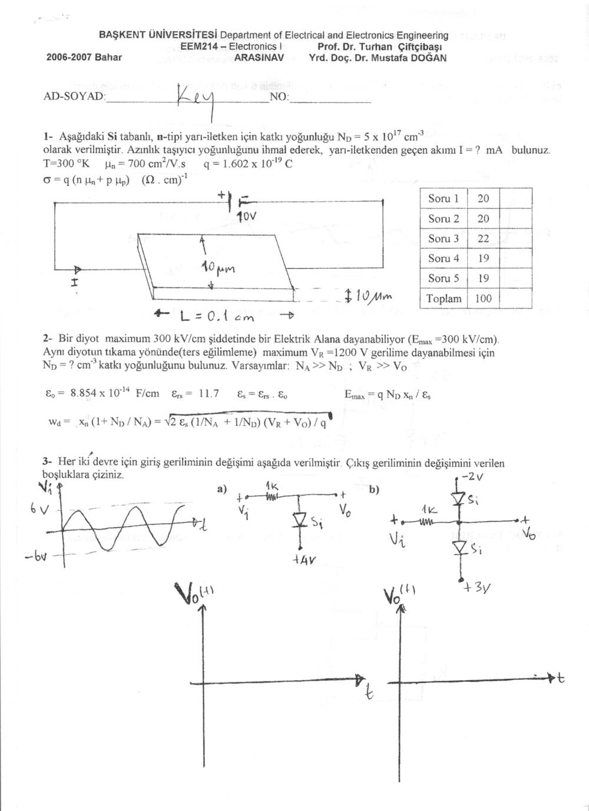
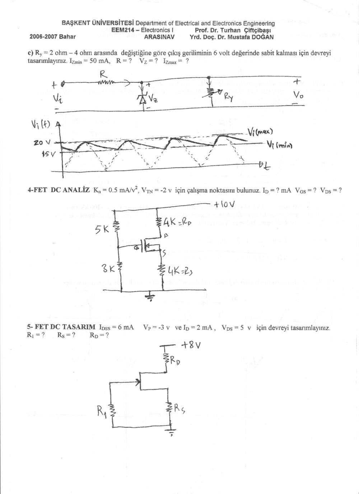
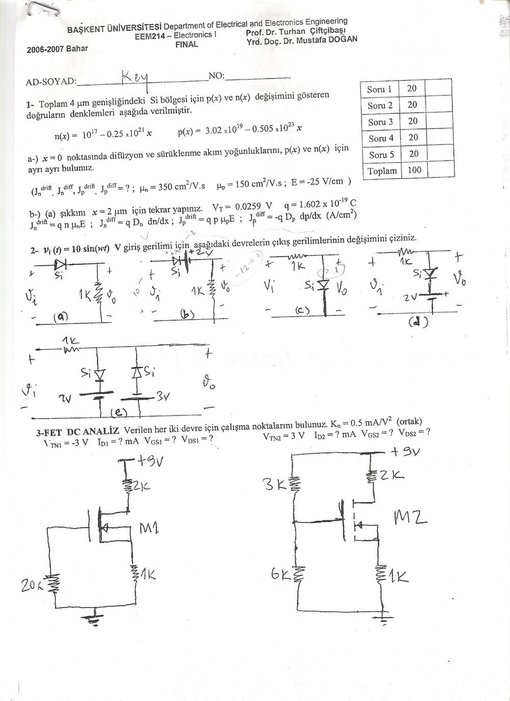
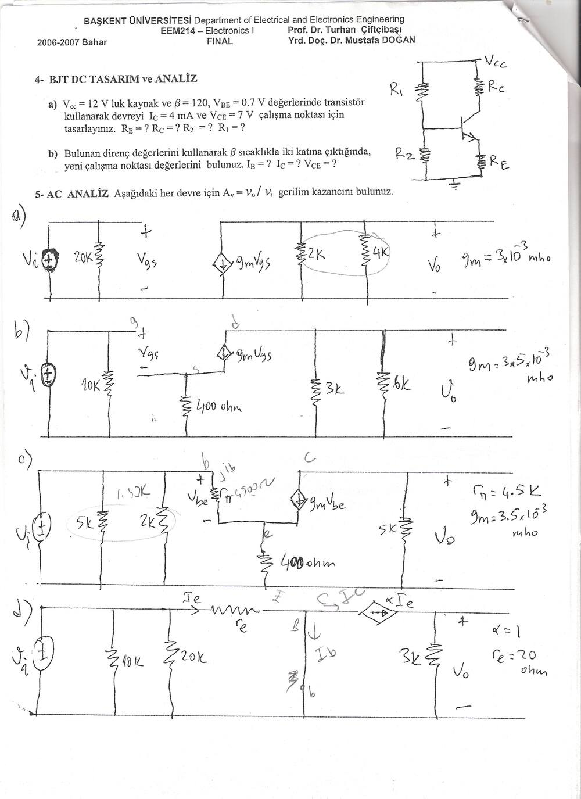
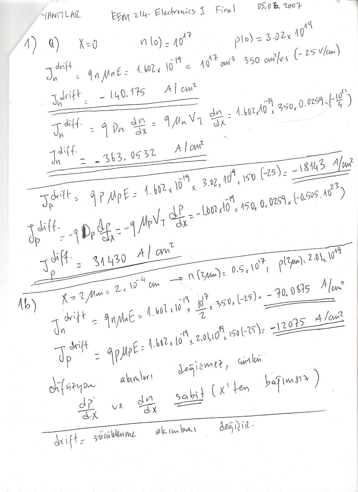
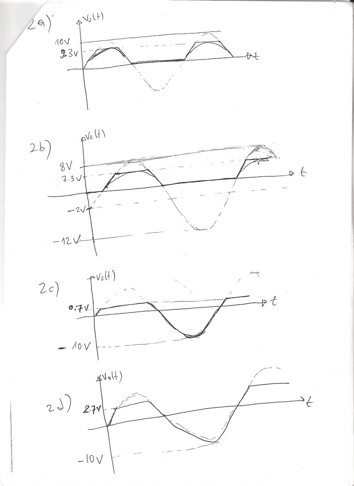
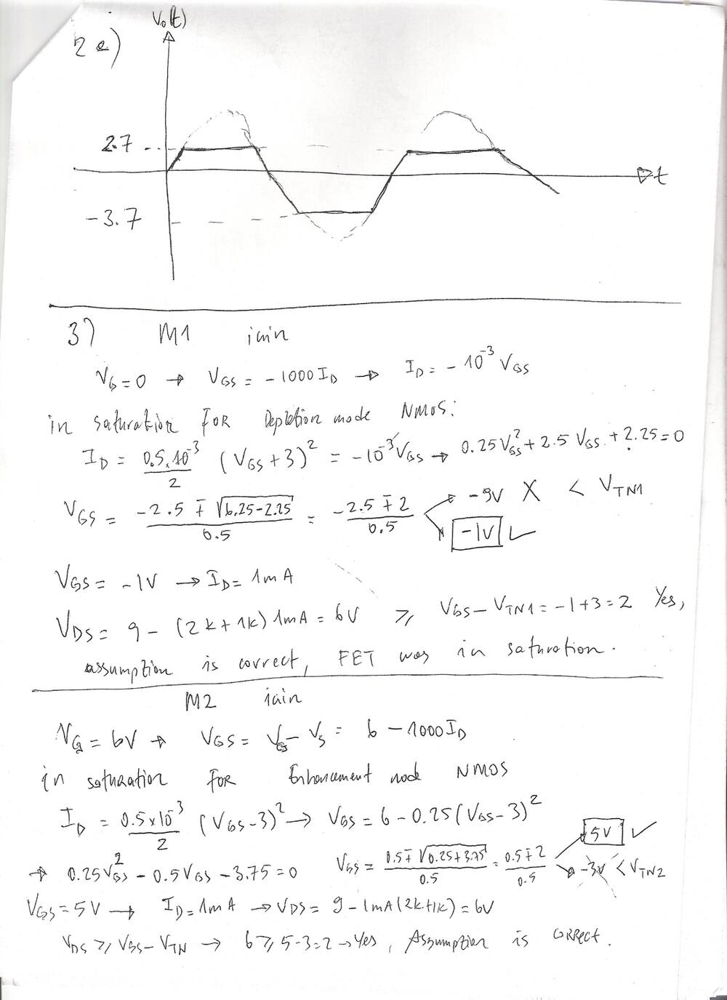
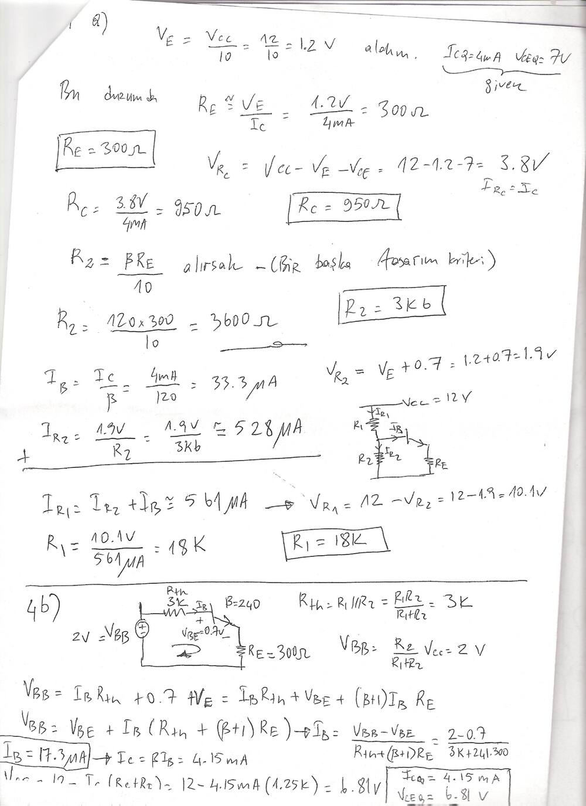
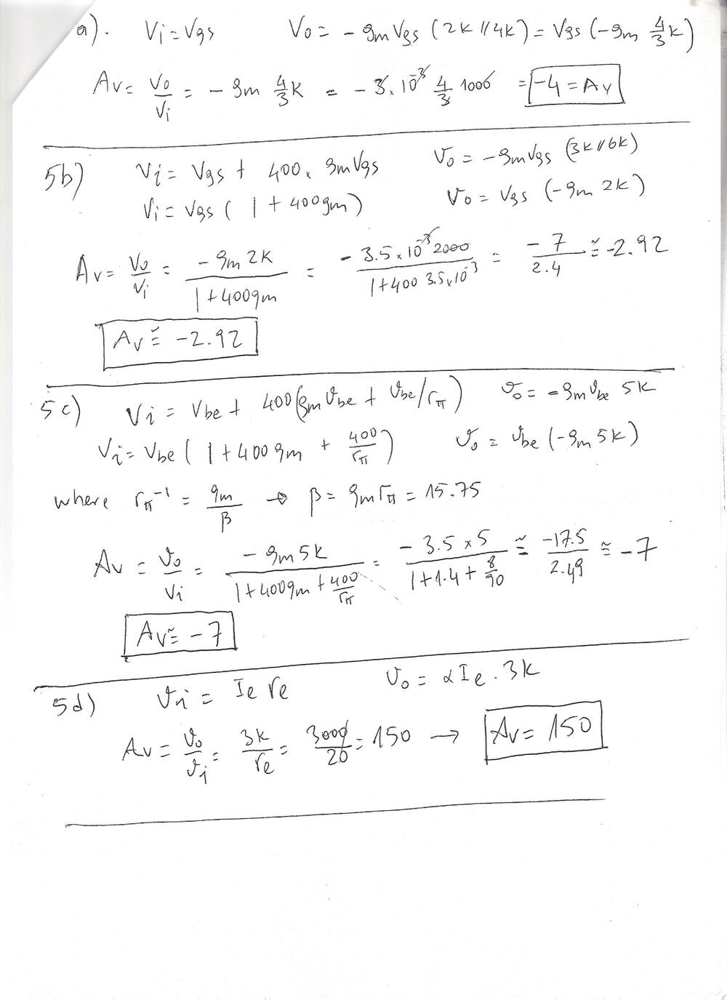
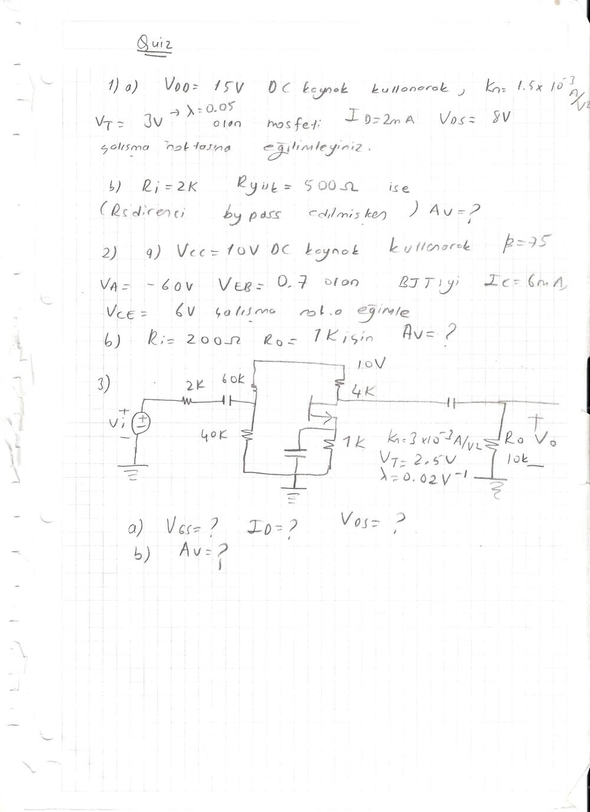

Bu yazı, Başkent Üniversitesi **EEM214 Electronics I** dersinin **2006–2007 bahar** dönemine ait ara sınav ve final sınavını (öğretim üyeleri **Prof. Dr. Turhan Çiftçibaşı** ve **Yrd. Doç. Dr. Mustafa Doğan**) cevap anahtarlarıyla birlikte aktarıyor. Belgeler tarayıcıyla taranmış sayfalar: soru kâğıtlarının "Ad-Soyad" alanına "Key" yazılmış ve el yazısı çözümler eklenmiş (final cevap anahtarı 05.06.2007 tarihli). Sorular ve sonuçlar metin olarak yazıldı, taranmış sayfalar da görsel olarak eklendi. Sonda, defter kâğıdına el yazısıyla geçirilmiş bir quiz sorusu sayfası var. Taramaların orijinalleri yazının sonunda ZIP olarak indirilebilir.

## Ara sınav (2006–2007 Bahar)

Puanlama: Soru 1 – 20, Soru 2 – 20, Soru 3 – 22, Soru 4 – 19, Soru 5 – 19 (toplam 100).

**1.** Si tabanlı n tipi yarıiletkenin katkı yoğunluğu N_D = 5 × 10¹⁷ cm⁻³. Azınlık taşıyıcı yoğunluğunu ihmal ederek yarıiletkenden geçen akımı (mA) bulunuz. T = 300 K, µ_n = 700 cm²/V·s, q = 1.602 × 10⁻¹⁹ C, σ = q(nµ_n + pµ_p). Çubuk: L = 0.1 cm, kesit 10 µm × 10 µm, uçlarına 10 V uygulanıyor.

*Cevap:* σ ≅ qµ_nN_D = 56.07 (Ω·cm)⁻¹; A = 10⁻³ cm × 10⁻³ cm = 10⁻⁶ cm²; R = L/(σA) = 10⁵/56.07 ≅ 1783 Ω; **I = 10 V / 1783 Ω ≅ 5.6 mA**.

**2.** Bir diyot en fazla E_max = 300 kV/cm elektrik alana dayanabiliyor. Aynı diyotun ters yönde en fazla V_R = 1200 V'a dayanabilmesi için N_D kaç olmalıdır? (N_A >> N_D, V_R >> V_0; ε₀ = 8.854 × 10⁻¹⁴ F/cm, ε_rs = 11.7, E_max = qN_Dx_n/ε_s, w_d = x_n(1 + N_D/N_A) = √[2ε_s(1/N_A + 1/N_D)(V_R + V_0)/q])

*Cevap:* N_A >> N_D için w_d ≅ x_n = √(2ε_sV_R/(qN_D)); E_max² = 2qN_DV_R/ε_s ⇒ N_D = E_max²·ε_s/(2qV_R) = (3 × 10⁵)² × 11.7 × 8.854 × 10⁻¹⁴ / (2 × 1.602 × 10⁻¹⁹ × 1200) ≅ **2.42 × 10¹⁴ cm⁻³** (w_d = 2V_R/E_max = 8 × 10⁻³ cm).

**3.** Giriş 6 V tepe değerli sinüs. a) Seri 1 kΩ, çıkışa paralel Si diyot ve +4 V kaynak: çıkış **4.7 V**'ta kırpılır, negatif yarı periyot −6 V'a kadar geçer. b) Seri 1 kΩ, çıkışta biri −2 V'a, diğeri +3 V'a bağlı iki Si diyot: çıkış **3.7 V** ve **−2.7 V** arasında sınırlanır. c) V_i, 15 V ile 20 V arasında dalgalanan bir doğrultucu çıkışı; R_y yükü 2–4 Ω arasında değişirken çıkış 6 V'ta sabit kalsın (I_Zmin = 50 mA). R, V_Z, I_Zmax = ?

*Cevap (3c):* V_Z = 6 V; i_Ymax = 6/2 = 3 A, i_R = I_Zmin + i_Ymax = 3.05 A; R = (V_i(min) − V_Z)/i_R = (15 − 6)/3.05 **≅ 3 Ω**. I_Zmax için V_i(max) ve i_Ymin = 6/4 = 1.5 A: i_R = (20 − 6)/3 = 4.7 A, **I_Zmax = 4.7 − 1.5 = 3.2 A**.

**4. FET DC analiz:** K_n = 0.5 mA/V², V_TN = −2 V. +10 V, 5 kΩ/3 kΩ bölücü, R_D = 4 kΩ, R_S = 4 kΩ. I_D, V_GS, V_DS = ?

*Cevap:* V_G = 3·10/8 = 3.75 V, V_GS = 3.75 − 4I_D (mA). Azaltıcı tip NMOS doyumda varsayılarak I_D = (K_n/2)(V_GS + 2)²; V_GS² + 5V_GS + 0.25 = 0 ⇒ V_GS ≈ −0.05 V (diğer kök −4.95 V < V_TN, kesim). **V_GS ≅ −0.05 V, I_D ≅ 0.95 mA, V_DS = 10 − 8k × 0.95 mA ≅ 2.4 V**; V_DS > V_GS − V_TN = 1.95 V olduğundan varsayım doğru.

**5. FET DC tasarım:** I_DSS = 6 mA, V_P = −3 V, I_D = 2 mA, V_DS = 5 V, +8 V besleme, kapı R1 ile toprağa, kaynakta R_S. R1, R_S, R_D = ?

*Cevap:* n kanallı JFET doyumda: 2 = 6(1 + V_GS/3)² ⇒ V_GS ≅ −1.3 V; **R_S = 1.3 V / 2 mA = 650 Ω**; V_RD = 8 − 5 − 1.3 = 1.7 V ⇒ **R_D = 850 Ω**; **R1 ≥ 10 kΩ** (kapı akımı yok, büyük seçilir).

")

: soru 4")

: soru 5")

## Final (2006–2007 Bahar)

Puanlama: her soru 20 puan.

**1.** Toplam 4 µm genişliğindeki bir Si bölgede n(x) = 10¹⁷ − 0.25 × 10²¹·x ve p(x) = 3.02 × 10¹⁹ − 0.505 × 10²³·x (cm⁻³, x cm cinsinden). µ_n = 350 cm²/V·s, µ_p = 150 cm²/V·s, E = −25 V/cm, V_T = 0.0259 V. a) x = 0'da difüzyon ve sürüklenme akım yoğunluklarını bulunuz. b) x = 2 µm için tekrarlayınız.

*Cevap:* a) J_n^drift = qnµ_nE = **−140.175 A/cm²**, J_n^diff = qµ_nV_T·dn/dx = **−363.05 A/cm²**, J_p^drift = qpµ_pE = **−18 143 A/cm²**, J_p^diff = −qµ_pV_T·dp/dx = **31 430 A/cm²**. b) x = 2 µm'de n = 0.5 × 10¹⁷, p = 2.01 × 10¹⁹: J_n^drift = **−70.09 A/cm²**, J_p^drift = **−12 075 A/cm²**; dn/dx ve dp/dx sabit (x'ten bağımsız) olduğundan difüzyon akımları değişmez, yalnız sürüklenme akımları değişir.

**2.** v_i(t) = 10 sin(ωt) V için çıkışları çiziniz. Cevap anahtarındaki sonuçlar: a) seri Si diyot ve 1 kΩ: yalnız pozitif yarı periyot, tepe **9.3 V**; b) seri diyot ve +2 V kaynak: tepe **7.3 V** (10 − 2 − 0.7), negatifte 0; c) çıkışa paralel Si diyot: pozitifte **0.7 V**'ta kırpılır, negatifte −10 V'a iner; d) paralel diyot ve 2 V kaynak: **2.7 V**'ta kırpılır, negatifte −10 V; e) 2 V ve 3 V kaynaklı iki ters diyot kolu: **+2.7 V** ve **−3.7 V** arasında sınırlanır.

**3. FET DC analiz:** K_n = 0.5 mA/V² (ortak). M1: V_TN1 = −3 V, +9 V, R_D = 2 kΩ, R_S = 1 kΩ, kapı 20 kΩ ile toprağa. M2: V_TN2 = 3 V, +9 V, 3 kΩ/6 kΩ bölücü, R_D = 2 kΩ, R_S = 1 kΩ.

*Cevap:* M1 (azaltıcı tip): V_G = 0, I_D = −V_GS/1 kΩ; 0.25V_GS² + 2.5V_GS + 2.25 = 0 ⇒ V_GS = −1 V (−9 V < V_TN1 reddedilir), **I_D1 = 1 mA, V_DS1 = 9 − 3k × 1 mA = 6 V** > V_GS − V_TN1 = 2 V, doyumda. M2 (zenginleştirilmiş tip): V_G = 6 V, V_GS = 6 − 1000I_D; 0.25V_GS² − 0.5V_GS − 3.75 = 0 ⇒ V_GS = 5 V (−3 V reddedilir), **I_D2 = 1 mA, V_DS2 = 6 V** > 5 − 3 = 2 V, doyumda.

**4. BJT DC tasarım ve analiz:** a) V_CC = 12 V, β = 120, V_BE = 0.7 V ile gerilim bölücü kutuplamalı devreyi I_C = 4 mA, V_CE = 7 V için tasarlayınız. b) β sıcaklıkla iki katına çıkarsa yeni çalışma noktası?

*Cevap:* a) V_E = V_CC/10 = 1.2 V seçilerek **R_E = 300 Ω**; V_RC = 12 − 1.2 − 7 = 3.8 V ⇒ **R_C = 950 Ω**; R2 = βR_E/10 ⇒ **R2 = 3.6 kΩ**; I_B = 33.3 µA, V_R2 = 1.9 V, I_R2 ≅ 528 µA, I_R1 ≅ 561 µA, V_R1 = 10.1 V ⇒ **R1 = 18 kΩ**. b) β = 240: R_th = 18k ∥ 3.6k = 3 kΩ, V_BB = 2 V; I_B = (2 − 0.7)/(3k + 241 × 300) = **17.3 µA**, **I_C = 4.15 mA, V_CE = 12 − 4.15 mA × 1.25 kΩ = 6.81 V**. β iki katına çıkınca I_C yalnızca %4 kadar artıyor; gerilim bölücü kutuplamanın kararlılığı.

**5. AC analiz:** Verilen küçük sinyal eşdeğer devrelerinde A_v = v_o/v_i = ?

*Cevap:* a) Ortak kaynak, g_m = 3 mS, yük 2k ∥ 4k: **A_v = −g_m·(4/3) kΩ = −4**. b) Kaynakta köprülenmemiş 400 Ω, g_m = 3.5 mS, yük 3k ∥ 6k = 2 kΩ: **A_v = −g_m·2k/(1 + 400g_m) = −7/2.4 ≅ −2.92**. c) BJT, r_π = 4.5 kΩ, g_m = 3.5 mS, emetörde 400 Ω, kolektörde 5 kΩ: β = g_m·r_π = 15.75 ve **A_v = −g_m·5k/(1 + 400g_m + 400/r_π) ≅ −17.5/2.49 ≅ −7**. d) Ortak baz, α = 1, r_e = 20 Ω, 3 kΩ: **A_v = 3k/r_e = 150**.

## Quiz soruları (el yazısı)

Aynı klasörde, kareli kâğıda el yazısıyla geçirilmiş bir quiz sayfası da var:

1. a) V_DD = 15 V DC kaynak kullanarak k_n = 1.5 × 10⁻³ A/V², V_T = 3 V, λ = 0.05 olan MOSFET'i I_D = 2 mA, V_DS = 8 V çalışma noktasına kutuplayınız. b) R_i = 2 kΩ, R_yük = 500 Ω ise (R_S köprülenmişken) A_v = ?
1. a) V_CC = 10 V DC kaynak kullanarak β = 75, V_A = −60 V, V_EB = 0.7 V olan BJT'yi I_C = 6 mA, V_CE = 6 V çalışma noktasına kutuplayınız. b) R_i = 200 Ω, R_o = 1 kΩ için A_v = ?
1. 10 V, 60 kΩ/40 kΩ bölücü, R_D = 4 kΩ, köprülenmiş R_S = 1 kΩ, 2 kΩ kaynak direnci ve 10 kΩ yüklü MOSFET yükselteci (k_n = 3 × 10⁻³ A/V², V_T = 2.5 V, λ = 0.02 V⁻¹): a) V_GS, I_D, V_DS = ? b) A_v = ?

## İndirme

ZIP dosyasında ara sınav cevap anahtarının beş, final cevap anahtarının yedi taranmış sayfası ve quiz sayfası bulunuyor.
