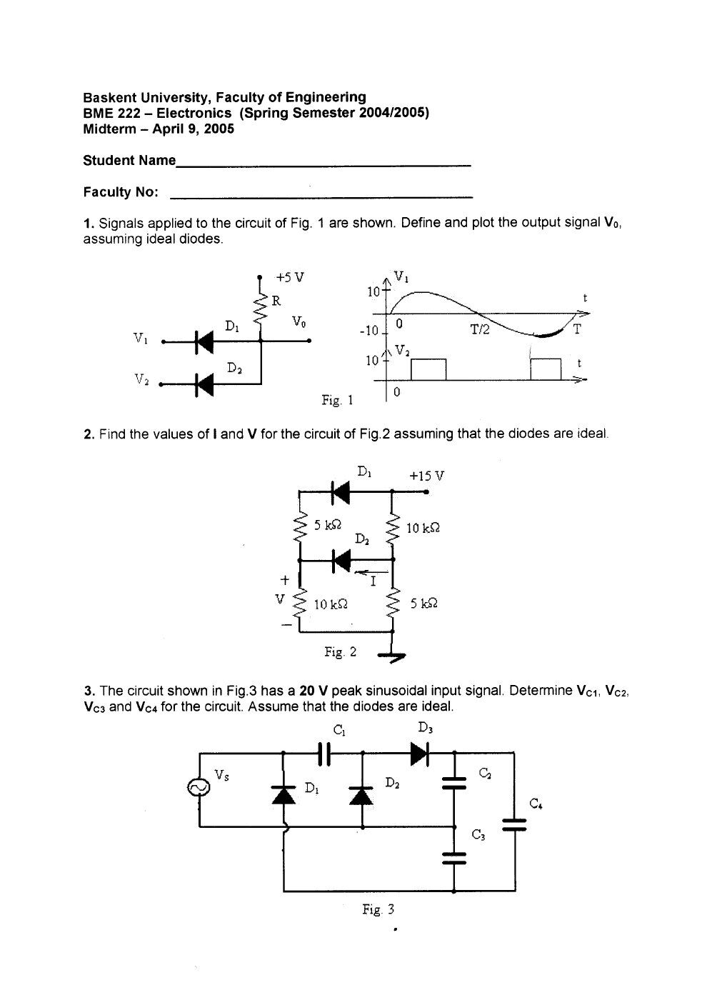
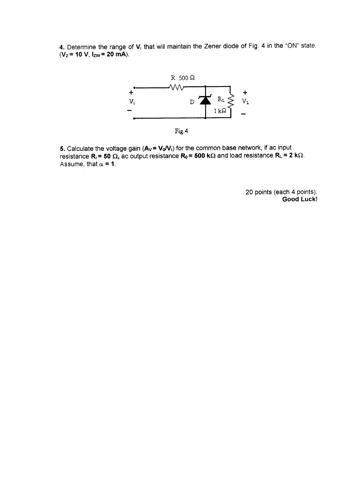
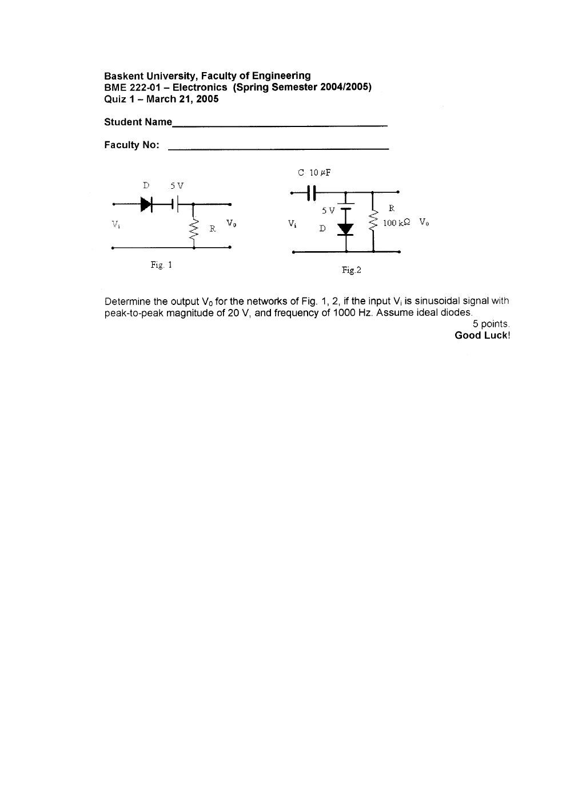
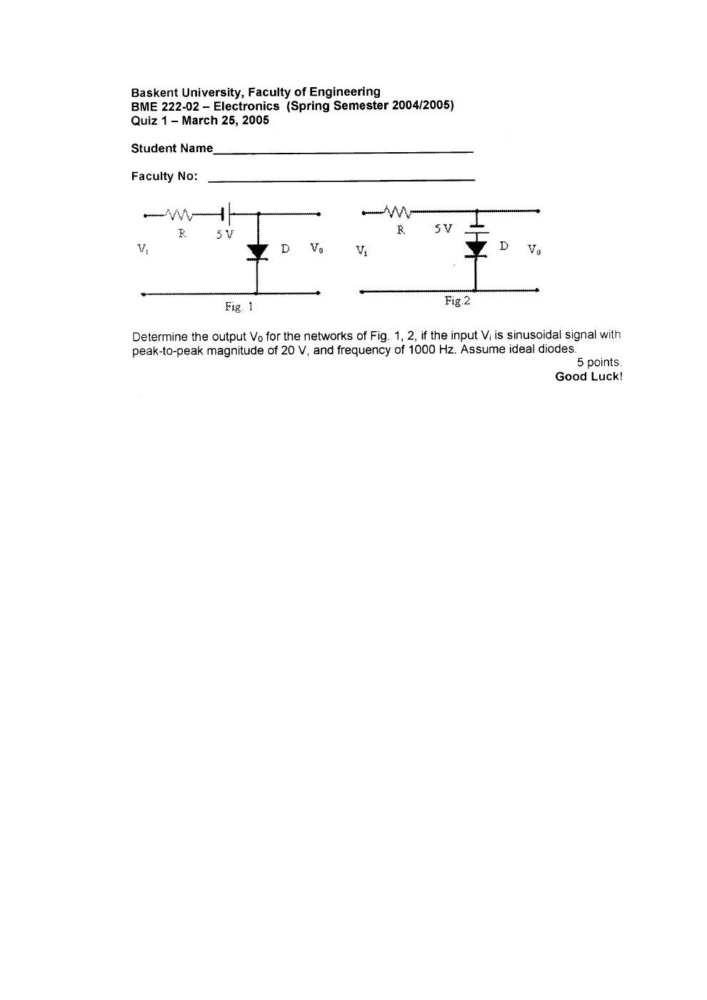
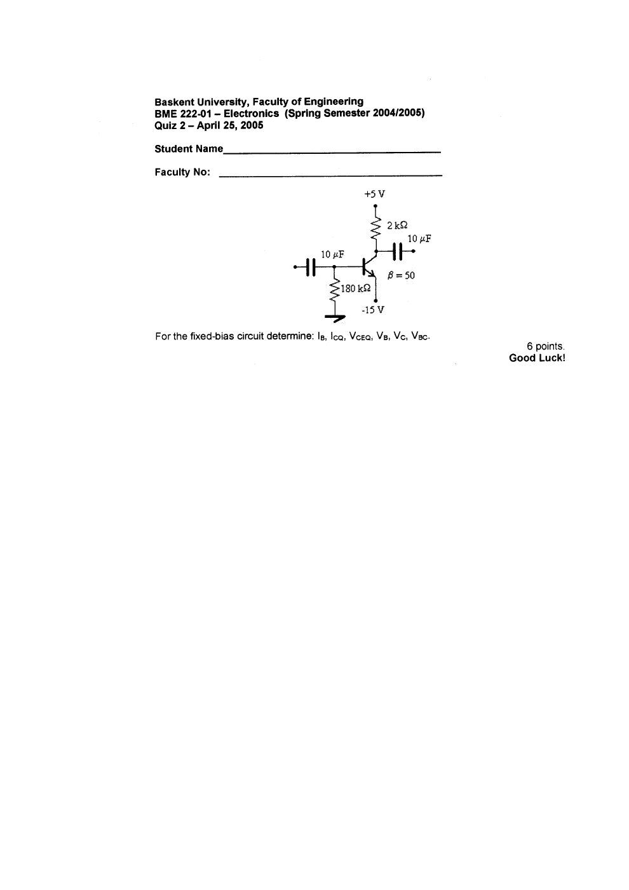
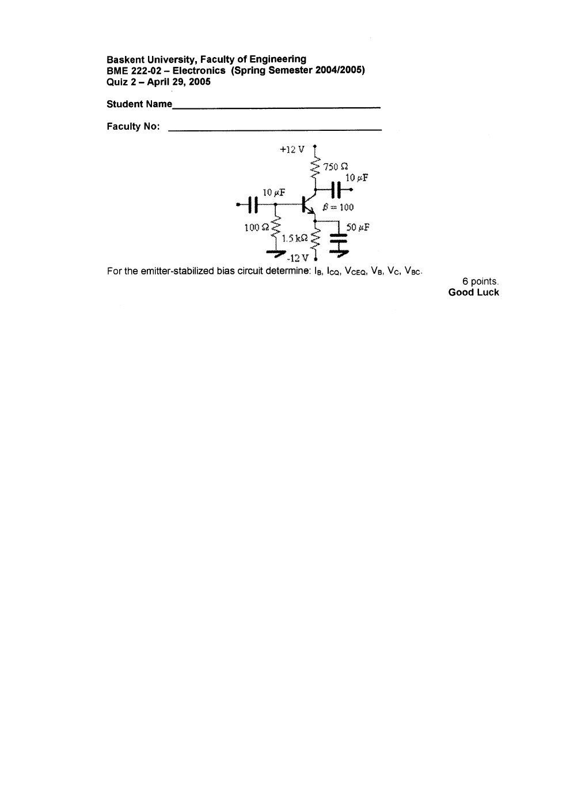
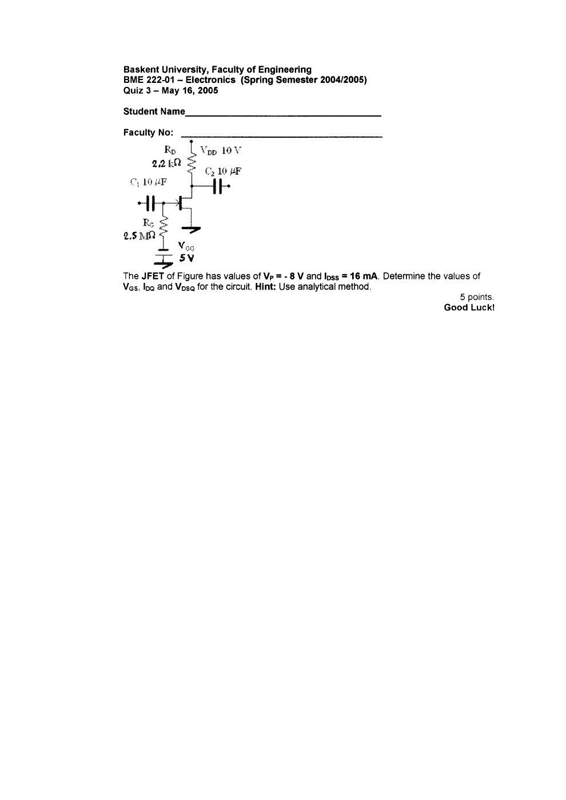
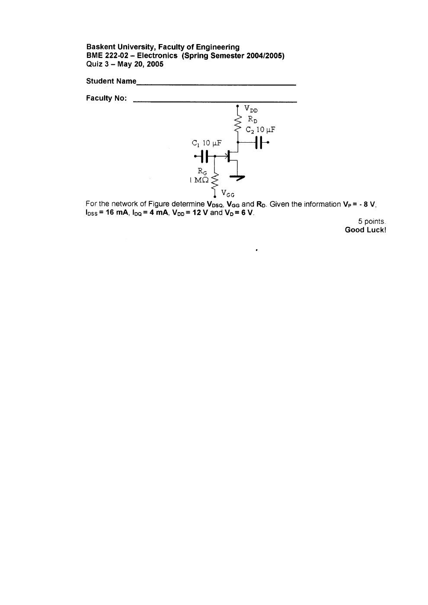

This post contains the midterm exam and three quizzes from each of the two sections of the **Başkent University BME222 Electronics** course, from the 2004–2005 spring semester, stored in the EEM214 Electronics I folder. The author is not named; the documents carry dates from 21 March to 20 May 2005. The scanned question and handwritten solution pages were transcribed into text; the seven PDFs can be downloaded as a ZIP at the end of the post. The documents' course code is BME222; they are under EEM214 because of the source folder.

*This content belongs to a third-party source; it is shared for archival and nostalgic purposes with the source credited. It will be removed at the request of the rights holder.*

## Midterm exam — 9 April 2005

There are five questions, each worth 20 points. The diodes are assumed to be ideal.

### Question 1: Output of the circuit with two diodes

An output node connected through a resistor to 5 V is connected through two diodes to the inputs V₁ and V₂. V₁ is a ±10 V sinusoid; V₂ is a square wave varying between 0 and 10 V. The waveform V_o(t) is requested.

In the solution graph, the output is determined by the smaller of the inputs and by the effect of the 5 V supply limit:

V_o(t) = min[5 V, V₁(t), V₂(t)].

When V₂ = 0, the positive input portions are limited to 0 V; when V₂ = 10 V, the upper limit of the output is 5 V. The negative portion of V₁ passes through to the output.

### Question 2: I and V

In the circuit with a 15 V supply, two diodes, and 5 kΩ–10 kΩ resistors, I and V are requested. In the solution, D₁ is conducting and D₂ is cut off. The voltage divider on the left branch gives:

V = 15 × 10/(5 + 10) = **10 V**.

Since there is also 10 V across the lower-right 5 kΩ, there is no voltage across D₂ to make it conduct; the result given is **I = 0 A**.

### Question 3: Voltage tripler

The peak value of the input sinusoid is V_m = 20 V. With ideal diodes, the voltages of C₁, C₂, C₃ and the total C₄ are requested. Solution:

- C₁ and C₃ charge to V_m = 20 V in separate half-cycles.
- C₂ charges to 2V_m = 40 V through D₃.
- The output across C₄ from the series combination of C₂ and C₃ is **V_C4 = 3V_m = 60 V**.

### Question 4: Input range over which the Zener operates

R = 500 Ω, R_L = 1 kΩ, V_Z = 10 V and I_ZM = 20 mA. At the lower limit, I_Z = 0:

V_i,min = [(R_L + R)/R_L]V_Z = **15 V**.

The load current is I_L = 10 V/1 kΩ = 10 mA. At the upper limit, I_R,max = I_ZM + I_L = 30 mA:

V_i,max = I_R,max R + V_Z = **25 V**.

Thus, in the ideal model, the limit values are 15–25 V; for full conduction, the input stays above the lower limit.

### Question 5: Gain of the common-base amplifier

Given: R_i = 50 Ω, R_o = 500 kΩ, R_L = 2 kΩ, α = 1. Using the fact that R_o is large compared to the load, the solution gives:

I_i = V_i/50, I_o ≈ I_i, V_o ≈ I_o R_L = 40V_i, **A_v ≈ +40**.

*Note: The solution neglects R_o = 500 kΩ. If the finite output resistance is taken into account, A_v = α(R_o ∥ R_L)/R_i ≈ 39.84.*

## Quiz 1 — Diode clippers and clampers

Each section's question is worth 5 points. The input is a 20 V peak-to-peak, 1 kHz sinusoid; the diodes are ideal.

### BME222-01 — 21 March 2005

The first circuit consists of a series diode, a 5 V source and a load resistor. The transition level is V_i = −5 V. The solution finds V_o = 5 V for V_i = 0 and V_o = 15 V for V_i = 10 V. The lower part of the output is limited at zero:

V_o = max(0, V_i + 5 V).

The second circuit has C = 10 µF, R = 100 kΩ and a 5 V bias. The time constant is τ = RC = 1 s and the signal period is T = 1 ms. Since τ ≫ T, the capacitor voltage is approximately preserved. At the positive peak, C charges to 5 V; the output swings between +5 V and −15 V.

### BME222-02 — 25 March 2005

In the first circuit, the diode after the series resistor and the 5 V source limits the output to zero. The transition is at V_i = −5 V; at the negative peak, V_o = −5 V. In the second circuit, the output after the series resistor is clipped at the −5 V level by the 5 V source and the diode branch. The waveforms in the solution are, respectively:

- Figure 1: V_o = min(0, V_i + 5 V).
- Figure 2: V_o = min(−5 V, V_i).

## Quiz 2 — BJT DC analysis

Each question is worth 6 points; I_B, I_CQ, V_CEQ, V_B, V_C and V_BC are requested. In DC analysis, coupling and bypass capacitors are open circuits.

### BME222-01 — 25 April 2005

Circuit: the collector is connected to +5 V through 2 kΩ, the emitter to −15 V, and the base to ground through 180 kΩ; β = 50. The solution takes V_BE = 0.7 V:

- I_B = (15 − 0.7)/180 kΩ ≈ **79 µA**.
- I_CQ = βI_B ≈ **3.95 mA**.
- V_CEQ = 20 − I_CQ·2 kΩ = **12.1 V**.
- V_B = −I_B·180 kΩ = **−14.22 V**.
- V_C = −15 + 12.1 = **−2.9 V**.
- V_BC = V_B − V_C = **−11.32 V**.

*Note: These are the rounded values in the solution. Without rounding in the intermediate steps, I_B ≈ 79.44 µA, I_C ≈ 3.972 mA, V_B = −14.3 V and V_C ≈ −2.944 V are obtained.*

### BME222-02 — 29 April 2005

Circuit: ±12 V supplies, R_C = 750 Ω, R_E = 1.5 kΩ, R_B = 100 Ω and β = 100. Solution:

I_B = (12 − 0.7)/[100 + 101·1500] ≈ **74.5 µA**.

- V_B = −I_B R_B = **−7.45 mV**.
- I_CQ = βI_B = **7.45 mA**.
- With the approximation I_E ≈ I_C, V_CEQ = 24 − I_C(R_C + R_E) = **7.24 V**.
- V_C = 12 − I_CR_C = **6.41 V**.
- V_BC ≈ **−6.42 V**.

*Note: In the V_CE step of the solution, the approximation I_E ≈ I_C is used. With I_E = (β + 1)I_B and without intermediate rounding, V_CE comes out to approximately 7.15 V.*

## Quiz 3 — JFET operating point

Each question is worth 5 points. The basic relation is the Shockley equation:

I_D = I_DSS(1 − V_GS/V_P)².

### BME222-01 — 16 May 2005

V_P = −8 V, I_DSS = 16 mA, V_DD = 10 V, R_D = 2.2 kΩ, R_G = 2.5 MΩ and V_GG = 5 V. Since the gate current is taken as zero:

- V_GSQ = −V_GG = **−5 V**.
- I_DQ = 16 mA·[1 − (−5)/(−8)]² = **2.25 mA**.
- V_DSQ = 10 − 2.25 mA·2.2 kΩ = **5.05 V**.

### BME222-02 — 20 May 2005

Given V_P = −8 V, I_DSS = 16 mA, I_DQ = 4 mA, V_DD = 12 V and V_D = 6 V. V_DSQ, V_GG and R_D are requested.

- V_GS = V_P[1 − √(I_D/I_DSS)] = **−4 V**.
- V_GG = **4 V**.
- Since the source is grounded, V_DSQ = **6 V**.
- R_D = (12 − 6)/4 mA = **1.5 kΩ**.

