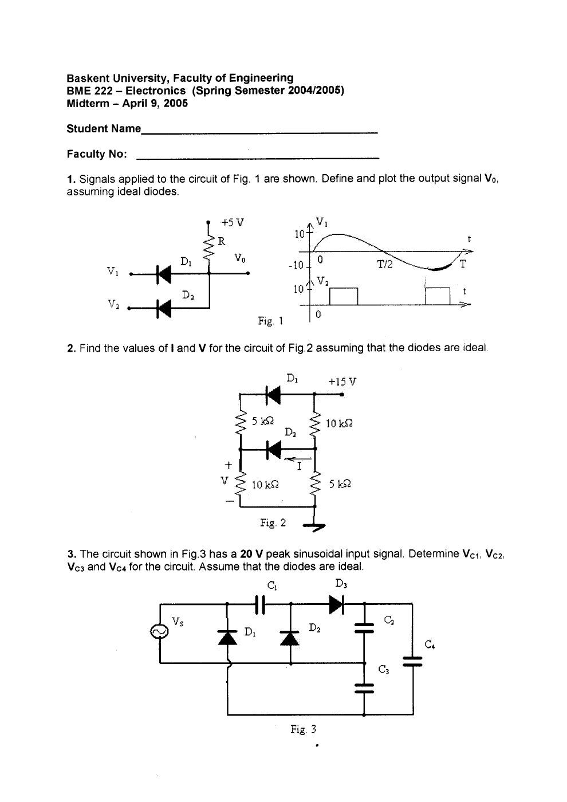
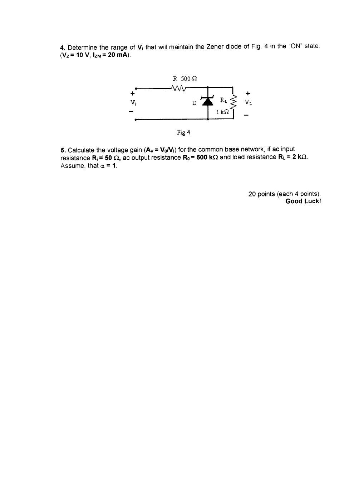
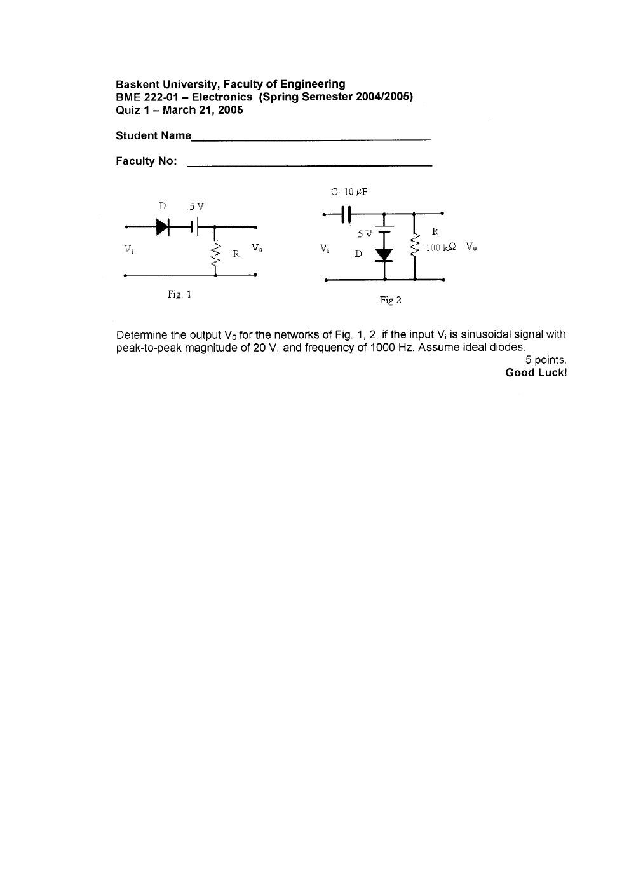
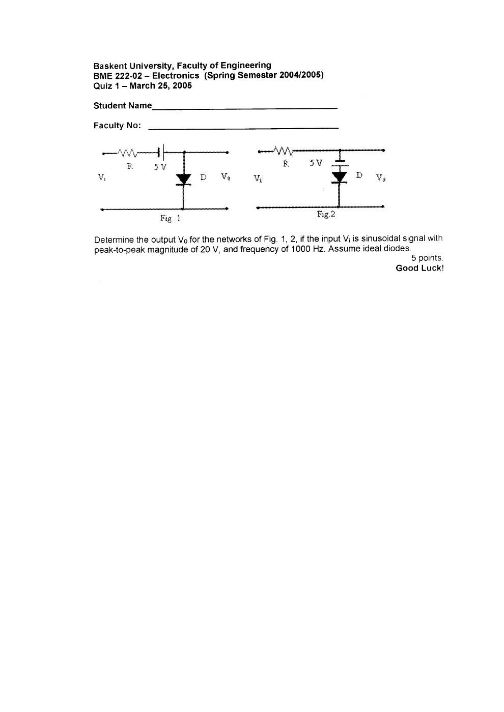
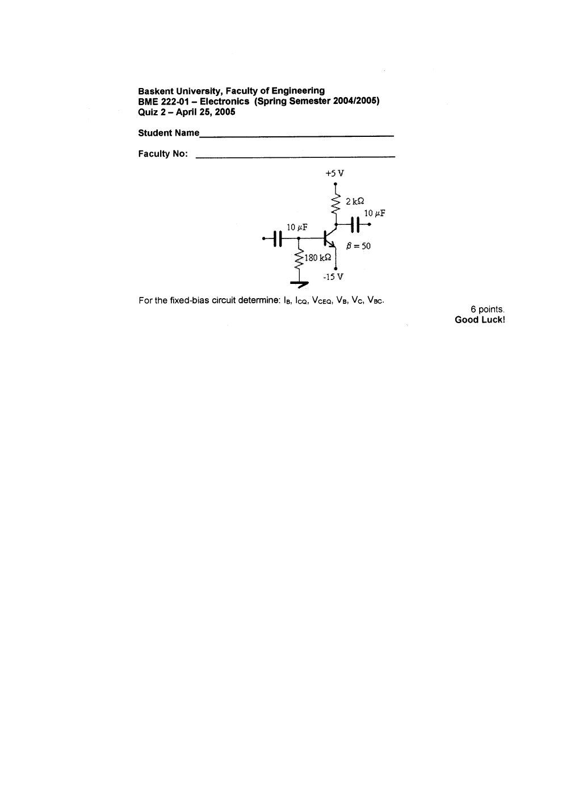
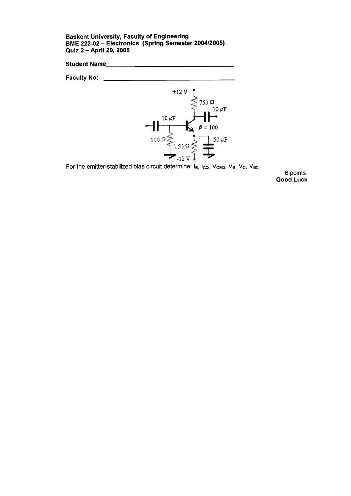
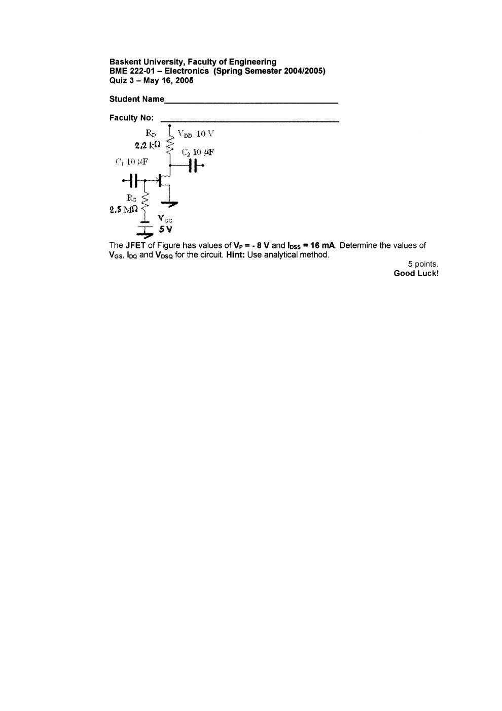
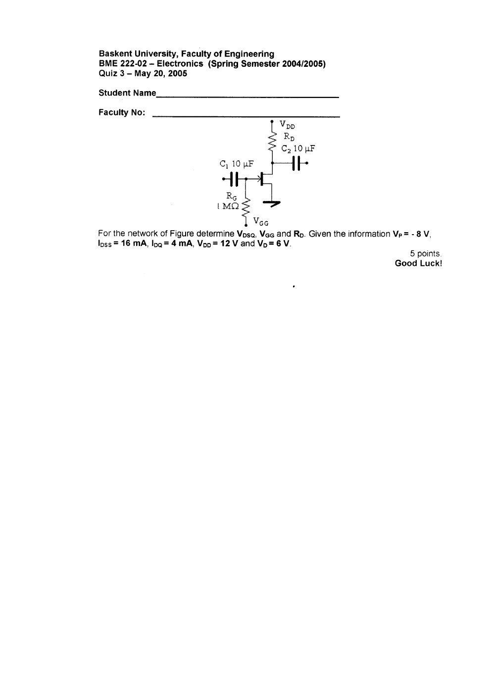

Bu yazı, EEM214 Elektronik I klasöründe saklanan, **Başkent Üniversitesi BME222 Electronics** dersinin 2004–2005 bahar dönemine ait ara sınavını ve iki şubenin üçer quizini içeriyor. Hazırlayan adı belirtilmemiş; belgelerde 21 Mart–20 Mayıs 2005 tarihleri bulunuyor. Taranmış soru ve el yazısı çözüm sayfaları metne aktarıldı; yedi PDF yazının sonunda ZIP olarak indirilebilir. Belgelerin ders kodu BME222’dir; EEM214 altında bulunmalarının nedeni kaynak klasörüdür.

*Bu içerik üçüncü taraf bir kaynağa aittir; arşiv ve nostalji amacıyla kaynak belirtilerek paylaşılmıştır. Hak sahibinin talebi hâlinde kaldırılır.*

## Ara sınav — 9 Nisan 2005

Beş soru vardır; her biri 20 puandır. Diyotlar ideal kabul edilmiştir.

### Soru 1: İki diyotlu devrede çıkış

5 V’a dirençle bağlı çıkış düğümü, iki diyot üzerinden V₁ ve V₂ girişlerine bağlanır. V₁, ±10 V sinüstür; V₂ ise 0–10 V arasında değişen dikdörtgen işarettir. İstenen V_o(t) dalga şeklidir.

Çözüm grafiğinde çıkış, girişlerden küçük olanın ve 5 V besleme sınırının etkisiyle belirlenir:

V_o(t) = min[5 V, V₁(t), V₂(t)].

V₂ = 0 iken pozitif giriş kısımları 0 V’ta sınırlanır; V₂ = 10 V iken çıkışın üst sınırı 5 V olur. V₁’in negatif kısmı çıkışa geçer.

### Soru 2: I ve V

15 V beslemeli, iki diyot ve 5 kΩ–10 kΩ dirençlerden oluşan devrede I ve V istenir. Çözümde D₁ iletimde, D₂ kesimdedir. Sol koldaki gerilim bölücü:

V = 15 × 10/(5 + 10) = **10 V**.

Sağ alt 5 kΩ üzerinde de 10 V bulunduğundan D₂ üzerinde iletim oluşturacak gerilim yoktur; **I = 0 A** sonucu verilir.

### Soru 3: Gerilim üçleyici

Giriş sinüsünün tepe değeri V_m = 20 V’tur. İdeal diyotlarla C₁, C₂, C₃ ve toplam C₄ gerilimleri istenir. Çözüm:

- C₁ ve C₃ ayrı yarım periyotlarda V_m = 20 V’a şarj olur.
- C₂, D₃ üzerinden 2V_m = 40 V’a şarj olur.
- C₂ ve C₃ seri birleşiminin C₄ üzerindeki çıkışı **V_C4 = 3V_m = 60 V**’tur.

### Soru 4: Zenerin çalıştığı giriş aralığı

R = 500 Ω, R_L = 1 kΩ, V_Z = 10 V ve I_ZM = 20 mA. Alt sınırda I_Z = 0:

V_i,min = [(R_L + R)/R_L]V_Z = **15 V**.

Yük akımı I_L = 10 V/1 kΩ = 10 mA. Üst sınırda I_R,max = I_ZM + I_L = 30 mA:

V_i,max = I_R,max R + V_Z = **25 V**.

Dolayısıyla ideal modelde sınır değerleri 15–25 V’tur; tam iletim için alt sınırın üstünde kalınır.

### Soru 5: Ortak bazlı yükseltecin kazancı

Verilenler: R_i = 50 Ω, R_o = 500 kΩ, R_L = 2 kΩ, α = 1. Çözüm, R_o’nun yüke göre büyük olmasını kullanarak:

I_i = V_i/50, I_o ≈ I_i, V_o ≈ I_o R_L = 40V_i, **A_v ≈ +40**.

*Not: Çözüm R_o = 500 kΩ’yu ihmal ediyor. Sonlu çıkış direnci hesaba katılırsa A_v = α(R_o ∥ R_L)/R_i ≈ 39.84 olur.*

## Quiz 1 — Diyotlu kırpıcı ve kenetleyiciler

Her şubenin sorusu 5 puandır. Giriş 20 V tepeden tepeye, 1 kHz sinüs; diyotlar idealdir.

### BME222-01 — 21 Mart 2005

İlk devre seri diyot, 5 V kaynak ve yük direncinden oluşur. Geçiş seviyesi V_i = −5 V’tur. Çözümde V_i = 0 için V_o = 5 V, V_i = 10 V için V_o = 15 V bulunur. Çıkışın alt kısmı sıfırda sınırlanır:

V_o = max(0, V_i + 5 V).

İkinci devrede C = 10 µF, R = 100 kΩ ve 5 V öngerilim vardır. Zaman sabiti τ = RC = 1 s, işaret periyodu T = 1 ms’dir. τ ≫ T olduğundan kondansatör gerilimi yaklaşık korunur. Pozitif tepede C, 5 V’a şarj olur; çıkış +5 V ile −15 V arasında salınır.

### BME222-02 — 25 Mart 2005

Birinci devrede seri direnç ve 5 V kaynak sonrası diyot çıkışı sıfıra sınırlar. Geçiş V_i = −5 V; negatif tepede V_o = −5 V’tur. İkinci devrede seri dirençten sonraki çıkış, 5 V kaynak ve diyot koluyla −5 V seviyesinde kırpılır. Çözümün dalga şekilleri sırasıyla:

- Şekil 1: V_o = min(0, V_i + 5 V).
- Şekil 2: V_o = min(−5 V, V_i).

## Quiz 2 — BJT DC analizi

Her soru 6 puandır; I_B, I_CQ, V_CEQ, V_B, V_C ve V_BC istenir. DC analizinde kuplaj ve by-pass kondansatörleri açık devredir.

### BME222-01 — 25 Nisan 2005

Devre: kolektör +5 V’a 2 kΩ üzerinden, emetör −15 V’a, baz toprağa 180 kΩ üzerinden bağlıdır; β = 50. Çözüm V_BE = 0.7 V alır:

- I_B = (15 − 0.7)/180 kΩ ≈ **79 µA**.
- I_CQ = βI_B ≈ **3.95 mA**.
- V_CEQ = 20 − I_CQ·2 kΩ = **12.1 V**.
- V_B = −I_B·180 kΩ = **−14.22 V**.
- V_C = −15 + 12.1 = **−2.9 V**.
- V_BC = V_B − V_C = **−11.32 V**.

*Not: Bunlar çözümdeki yuvarlatılmış değerlerdir. Ara adımlarda yuvarlama yapılmazsa I_B ≈ 79.44 µA, I_C ≈ 3.972 mA, V_B = −14.3 V ve V_C ≈ −2.944 V elde edilir.*

### BME222-02 — 29 Nisan 2005

Devre: +12/−12 V besleme, R_C = 750 Ω, R_E = 1.5 kΩ, R_B = 100 Ω ve β = 100. Çözüm:

I_B = (12 − 0.7)/[100 + 101·1500] ≈ **74.5 µA**.

- V_B = −I_B R_B = **−7.45 mV**.
- I_CQ = βI_B = **7.45 mA**.
- I_E ≈ I_C yaklaşımıyla V_CEQ = 24 − I_C(R_C + R_E) = **7.24 V**.
- V_C = 12 − I_CR_C = **6.41 V**.
- V_BC ≈ **−6.42 V**.

*Not: Çözümün V_CE adımında I_E ≈ I_C yaklaşımı kullanılmıştır. I_E = (β + 1)I_B ile ve ara yuvarlama yapmadan V_CE yaklaşık 7.15 V bulunur.*

## Quiz 3 — JFET çalışma noktası

Her soru 5 puandır. Temel bağıntı Shockley denklemidir:

I_D = I_DSS(1 − V_GS/V_P)².

### BME222-01 — 16 Mayıs 2005

V_P = −8 V, I_DSS = 16 mA, V_DD = 10 V, R_D = 2.2 kΩ, R_G = 2.5 MΩ ve V_GG = 5 V. Kapı akımı sıfır kabul edildiğinden:

- V_GSQ = −V_GG = **−5 V**.
- I_DQ = 16 mA·[1 − (−5)/(−8)]² = **2.25 mA**.
- V_DSQ = 10 − 2.25 mA·2.2 kΩ = **5.05 V**.

### BME222-02 — 20 Mayıs 2005

Verilenler V_P = −8 V, I_DSS = 16 mA, I_DQ = 4 mA, V_DD = 12 V ve V_D = 6 V. V_DSQ, V_GG ve R_D istenir.

- V_GS = V_P[1 − √(I_D/I_DSS)] = **−4 V**.
- V_GG = **4 V**.
- Kaynak topraklı olduğundan V_DSQ = **6 V**.
- R_D = (12 − 6)/4 mA = **1.5 kΩ**.

