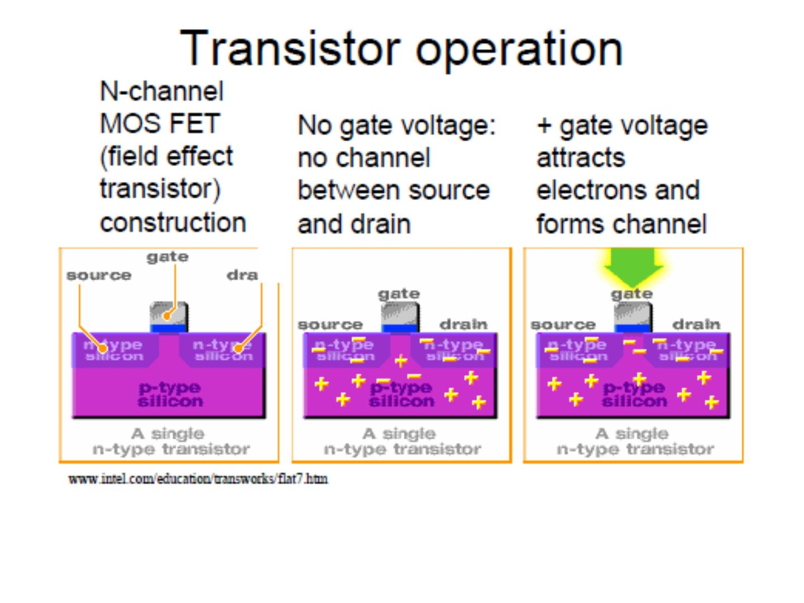
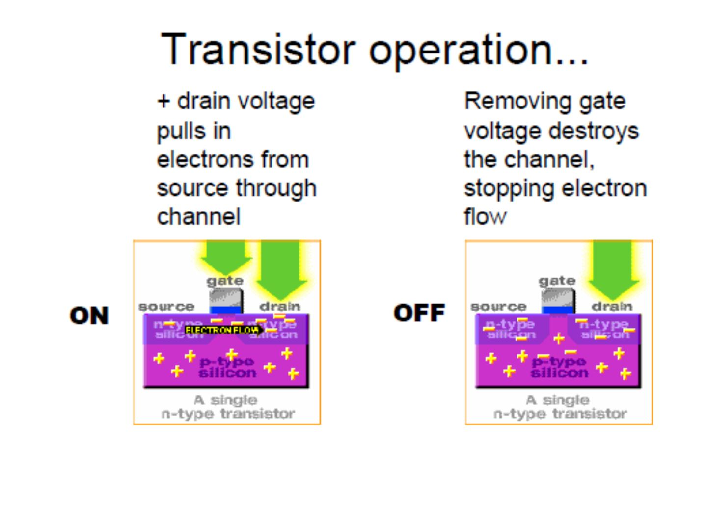
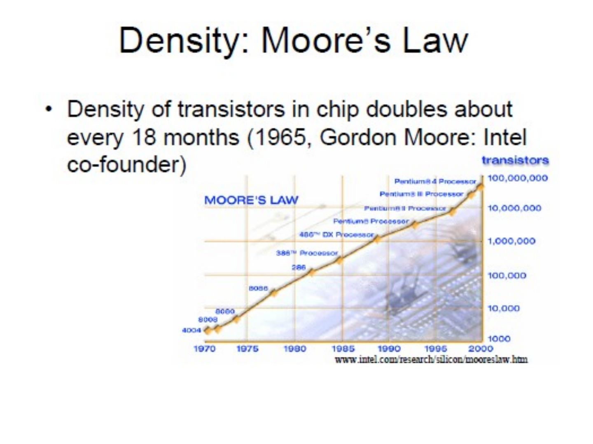
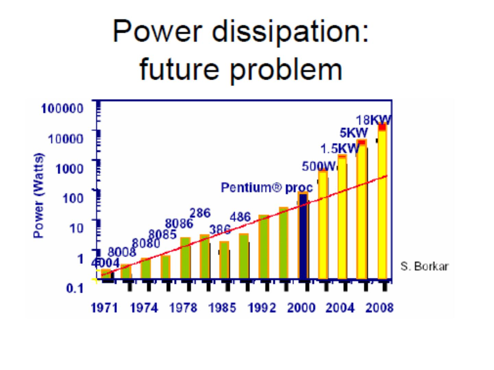
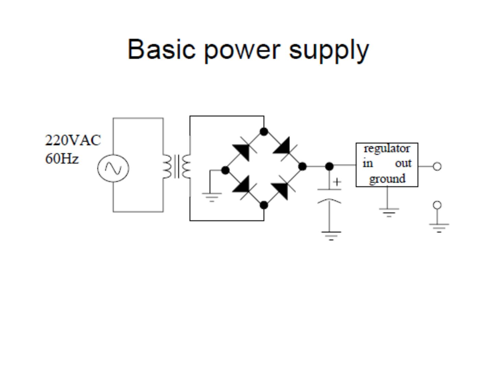
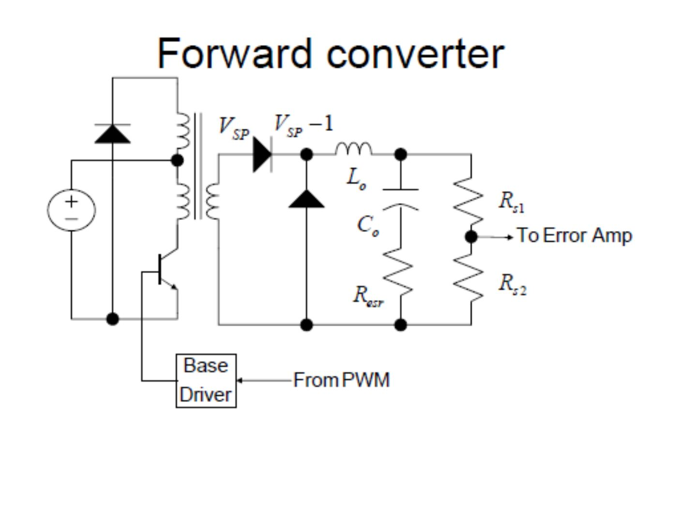
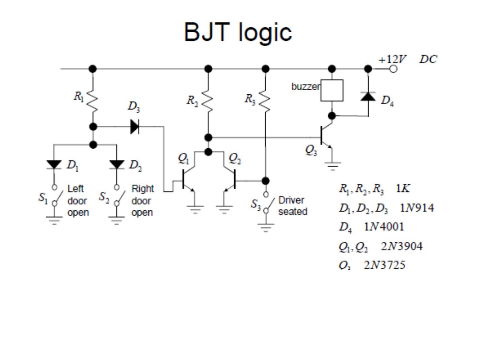
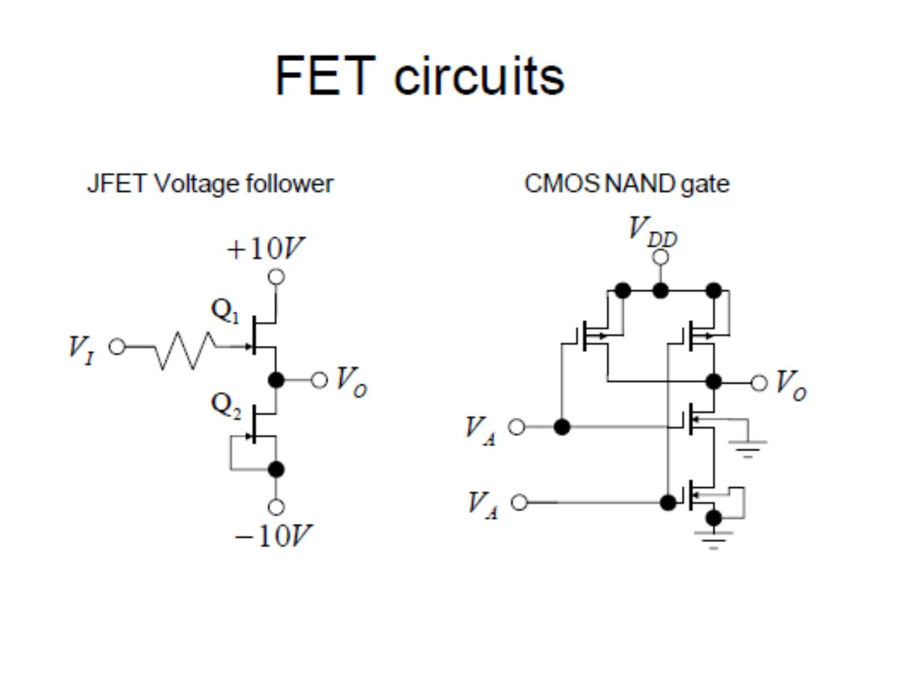

This post is the content of the *Lecture 1* presentation shown in the first week of the Başkent University **EEM214 Electronics I** course. The presentation was prepared by the course instructor, Asst. Prof. Dr. Derya Yılmaz; the last edit date is February 2014. The first slides cover course information, and the rest describe where electronics is used and its brief history. Some slides in the introduction are taken from the lecture notes of Luis G. Sison (University of the Philippines – Diliman). Since the slides are in English, the texts are also given in English. The original presentation file can be downloaded at the end of the post.

## Course information

- **Course code / name:** EEM214-02 Electronics I
- **Instructor:** Asst. Prof. Dr. Derya Yılmaz
- **Class hours:** Monday 13:00–14:50, Friday 09:00–10:50; LAB-01 Tuesday 11:00–12:50, LAB-02 Tuesday 15:00–16:50
- **Office hours:** Monday 11:00–11:50, Friday 13:00–13:50 (Office: D404)
- **Web page:** moodle.baskent.edu.tr

The course resources are Sedra & Smith *Microelectronic Circuits* (6th edition) and Jaeger & Blalock *Microelectronic Circuit Design* (4th edition); additional resources are Boylestad & Nashelsky, Neamen, and Kenneth C. Smith's problem and laboratory books. The complete weekly topic plan is in the course content form post.

> **Important note:** Students who miss more than 20% of the laboratory hours or more than 30% of the class hours receive an F2 grade in the course.

| Lab | Quiz | Homework | Midterm exam | Final exam | Total |
|---|---|---|---|---|---|
| 15% | 20% | 5% | 25% | 35% | 100% |

## Applications

- Amplification
- Power control/conversion
- Switching: discrete logic, computers
- Signal generation (oscillators, etc.)
- Signal processing (demodulation, etc.)

### Penryn microprocessor

- Feature size: 45 nm (1 nm = 10⁻⁹ meter; width of human hair = 100,000 nm)
- Operating speed: up to 3.2 GHz
- Number of transistors: >800M for quad-core

### Laser diodes

Example: pulsed laser diode, 860 nm, 5 W. Used in CD/DVD players, fiber optic communications equipment, laser pointers, instrumentation.

### Toyota Prius hybrid car

- Does 22 km/liter of gasoline
- Ultralow emissions
- Power electronics convert/control energy from motors/battery/gas engine

### Cell phones

- Microprocessor – overall control
- DSP/ADC/DAC – process audio and baseband signals
- ROM and flash memory – programs and user info (directory, etc.)
- RF amplifiers
- Power management
- Liquid crystal display

## History

An excellent multimedia tour is at www.pbs.org/transistor/ (the slide shows examples of tubes and transistors from 1941 to 1997 held on a fingertip).

### Vacuum tubes

- 1883: Edison effect – electrons travel through a vacuum to form current
- 1904: John Fleming invents Fleming valve – uses Edison effect to rectify AC current
- 1906: Lee De Forest invents Audion vacuum tube capable of amplification
- Short component life

### Semiconductors

- Early 1900's: galena (crystalline lead sulfide) used as radio detectors (rectifying AC current)
- Point contact rectifier
- 1940: Russell Ohl discovers silicon p-n junction

### Transistor

- 1947: Shockley, Bardeen & Brattain invent transistor at Bell Labs (won Nobel prize in 1956)
- Point contact transistor using germanium
- Today, silicon transistors more popular because of excellent chemical properties (easier to work with)

### Integrated circuits

- 1958: Jack Kilby and Robert Noyce invent the integrated circuit – squeezing several components on a single chip of silicon
- A simple oscillator IC with five integrated components
- Early technology difficult to scale
- 1959: invention of planar IC technology (still used today in VLSI)

**VLSI:** Very Large Scale Integration. Modern integrated circuits use copper for the metallic lines; copper is used to enable high-speed operation. The lines are as narrow as 0.13 micrometres. Integrated circuits are now fabricated on silicon wafers as large as 300 mm in diameter; they contain an enormous number of transistors.

## Transistor operation

N-channel MOSFET (field effect transistor) construction:

1. No gate voltage: no channel between source and drain.
1. + gate voltage attracts electrons and forms channel.
1. + drain voltage pulls in electrons from source through channel (ON).
1. Removing gate voltage destroys the channel, stopping electron flow (OFF).

### Problems with simple explanations

- Does not give detailed/quantitative device behavior useful in circuit design
- Does not allow us to predict performance of a device design
- Does not give us insight on how to build better devices

## Technology metrics

Density, speed, power consumption, power rating, noise.

### Density: Moore's Law

Density of transistors in chip doubles about every 18 months (1965, Gordon Moore: Intel co-founder). Higher density = smaller feature sizes: the Intel386 DX, Intel486 DX, Pentium and Pentium Pro/II processors keep shrinking in silicon processes going from 1.5 µ down to 0.25 µ.

**The vanishing transistor:** gate lengths of 70 nm in the 0.13 µ process in 2001, 30 nm in the 65 nm process in 2005, 20 nm in the 45 nm process in 2007, and 15 nm in the 32 nm process in 2009 (Intel). Difficulties in performance, reliability, mass-production as feature sizes shrink; addressed by new topologies/processes.

### Speed

Factors: size, material, design. In the chart on the slide, actual CPU speeds from 1995 to 2001 appear to far exceed the speed predictions in R. Pierret's *Semiconductor Device Fundamentals* (1996).

**The fastest transistor?**

- Silicon germanium (SiGe) transistor that can operate at 210 GHz (IBM, 2001)
- SiGe, GaAs and other materials faster than silicon alone. Other design features help achieve speed.

### Power consumption

- Power ∝ (frequency)²
- Power ∝ (supply voltage)²

**Power dissipation: future problem.** S. Borkar's chart shows processor power increasing exponentially from the 4004 to the Pentium, and, if the trend continues, reaching the order of 500 W, 1.5 kW, 5 kW and 18 kW toward 2008.

### White LEDs

- Composition determines color
- Red: Ga, As, P – earliest sale 1970's
- Green: Ga, P, N
- Blue: Ga, N – first sold 1994; made white/full-spectrum LEDs possible

## Example circuits

The final slides of the presentation show circuits that use the components to be learned during the semester.

