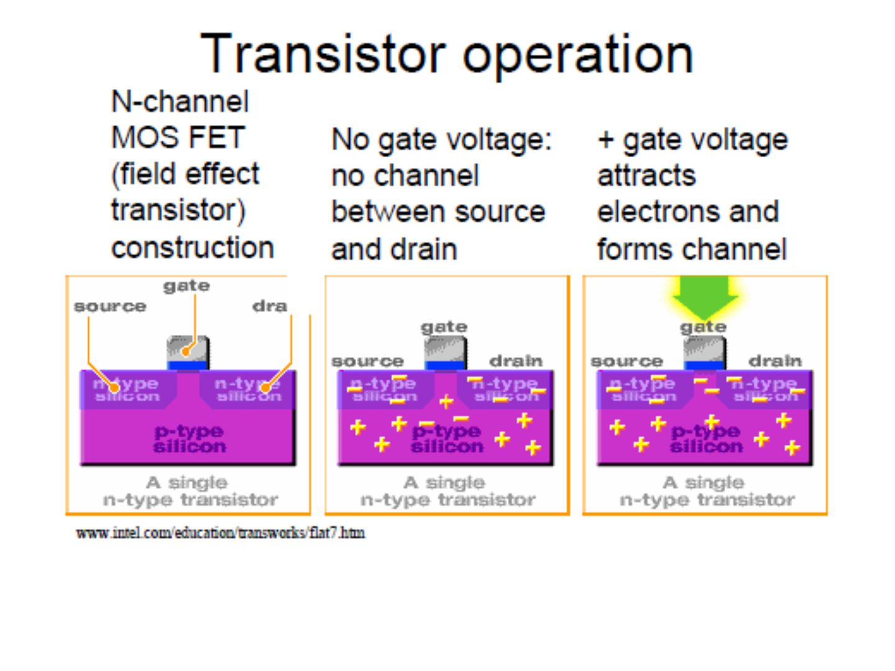
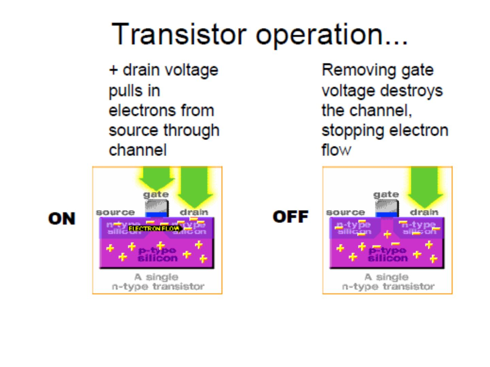
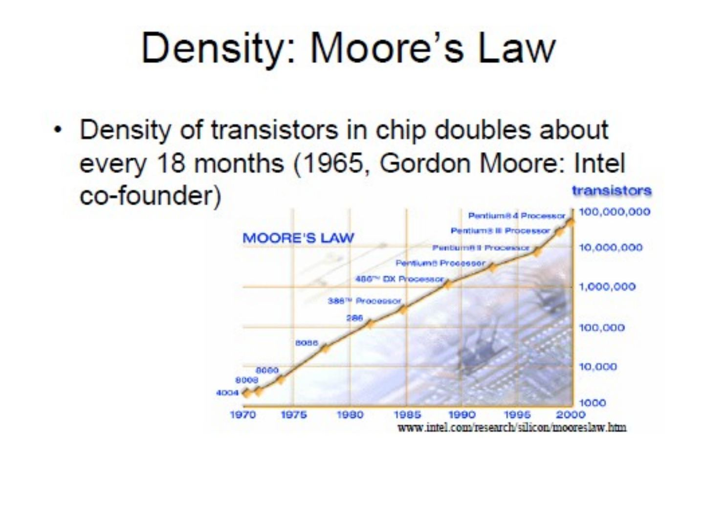
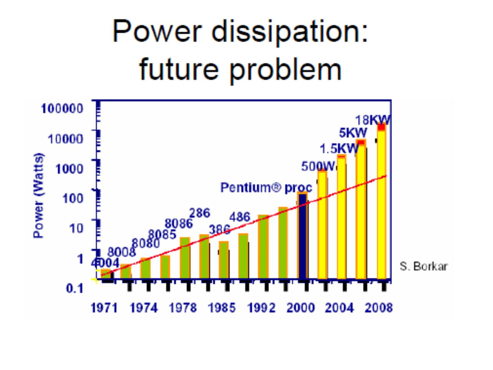
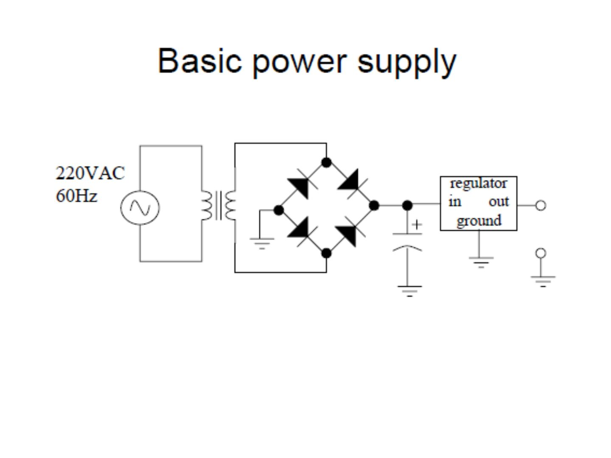
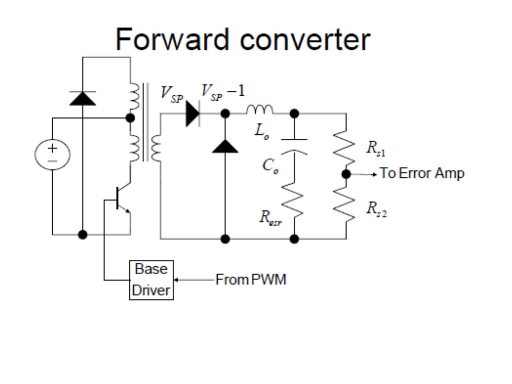
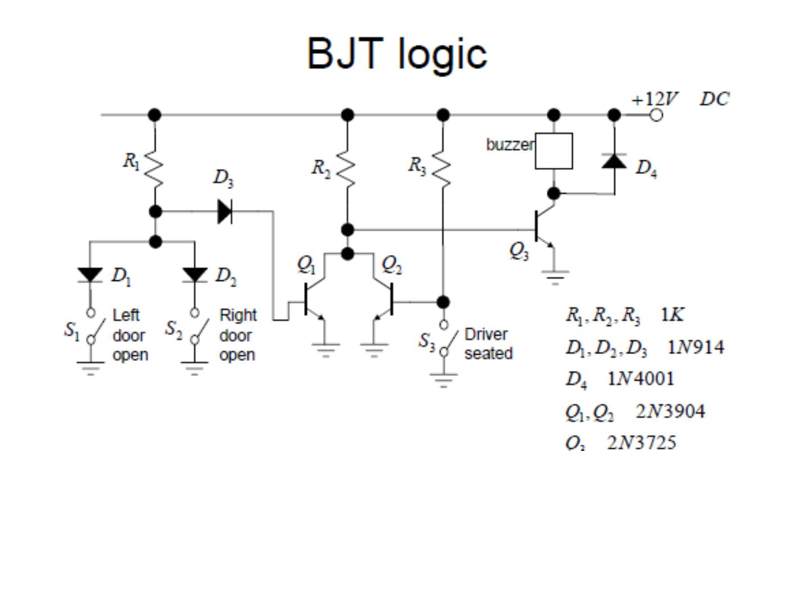
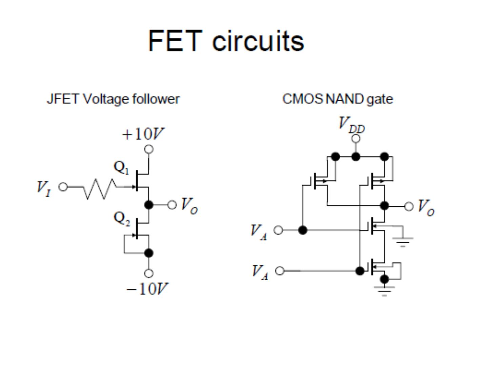

Bu yazı, Başkent Üniversitesi **EEM214 Elektronik I** dersinin ilk haftasında gösterilen *Lecture 1* sunumunun içeriğidir. Sunumu dersin öğretim elemanı Yrd. Doç. Dr. Derya Yılmaz hazırlamış; son düzenleme tarihi Şubat 2014. İlk slaytlar ders bilgilerini, geri kalanı elektroniğin nerelerde kullanıldığını ve kısa tarihini anlatıyor. Giriş bölümündeki bazı slaytlar Luis G. Sison'un (University of the Philippines – Diliman) ders notlarından alınmış. Slaytlar İngilizce olduğu için metinler de İngilizce aktarıldı. Sunumun orijinal dosyası yazının sonunda indirilebilir.

## Ders bilgileri

- **Dersin kodu / adı:** EEM214-02 Elektronik I
- **Öğretim elemanı:** Yrd. Doç. Dr. Derya Yılmaz
- **Ders saatleri:** Pazartesi 13:00–14:50, Cuma 09:00–10:50; LAB-01 Salı 11:00–12:50, LAB-02 Salı 15:00–16:50
- **Ofis saatleri:** Pazartesi 11:00–11:50, Cuma 13:00–13:50 (Ofis: D404)
- **Web sayfası:** moodle.baskent.edu.tr

Ders kaynakları Sedra & Smith *Microelectronic Circuits* (6. baskı) ve Jaeger & Blalock *Microelectronic Circuit Design* (4. baskı); ek kaynaklar Boylestad & Nashelsky, Neamen ve Kenneth C. Smith'in problem ve laboratuvar kitapları. Haftalık konu planının tamamı ders içerik formu yazısında.

> **Önemli not:** Laboratuvar saatlerinin %20'sinden, ders saatlerinin de %30'undan fazlasına katılmayan öğrenciler dersten F2 notu alırlar.

| Lab | Quiz | Ödev | Ara sınav | Yarıyıl sonu sınavı | Toplam |
|---|---|---|---|---|---|
| %15 | %20 | %5 | %25 | %35 | %100 |

## Applications

- Amplification
- Power control/conversion
- Switching: discrete logic, computers
- Signal generation (oscillators, etc.)
- Signal processing (demodulation, etc.)

### Penryn microprocessor

- Feature size: 45 nm (1 nm = 10⁻⁹ meter; width of human hair = 100,000 nm)
- Operating speed: up to 3.2 GHz
- Number of transistors: >800M for quad-core

### Laser diodes

Example: pulsed laser diode, 860 nm, 5 W. Used in CD/DVD players, fiber optic communications equipment, laser pointers, instrumentation.

### Toyota Prius hybrid car

- Does 22 km/liter of gasoline
- Ultralow emissions
- Power electronics convert/control energy from motors/battery/gas engine

### Cell phones

- Microprocessor – overall control
- DSP/ADC/DAC – process audio and baseband signals
- ROM and flash memory – programs and user info (directory, etc.)
- RF amplifiers
- Power management
- Liquid crystal display

## History

An excellent multimedia tour is at www.pbs.org/transistor/ (slaytta 1941'den 1997'ye tüp ve transistör örnekleri bir parmak ucunda gösteriliyor).

### Vacuum tubes

- 1883: Edison effect – electrons travel through a vacuum to form current
- 1904: John Fleming invents Fleming valve – uses Edison effect to rectify AC current
- 1906: Lee De Forest invents Audion vacuum tube capable of amplification
- Short component life

### Semiconductors

- Early 1900's: galena (crystalline lead sulfide) used as radio detectors (rectifying AC current)
- Point contact rectifier
- 1940: Russell Ohl discovers silicon p-n junction

### Transistor

- 1947: Shockley, Bardeen & Brattain invent transistor at Bell Labs (won Nobel prize in 1956)
- Point contact transistor using germanium
- Today, silicon transistors more popular because of excellent chemical properties (easier to work with)

### Integrated circuits

- 1958: Jack Kilby and Robert Noyce invent the integrated circuit – squeezing several components on a single chip of silicon
- A simple oscillator IC with five integrated components
- Early technology difficult to scale
- 1959: invention of planar IC technology (still used today in VLSI)

**VLSI:** Very Large Scale Integration. Modern integrated circuits use copper for the metallic lines; copper is used to enable high-speed operation. The lines are as narrow as 0.13 micrometres. Integrated circuits are now fabricated on silicon wafers as large as 300 mm in diameter; they contain an enormous number of transistors.

## Transistor operation

N-channel MOSFET (field effect transistor) construction:

1. No gate voltage: no channel between source and drain.
1. + gate voltage attracts electrons and forms channel.
1. + drain voltage pulls in electrons from source through channel (ON).
1. Removing gate voltage destroys the channel, stopping electron flow (OFF).

### Problems with simple explanations

- Does not give detailed/quantitative device behavior useful in circuit design
- Does not allow us to predict performance of a device design
- Does not give us insight on how to build better devices

## Technology metrics

Density, speed, power consumption, power rating, noise.

### Density: Moore's Law

Density of transistors in chip doubles about every 18 months (1965, Gordon Moore: Intel co-founder). Higher density = smaller feature sizes: Intel386 DX, Intel486 DX, Pentium ve Pentium Pro/II işlemcileri 1.5 µ'dan 0.25 µ'ya inen silikon süreçlerinde gittikçe küçülüyor.

**The vanishing transistor:** 2001'de 0.13 µ süreçte 70 nm, 2005'te 65 nm süreçte 30 nm, 2007'de 45 nm süreçte 20 nm, 2009'da 32 nm süreçte 15 nm kapı uzunluğu (Intel). Difficulties in performance, reliability, mass-production as feature sizes shrink; addressed by new topologies/processes.

### Speed

Factors: size, material, design. Slayttaki grafikte 1995–2001 arası gerçek CPU hızları, R. Pierret'in *Semiconductor Device Fundamentals* (1996) kitabındaki hız öngörülerini çok aşmış görünüyor.

**The fastest transistor?**

- Silicon germanium (SiGe) transistor that can operate at 210 GHz (IBM, 2001)
- SiGe, GaAs and other materials faster than silicon alone. Other design features help achieve speed.

### Power consumption

- Power ∝ (frequency)²
- Power ∝ (supply voltage)²

**Power dissipation: future problem.** S. Borkar'ın grafiği 4004'ten Pentium'a işlemci güçlerinin üstel arttığını, eğilim sürerse 2008'e doğru 500 W, 1.5 kW, 5 kW ve 18 kW mertebelerine çıkacağını gösteriyor.

### White LEDs

- Composition determines color
- Red: Ga, As, P – earliest sale 1970's
- Green: Ga, P, N
- Blue: Ga, N – first sold 1994; made white/full-spectrum LEDs possible

## Örnek devreler

Sunumun son slaytları, dönem boyunca öğrenilecek elemanların kullanıldığı devreleri gösteriyor.

