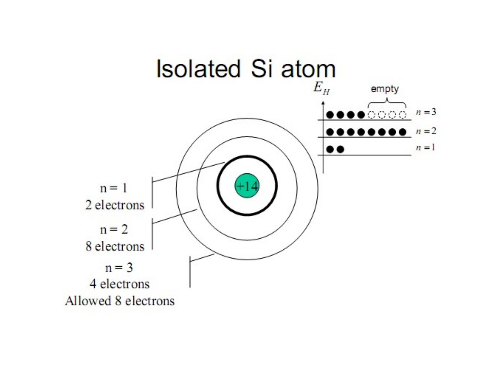
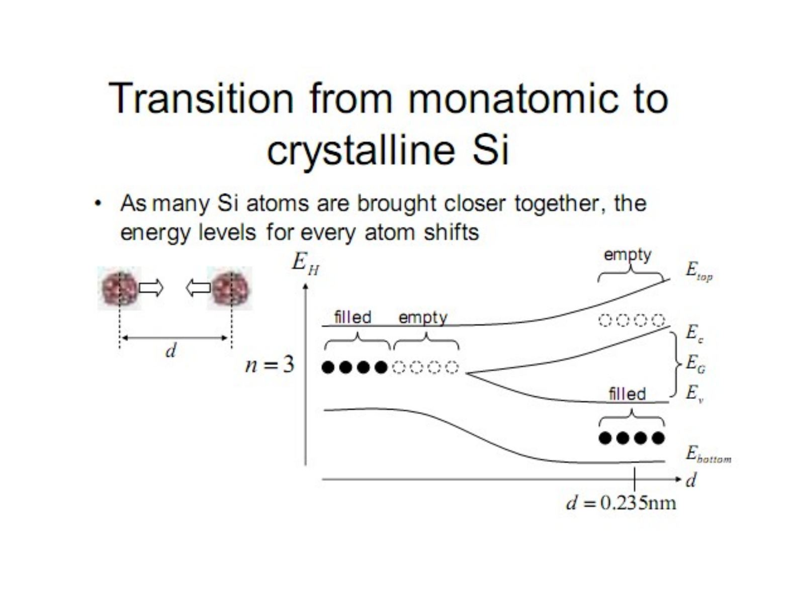
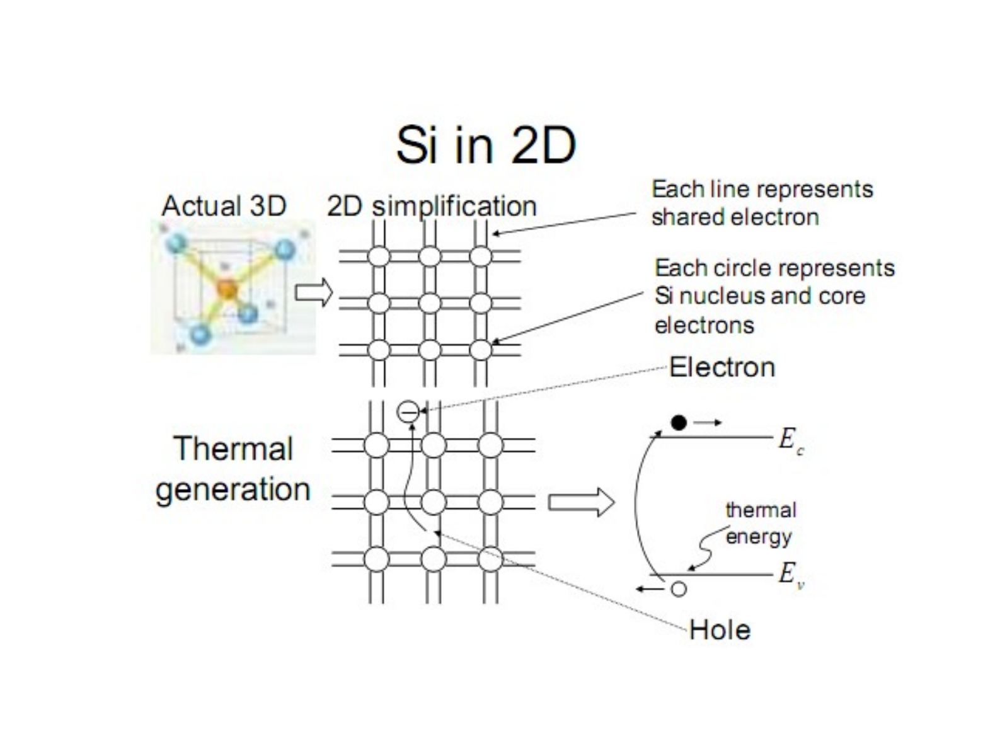
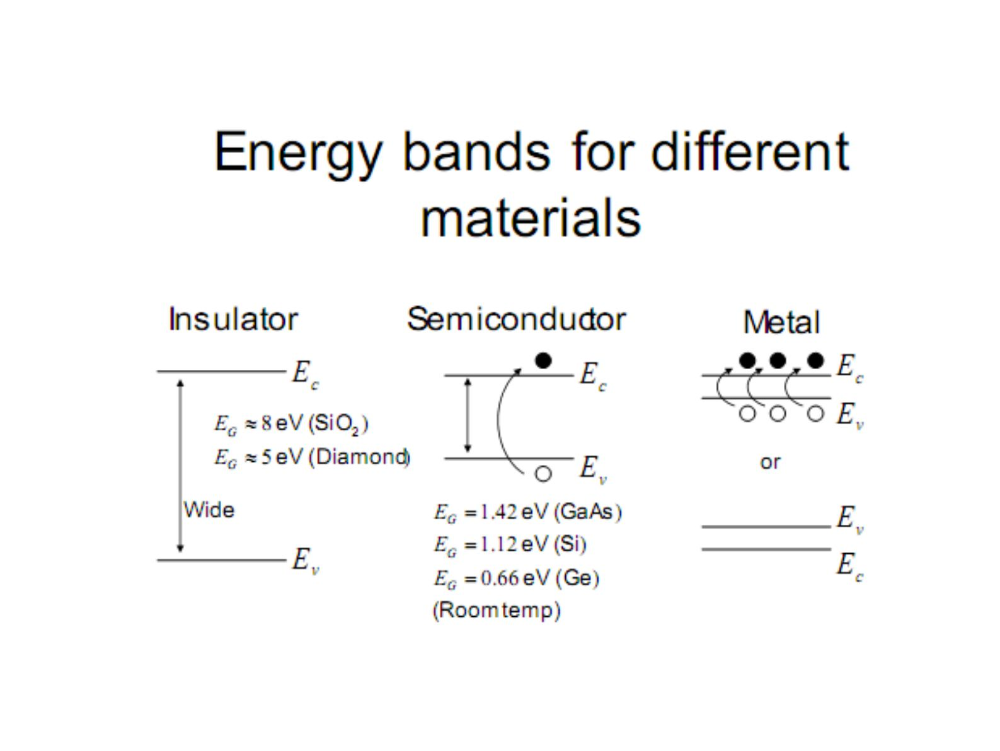
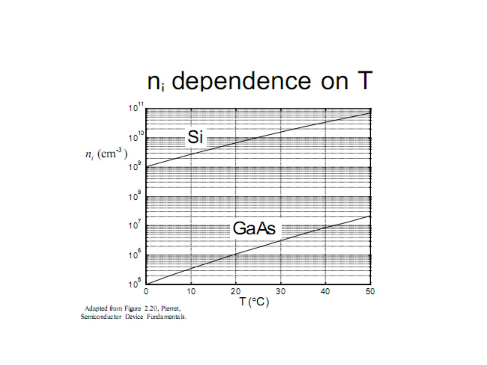
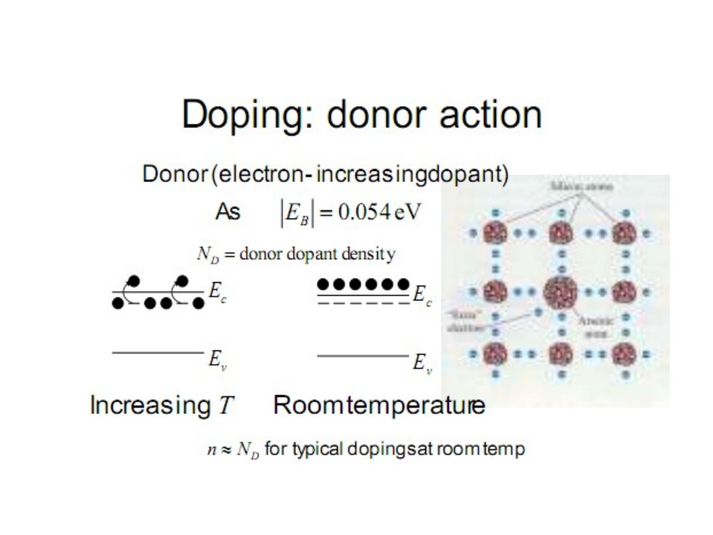
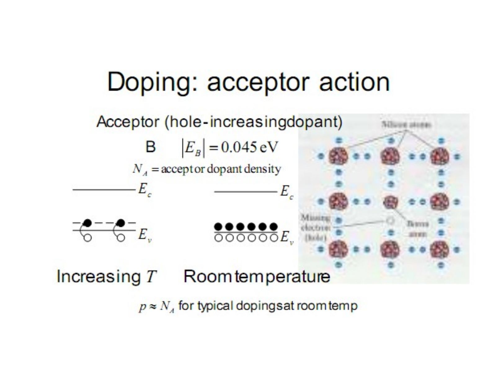
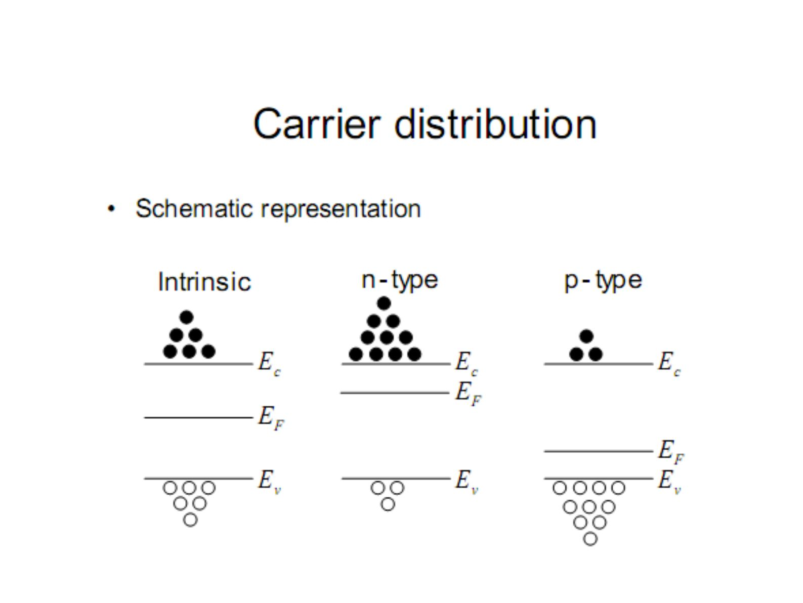

Bu yazı, Başkent Üniversitesi **EEM214 Elektronik I** dersinin *Lecture 2: Carrier Modelling* sunumunun içeriğidir. Sunum dersin öğretim elemanı Yrd. Doç. Dr. Derya Yılmaz'ın ders slaytları arasında yer alıyor; son düzenleme tarihi Şubat 2013. Konu, diyot denkleminin arkasındaki yarıiletken fiziği: akımı belirleyen taşıyıcıların sayısı ve dağılımı. Slaytlar İngilizce olduğu için metinler de İngilizce aktarıldı, formüller düz metin olarak yazıldı; bant diyagramları sayfa görselleriyle verildi. Sunumun orijinal dosyası yazının sonunda indirilebilir.

## Semiconductor physics

How do we go from a p-n junction picture to the diode equation?

i_D = I_S·(e^(v_D/ηV_T) − 1)

What determines current?

- Number of charge carriers – state and carrier distribution
- Speed of charge carriers – mobility, drift, diffusion

### Crystalline silicon

- 3D lattice: each Si atom bonded to 4 neighbors (tetrahedral coordination)
- Density: 5×10²² atoms/cm³
- Distance between atoms: 0.235 nm
- Q: If Si transistor gate is 15 nm wide, how many atoms wide is the gate?

## Review of electrostatics

- **Charge** – basic unit: Coulomb; q (charge of an electron) = 1.6×10⁻¹⁹ C
- **Current** – 1 A = 1 C / 1 sec
- **Electric field:** force per unit charge, |ε on Q₂| = Q₁ / (4π·ε₀·r²)
- **Energy = Work:** force × distance – basic unit: Joules
- **Potential = Work per unit charge** – basic unit: 1 Volt = 1 J / 1 C

Moving the negative charge Q₂ away from the positive charge Q₁ means increasing energy, lower potential.

## Energy levels

For the hydrogen atom:

E_H = −13.6/n² eV, n = 1, 2, 3, …

1 eV = 1 electron-volt = 1.6×10⁻¹⁹ joules. There are actually sublevels within these levels.

### Rules for electrons

- Tend to settle to lowest levels.
- Need extra energy (light or thermal energy) to move to higher levels.
- Can move to lower or equal energy levels if not filled. Give up energy when moving to lower levels.

### Periodic table and the isolated Si atom

| II | III | IV | V | VI |
|---|---|---|---|---|
| Be⁴ | B⁵ | C⁶ | N⁷ | O⁸ |
| Mg¹² | Al¹³ | **Si¹⁴** | P¹⁵ | S¹⁶ |
| Zn³⁰ | Ga³¹ | Ge³² | As³³ | Se³⁴ |
| Cd⁴⁸ | In⁴⁹ | Sn⁵⁰ | Sb⁵¹ | Te⁵² |

The Roman numeral at the top of each column indicates the number of valence electrons. The isolated Si atom (+14) has 2 electrons in n = 1, 8 electrons in n = 2 and 4 electrons in n = 3, where 8 electrons are allowed (4 states empty).

## Covalent bonding and energy bands

Each Si atom shares 4 electrons with its 4 neighbors, filling in 4 previously empty n = 3 levels (covalent bond).

As many Si atoms are brought closer together, the energy levels for every atom shift: at the crystal spacing d = 0.235 nm the n = 3 level splits into a filled band (E_bottom … E_v) and an empty band (E_c … E_top), separated by the band gap E_G.

**Crystalline Si (N atoms):** 4N allowed states in the conduction band (mostly empty, between E_c and E_top) and 4N allowed states in the valence band (mostly filled, between E_bottom and E_v). In the simplified version only E_c and E_v are drawn.

")

### Si in 2D, electrons and holes

In the 2D simplification each line represents a shared electron and each circle represents a Si nucleus and core electrons. **Thermal generation:** thermal energy breaks a bond, an electron rises to E_c and leaves a hole at E_v.

- Holes "move" when a shared electron moves to fill it in.
- Electrons move faster than holes.

In the energy band diagram: no carriers means an empty E_c and a completely filled E_v; an excited electron in the conduction band leaves a hole in the valence band.

### Energy bands for different materials

- **Insulator:** wide gap, E_G ≈ 8 eV (SiO₂), E_G ≈ 5 eV (Diamond)
- **Semiconductor:** E_G = 1.42 eV (GaAs), 1.12 eV (Si), 0.66 eV (Ge) at room temperature
- **Metal:** E_c and E_v overlap, or the bands are partially filled

## Carriers and electrical properties

- More carriers = higher conductivity
- Can also increase the number of carriers by doping (introducing impurities)
- Purity of Si used in chips: 99.9999999%! (less than 1 non-Si atom in 10⁹ Si atoms)
- Pure Si: **intrinsic** semiconductor; doped Si: **extrinsic** semiconductor

### Intrinsic carrier concentration

Thermal excitation creates electron-hole pairs: n = number of free electrons/cm³, p = number of free holes/cm³. Intrinsic carrier concentration at room temperature:

| Material | n_i |
|---|---|
| GaAs | ≈ 2×10⁶ /cm³ |
| Si | ≈ 1×10¹⁰ /cm³ |
| Ge | ≈ 2×10¹³ /cm³ |

For Si at room temperature, less than 1 bond in 10¹³ is broken (assuming 5×10²² atoms/cm³).

## Doping

Group III elements (B, Al, Ga, In) are **acceptor dopants**, group V elements (N, P, As, Sb) are **donor dopants**. 1 in 10³ to 1 in 10⁸ dopants are typically introduced to alter Si's electrical properties.

- **Donor (electron-increasing dopant):** e.g. As, |E_B| = 0.054 eV. N_D = donor dopant density. n ≈ N_D for typical dopings at room temperature.
- **Acceptor (hole-increasing dopant):** e.g. B, |E_B| = 0.045 eV. N_A = acceptor dopant density. p ≈ N_A for typical dopings at room temperature.

### Carrier distribution

In the intrinsic material E_F lies near the middle of the gap; in n-type material it moves toward E_c (more electrons), in p-type toward E_v (more holes).

## Fermi level

Carrier density and E_F are related – need one to solve the other:

- n = n_i·e^((E_F − E_i)/kT)
- p = n_i·e^((E_i − E_F)/kT)
- E_i ≈ (E_c + E_v)/2

E_F = Fermi energy/level, k = Boltzmann constant = 8.617×10⁻⁵ eV/K, T = temperature in Kelvin. Q: Show that np = n_i².

Assumes a **non-degenerate** semiconductor: E_F not too close to E_c or E_v (more than 3kT away).

## Computing carrier density in extrinsic semiconductors

- Previous equations apply to both intrinsic and extrinsic semiconductors.
- Charge neutrality relationship (assuming total ionization):

p − n + N_D − N_A = 0, where N_D = number of donors/cm³ and N_A = number of acceptors/cm³.

- Carrier concentrations, assuming non-degenerate and N_D or N_A ≫ n_i:

| | Majority | Minority |
|---|---|---|
| n-type | n ≈ N_D | p ≈ n_i²/N_D |
| p-type | p ≈ N_A | n ≈ n_i²/N_A |
