Bu yazı, Başkent Üniversitesi **EEM214 Elektronik I** dersinin *Lecture 3: Carrier Action* sunumunun içeriğidir. Sunum dersin öğretim elemanı Yrd. Doç. Dr. Derya Yılmaz'ın ders slaytları arasında yer alıyor (son düzenleme Şubat 2012); kapak slaytında Luis G. Sison'un (University of the Philippines – Diliman) adı geçiyor, yani slaytlar onun ders notlarından uyarlanmış. Konu: taşıyıcıların sürüklenme (drift) ve difüzyonla hareketi, ardından bu bilgilerle P-N ekleminin nitel davranışı. Slaytlar İngilizce olduğu için metinler de İngilizce aktarıldı; bant diyagramları sayfa görselleriyle verildi. Arşivde bu sunumun 19 slaytlık daha kısa bir kopyası da vardı; burada 24 slaytlık tam sürüm kullanıldı. Sunumun orijinal dosyası yazının sonunda indirilebilir.

## Causes of carrier motion

- **Drift:** caused by electric field (or potential difference)
- **Diffusion:** caused by difference in concentration of carriers

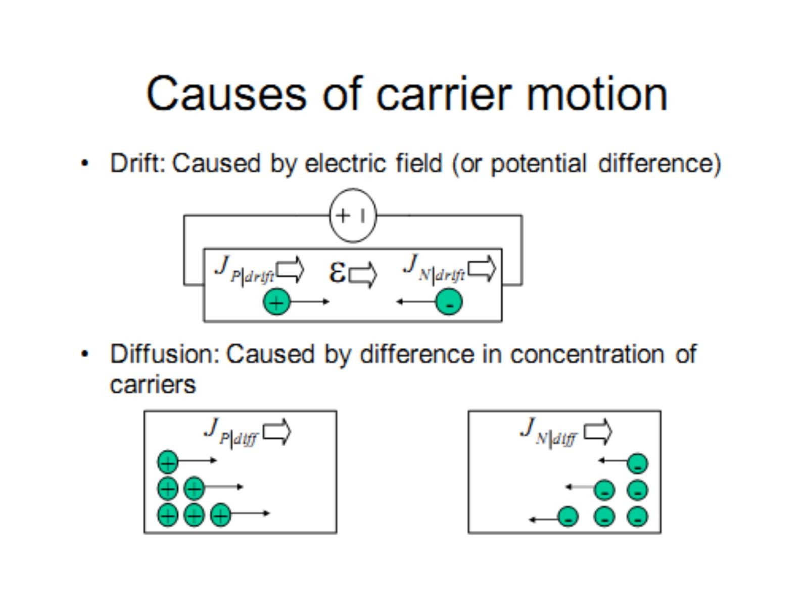

## Drift currents

Drift current density:

- J_P|drift = q·μ_p·p·ε for holes
- J_N|drift = q·μ_n·n·ε for electrons

Terminal velocity is reached for high E-fields.

### Mobilities

| Material (room temperature) | μ_p | μ_n |
|---|---|---|
| Si (almost pure) | ≈ 460 cm²/V·s (at N_A = 10¹⁴/cm³) | ≈ 1360 cm²/V·s (at N_D = 10¹⁴/cm³) |
| GaAs (high purity) | ≈ 400 cm²/V·s (at N_A ≤ 10¹⁵/cm³) | ≈ 8000 cm²/V·s (at N_D ≤ 10¹⁵/cm³) |

Electrons are faster than holes.

**Doping dependence:** mobility decreases as a result of increased scattering by ionized impurities. **Temperature dependence:** for N_D = 10¹⁴ … 10¹⁸ cm⁻³, μ_n falls as T rises from 10² K toward 10³ K; the effect is weaker at heavy doping.

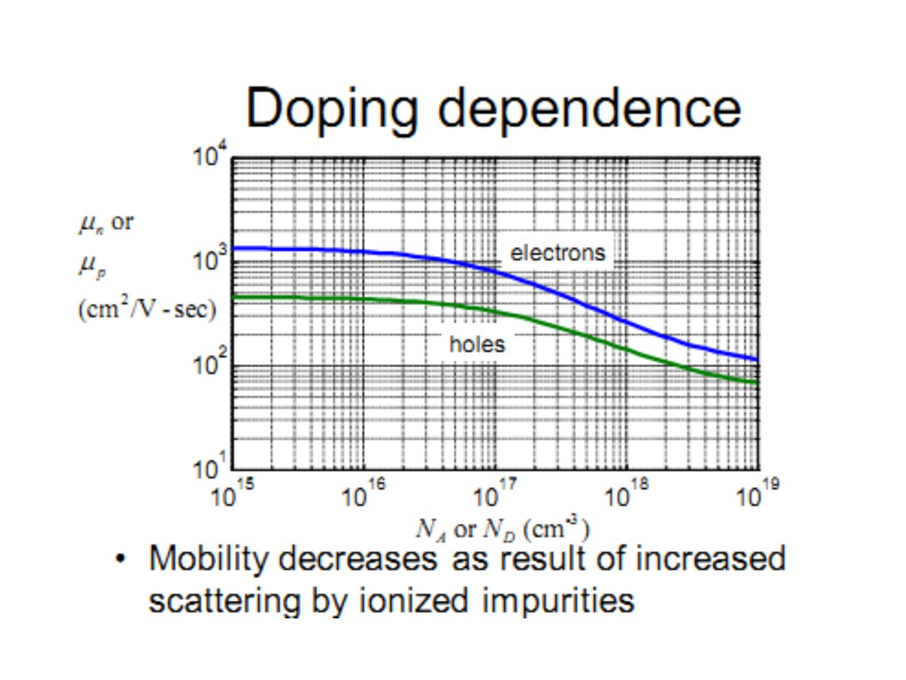

### Resistivity and doping

- J = (1/ρ)·ε, ρ = 1 / (q·(μ_n·n + μ_p·p))
- Effect of doping: ρ = 1/(q·μ_n·N_D) for n-type, ρ = 1/(q·μ_p·N_A) for p-type

## Diffusion current density

Diffusion is driven by the concentration gradient:

- J_P|diff = −q·D_p·∇p
- J_N|diff = q·D_n·∇n

### Einstein relationship (summary)

- D_N/μ_n = kT/q for electrons
- D_P/μ_p = kT/q for holes

Units of diffusion constant: cm²/sec.

### Total currents

- J_P = q·μ_p·p·ε − q·D_p·∇p (drift + diffusion)
- J_N = q·μ_n·n·ε + q·D_n·∇n
- J = J_P + J_N

## Band bending

With no external voltage E_c and E_v are flat. With an applied voltage the bands tilt: the voltage increases in the direction opposite ε, since ε = −∇V.

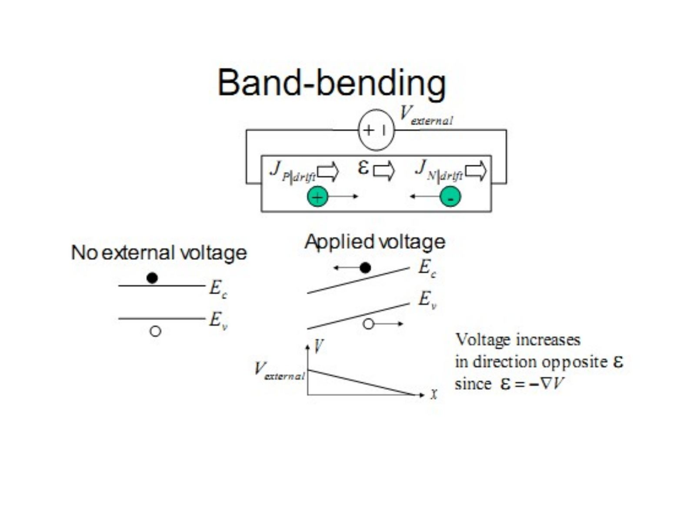

### Energy-voltage relationship

The energy diagram is the flipped graph of voltage:

P.E. = −qV = E_c − E_ref

Therefore the electric field is proportional to the slope of the energy diagram:

ε = −∇V = (1/q)·dE_c/dx = (1/q)·dE_v/dx = (1/q)·dE_i/dx

Questions on the slide: sketch the ε of the material with a given band diagram; what is the direction of drift for each of the charge carriers shown?

## Depletion region formation

- Before equilibrium, carriers near the junction recombine.
- At equilibrium a depletion region forms; outside it are quasi-neutral regions with negligible ε-field.
- Q: Sketch V(x) using ε = −∇V.

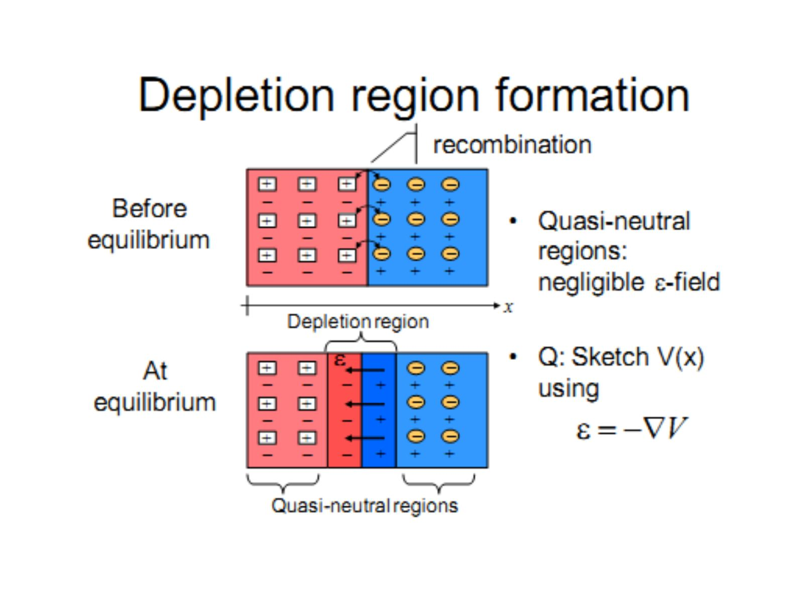

### Non-uniform doping

- Electrons diffuse from the high N_D area to the low N_D area …
- The Fermi level equalizes across the material …
- But relative energy levels in each area (far from the junction) remain constant

… which results in band-bending. In equilibrium:

- J_P = q·μ_p·p·ε − q·D_p·∇p = 0
- J_N = q·μ_n·n·ε + q·D_n·∇n = 0

Band bending sets up an electric field stopping further diffusion. (Q: In which direction is the electric field caused by band bending?)

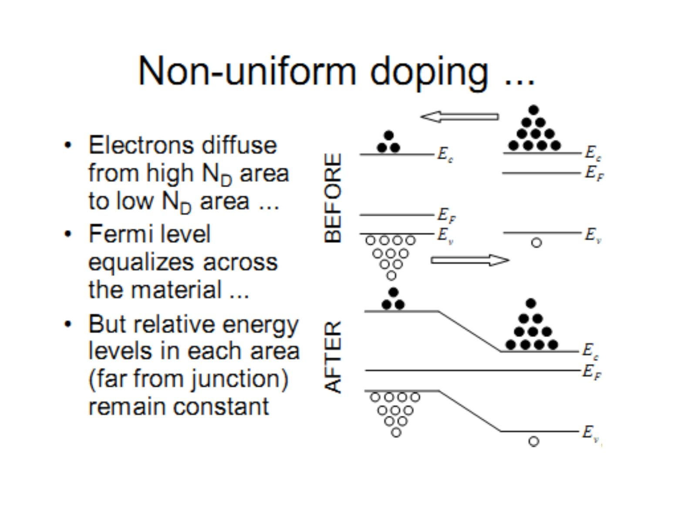

## Built-in potential

The internal potential V_j is the sum of the built-in potential V_bi plus any externally applied potential V_d.

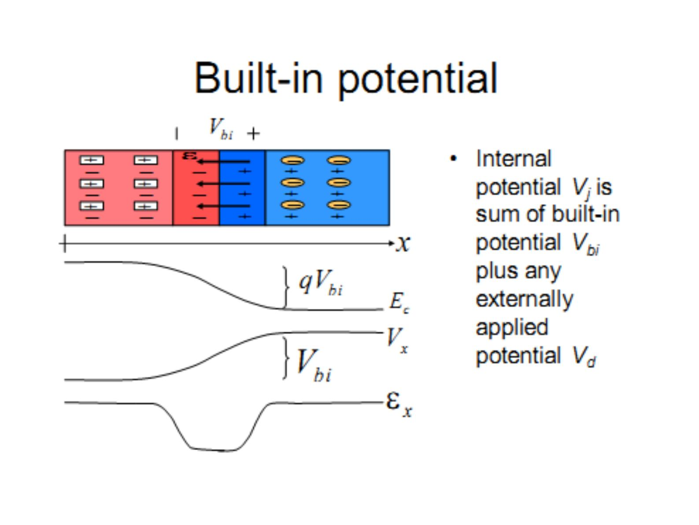

Energy levels are related to charge concentrations by the following equations:

- N_A ≈ p = n_i·e^((E_i − E_F)/kT)
- N_D ≈ n = n_i·e^((E_F − E_i)/kT)

From qV_bi = a + b we get:

V_bi = (kT/q)·ln(N_A·N_D / n_i²)

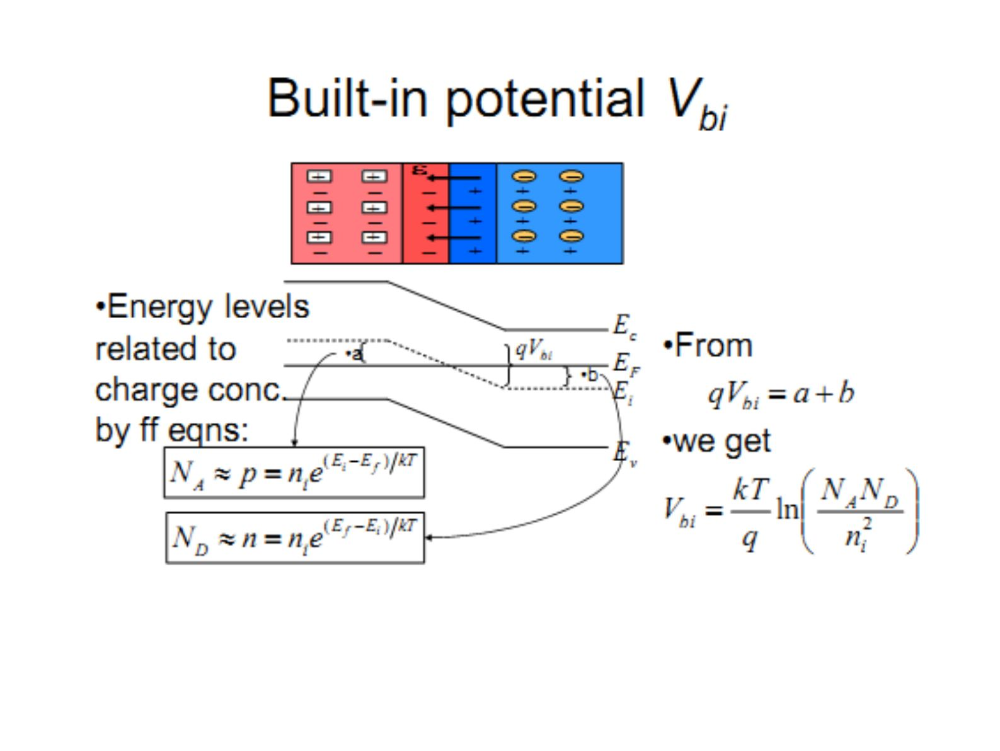

> Q: Suppose N_A = N_D = 10¹⁴/cm³ for Si at 300 K. Compute V_bi. Sketch the energy band diagram of the diode. Compute the spacings between E_F and E_i at both ends of the diode.

## P-N junction under bias

At V_d = 0, drift and diffusion currents of electrons and holes balance each other.

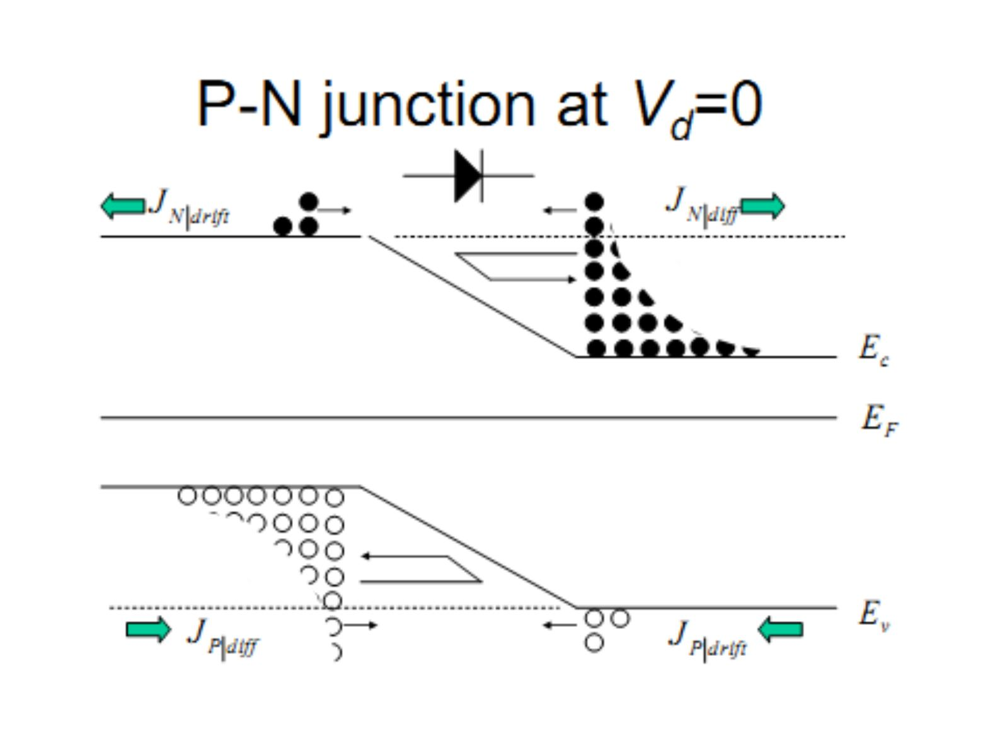

**P-N junction electrostatics:** the built-in voltage has opposite polarity to V_d. (1) V_d > 0 (2) lowers V_bi to V_j (3) raises E_c to E_c′ by qV_d.

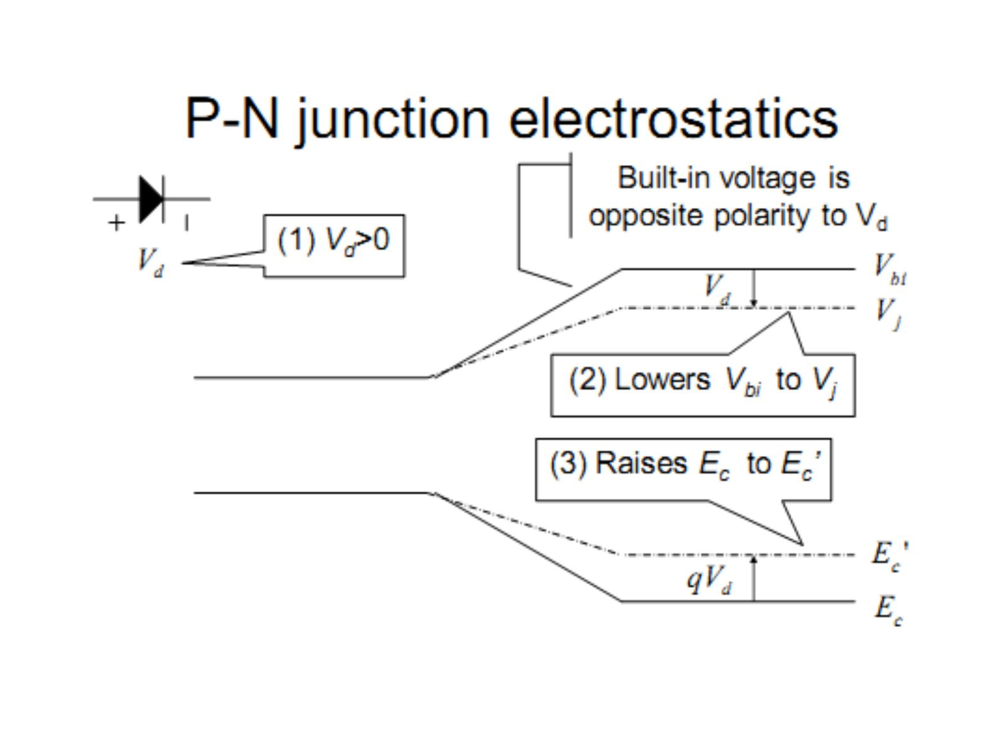

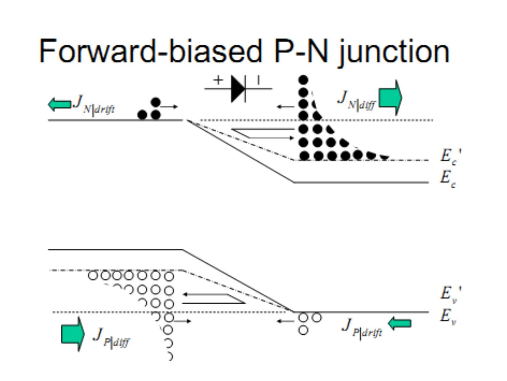

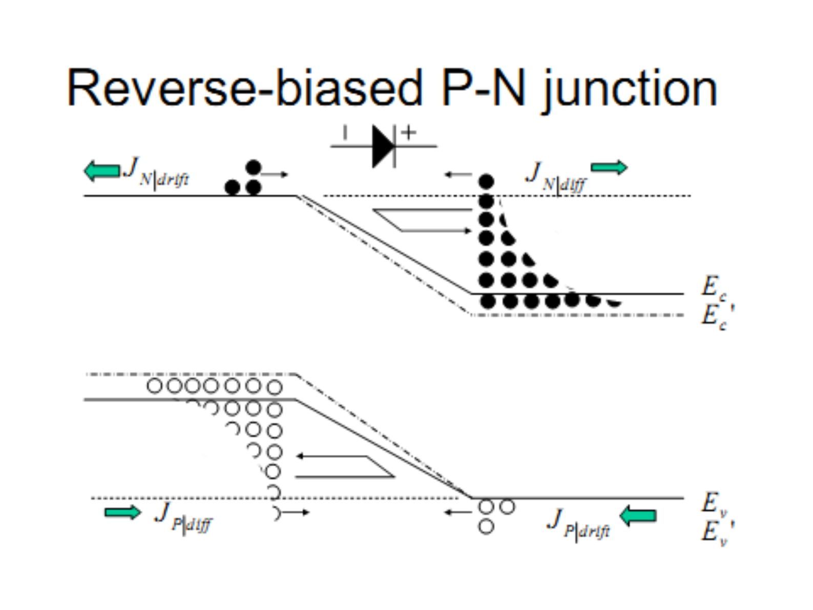

## Summary of qualitative diode behavior

- Fermi level no longer flat when net currents flow – use quasi-Fermi levels
- When the diode is forward-biased, "ON" current is mainly **diffusion** current: electrons diffuse from N to P region, where they become **minority carriers**; similarly, holes diffuse from P to N …
- Minority carrier diffusion dynamics are important! – leads to the ideal diode equation
