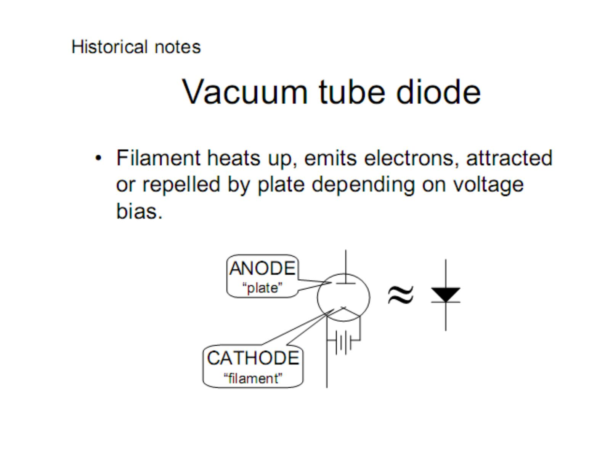
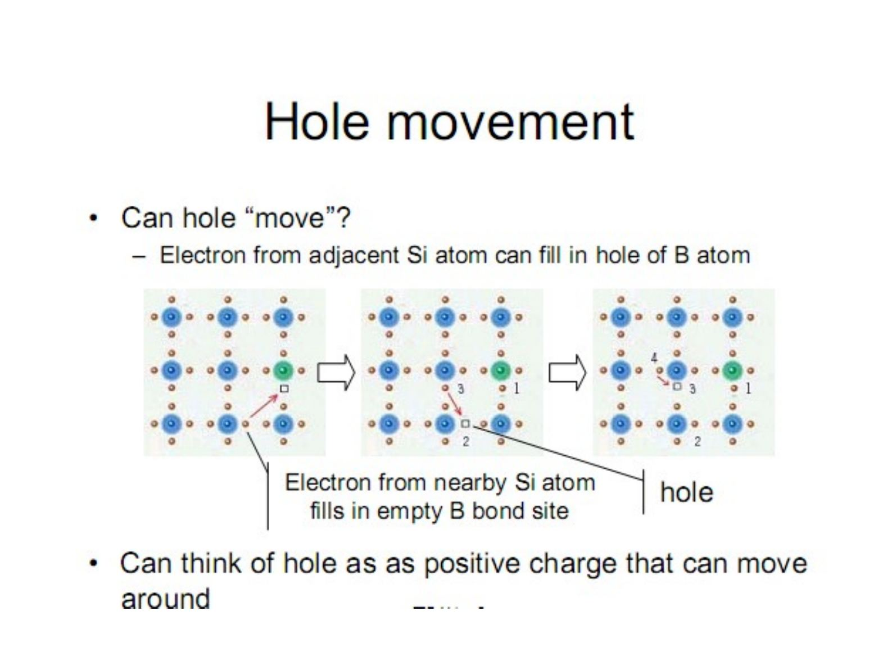
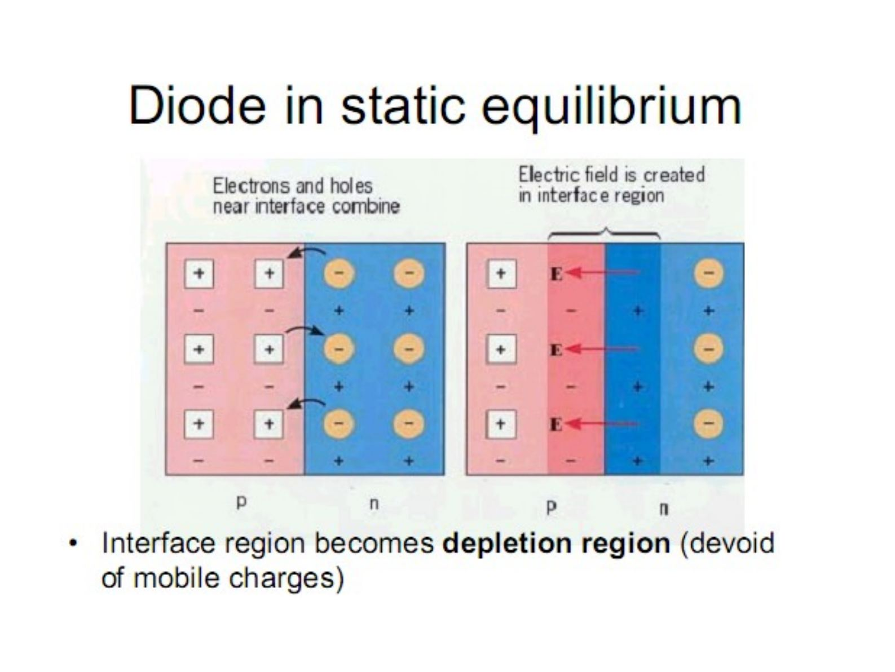
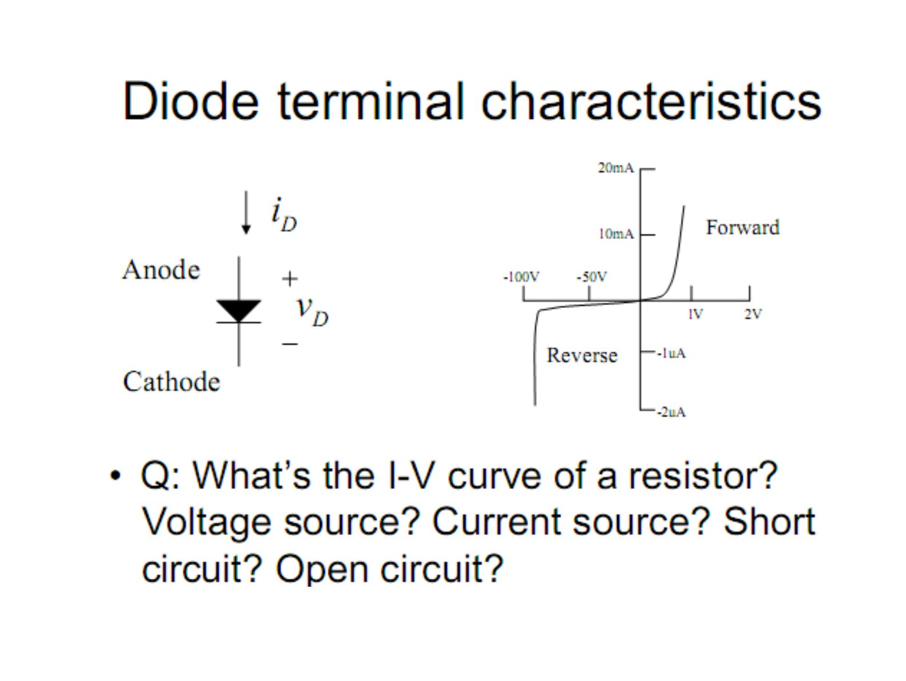
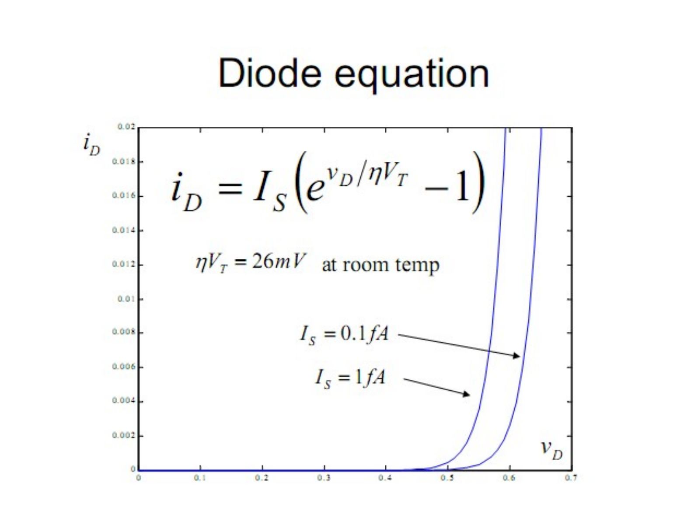
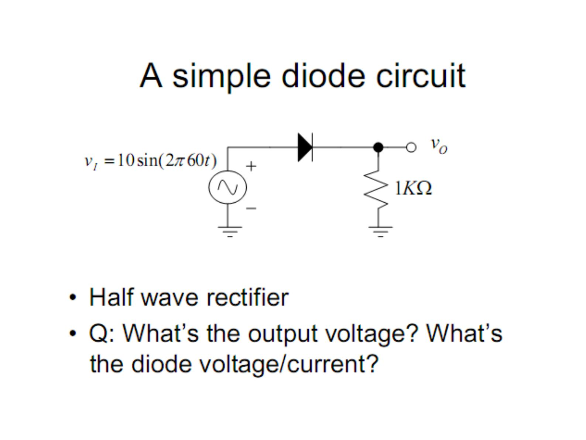
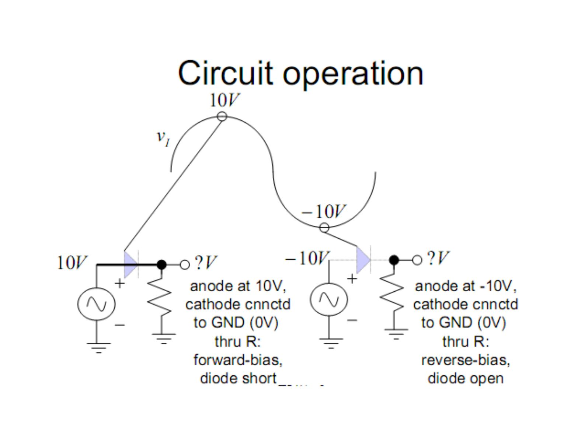
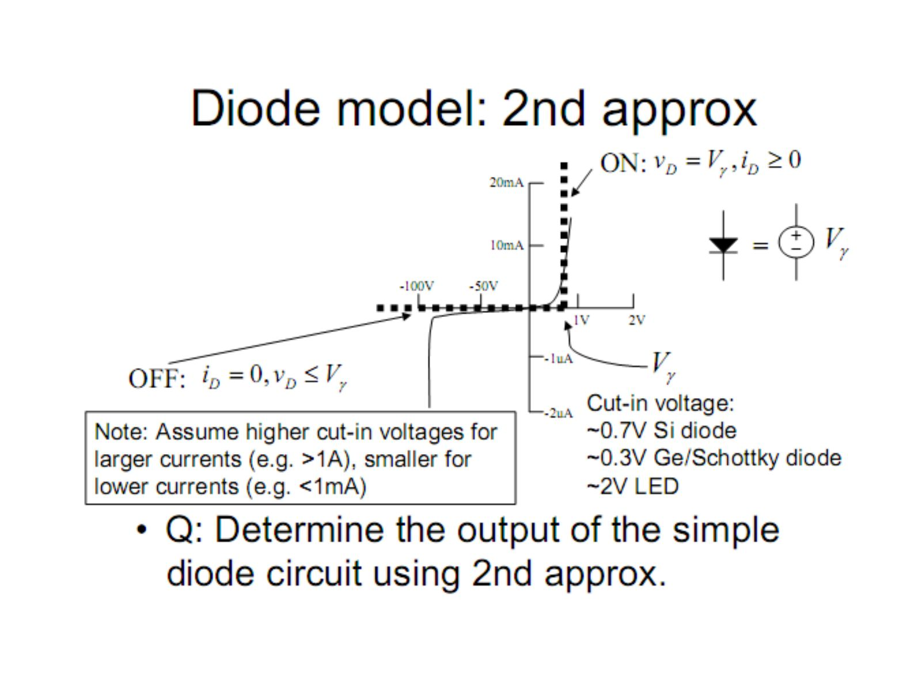
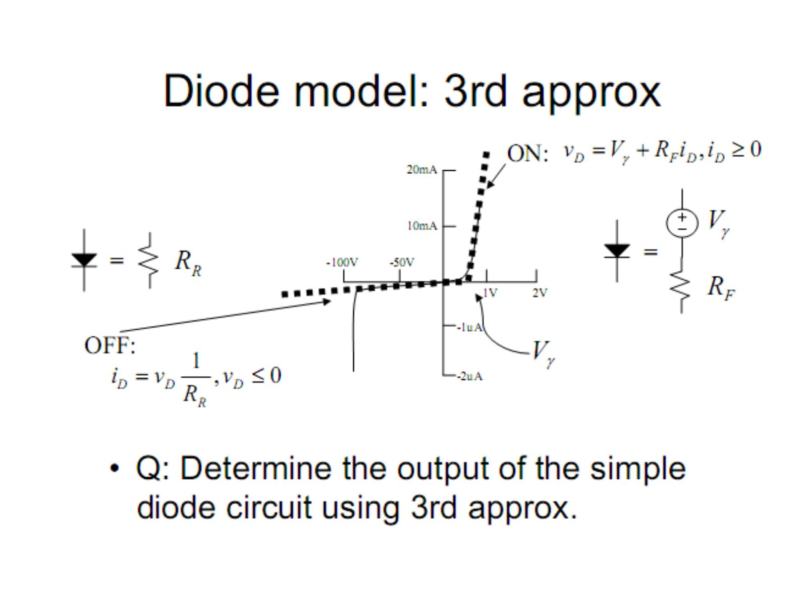
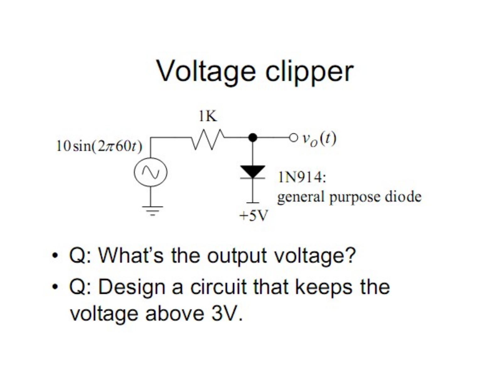

Bu yazı, Başkent Üniversitesi **EEM214 Elektronik I** dersinin *Lecture 4: Diode and Diode Models* sunumunun içeriğidir. Sunum dersin öğretim elemanı Yrd. Doç. Dr. Derya Yılmaz'ın ders slaytları arasında yer alıyor (son düzenleme Şubat 2012). Önceki iki dersteki yarıiletken fiziği burada sezgisel resimlerle tekrar ediliyor, ardından diyotlu devre analizi için doğrusal modellere geçiliyor. Slaytlar İngilizce olduğu için metinler de İngilizce aktarıldı; devre şemaları ve karakteristik eğrileri sayfa görselleriyle verildi. Sunumun orijinal dosyası yazının sonunda indirilebilir.

## Historical notes: vacuum tube diode

Filament heats up, emits electrons, attracted or repelled by the plate depending on voltage bias. The anode is the "plate", the cathode is the "filament".

- Filament heated up by battery: emits electrons
- Forward-bias: electrons attracted to anode causing current flow
- Reverse-bias: electrons repelled by anode stopping current flow

## Semiconductor diode

- Junction of P-type and N-type semiconductor (anode on the P side, cathode on the N side; the band on the package indicates the cathode)
- Other types of semiconductor diode exist
- 1940: Russell Ohl discovers that impurities in silicon determine its electrical properties
- A simplified explanation follows

### Pure, N-type and P-type silicon

- **Pure silicon:** 4 valence electrons form covalent bonds with 4 adjacent silicon (Si) atoms in pure crystalline Si.
- **N-type silicon:** arsenic (As) has 5 valence electrons; the fifth electron is free to move, the arsenic ion doesn't move. If the mobile electron leaves As, the remaining As atom will have positive charge.
- **P-type silicon:** boron (B) has 3 valence electrons. An electron from an adjacent Si atom can fill in the empty B bond site, creating a **hole**. If the empty B bond site is filled, the remaining B atom will have negative charge.

### Hole movement

Can a hole "move"? An electron from an adjacent Si atom can fill in the hole of the B atom; an electron from a nearby Si atom then fills in that empty bond site, and so on. We can think of a hole as a positive charge that can move around.

In p-type Si there are mobile positive holes and immobile boron ions; in n-type Si there are mobile electrons and immobile arsenic ions.

## Diode in static equilibrium

Electrons and holes near the interface combine, and an electric field is created in the interface region. The interface region becomes the **depletion region** (devoid of mobile charges).

### ON diode (forward-biased)

There is a net current: holes move to the right, electrons to the left. The electric field of the battery competes against the junction electric field to push the holes and electrons across the interface. If the battery's field is too weak, holes can't be pushed across the interface, nor can electrons. Boron and arsenic ions don't move.

")

### OFF diode (reverse-biased)

No net current! Charges are attracted towards the terminals and do not cross the depletion region; the depletion region widens.

## Diode terminal characteristics

The diode current i_D flows from anode to cathode and v_D is the anode-to-cathode voltage. In the forward direction the current rises steeply near 1 V (tens of mA); in the reverse direction only about −1 µA flows until breakdown near −100 V.

Q: What's the I-V curve of a resistor? Voltage source? Current source? Short circuit? Open circuit?

### Diode equation

i_D = I_S·(e^(v_D/ηV_T) − 1), ηV_T = 26 mV at room temperature

## A simple diode circuit

A half wave rectifier: v_I = 10·sin(2π·60t) drives a diode in series with a 1 kΩ load; the output v_O is taken across the resistor. Q: What's the output voltage? What's the diode voltage/current?

### Diode model: 1st approximation (short and open)

- ON: v_D = 0, i_D ≥ 0
- OFF: i_D = 0, v_D ≤ 0

**Circuit operation:** when the anode is at 10 V and the cathode is connected to GND (0 V) through R, the diode is forward-biased and acts as a short. When the anode is at −10 V, the diode is reverse-biased and acts as an open circuit.

### Circuit analysis with diodes

1. Guess the state of the diode(s).
1. Replace the diode(s) with corresponding linear model(s).
1. Verify if the state is consistent with the model: if assumed OFF, check if the voltage is negative; if assumed ON, check if the current is positive.

### Diode model: 2nd approximation

- ON: v_D = V_γ, i_D ≥ 0 (the diode is replaced by a voltage source V_γ)
- OFF: i_D = 0, v_D ≤ V_γ

Cut-in voltage: ~0.7 V Si diode, ~0.3 V Ge/Schottky diode, ~2 V LED. Note: assume higher cut-in voltages for larger currents (e.g. >1 A), smaller for lower currents (e.g. <1 mA). Q: Determine the output of the simple diode circuit using the 2nd approximation.

### Diode model: 3rd approximation

- ON: v_D = V_γ + R_F·i_D, i_D ≥ 0 (voltage source V_γ in series with R_F)
- OFF: i_D = v_D·(1/R_R), v_D ≤ 0 (the diode is a resistor R_R)

Q: Determine the output of the simple diode circuit using the 3rd approximation.

## Voltage clipper

A 10·sin(2π·60t) source feeds a 1 kΩ resistor; the output node is connected to the anode of a 1N914 general purpose diode whose cathode is at +5 V.

- Q: What's the output voltage?
- Q: Design a circuit that keeps the voltage above 3 V.

