Bu yazı, Başkent Üniversitesi **EEM214 Elektronik I** dersinin *Lecture 5: BJT Transistors* sunumunun içeriğidir. Sunum dersin öğretim elemanı Yrd. Doç. Dr. Derya Yılmaz'ın ders slaytları arasında yer alıyor (son düzenleme Mart 2012). 44 slaytlık sunum, bipolar eklem transistörünün (BJT) yapısını, çalışma modlarını ve büyük sinyal modellerini anlatıyor; şekil numaraları (Figure 7.7, 7.18, 7.21) dersin ana kaynağı Sedra & Smith'in *Microelectronic Circuits* kitabına atıf yapıyor. Slaytlar İngilizce olduğu için metinler de İngilizce aktarıldı, formüller düz metin olarak yazıldı; şekil ve karakteristik eğrileri sayfa görselleriyle verildi. Sunumun orijinal dosyası yazının sonunda indirilebilir.

## Bipolar Junction Transistor (BJT)

A three-terminal device that uses the **voltage** of two terminals to **control** the **current** flowing in the third terminal.

- The basis for amplifier design
- The basis for switch design
- The basic element of high speed integrated digital and analog circuits

Applications:

- Discrete-circuit design
- Analog circuits: high frequency applications such as radio frequency analog circuits
- Digital circuits: high speed digital circuits such as emitter coupled logic (ECL)
- Bi-CMOS (Bipolar + CMOS) circuits that combine the advantages of MOSFET (high input impedance and low power) and bipolar transistors (high-frequency operation and high-current-driving capabilities)

## Structure

### NPN transistor

- Emitter (E): heavily doped n-type region
- Base (B): lightly doped p-type region
- Collector (C): heavily doped n-type region
- Two diodes connected in series with opposite directions: EBJ (Emitter-Base junction) and CBJ (Collector-Base junction)

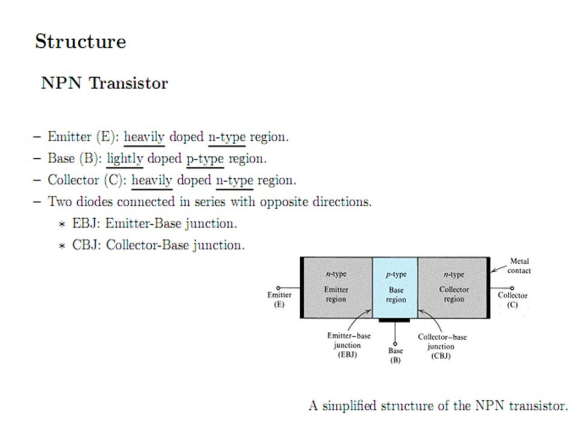

### Modes of operation

There are four basic modes of operation for a BJT depending on the states of the two pn junctions of the transistor:

| Mode | Emitter-Base Jct. | Collector-Base Jct. |
|---|---|---|
| Cutoff | Reverse | Reverse |
| Active | Forward | Reverse |
| Saturation | Forward | Forward |
| Reverse Active | Reverse | Forward |

For the NPN transistor:

- Cutoff: v_BE < 0, v_CB > 0
- Active: v_BE > 0, v_CB > 0
- Reverse active: v_BE < 0, v_CB < 0
- Saturation: v_BE < 0, v_CB < 0

*Not: Doyum (saturation) modunda EBJ ileri yönlü olduğu için koşul v_BE > 0, v_CB < 0 olmalı; slayttaki "v_BE < 0" ifadesi hatalı.*

In **digital logic** applications the transistor switches between the cutoff and saturation modes. As a **linear amplifier** in a communication circuit, the transistor would operate in the active mode. Because of the asymmetrical physical construction, the reverse active mode is not the same as interchanging the collector and emitter leads. The states of the two pn junctions can be altered by the external circuitry connected to the transistor; this is called **biasing** the transistor.

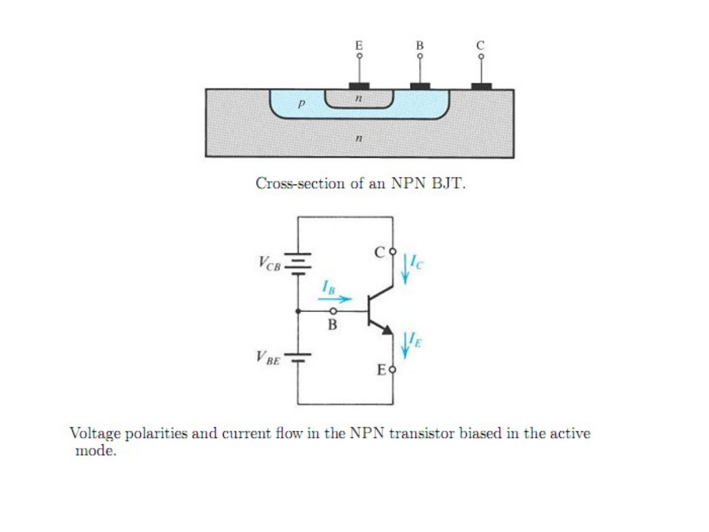

### PNP transistor

- Emitter (E): heavily doped p-type region
- Base (B): lightly doped n-type region
- Collector (C): heavily doped p-type region
- Two diodes connected in series with opposite directions (EBJ and CBJ)

Modes of operation for the PNP transistor:

- Cutoff: v_EB < 0, v_BC < 0
- Active: v_EB > 0, v_BC > 0
- Reverse active: v_EB < 0, v_BC < 0
- Saturation: v_EB > 0, v_CB > 0

*Not: PNP'de kesimde CBJ ters yönlü olduğundan koşul v_BC > 0 olmalı; slayttaki "v_BC < 0" ifadesi hatalı.*

## Operations of the NPN transistor: active mode

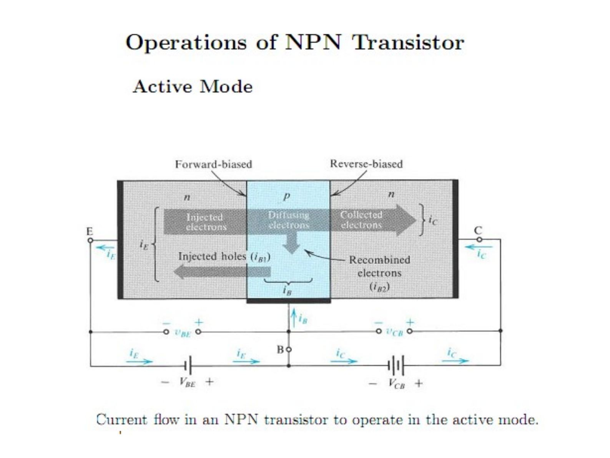

**Emitter-Base junction:** forward bias, v_BE > 0. Electrons in the emitter region are injected into the base causing a current i_E1. Holes in the base region are injected into the emitter region causing a current i_E2. Generally i_E1 ≫ i_E2, and i_E(t) = i_E1 + i_E2.

**Base region:** the tapered concentration causes the electrons to diffuse through the base region toward the collector. Some of the electrons may combine with holes, causing a concave shape of the profile; the recombination process is quite small due to the lightly doped and thin base region.

n_p(0) = n_p0·e^(v_BE/V_T)

The diffusion current I_n (flowing from right to left) is proportional to the slope of the concentration profile:

I_n = A_E·q·D_n·dn_p(x)/dx = −A_E·q·D_n·n_p(0)/W

where A_E is the cross-sectional area of the base-emitter junction, D_n is the electron diffusivity in the base region and W is the effective width of the base.

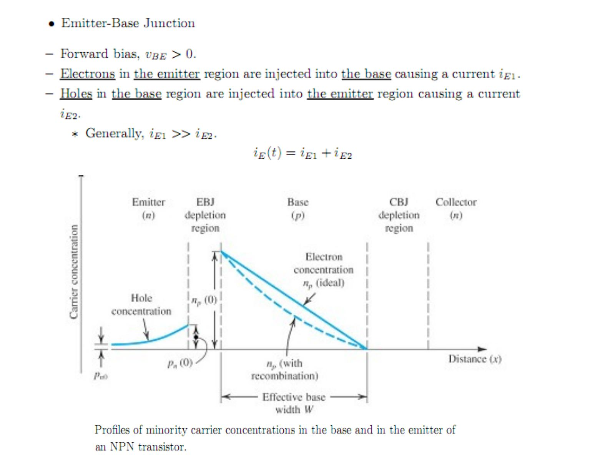

**Collector-Base junction:** reverse bias, v_BC > 0. The electrons near the collector side are swept into the collector region, causing zero concentration at the collector side.

### Collector current

Most of the diffusing electrons reach the collector region (i_C = −I_n); only a very small percentage recombine with holes in the base. As long as v_CB > 0, i_C is independent of v_CB.

i_C = −I_n = A_E·q·D_n·n_p(0)/W = (A_E·q·D_n·n_p0/W)·e^(v_BE/V_T) = (A_E·q·D_n·n_i²/(W·N_A))·e^(v_BE/V_T) = I_S·e^(v_BE/V_T)

The saturation current (also known as scale current) I_S = A_E·q·D_n·n_i²/(W·N_A) is a strong function of temperature, proportional to the cross-sectional area of the base-emitter junction and inversely proportional to the base width W.

### Base current

i_B is composed of two currents:

- The holes injected from the base region into the emitter region: i_B1 = (A_E·q·D_p·n_i²/(N_D·L_p))·e^(v_BE/V_T)
- The holes that have to be supplied by the external circuit due to recombination (τ_b is the average time for a minority electron to recombine with a majority hole): i_B2 = (1/2)·(A_E·q·W·n_i²/(τ_b·N_A))·e^(v_BE/V_T)

In terms of i_C:

i_B = i_B1 + i_B2 = I_S·((D_p/D_n)·(N_A/N_D)·(W/L_p) + (1/2)·W²/(D_n·τ_b))·e^(v_BE/V_T) = (1/β)·i_C

β = 1 / ((D_p/D_n)·(N_A/N_D)·(W/L_p) + (1/2)·W²/(D_n·τ_b)) is a constant (normally in the range 50–200) for a given transistor. β is mainly influenced by (1) the width of the base region and (2) the relative dopings of the base and emitter regions, N_A/N_D. To achieve high β values the base should be thin (W small) and lightly doped, and the emitter heavily doped.

### Emitter current

From KCL:

i_E = i_B + i_C = (1/β)·i_C + i_C = ((1+β)/β)·i_C = (1/α)·i_C = (1/α)·I_S·e^(v_BE/V_T)

α = β/(1+β) ≈ 1 is a constant for a given transistor. A small change in α corresponds to large changes in β.

### Recapitulation

Configuration: EBJ forward, CBJ reverse.

- i_C = β·i_B (β normally 50–200)
- i_C = α·i_E (α = β/(1+β) ≲ 1)
- i_B, i_C and i_E are all controlled by v_BE: i_C = I_S·e^(v_BE/V_T), i_B = (1/β)·I_S·e^(v_BE/V_T), i_E = (1/α)·I_S·e^(v_BE/V_T)

**Large signal equivalent models** in the forward active mode: (a) i_C behaves as a voltage (v_BE) controlled current source, i_C + i_B = i_E = i_C/α; (b) i_C behaves as a current (i_E) controlled current source, α·i_E + i_B = i_E. The diode D_E (I_SE = I_S/α_F) represents the forward base-emitter junction.

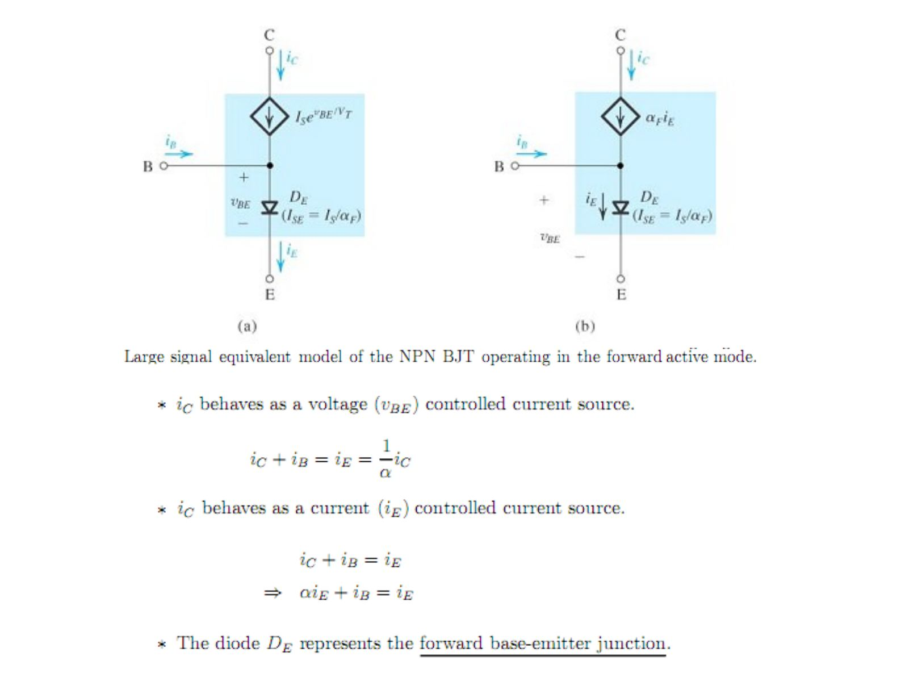

### Discussion about the BJT in the active mode

1. The proportion of electrons from the emitter that "make it" to the base is called the **collector efficiency** α: α ≡ i_C/i_E, or i_C = α·i_E. Typically it has values near 0.99; α is called the common-base current gain in the text. Also i_E = i_B + i_C, so i_B = i_E − i_C = (1 − α)·i_E. With α ≈ 1, i_B will be much, much smaller than i_E.
1. The ratio of collector current to base current is called the **current gain** β: β ≡ i_C/i_B, or i_C = β·i_B.
1. Dividing (1) by (4) we find i_C/i_B = α/(1 − α), so β = α/(1 − α) and α = β/(β + 1). With α ≈ 0.99 ⇒ β ≈ 100.
1. One can think of the base current in the BJT as controlling the collector current: i_C = β·i_B. Since β is large, a small change in i_B produces a large change in i_C. If the base were an input signal and the collector the output, this would be signal amplification!
1. In the circuit symbol of the npn BJT the arrows indicate the assumed directions for positive current. The filled arrow is always located on the emitter and helps us to remember the direction of the emitter current.
1. One biasing circuit uses a V_BE source on the base-emitter and a V_CB source on the collector-base.

*Not: α, emetörden çıkıp kolektöre ulaşan elektronların oranıdır (i_C/i_E); slayttaki "to the base" ifadesi "to the collector" olmalı.*

## Reverse active mode

The α and β in the reverse active mode are much lower than those in the forward active mode:

- α_R is in the range of 0.01 to 0.5. In forward active mode the collector virtually surrounds the emitter region, so electrons injected into the thin base are mostly captured by the collector. In reverse active mode the emitter virtually surrounds the collector region, so electrons injected into the base are partly captured.
- β_R is in the range of 0.01 to 1.

The CBJ has a much larger area than the EBJ. The diode D_C denotes the forward base-collector junction; D_C has a larger scale current (I_SC = I_S/α_R) than D_E and therefore a lower voltage drop when forward biased.

## Ebers-Moll (EM) model

A composite model that can be used to predict the operation of the BJT in all possible modes. α_F and β_F denote the parameters in forward active mode, α_R and β_R in reverse active mode.

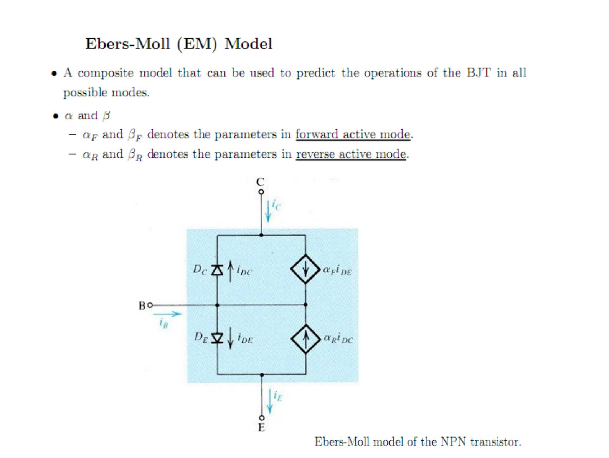

I_SE and I_SC are the equivalent saturation currents at the EBJ and CBJ: I_SE = I_S/α_F, I_SC = I_S/α_R ⇒ α_F·I_SE = α_R·I_SC = I_S.

- i_E = i_DE − α_R·i_DC
- i_C = −i_DC + α_F·i_DE
- i_B = (1 − α_F)·i_DE + (1 − α_R)·i_DC
- i_DE = I_SE·(e^(v_BE/V_T) − 1), i_DC = I_SC·(e^(v_BC/V_T) − 1)

So:

- i_E = (I_S/α_F)·(e^(v_BE/V_T) − 1) − I_S·(e^(v_BC/V_T) − 1)
- i_C = I_S·(e^(v_BE/V_T) − 1) − (I_S/α_R)·(e^(v_BC/V_T) − 1)
- i_B = (I_S/β_F)·(e^(v_BE/V_T) − 1) + (I_S/β_R)·(e^(v_BC/V_T) − 1)

with β_F = α_F/(1 − α_F) and β_R = α_R/(1 − α_R).

## Saturation mode

The CBJ is in forward bias, i.e. v_BC > 0.4 V. The CBJ has a larger junction area, a larger saturation current I_S and a lower cut-in voltage than the EBJ. In forward bias the voltage drop across the CBJ is 0.4 V and across the EBJ 0.7 V. As v_BC is increased, i_C will decrease and eventually reach zero:

i_C ≈ I_S·e^(v_BE/V_T) − (I_S/α_R)·e^(v_BC/V_T)

## Operations of the PNP transistor

Current in a PNP transistor is mainly conducted by **holes**. The emitter-base junction is forward biased (v_EB > 0): holes in the emitter are injected into the base (i_E1), electrons in the base are injected into the emitter (i_E2), generally i_E1 ≫ i_E2. Holes diffuse through the base toward the collector; recombination is small. The collector-base junction is reverse biased (v_BC > 0) and holes near the collector side are swept into the collector. As long as v_BC > 0, i_C is independent of v_BC. The base current consists of electrons injected from the base into the emitter and electrons supplied by the external circuit due to recombination. As for the NPN, i_E = (1/α)·i_C = (1/α)·I_S·e^(v_EB/V_T). Reverse active and saturation modes are similar to the NPN transistor.

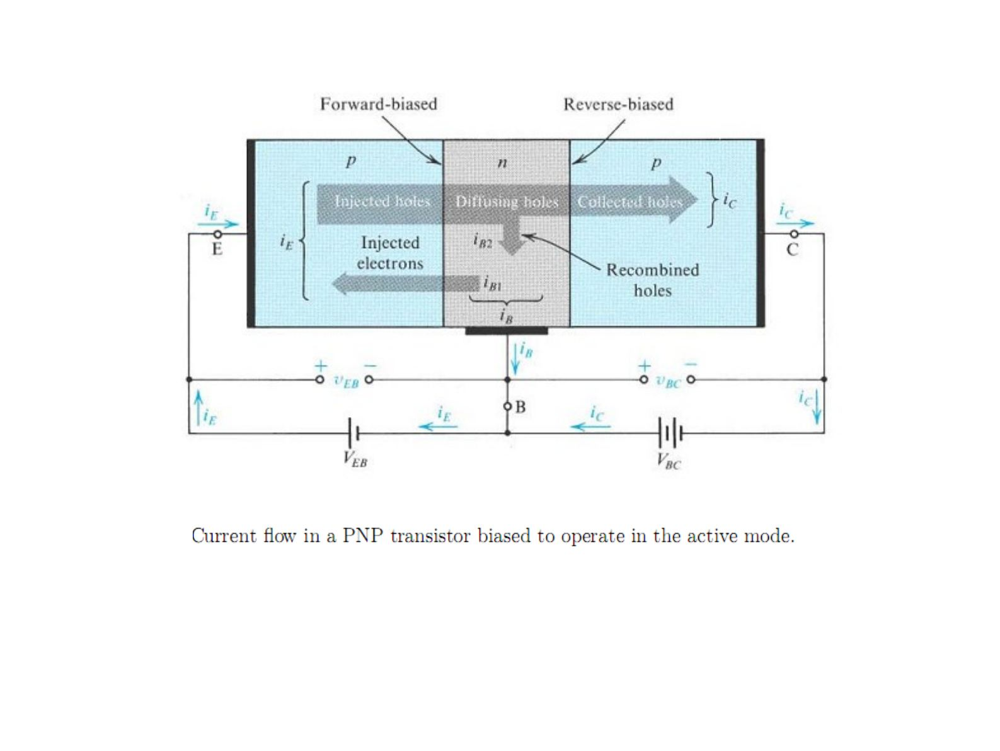

### Summary of i_C, i_B, i_E relationships in active mode

- i_C = I_S·e^(v_BE/V_T)
- i_B = (I_S/β)·e^(v_BE/V_T)
- i_E = (I_S/α)·e^(v_BE/V_T)
- i_C = α·i_E, i_C = β·i_B
- i_B = (1 − α)·i_E = i_E/(1 + β)
- i_E = (1 + β)·i_B

For the PNP transistor v_BE is replaced by v_EB.

## The i-v characteristics of the NPN transistor

### Common base (i_C – v_CB)

The figure depicts i_C versus v_CB for various i_E, known as the common-base characteristics. Input port: emitter and base terminals (input current i_E). Output port: collector and base terminals (output current i_C). The base terminal is common to both ports.

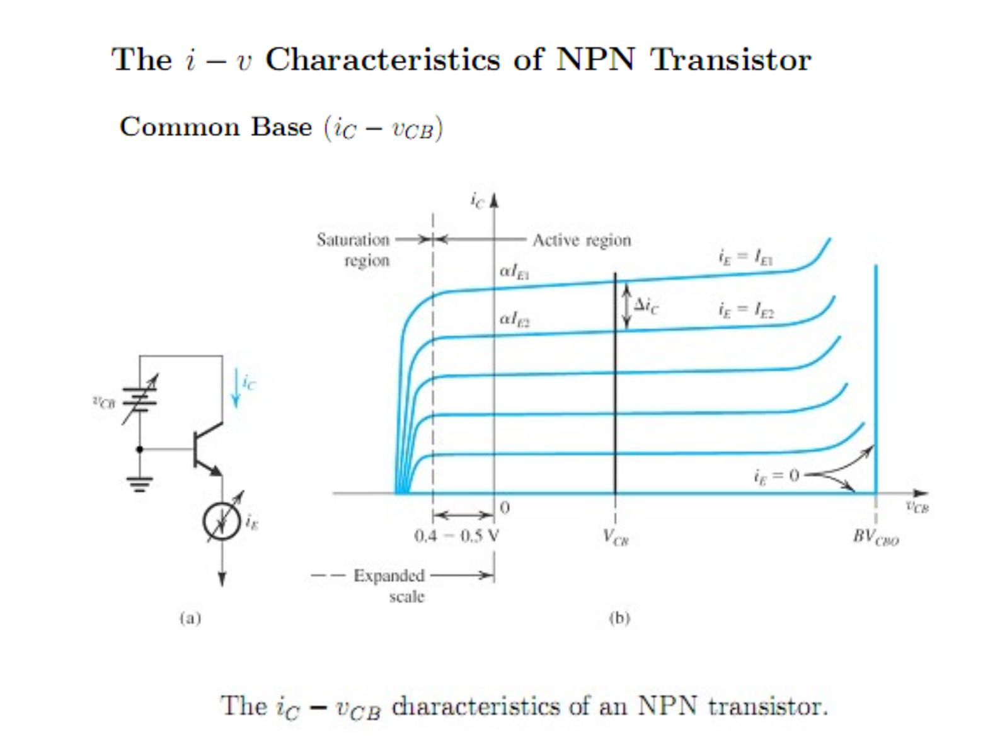

- **Active region (v_CB ≥ −0.4 V):** i_C depends slightly on v_CB and shows a small positive slope. i_C shows a rapid increase, known as the breakdown phenomenon, for a relatively large v_CB. Each curve intersects the vertical axis at a current level equal to α·I_E. Total or large-signal α (common-base current gain): α = i_C/i_E; incremental or small-signal α: α = Δi_C/Δi_E. Usually the two differ slightly.
- **Saturation region (v_CB < −0.4 V):** the CBJ is forward biased. The EM model can be used to determine the v_CB at which i_C is zero.

### Common emitter (i_C – v_CE)

The figure depicts i_C versus v_CE for various v_BE, known as the common-emitter characteristics. Input port: base and emitter (input current i_B). Output port: collector and emitter (output current i_C). The emitter is common to both ports.

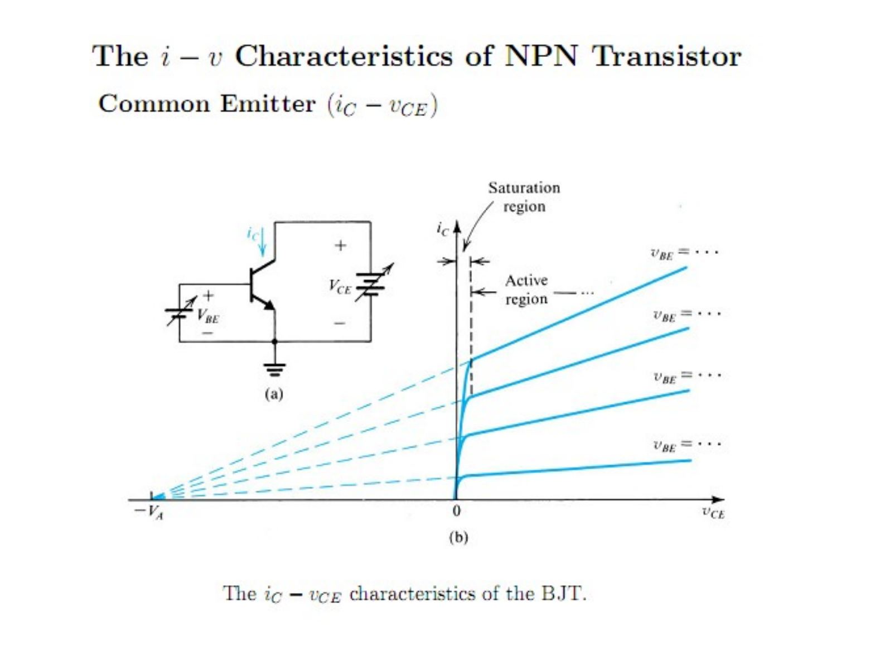

**Active region (v_CB ≥ −0.4 V):** i_C increases as v_CE is increased, which is known as the **Early effect**. At a given v_BE, increasing v_CE increases the width of the CBJ depletion region, the effective base width W decreases, and I_S is inversely proportional to W. When extrapolated, the characteristic lines meet at a point on the negative v_CE axis, −V_A (V_A normally 50 V to 100 V, constant for a given transistor).

Large signal model in active mode:

i_C = I_S·e^(v_BE/V_T)·(1 + v_CE/V_A) = I_C·(1 + v_CE/V_A)

The output resistance looking into the collector-emitter terminals is inversely proportional to the collector current I_C (without considering the Early effect) and controlled by v_BE:

Δi_C = I_S·e^(v_BE/V_T)·(Δv_CE/V_A) ⇒ r_o = Δv_CE/Δi_C = V_A/I_C

In Figure 7.18, (a) v_BE controls the collector current source I_S·e^(v_BE/V_T), (b) the base current i_B controls the collector current source β·i_B; in both, the diode D_B (I_S/β) and r_o are present.

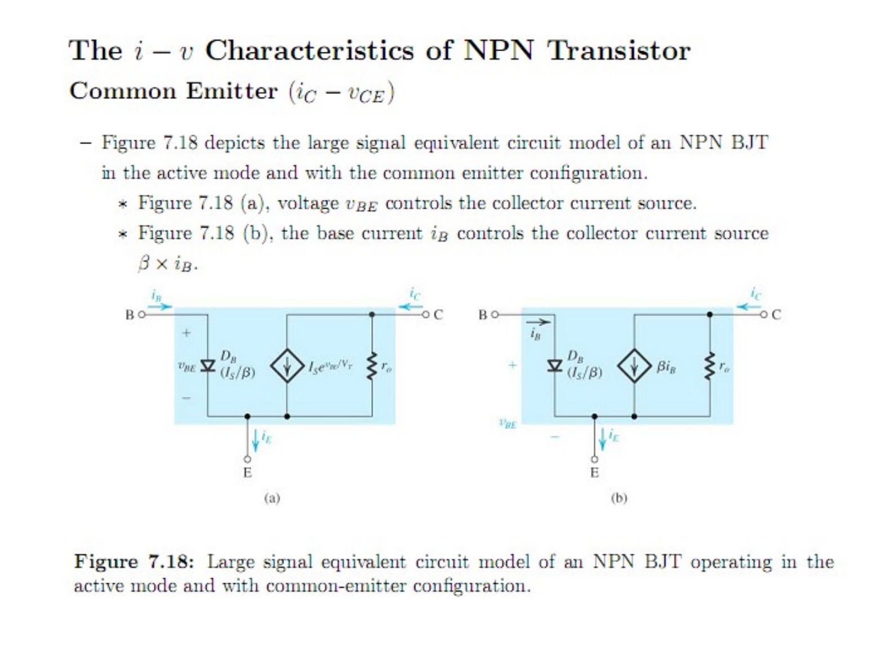

**Large signal or DC β:** the ratio of total collector current to total base current, the ideal current gain (r_o not present) of the common-emitter configuration: β_dc = i_C/i_B at constant v_CE. Also known as the common-emitter current gain. **Incremental or AC β:** short-circuit common-emitter current gain, β_ac = Δi_C/Δi_B at constant v_CE. AC β and DC β differ by approximately 10% to 20%.

### Saturation region (v_CB < −0.4 V)

Using the EM model with v_BE = v_CE + v_CB:

- i_C ≈ I_S·e^(v_BE/V_T) − (I_S/α_R)·e^(v_BC/V_T)
- I_B ≈ (I_S/β_F)·e^(v_BE/V_T) + (I_S/β_R)·e^(v_BC/V_T)
- i_C ≈ (β_F·I_B)·(e^(v_CE/V_T) − 1/α_R) / (e^(v_CE/V_T) + β_F/β_R)

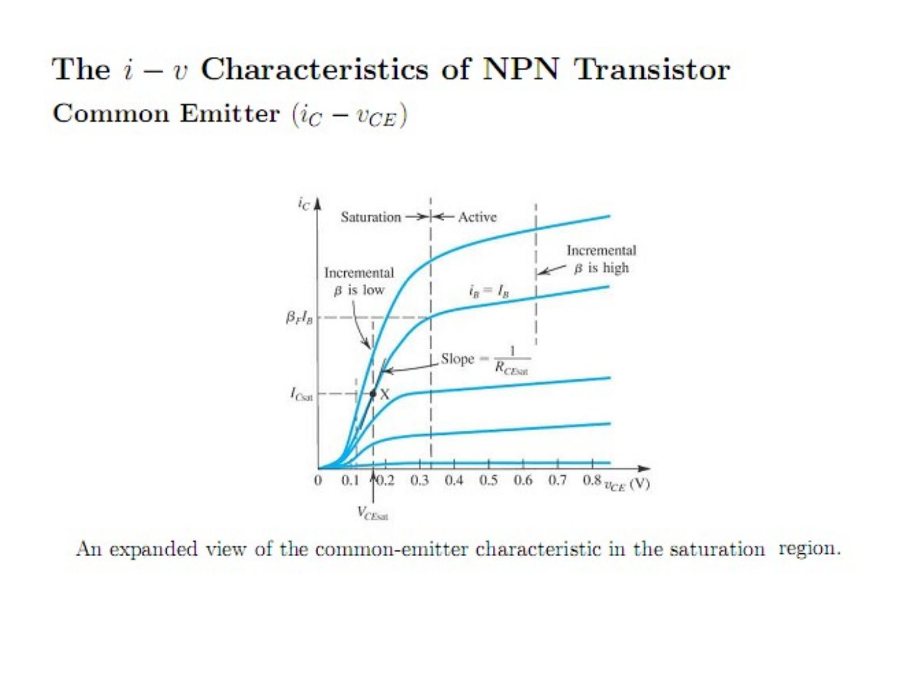

A plot of normalized i_C versus v_CE for an NPN transistor with β_F = 100 and α_R = 0.1 shows i_C/(β_F·I_B) rising from zero near V_T·ln(1/α_R) to 1 (β_forced/β_F), with a slope of about 10 V⁻¹ around 0.5.

**Large signal model in saturation mode:** the saturated transistor exhibits a low collector-to-emitter resistance

R_CEsat = ∂v_CE/∂i_C (at i_B = I_B, i_C = I_C) ≈ 1/(10·β_F·I_B)

At the collector side the transistor is modeled as a resistance R_CEsat in series with a battery V_CEoff (Figure 7.21 c). V_CEoff is typically around 0.1 V and V_CEsat around 0.1–0.3 V:

V_CEsat = V_CEoff + I_Csat·R_CEsat

For many applications the even simpler model of Figure 7.21 (d) is used: 0.7 V between base and emitter and 0.2 V between collector and emitter.

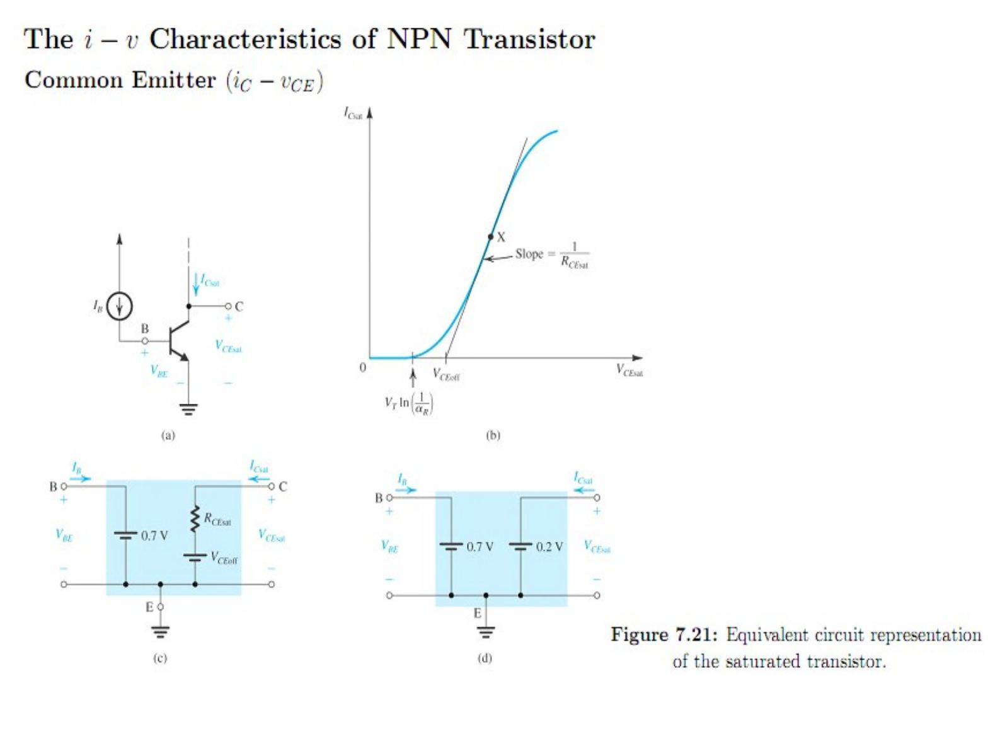
