This post is the content of the *Lecture 6* (FET) presentation of the **EEM214 Electronics I** course at Başkent University. The presentation was prepared by the course instructor, Asst. Prof. Dr. Derya Yılmaz; its last revision date is May 2013. The presentation consists largely of scanned figures (Fig. 6.27–6.38) from the supplementary textbook *Electronic Devices and Circuit Theory* by Boylestad & Nashelsky; text appears on only a few slides. For this reason the figures are provided as slide images, and the information and formulas they contain are written out as text. The original presentation file can be downloaded at the end of the post.

## JFET characteristics

The first slide shows how the transfer characteristic (I_D – V_GS) of an n-channel JFET is obtained from the drain characteristics (I_D – V_DS). In the example, I_DSS = 8 mA and V_P = −4 V: at V_GS = 0 V, I_D = I_DSS, and at V_GS = V_P, I_D = 0 mA.

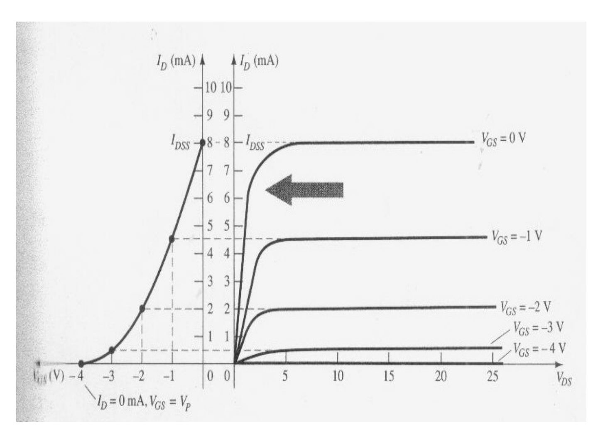

### JFET and BJT comparison

| JFET | | BJT |
|---|---|---|
| I_D = I_DSS·(1 − V_GS/V_P)² | ⇔ | I_C = β·I_B |
| I_D = I_S | ⇔ | I_C ≅ I_E |
| I_G ≅ 0 A | ⇔ | V_BE ≅ 0.7 V |

 and BJT (b)")

## Depletion MOSFET (Insulated-Gate FET, IGFET)

In the n-channel depletion-type MOSFET, there is a doped n channel between two n-doped regions (drain D and source S) on a p-type substrate (SS); the gate (G) is separated from the channel by an insulating SiO₂ layer.

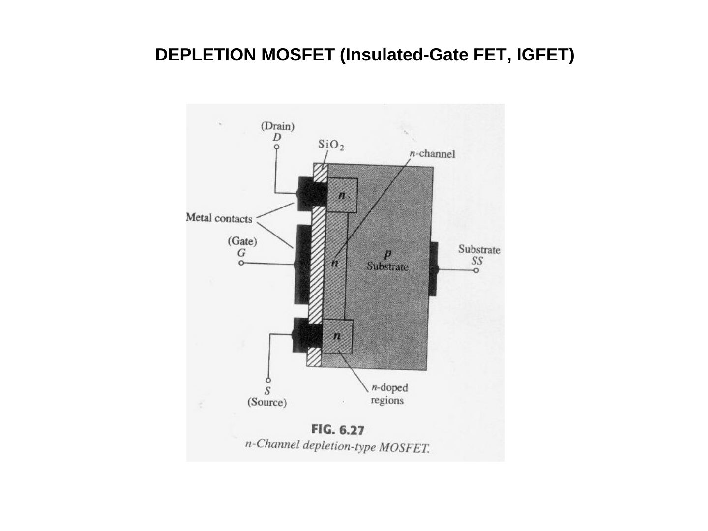

When V_DD is applied to the drain at V_GS = 0 V, a current I_D = I_S = I_DSS flows through the channel.

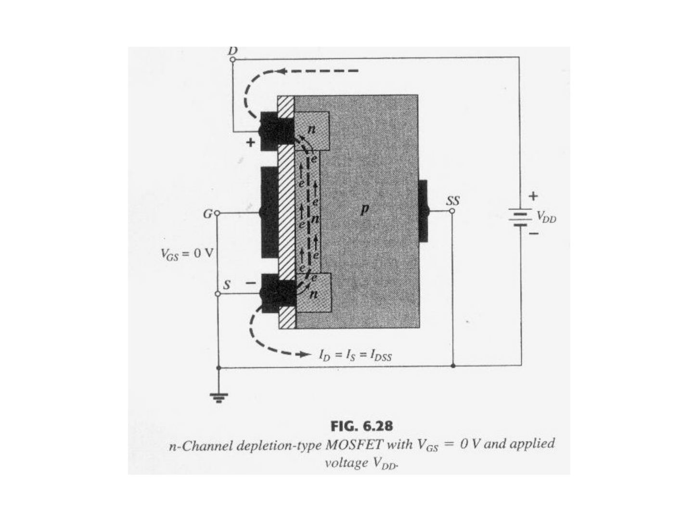

The depletion-type MOSFET can operate in both depletion (V_GS < 0) and enhancement (V_GS > 0) modes. In the example, I_DSS = 8 mA and V_P = −6 V; at V_GS = +1 V, I_D = 10.9 mA, and at V_GS = V_P/2 = −3 V, I_D = I_DSS/4 = 2 mA.

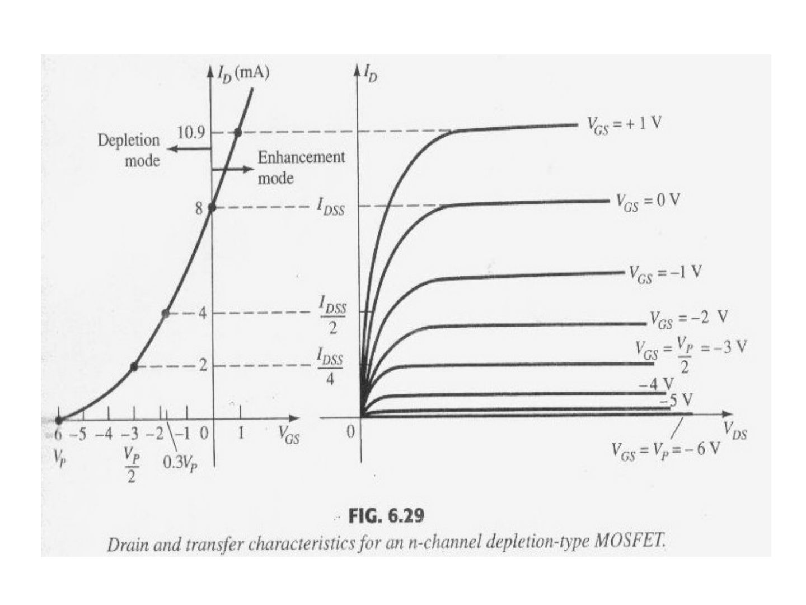

In the p-channel depletion-type MOSFET the substrate is n-type; in the example characteristic, I_DSS = 6 mA and V_P = +6 V, and the current decreases as V_GS increases.

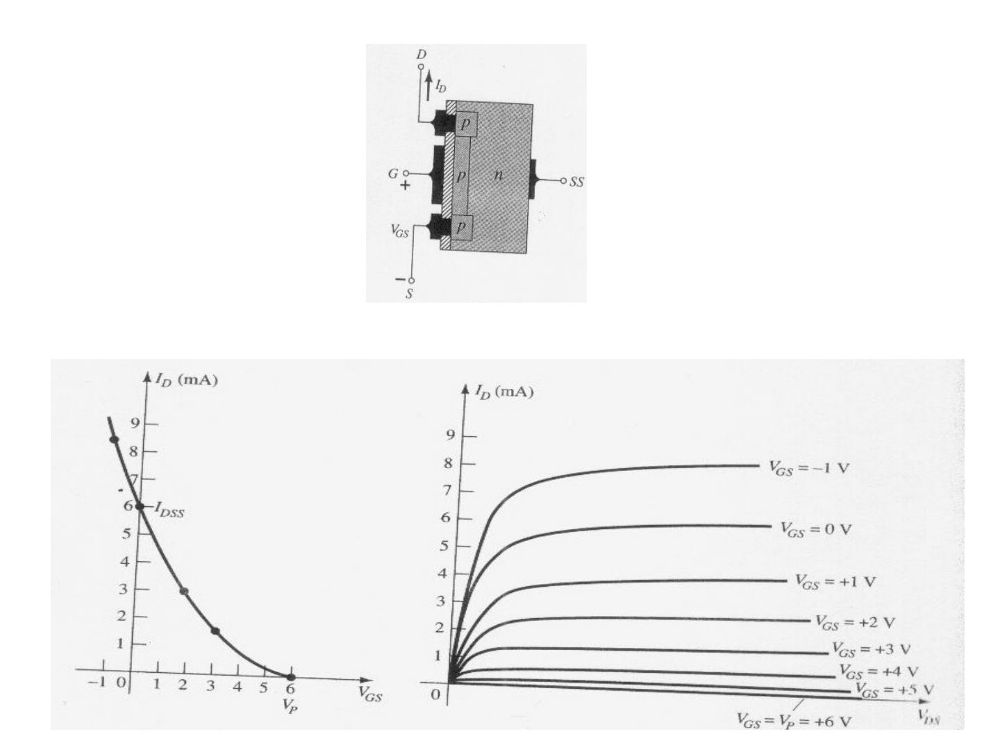

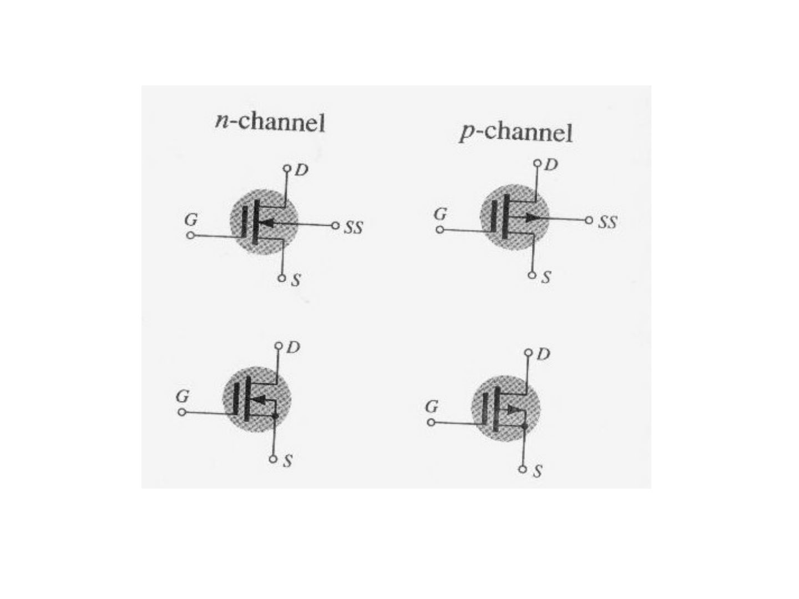

## Enhancement MOSFET (Insulated-Gate FET, IGFET)

In the enhancement-type MOSFET there is no doped channel between the drain and source regions ("no-channel"); the channel forms when a positive voltage above the threshold voltage (V_T) is applied to the gate.

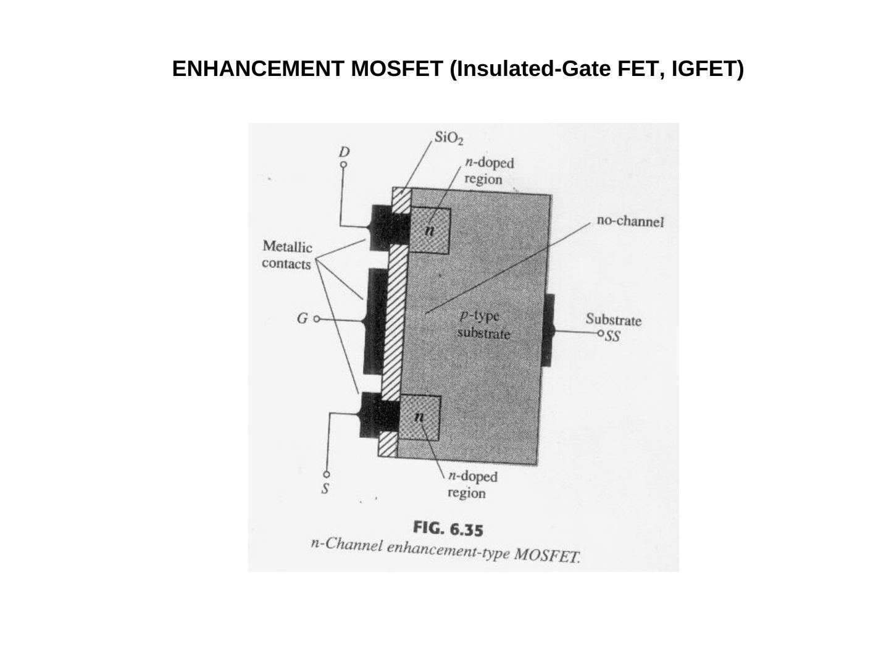

For a fixed V_GS, as V_DS increases the depletion region widens on the drain side and the channel narrows, beginning to pinch off.

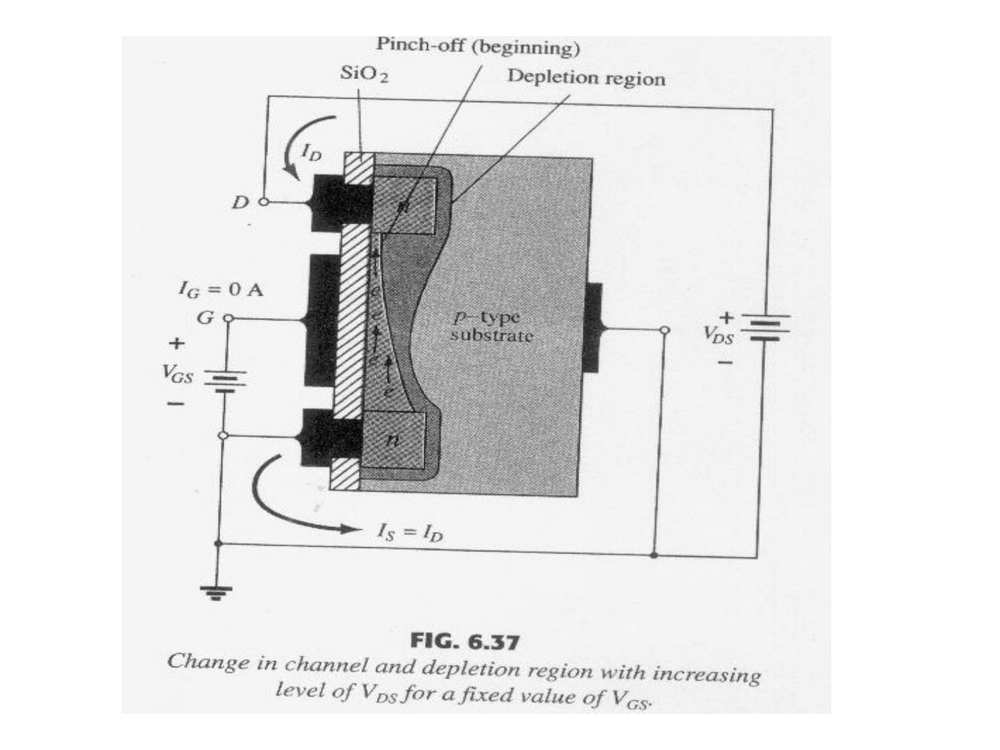

Locus of the saturation points: V_DSsat = V_GS − V_T. In the example characteristic, V_T = 2 V and k = 0.278×10⁻³ A/V²; at V_GS = +8 V, I_D ≈ 10 mA.

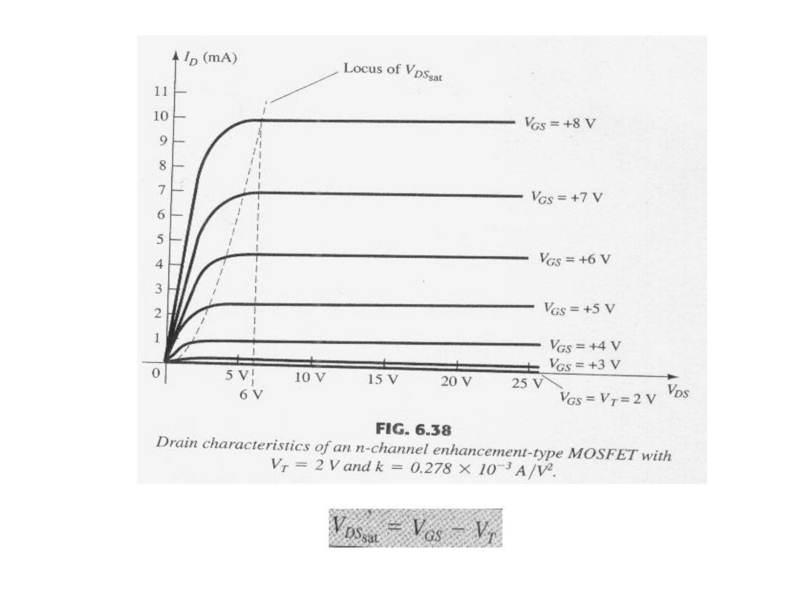

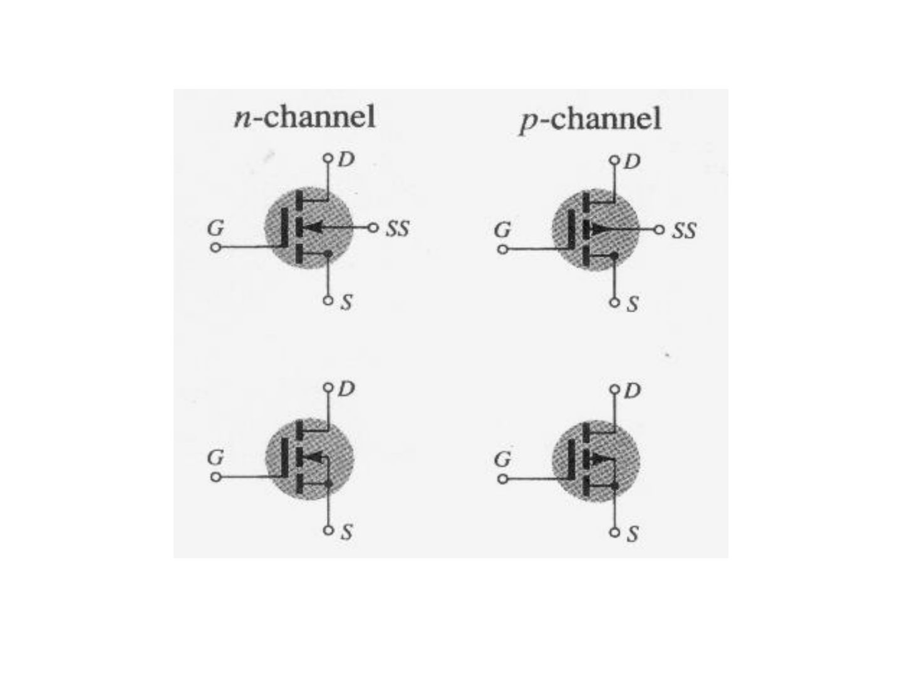

## CMOS transistors (Complementary MOS)

They are formed by using N- and P-channel MOSFET transistors together. They have low power dissipation. They are widely used in digital circuit design.

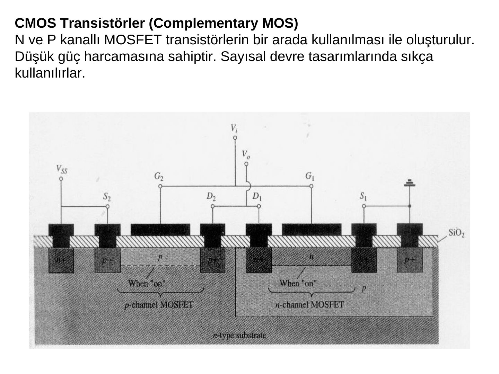

### CMOS inverter

Inverter supplied with V_SS = 5 V: when 5 V (state 1) is applied to the input, the n-channel Q₁ conducts (R₁ low) and the p-channel Q₂ is cut off (R₂ high), so the output is V_o = R₁·V_SS/(R₁ + R₂) ≅ 0 V (state 0).

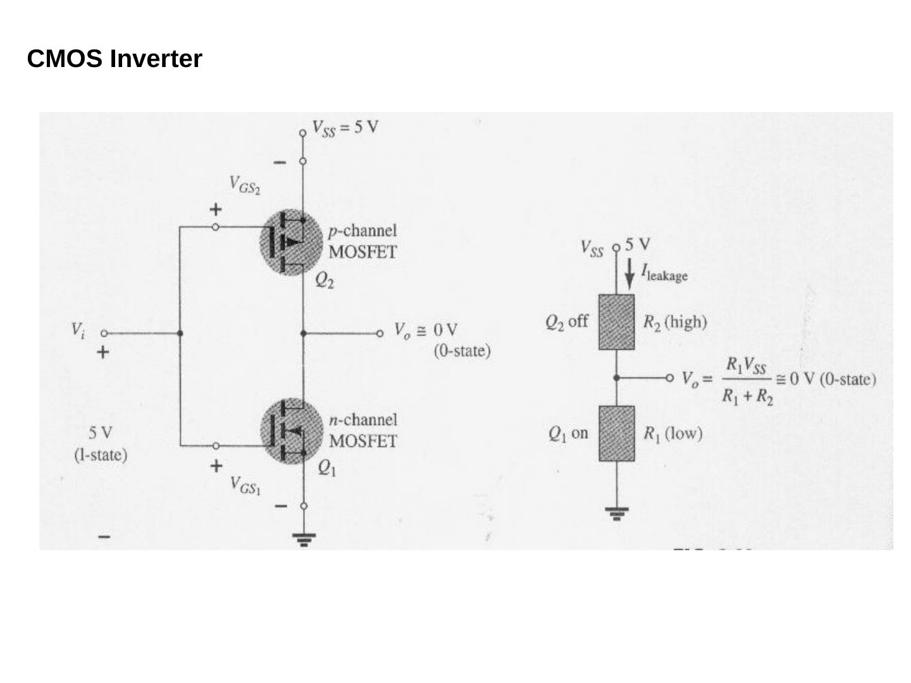

## VMOS transistors (Vertical Metal Oxide Silicon FET)

- Compared with MOSFETs, their channel resistances are low and they have high current and power ratings.
- They have a positive temperature coefficient.
- Their switching times are very short.

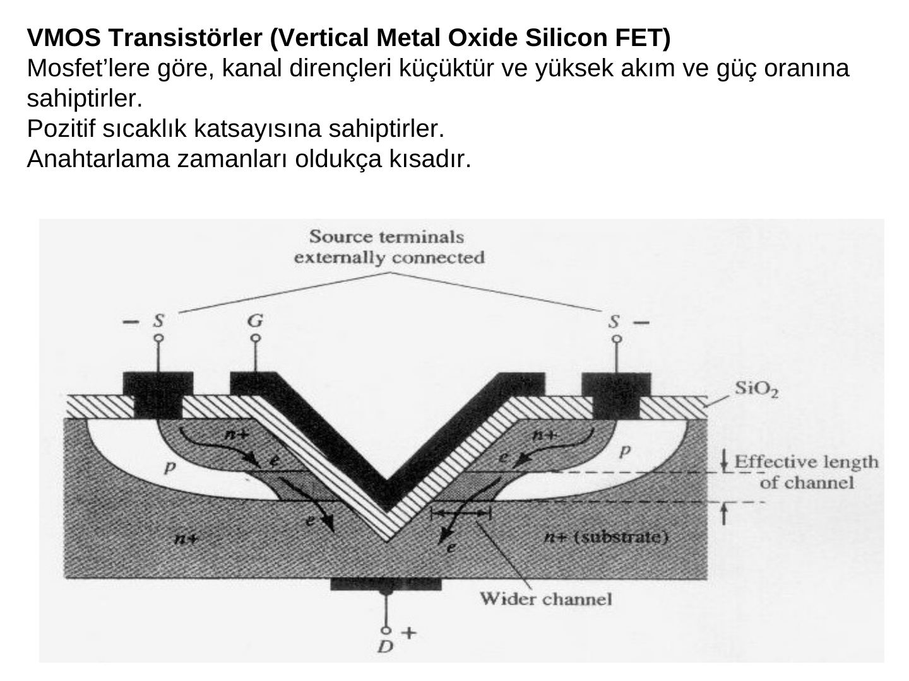

## MESFET transistors (Metal Semiconductor Field Effect Transistors)

- Compared with MOSFETs, their channel resistances are low and they have high current and power ratings.
- They have a positive temperature coefficient.
- Their switching times are very short.

*Note: The items on the MESFET slide are identical to those on the VMOS slide; most likely they were copied and left uncorrected. The distinguishing feature of the MESFET is that its gate is made of a metal (tungsten in the figure) that forms a Schottky junction directly with the semiconductor instead of an insulator, and that it can be used at high frequencies thanks to the GaAs substrate.*

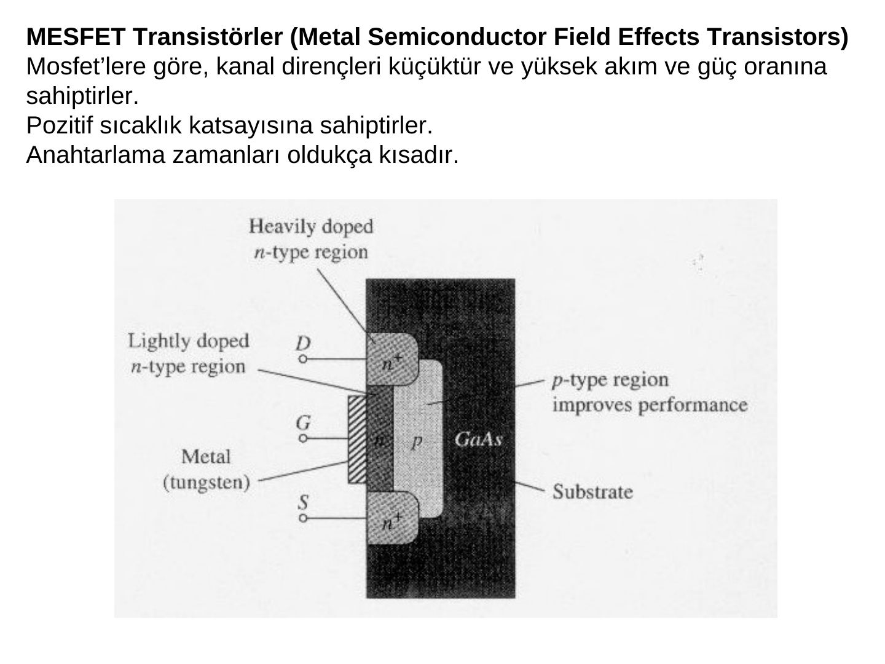
