Bu yazı, Başkent Üniversitesi **EEM214 Elektronik I** dersinin *Lecture 6* (FET) sunumunun içeriğidir. Sunumu dersin öğretim elemanı Yrd. Doç. Dr. Derya Yılmaz hazırlamış; son düzenleme tarihi Mayıs 2013. Sunum büyük ölçüde ek ders kitabı olan Boylestad & Nashelsky'nin *Electronic Devices and Circuit Theory* kitabından taranmış şekillerden (Fig. 6.27–6.38) oluşuyor; metin yalnızca birkaç slaytta var. Bu yüzden şekiller sayfa görselleriyle verildi, içerdikleri bilgiler ve formüller metin olarak yazıldı. Sunumun orijinal dosyası yazının sonunda indirilebilir.

## JFET karakteristikleri

İlk slayt, n kanallı bir JFET'in transfer karakteristiğini (I_D – V_GS) savak karakteristiklerinden (I_D – V_DS) nasıl elde edildiğini gösteriyor. Örnekte I_DSS = 8 mA ve V_P = −4 V: V_GS = 0 V'ta I_D = I_DSS, V_GS = V_P'de I_D = 0 mA.

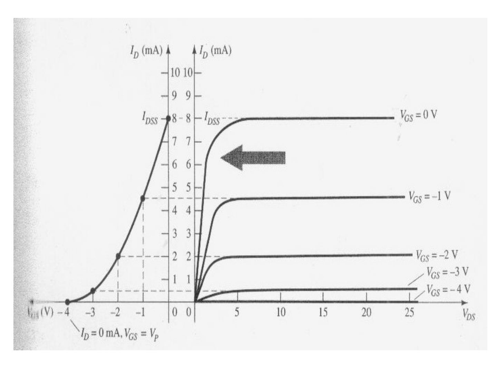

### JFET ve BJT karşılaştırması

| JFET | | BJT |
|---|---|---|
| I_D = I_DSS·(1 − V_GS/V_P)² | ⇔ | I_C = β·I_B |
| I_D = I_S | ⇔ | I_C ≅ I_E |
| I_G ≅ 0 A | ⇔ | V_BE ≅ 0.7 V |

 ve BJT (b)")

## Depletion MOSFET (Insulated-Gate FET, IGFET)

n kanallı azaltıcı tip MOSFET'te p tipi alttaş (substrate, SS) üzerinde iki n katkılı bölge (savak D ve kaynak S) arasında katkılanmış bir n kanalı bulunur; kapı (G), SiO₂ yalıtkan katmanla kanaldan ayrılmıştır.

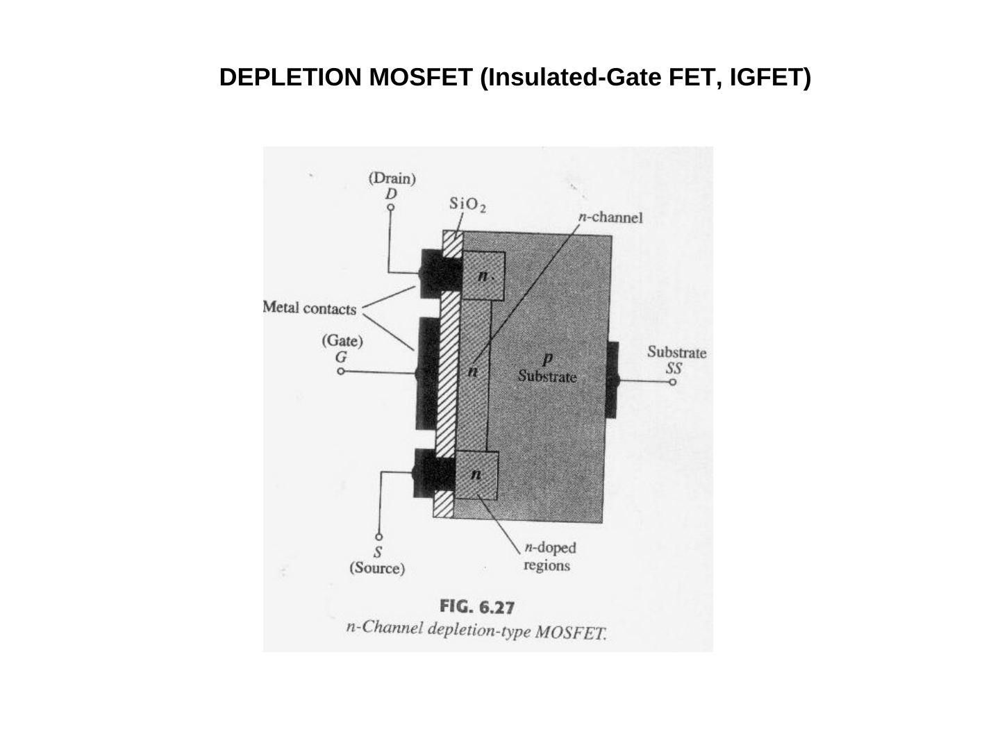

V_GS = 0 V'ta savağa V_DD uygulandığında kanaldan I_D = I_S = I_DSS akımı akar.

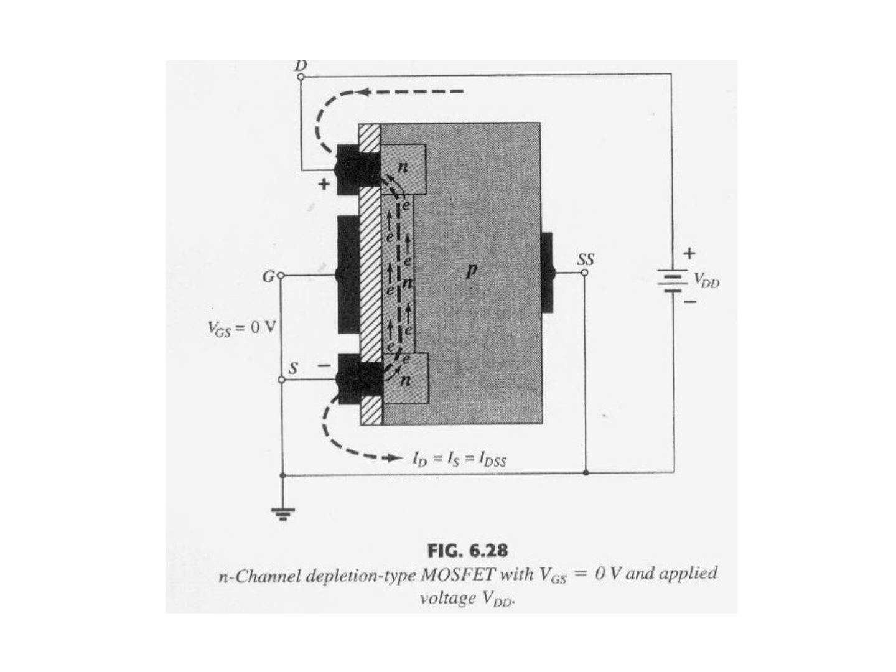

Azaltıcı tip MOSFET hem azaltma (V_GS < 0) hem çoğaltma (V_GS > 0) modunda çalışabilir. Örnekte I_DSS = 8 mA, V_P = −6 V; V_GS = +1 V'ta I_D = 10.9 mA, V_GS = V_P/2 = −3 V'ta I_D = I_DSS/4 = 2 mA.

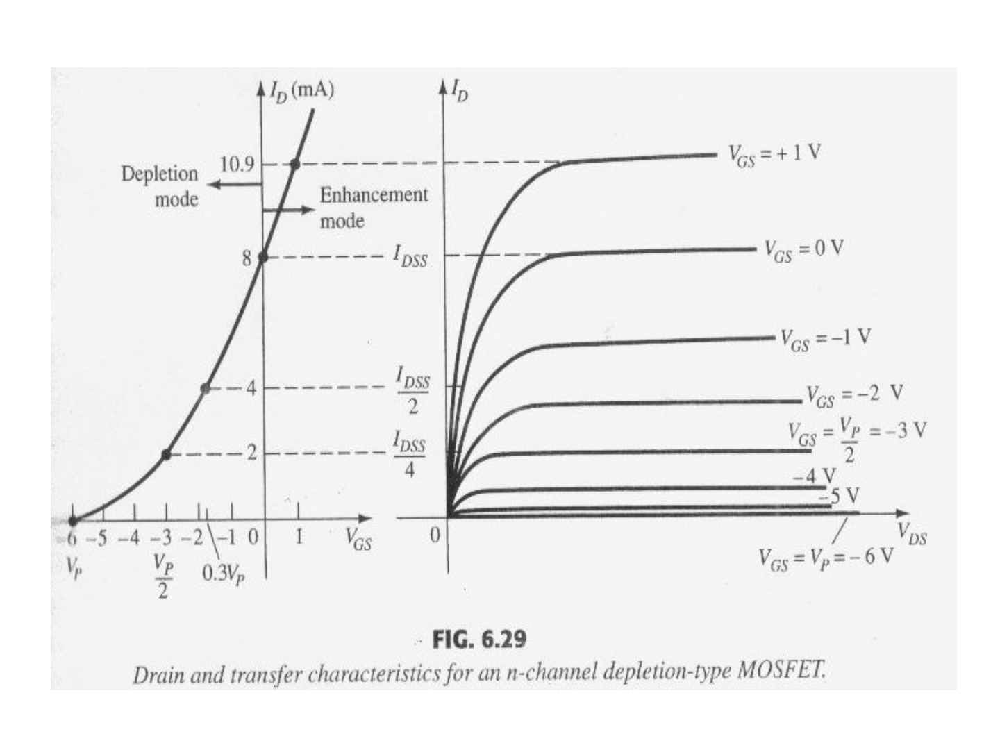

p kanallı azaltıcı tip MOSFET'te alttaş n tipidir; örnek karakteristikte I_DSS = 6 mA ve V_P = +6 V, akım V_GS arttıkça azalıyor.

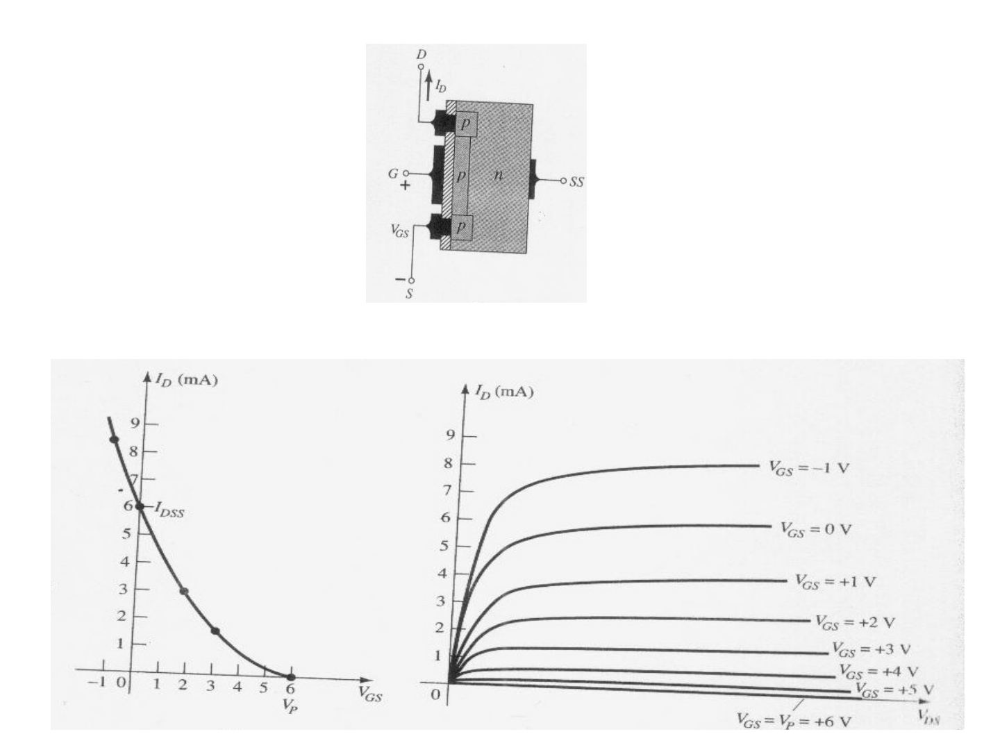

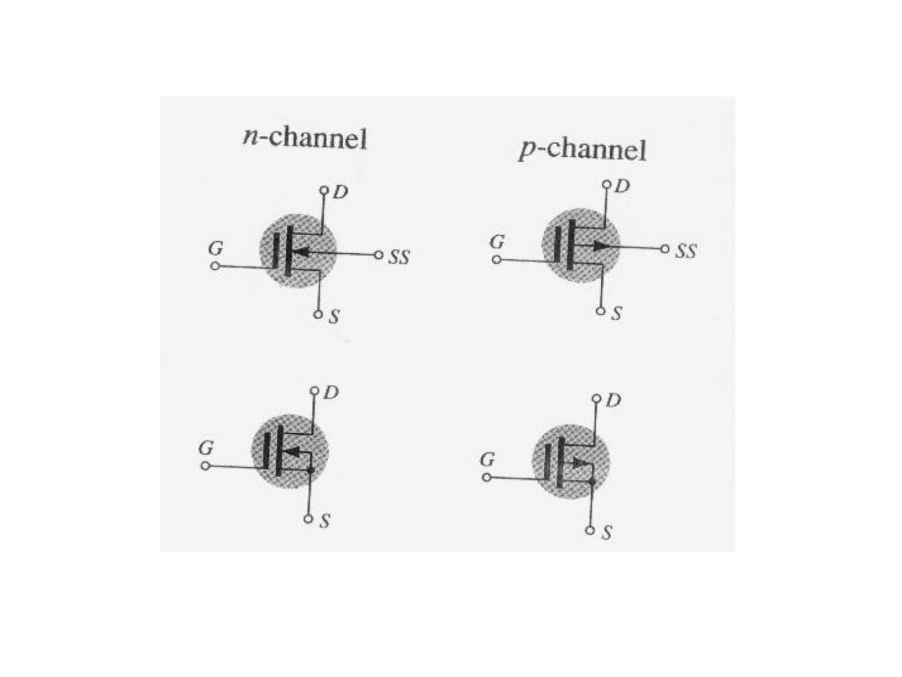

## Enhancement MOSFET (Insulated-Gate FET, IGFET)

Çoğaltıcı tip MOSFET'te savak ve kaynak bölgeleri arasında katkılanmış bir kanal yoktur ("no-channel"); kanal, kapıya eşik geriliminin (V_T) üzerinde pozitif gerilim uygulanınca oluşur.

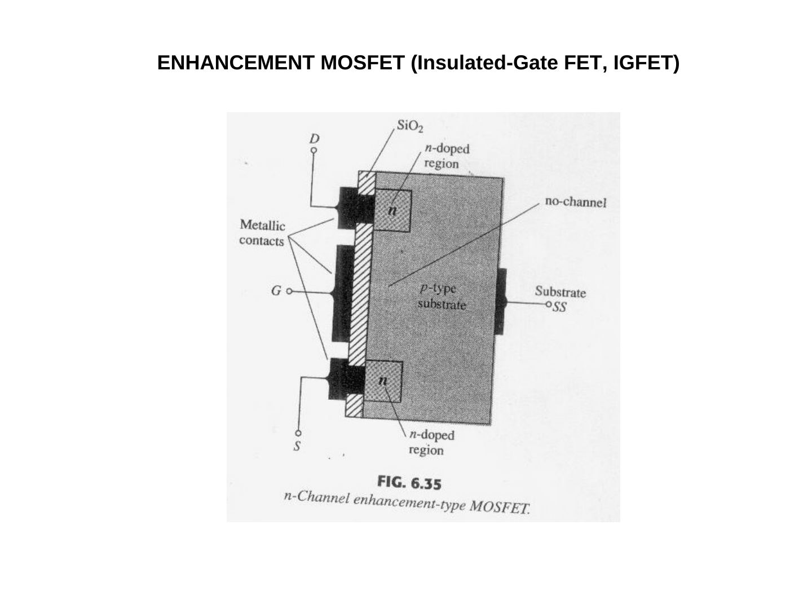

Sabit bir V_GS için V_DS arttıkça savak tarafında boşaltılmış bölge genişler ve kanal daralarak kısılmaya (pinch-off) başlar.

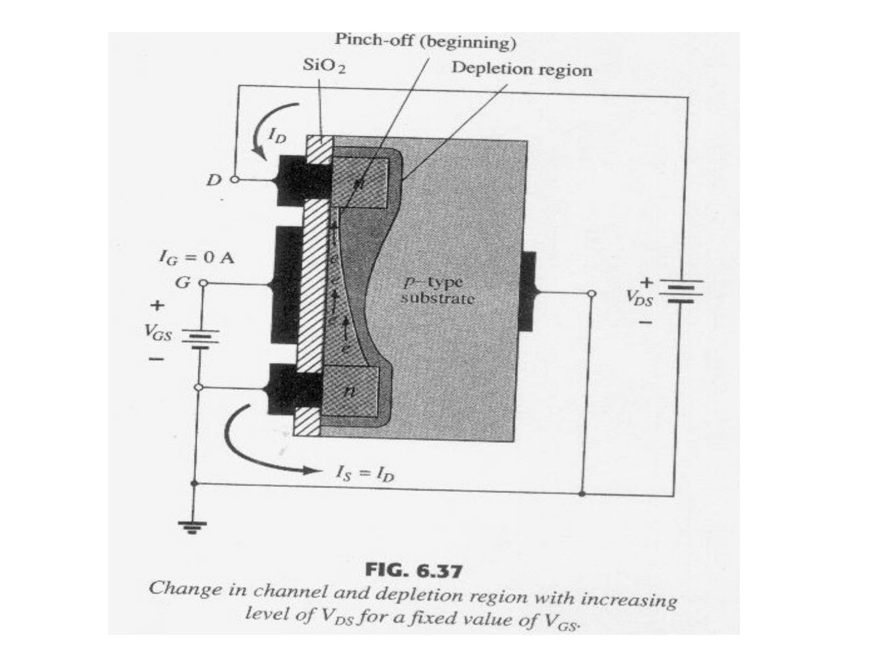

Doyma noktalarının yeri: V_DSsat = V_GS − V_T. Örnek karakteristikte V_T = 2 V ve k = 0.278×10⁻³ A/V²; V_GS = +8 V'ta I_D ≈ 10 mA.

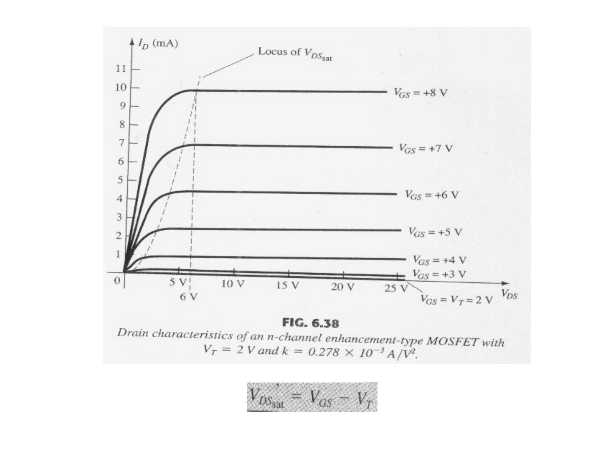

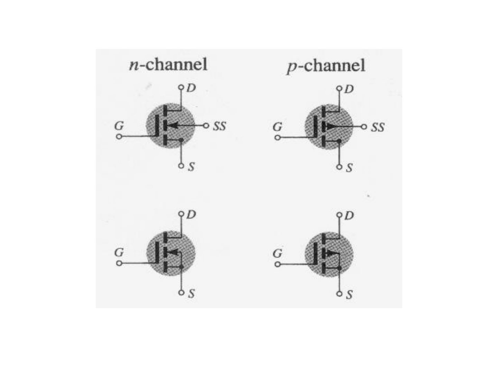

## CMOS transistörler (Complementary MOS)

N ve P kanallı MOSFET transistörlerin bir arada kullanılması ile oluşturulur. Düşük güç harcamasına sahiptir. Sayısal devre tasarımlarında sıkça kullanılırlar.

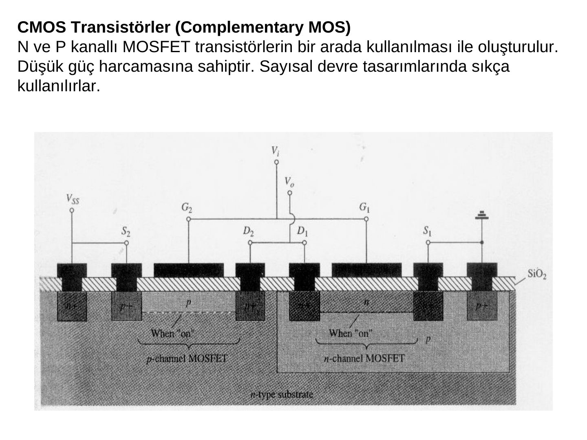

### CMOS inverter

V_SS = 5 V ile beslenen evirici: girişe 5 V (1 durumu) uygulandığında n kanallı Q₁ iletimde (R₁ düşük), p kanallı Q₂ kesimde (R₂ yüksek) olur ve çıkış V_o = R₁·V_SS/(R₁ + R₂) ≅ 0 V (0 durumu) olur.

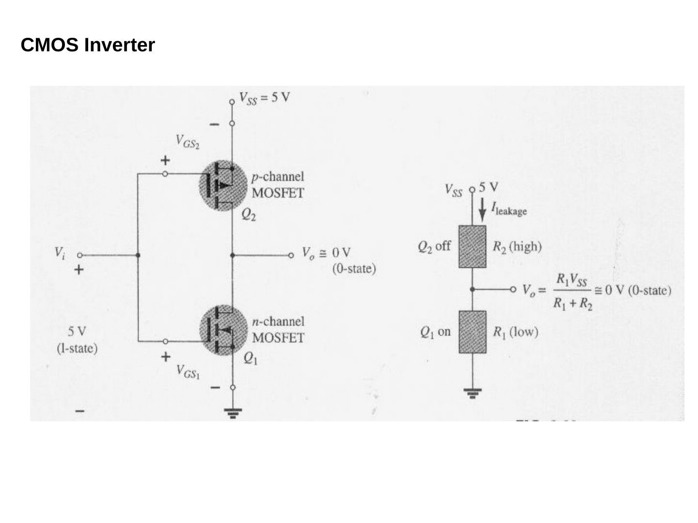

## VMOS transistörler (Vertical Metal Oxide Silicon FET)

- MOSFET'lere göre kanal dirençleri küçüktür ve yüksek akım ve güç oranına sahiptirler.
- Pozitif sıcaklık katsayısına sahiptirler.
- Anahtarlama zamanları oldukça kısadır.

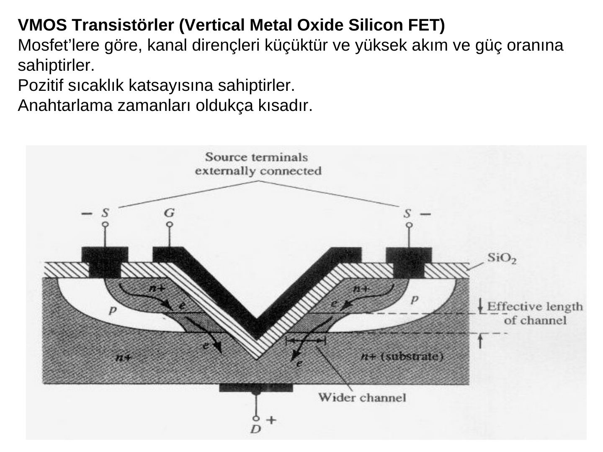

## MESFET transistörler (Metal Semiconductor Field Effect Transistors)

- MOSFET'lere göre kanal dirençleri küçüktür ve yüksek akım ve güç oranına sahiptirler.
- Pozitif sıcaklık katsayısına sahiptirler.
- Anahtarlama zamanları oldukça kısadır.

*Not: MESFET slaytındaki maddeler VMOS slaytındakilerle birebir aynı; büyük olasılıkla kopyalanıp düzeltilmeden bırakılmış. MESFET'in ayırt edici özelliği, kapının yalıtkan yerine doğrudan yarıiletkenle Schottky eklemi oluşturan bir metalden (şekilde tungsten) yapılması ve GaAs alttaş sayesinde yüksek frekanslarda kullanılmasıdır.*

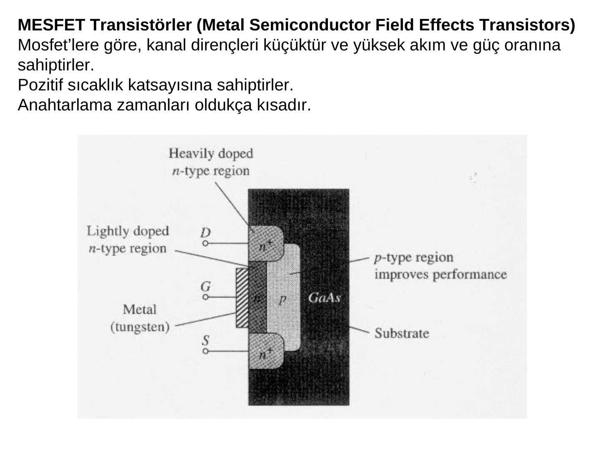
