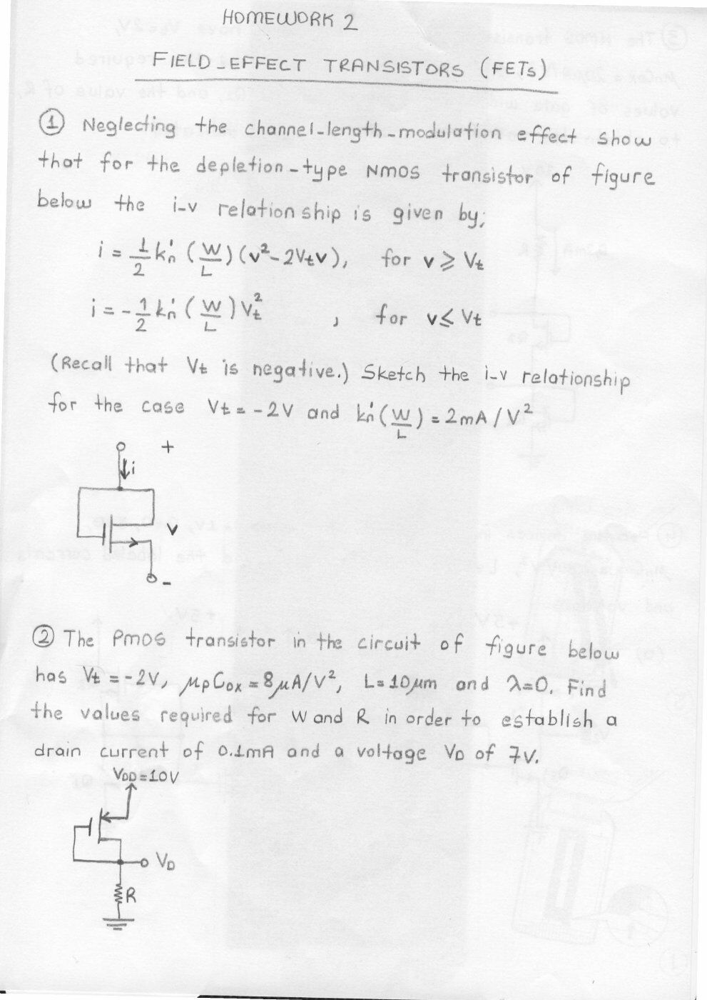
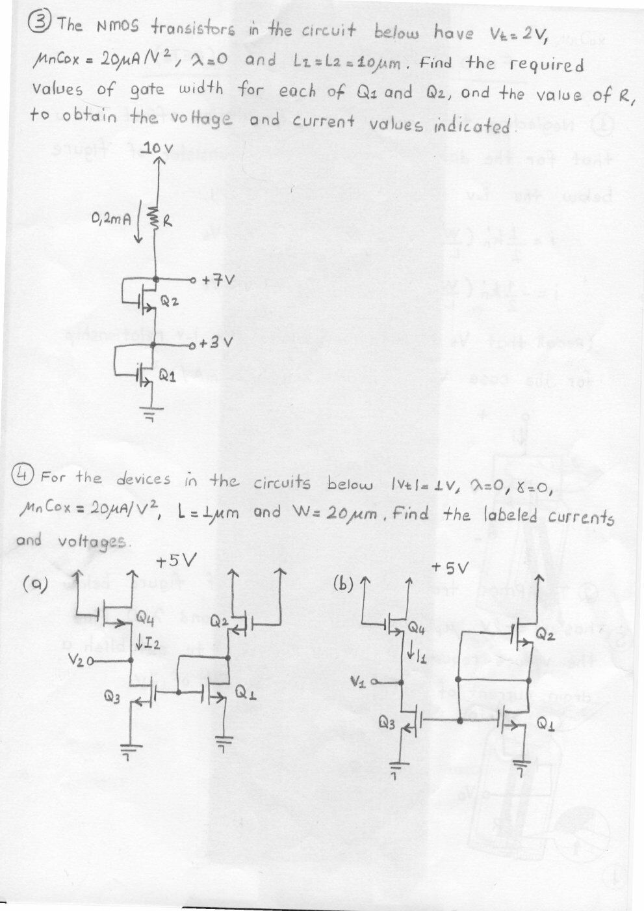
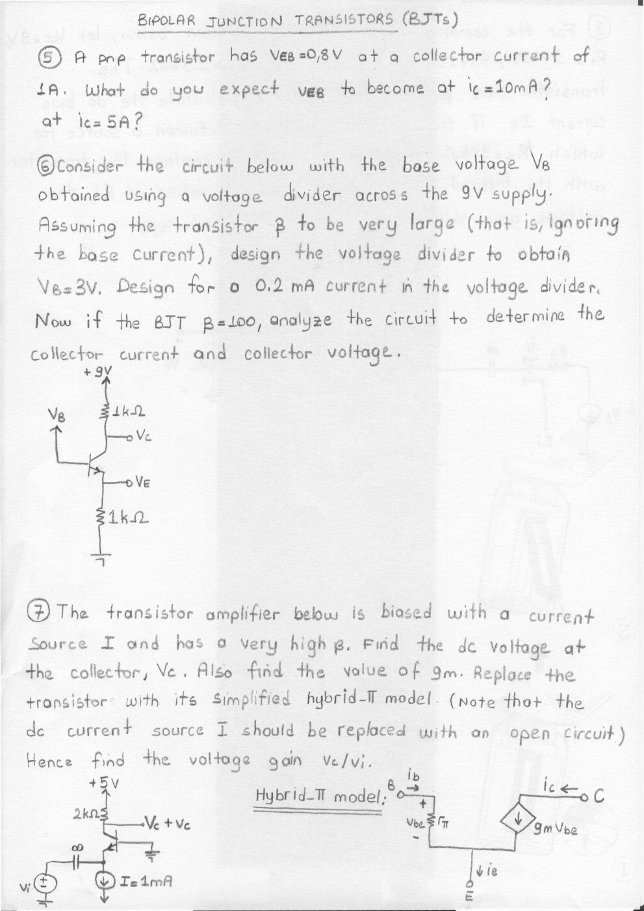
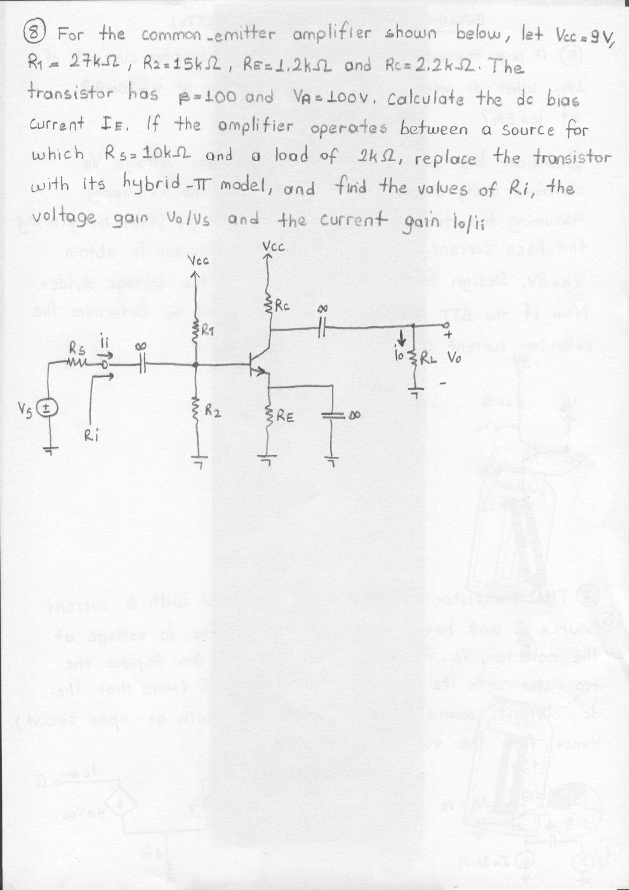

Bu yazı, EEM214 Elektronik I klasöründeki iki el yazısı ödev setini içeriyor. Hazırlayan adları belirtilmemiştir. İlk set dört görüntüden metne aktarıldı; görüntüler özel arşivde tutuldu. İkinci set, **Homework 2 – Field-Effect Transistors / Bipolar Junction Transistors** başlıklı, 29 Nisan 2010 tarama tarihli dört sayfalık PDF’tir ve yazının sonunda indirilebilir. Belgeler soru föyüdür; çözüm anahtarı içermez.

## Birinci ödev: Diyot devreleri

### Soru 1: Pil ve ideal diyot

An AA flashlight cell has a Thévenin equivalent of a 1.5 V source and a 1 Ω resistance. It is connected to an ideal diode. Describe the two possible cases and determine diode current and terminal voltage when the positive battery terminal is connected to (a) the cathode, (b) the anode.

### Soru 2: Dört seri bağlantı

For each circuit between +5 V and −5 V, determine the indicated current I and midpoint voltage V. The current reference is downward.

| Circuit | Upper element | Lower element |
|---|---|---|
| 1 | 10 kΩ resistor | Diode with anode at V, cathode at −5 V |
| 2 | 10 kΩ resistor | Diode with cathode at V, anode at −5 V |
| 3 | Diode with anode at +5 V, cathode at V | 10 kΩ resistor |
| 4 | Diode with cathode at +5 V, anode at V | Resistor; value not repeated in the drawing |

*Not: Kaynak “ideal diyot” demesine rağmen ilişik karakteristikte iletim eşiği 0.7 V çizilmiş. Bunlar farklı modellerdir; soru çözülürken hangi kabulün kullanıldığı belirtilmelidir.*

### Soru 3: Diyotlu mantık kapısı

Three inputs V_a, V_b and V_c feed the common output V_y through three diodes; each anode is at its input and each cathode at the output. A resistor R connects V_y to ground. Assume ideal diodes and input levels of 0 and 5 V. Find a suitable R so that the current required from each input source does not exceed **0.2 mA**.

### Soru 4: İki diyotlu DC devreler

Find the labelled current I and voltage V. A common upper node is connected through a resistor to +10 V. One diode leads downward from that node to ground; a second downward diode leads to V, which connects through a resistor to −10 V.

- First circuit: upper resistor 5 kΩ, lower resistor 10 kΩ.
- Second circuit: upper resistor 10 kΩ, lower resistor 5 kΩ.
- I is the downward current in the diode ending at ground.

The source again labels the diodes “ideal” while drawing a 0.7 V turn-on characteristic.

### Soru 5: Thévenin ile çözüm

Assuming ideal diodes, use Thévenin’s theorem to simplify each circuit and find the labelled current and voltage.

- First circuit: a 15 V supply feeds a 10 kΩ/20 kΩ divider. Its midpoint drives a forward-pointing diode to output V, which has a 20 kΩ load to ground. I is directed from the divider to the output.
- Second circuit: the left divider is 10 kΩ/10 kΩ across 15 V; the right divider is 10 kΩ/10 kΩ across 10 V. A diode connects their midpoints with its anode on the right, cathode on the left. I points left; diode voltage V is positive on the right.

### Soru 6: Diyot tanımı

What is a “diode”?

## Birinci ödev: Taşıyıcılar ve akım yoğunluğu

### Soru 7: Sürüklenme alanı

A current density of **10,000 A/cm²** exists in n-type silicon with resistivity **0.01 Ω·cm**. What electric field supports this drift current density?

### Soru 8: En büyük sürüklenme akımı

The maximum carrier drift velocity in silicon is approximately **10⁷ cm/s**. Find the maximum drift current density for n-type silicon doped at **10¹⁶ cm⁻³**.

### Soru 9: Kompanze yarıiletken

A semiconductor has N_D = 10¹⁶ cm⁻³, N_A = 4×10¹⁶ cm⁻³ and n_i = 10¹¹ cm⁻³. Find the electron and hole concentrations.

### Soru 10: Bor katkısı

Silicon is doped with **5×10¹⁸ boron atoms/cm³**. Determine whether it is n-type or p-type; find hole and electron concentrations at room temperature and at **200 K**.

### Soru 11: Eşit donör ve akseptör katkısı

A silicon sample is doped with **5.0×10¹⁹ donor atoms/cm³** and **5.0×10¹⁹ acceptor atoms/cm³**. Find its resistivity. Is it intrinsic material? Explain.

### Soru 12: İndiyum katkısı

Silicon is doped with an indium concentration of **7×10¹⁹ cm⁻³**. Is indium a donor or acceptor impurity? At **300 K**, find electron and hole concentrations, electron and hole mobilities and resistivity. Identify the conductivity type.

### Soru 13: Elektron difüzyonu

The electron concentration falls from **n(0) = 10¹⁸ cm⁻³** to zero at **W_B = 2 µm**. The graph joins these endpoints with a descending line. If μ_n = **350 cm²/(V·s)**, determine electron diffusion current density at room temperature.

### Soru 14: Sürüklenme ve difüzyon bileşenleri

In a **3 µm** silicon region, concentrations vary along the drawn straight lines:

- p(0) = 1.01×10¹⁸ cm⁻³, p(3 µm) = 10¹⁸ cm⁻³.
- n(0) = 10¹⁶ cm⁻³, n(3 µm) = 10¹⁴ cm⁻³.
- Electric field magnitude is **25 V/cm**, directed toward decreasing x.
- μ_n = 350 cm²/(V·s), μ_p = 150 cm²/(V·s).

Find total current density at x = 0. Find each electron and hole drift and diffusion component at x = 1.5 µm.

## İkinci ödev: Field-Effect Transistors

### Soru 1: Depletion NMOS’un iki uçlu karakteristiği

Neglect channel-length modulation. For the drawn depletion NMOS connection, show that:

- i = ½ k′_n(W/L)(v² − 2V_t v), for v ≥ V_t.
- i = −½ k′_n(W/L)V_t², for v < V_t.

Recall that V_t is negative. Sketch i–v for **V_t = −2 V** and **k′_n(W/L) = 2 mA/V²**.

### Soru 2: PMOS boyutlandırma

The PMOS has **V_t = −2 V**, **μ_p C_ox = 8 µA/V²**, **L = 10 µm** and **λ = 0**. The source is at +10 V; the gate and drain are joined at output V_D, which connects through R to ground. Find **W and R** to establish **I = 0.1 mA** and **V_D = 7 V**.

### Soru 3: İki NMOS ile seviye ayarı

The devices have **V_t = 2 V**, **μ_n C_ox = 20 µA/V²**, **λ = 0**, and **L₁ = L₂ = 10 µm**. Two diode-connected NMOS devices are stacked between ground and a resistor from +10 V. Their nodes are **+3 V** and **+7 V**; current through R is **0.2 mA**. Find each gate width and R.

### Soru 4: Akım aynalı devreler

For the devices in the two circuits, **|V_t| = 1 V**, **λ = 0**, **γ = 0**, **μ_n C_ox = 20 µA/V²**, **L = 1 µm**, **W = 20 µm**. Find labelled currents and voltages in the two **+5 V** circuits.

## İkinci ödev: Bipolar Junction Transistors

### Soru 5: V_BE ve akım

An npn transistor has **V_BE = 0.8 V** at **I_C = 1 A**. What V_BE is expected at I_C = 10 mA and I_C = 5 A?

### Soru 6: Gerilim bölücü tasarımı

The base voltage is obtained from a divider across **9 V**. Initially assume very large β and ignore base current. Design **V_B = 3 V** with **0.2 mA** in the divider. Then, for **β = 100**, analyze the circuit to find collector current and collector voltage. Both collector and emitter resistors are **1 kΩ**.

### Soru 7: Akım kaynağıyla kutuplama

An amplifier has a very high β and a **1 mA emitter current source**, a **2 kΩ collector resistor** and **+5 V supply**. Find the DC collector voltage and g_m. Replace the transistor with its simplified hybrid-π model; replace the DC current source with an open circuit for small-signal analysis. Find v_c/v_i.

### Soru 8: Kaynak ve yük etkisinde ortak emetör

Given **V_CC = 9 V, R₁ = 27 kΩ, R₂ = 15 kΩ, R_E = 1.2 kΩ, R_C = 2.2 kΩ, β = 100 and V_A = 100 V**, calculate the DC base current I_B. The amplifier operates between a source with **R_S = 10 kΩ** and a **2 kΩ load**. Replace the transistor with its hybrid-π model and find input resistance R_i, voltage gain v_o/v_s and current gain i_o/i_i. The emitter by-pass and input/output coupling capacitors are marked as very large.

