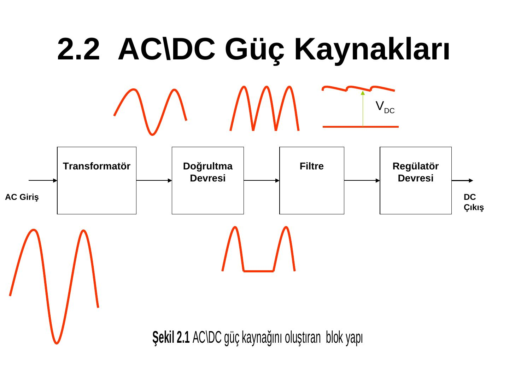
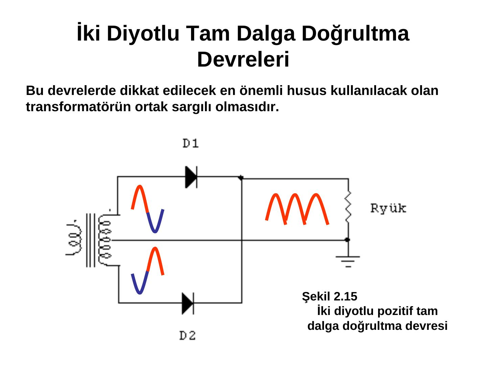
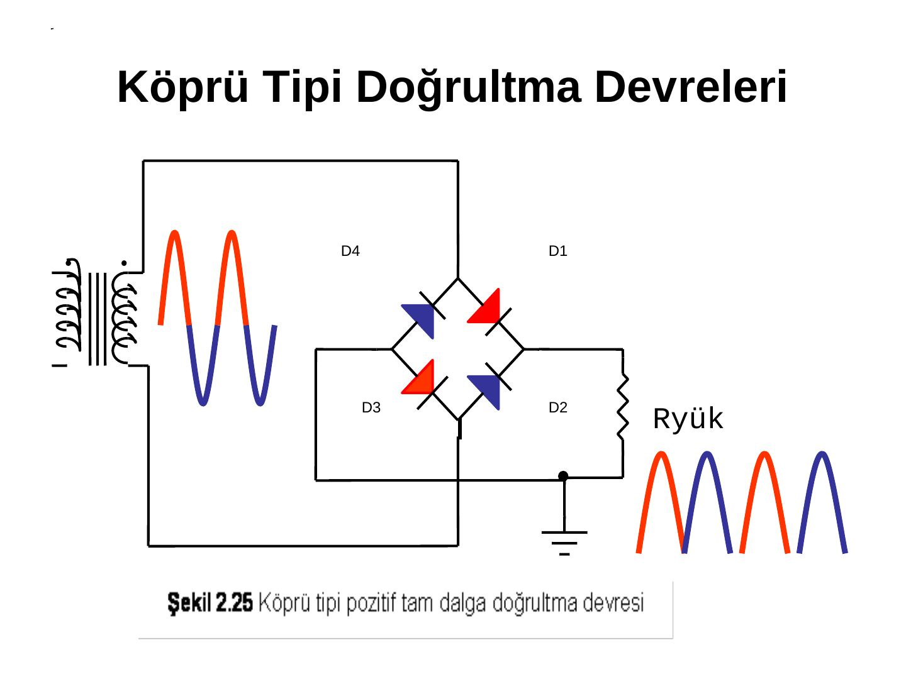
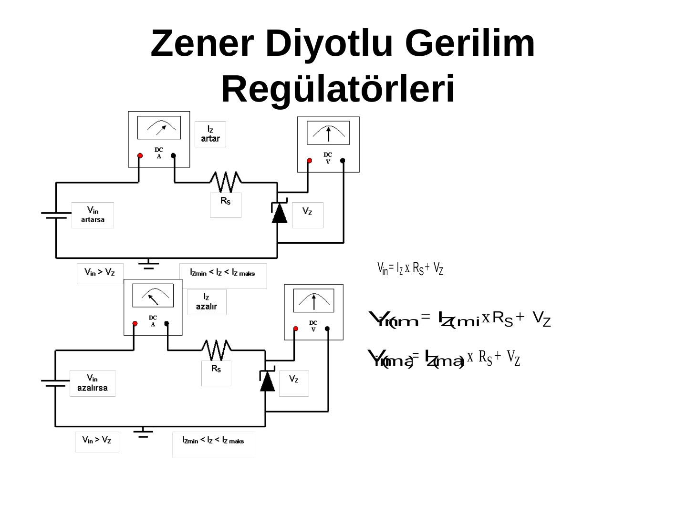
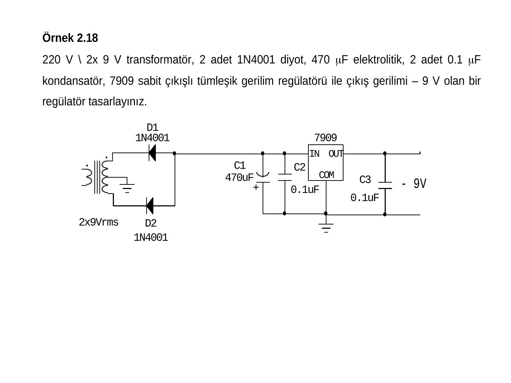
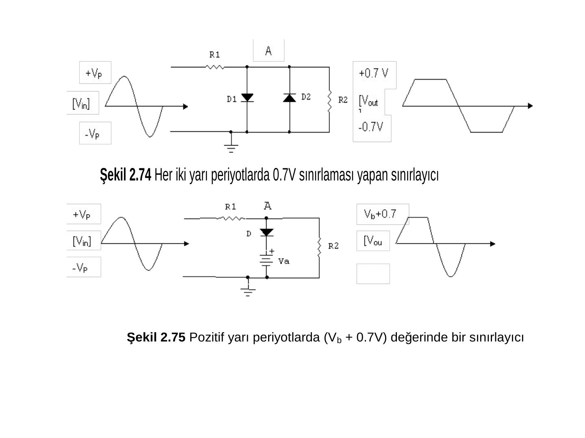
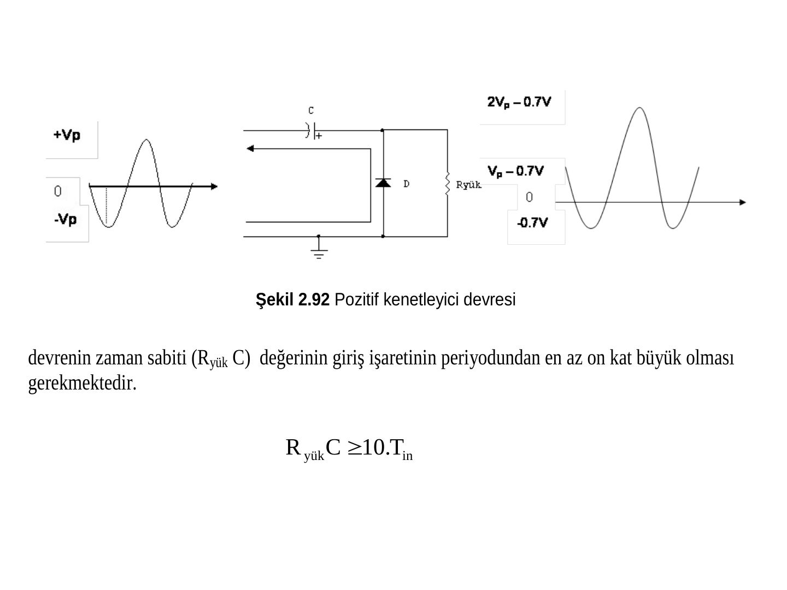
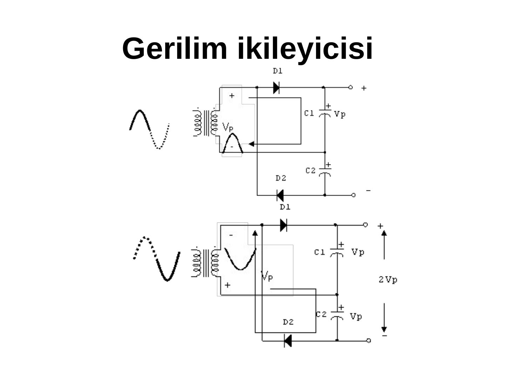

This post presents the 94-slide Turkish presentation **"Part 2 – Diode Applications"** (file name *Lecture_dogrultucu_devreleri.ppt*) found among the files of the EEM214 Electronics I course. The source of the presentation is unknown: the file properties list only "BTYO" (2006) as the creator; the numbered figures and examples (Figure 2.x, Example 2.x) suggest that it was adapted from the second chapter of a textbook or lecture notes. The file was used in the course in the spring semester of 2012. The presentation can be downloaded at the end of this post.

*Note: This content belongs to a third-party source; it is shared with attribution for archival and nostalgic purposes. It will be removed upon request by the rights holder.*

## 2.1 Introduction and AC/DC power supplies

Topics of this chapter: AC/DC power supplies, waveshaping circuits, and voltage multiplier circuits. An AC/DC power supply consists, in order, of the blocks **transformer, rectifier circuit, filter, and regulator**.

### Transformers

Transformers step an AC voltage up or down but do not change the frequency. The relation between the voltages and the numbers of turns is V_P / V_S = N_P / N_S.

- **Example 2.1:** If N_P = 200, N_S = 10, and V_P = 220 V_rms, then V_S = 220/20 = **11 V_rms** and the peak value is V_peak = 11 V × √2 ≈ **15.5 V**.
- **Example 2.2:** In a transformer with a center-tapped (common-winding) secondary, the voltages of the two half-windings are equal (11 V_rms, 15.5 V peak) but have a 180° phase difference between them; the frequency remains unchanged at 50 Hz.
- At most I = 50 W / 12 V ≈ 4.16 A can be drawn from the secondary of a 12 V / 50 W transformer. To avoid damaging the transformer, a voltage higher than the rated value must not be applied to the primary, and a current higher than the rated value must not be drawn from the secondary.

In short, the role of the transformer in a power supply is to reduce the primary voltage and to provide isolation between the primary and the secondary.

## 2.2.2 Rectifier circuits

Circuits whose inputs are connected to the transformer output and whose outputs consist of pulsating (pulse) sinusoidal voltages are called rectifier circuits.

### Half-wave rectifier

It is implemented with a single diode; it produces an output during only one half-cycle of the input. For a 10 V peak input, the output of the positive rectifier is 9.3 V peak, and the output of the negative rectifier is V_out(peak) = −V_in(peak) + 0.7 V = −9.3 V. The input and output frequencies are the same (T_in = T_out). The average value of the output is V_avg = V_out(peak) / π, and the average load current is I_avg = V_avg / R_L.

**Example 2.5:** 5:1 transformer, 110 V_rms input, 1N4001 and a 470 Ω load: V_S = 22 V_rms, V_S(peak) ≈ 31 V, V_out(peak) = 30.3 V, V_avg = 30.3/π = **9.65 V**, I_avg = 9.65 V / 470 Ω = **20.5 mA**.

### Full-wave rectifiers

There are two types: the full-wave rectifier with **two diodes** using a center-tapped transformer, and the **bridge-type** rectifier. In a full-wave rectifier the output frequency is twice the input frequency (50 Hz input → 100 Hz output, 20 ms period → 10 ms). The average value is V_avg = 2·V_peak / π. In the two-diode circuit each diode sees half of the secondary, and the peak inverse voltage of the diodes is approximately 2·V_S(peak); in the bridge, since two diodes are in series during conduction, the output peak is V_S(peak) − 1.4 V.

**Example 2.11:** In a full-wave rectifier with positive and negative outputs, V1 = 15.7 − 0.7 = 15 V, V2 = −15.7 + 0.7 = −15 V.

## 2.2.3 Filter circuits

Filters bring the rectifier output closer to DC; the simplest is a single electrolytic capacitor. The fluctuation at the output is called the **ripple voltage V_r**; the quality of the filter is measured by the ripple factor r = V_r(peak-to-peak) / V_DC (a smaller r is better; for the same load, a larger capacitor gives a smaller r). The relations between ripple, the peak input voltage, the period, and the time constant τ = R_load·C are:

- V_r = (T/τ)·V_p(in)
- V_DC = V_p(in) − V_r/2 = [1 − 1/(2f·R_load·C)]·V_p(in)

In practical calculations, since the capacitor is chosen to be large, the ripple is neglected and V_DC ≈ V_p(in) is taken.

- **Example 2.13:** In a half-wave rectifier with a capacitor, the filtered output is V_out = 31 V − 1.4 V = 29.6 V.
- **Example 2.14:** 2 × 12 V_rms center-tapped transformer, two diodes, a capacitor and 330 Ω: V_S(peak) = 16.92 V, V_p(in) = 16.22 V, the voltmeter reads 16.22 V, and the ammeter reads 16.22 / 330 = **49.15 mA**.

## Regulator circuits

### Zener diode regulators

In a regulator consisting of a series R_S and a Zener, V_in = I_Z·R_S + V_Z. The maximum Zener current is I_Z(max) = P_Z(max) / V_Z.

- **Example 2.15:** I_Z(min) = 1 mA, P_Z(max) = 1 W, V_Z = 5 V, R_S = 100 Ω: I_Z(max) = 200 mA; V_in(min) = 1 mA × 100 Ω + 5 V = 5.1 V, V_in(max) = 200 mA × 100 Ω + 5 V = 25 V; the input must satisfy **5.1 V < V_in < 25 V**.
- **Example 2.16:** I_Z(min) = 1 mA, P_Z(max) = 500 mW, V_Z = 9 V, 2 × 24 V transformer: I_Z(max) = 55.55 mA, V_p(in) = 33.84 − 1.4 = 32.44 V; **422 Ω < R_S < 23.44 kΩ**.
- **Example 2.17:** P_Z(max) = 250 mW, V_Z = 12 V, V_in = 24 V, R_S = 470 Ω: I_Z(max) = 20.83 mA, I_S = 25.53 mA, I_L(min) = 4.7 mA and I_L(max) = 24.53 mA; the load resistance must lie between approximately **489 Ω and 2.55 kΩ**. If the load is 400 Ω, the Zener current falls below the minimum, the Zener behaves like an open circuit, and the output becomes V_out = R_L/(R_L + R_S) × 24 V ≈ 11.03 V.

General relations for the load and Zener currents: I_S = (V_in − V_Z)/R_S, I_S = I_Z + I_L; when I_L(max) = V_Z/R_L(min), I_S = I_Z(min) + I_L(max); when I_L(min) = V_Z/R_L(max), I_S = I_Z(max) + I_L(min).

### Integrated voltage regulators

**Fixed-output types:** The 78XX are positive and the 79XX are negative regulators; XX gives the voltage between the output and the common terminal (5 V for the 7805). The highest DC voltage that can be applied to the input is 30 V, and the input must be at least 2 V greater than the output (at least 7 V for the 7805). According to current class, the 78LXX provides 100 mA, 78MXX 500 mA, 78XX 1 A, 78SXX 2 A, 78HXX 5 A, and 78PXX 10 A. Although not required, capacitors are connected at the input and output to eliminate high-frequency disturbances.

- **Example 2.18:** Design of a −9 V regulator with a 220 V / 2 × 9 V transformer, 2 × 1N4001, 470 µF, 2 × 0.1 µF and a 7909.
- **Example 2.20:** 2 × 12 V_rms transformer, two ±16.22 V filter capacitors, and 78L08, 78L05, 79L05, 79L08 giving V1 = 8 V, V2 = 5 V, V3 = −5 V, V4 = −8 V; for the 100 mA L series, the smallest load resistances are 80 Ω, 50 Ω, 50 Ω, 80 Ω.

**Adjustable-output types:** For the LM317 (positive) and LM337 (negative), V_out = 1.25 × (1 + R2/R1) V.

- **Example 2.21:** R1 = 220 Ω, R2 = 1 kΩ: V_out = 1.25 × (1 + 1000/220) ≈ **6.93 V**.
- **Example 2.22:** R2 = 0–2.2 kΩ potentiometer: 1.25 V ≤ V_out ≤ 13.75 V; the input must be at least 13.75 + 2 = 15.75 V.
- **Example 2.23:** For −5 V with the LM337, −5 = −1.25 × (1 + R2/220) → **R2 = 660 Ω**.

## Waveshaping circuits

### Voltage limiters (clippers)

Limiters modify only the positive half-cycle, only the negative half-cycle, or both. When the diode is in cutoff, the output is V_out(peak) = R2/(R1 + R2) × V_in(peak); in **Example 2.24**, with R1 = 1 kΩ, R2 = 4.7 kΩ and a 5 V peak input, this is 4.12 V. With two antiparallel diodes, limiting to ±0.7 V occurs in both half-cycles; with a battery V_b in series with the diode, limiting occurs at the level V_b + 0.7 V or −(V_b + 0.7 V); voltage dividers can also be used instead of batteries.

**Example 2.25:** For a limiter with a diode whose anode is at −5 V to limit in the negative half-cycle, V_K = V_A − 0.7 = −5.7 V, that is, the peak value of the input must be at least 5.7 V.

### Clampers

Clampers add only a DC voltage to the input signal without distorting its waveform; the element that adds this voltage is an electrolytic capacitor. Depending on the polarity of the added voltage, there are positive and negative clampers. For correct operation, the time constant must be at least ten times the input period: R_load·C ≥ 10·T_in. In the example, for T_in = 1 ms and R_load = 10 kΩ, C ≥ 10 ms / 10 kΩ = **1 µF**, and the capacitor voltage is V_C = V_P − 0.7 = 5 − 0.7 = 4.3 V.

### Voltage multipliers

Voltage multipliers use the operating principle of clampers to provide, as DC, two, three, or four times the peak value of the secondary voltage without requiring a new transformer. They are generally used for loads that require very low current and very high voltage (TV and oscilloscope tubes, CRTs). The presentation includes a voltage doubler (2V_p), a voltage tripler (3V_p), and an example with a 300 V_pp input.

## Download

The original PowerPoint file of the presentation and its PDF copy can be downloaded at the end of the post.
