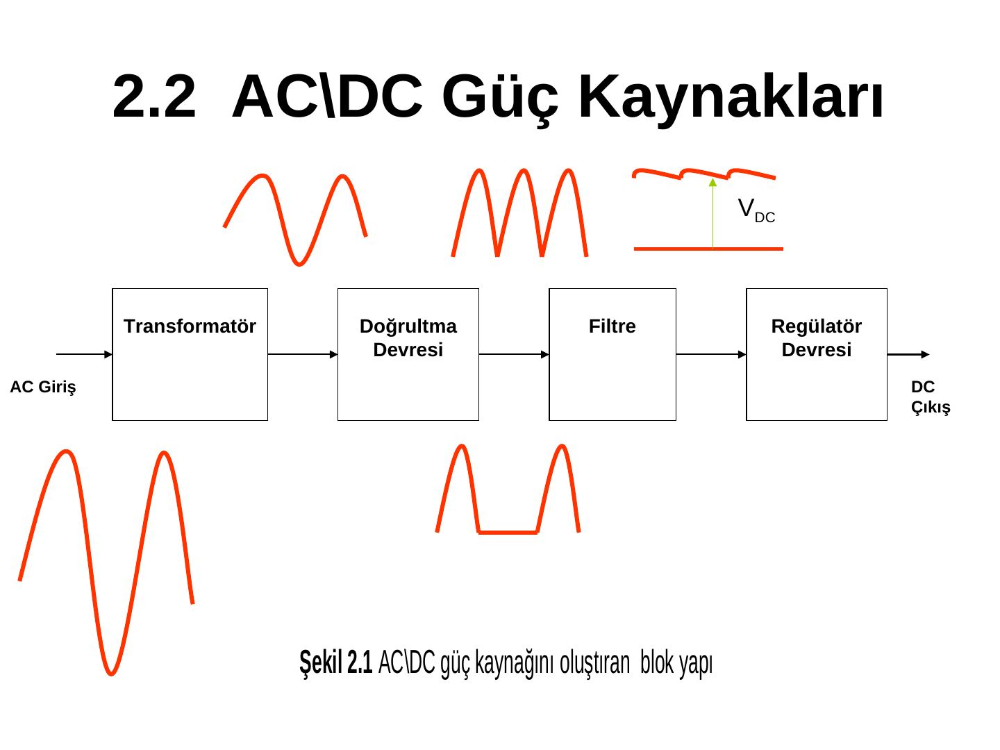
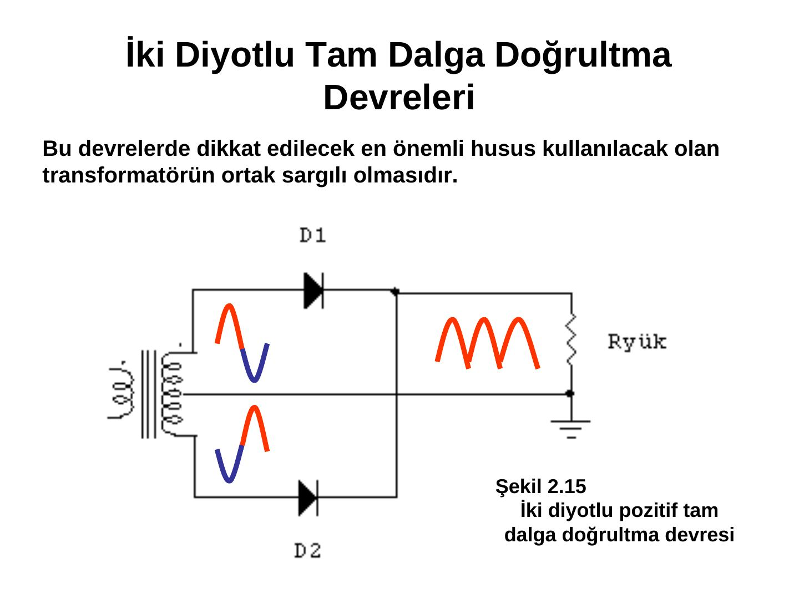
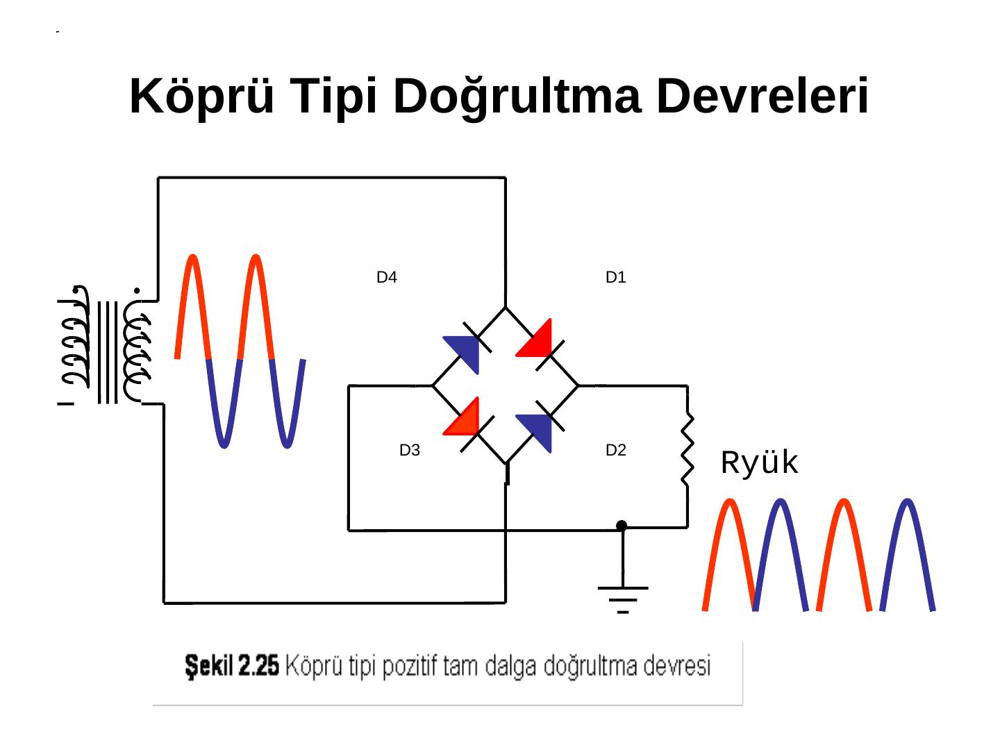
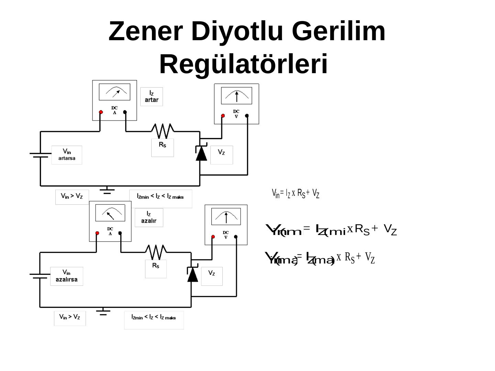
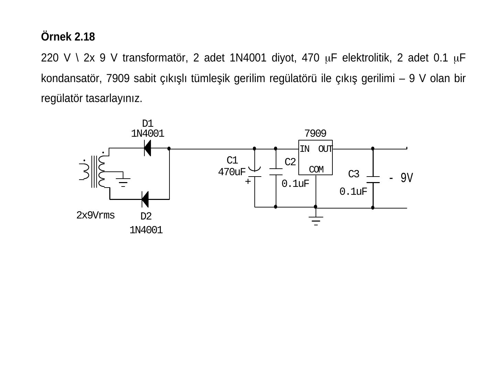
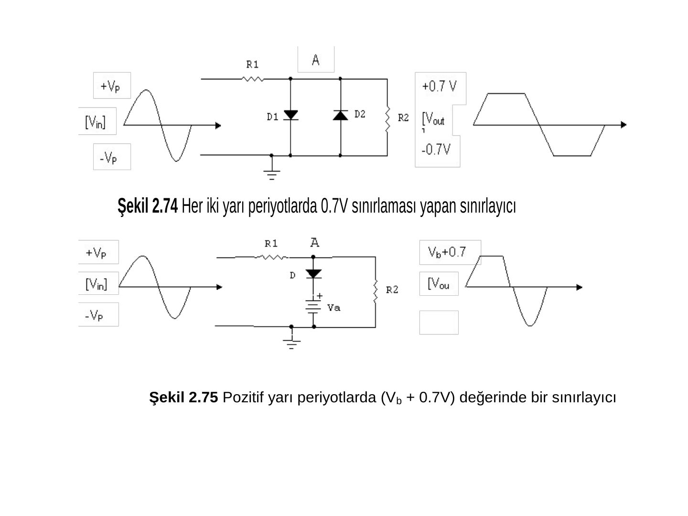
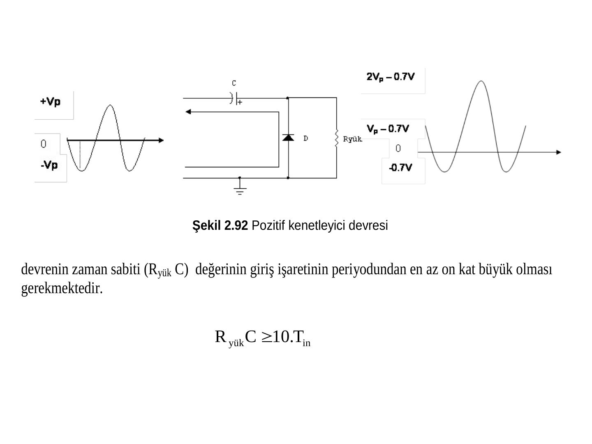
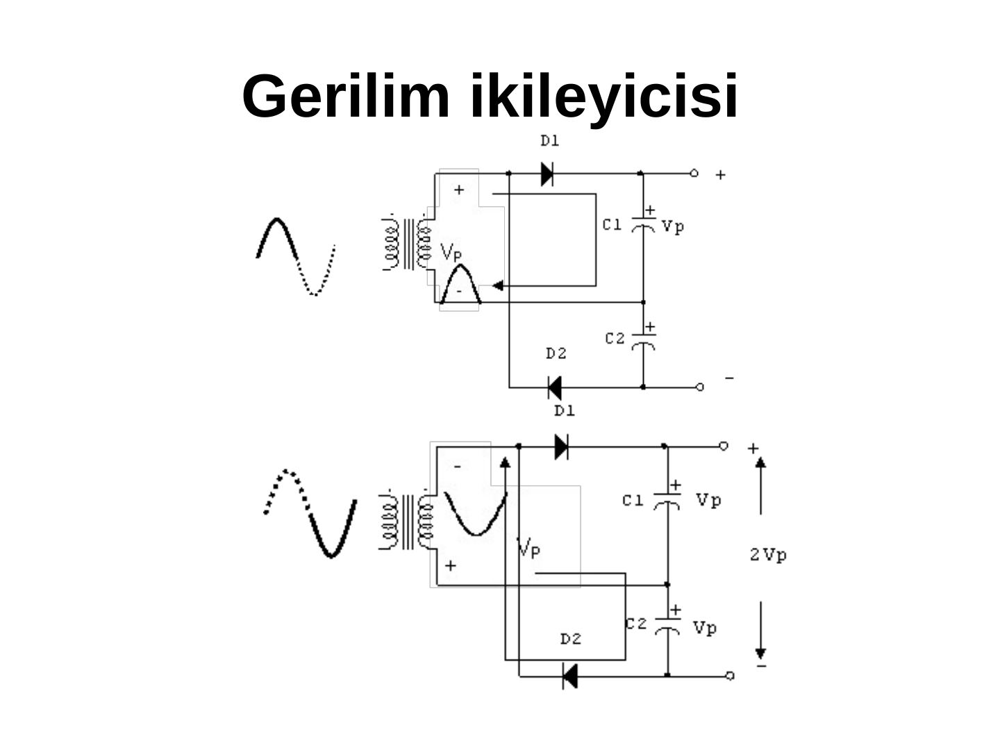

Bu yazı, EEM214 Elektronik I dersinin dosyaları arasında bulunan 94 slaytlık Türkçe **"Kısım 2 – Diyot Uygulamaları"** sunumunu (dosya adı *Lecture_dogrultucu_devreleri.ppt*) aktarıyor. Sunumun kaynağı belirsiz: dosya bilgilerinde oluşturan olarak yalnızca "BTYO" (2006) yazıyor; numaralı şekil ve örnekler (Şekil 2.x, Örnek 2.x) bir ders kitabının ya da ders notunun ikinci bölümünden uyarlandığını düşündürüyor. Dosya 2012 bahar döneminde ders kapsamında kullanılmış. Sunum yazının sonunda indirilebilir.

*Bu içerik üçüncü taraf bir kaynağa aittir; arşiv ve nostalji amacıyla kaynak belirtilerek paylaşılmıştır. Hak sahibinin talebi hâlinde kaldırılır.*

## 2.1 Giriş ve AC/DC güç kaynakları

Bölümün konuları: AC/DC güç kaynakları, dalga şekillendirici devreler ve gerilim katlayıcı devreler. Bir AC/DC güç kaynağı sırasıyla **transformatör, doğrultma devresi, filtre ve regülatör** bloklarından oluşur.

### Transformatörler

Transformatörler AC gerilimi yükseltir ya da düşürür, ama frekansı değiştirmez. Gerilim ile sarım sayıları arasındaki ilişki V_P / V_S = N_P / N_S'dir.

- **Örnek 2.1:** N_P = 200, N_S = 10, V_P = 220 V_rms ise V_S = 220/20 = **11 V_rms** ve tepe değeri V_tepe = 11 V × √2 ≈ **15.5 V**.
- **Örnek 2.2:** Sekonderi orta uçlu (ortak sargılı) transformatörde iki yarı sargının gerilimleri eşit (11 V_rms, 15.5 V tepe) ama aralarında 180° faz farkı var; frekans 50 Hz olarak değişmeden kalıyor.
- 12 V / 50 W'lık bir transformatörün sekonderinden en fazla I = 50 W / 12 V ≈ 4.16 A çekilebilir. Transformatörün bozulmaması için primere etiket değerinden fazla gerilim uygulanmamalı, sekonderden etiket değerinden fazla akım çekilmemelidir.

Özetle transformatörün güç kaynağındaki görevi primer gerilimini azaltmak ve primer ile sekonder arasında yalıtım sağlamaktır.

## 2.2.2 Doğrultma devreleri

Girişleri transformatör çıkışına bağlanan ve çıkışları darbeli (pulse) sinüzoidal gerilimlerden oluşan devrelere doğrultma (rectifier) devreleri denir.

### Yarım dalga doğrultucu

Tek diyotla gerçekleştirilir; girişin yalnız bir yarı periyodunda çıkış verir. 10 V tepe girişte pozitif doğrultucunun çıkışı 9.3 V tepe, negatif doğrultucunun çıkışı V_out(tepe) = −V_in(tepe) + 0.7 V = −9.3 V. Giriş ve çıkış frekansı aynıdır (T_in = T_out). Çıkışın ortalama değeri V_ort = V_out(tepe) / π, yük akımının ortalaması I_ort = V_ort / R_L.

**Örnek 2.5:** 5:1 transformatör, 110 V_rms giriş, 1N4001 ve 470 Ω yük: V_S = 22 V_rms, V_S(tepe) ≈ 31 V, V_out(tepe) = 30.3 V, V_ort = 30.3/π = **9.65 V**, I_ort = 9.65 V / 470 Ω = **20.5 mA**.

### Tam dalga doğrultucular

İki türü var: orta uçlu transformatörle **iki diyotlu** tam dalga doğrultucu ve **köprü tipi** doğrultucu. Tam dalga doğrultucuda çıkışın frekansı girişin iki katıdır (50 Hz giriş → 100 Hz çıkış, 20 ms periyot → 10 ms). Ortalama değer V_ort = 2·V_tepe / π. İki diyotlu devrede her diyot sekonderin yarısını görür ve diyotların ters tepe gerilimi yaklaşık 2·V_S(tepe) olur; köprüde iletimde iki diyot seri olduğundan çıkış tepesi V_S(tepe) − 1.4 V'tur.

**Örnek 2.11:** Pozitif ve negatif çıkışlı tam dalga doğrultucuda V1 = 15.7 − 0.7 = 15 V, V2 = −15.7 + 0.7 = −15 V.

## 2.2.3 Filtre devreleri

Filtreler doğrultucu çıkışını DC'ye yaklaştırır; en basiti tek bir elektrolitik kondansatördür. Çıkıştaki dalgalanmaya **dalgalılık gerilimi V_r** denir; filtrenin kalitesi dalgalılık faktörü r = V_r(tepe-tepe) / V_DC ile ölçülür (küçük r daha iyidir; aynı yükte daha büyük kondansatör daha küçük r verir). Dalgalılık ile tepe giriş gerilimi, periyot ve zaman sabiti τ = R_yük·C arasındaki ilişki:

- V_r = (T/τ)·V_p(in)
- V_DC = V_p(in) − V_r/2 = [1 − 1/(2f·R_yük·C)]·V_p(in)

Pratik hesaplarda kondansatör büyük seçildiği için dalgalılık ihmal edilip V_DC ≈ V_p(in) alınır.

- **Örnek 2.13:** Kondansatörlü yarım dalga doğrultucuda filtrelenmiş çıkış V_out = 31 V − 1.4 V = 29.6 V.
- **Örnek 2.14:** 2 × 12 V_rms orta uçlu transformatör, iki diyot, kondansatör ve 330 Ω: V_S(tepe) = 16.92 V, V_p(in) = 16.22 V, voltmetre 16.22 V, ampermetre 16.22 / 330 = **49.15 mA** okur.

## Regülatör devreleri

### Zener diyotlu regülatörler

Seri R_S ve Zener'den oluşan regülatörde V_in = I_Z·R_S + V_Z. Zener'in maksimum akımı I_Z(maks) = P_Z(maks) / V_Z.

- **Örnek 2.15:** I_Z(min) = 1 mA, P_Z(maks) = 1 W, V_Z = 5 V, R_S = 100 Ω: I_Z(maks) = 200 mA; V_in(min) = 1 mA × 100 Ω + 5 V = 5.1 V, V_in(maks) = 200 mA × 100 Ω + 5 V = 25 V; giriş **5.1 V < V_in < 25 V** olmalı.
- **Örnek 2.16:** I_Z(min) = 1 mA, P_Z(maks) = 500 mW, V_Z = 9 V, 2 × 24 V transformatör: I_Z(maks) = 55.55 mA, V_p(in) = 33.84 − 1.4 = 32.44 V; **422 Ω < R_S < 23.44 kΩ**.
- **Örnek 2.17:** P_Z(maks) = 250 mW, V_Z = 12 V, V_in = 24 V, R_S = 470 Ω: I_Z(maks) = 20.83 mA, I_S = 25.53 mA, I_L(min) = 4.7 mA ve I_L(maks) = 24.53 mA; yük direnci yaklaşık **489 Ω ile 2.55 kΩ** arasında olmalı. Yük 400 Ω olursa Zener akımı minimumun altına düşer, Zener açık devre gibi davranır ve çıkış V_out = R_L/(R_L + R_S) × 24 V ≈ 11.03 V olur.

Yük ve Zener akımları için genel bağıntılar: I_S = (V_in − V_Z)/R_S, I_S = I_Z + I_L; I_L(maks) = V_Z/R_L(min) iken I_S = I_Z(min) + I_L(maks), I_L(min) = V_Z/R_L(maks) iken I_S = I_Z(maks) + I_L(min).

### Tümleşik (entegre) gerilim regülatörleri

**Sabit çıkışlılar:** 78XX pozitif, 79XX negatif regülatörlerdir; XX çıkış ile ortak uç arasındaki gerilimi verir (7805 için 5 V). Girişe uygulanabilecek en yüksek DC gerilim 30 V'tur ve girişin çıkıştan en az 2 V büyük olması gerekir (7805 için en az 7 V). Akım sınıflarına göre 78LXX 100 mA, 78MXX 500 mA, 78XX 1 A, 78SXX 2 A, 78HXX 5 A, 78PXX 10 A çıkışlıdır. Giriş ve çıkışa, gerekli olmasa da yüksek frekanslı bozucuları yok etmek için kondansatör bağlanır.

- **Örnek 2.18:** 220 V / 2 × 9 V transformatör, 2 × 1N4001, 470 µF, 2 × 0.1 µF ve 7909 ile −9 V çıkışlı regülatör tasarımı.
- **Örnek 2.20:** 2 × 12 V_rms transformatör, ±16.22 V'luk iki filtre kondansatörü ve 78L08, 78L05, 79L05, 79L08 ile V1 = 8 V, V2 = 5 V, V3 = −5 V, V4 = −8 V; 100 mA'lik L serisi için en küçük yük dirençleri 80 Ω, 50 Ω, 50 Ω, 80 Ω.

**Ayarlanabilir çıkışlılar:** LM317 (pozitif) ve LM337 (negatif) için V_out = 1.25 × (1 + R2/R1) V.

- **Örnek 2.21:** R1 = 220 Ω, R2 = 1 kΩ: V_out = 1.25 × (1 + 1000/220) ≈ **6.93 V**.
- **Örnek 2.22:** R2 = 0–2.2 kΩ potansiyometre: 1.25 V ≤ V_out ≤ 13.75 V; giriş en az 13.75 + 2 = 15.75 V olmalı.
- **Örnek 2.23:** LM337 ile −5 V için −5 = −1.25 × (1 + R2/220) → **R2 = 660 Ω**.

## Dalga şekillendirici devreler

### Gerilim sınırlayıcılar (kırpıcılar)

Sınırlayıcılar yalnız pozitif, yalnız negatif ya da her iki yarı periyodu değiştirir. Diyot kesimdeyken çıkış V_out(tepe) = R2/(R1 + R2) × V_in(tepe) olur; **Örnek 2.24'te** R1 = 1 kΩ, R2 = 4.7 kΩ ve 5 V tepe giriş için 4.12 V. Ters paralel iki diyotla her iki yarı periyotta ±0.7 V sınırlama, diyota seri V_b bataryasıyla (V_b + 0.7 V) ya da −(V_b + 0.7 V) seviyesinde sınırlama yapılır; bataryalar yerine gerilim bölücüler de kullanılabilir.

**Örnek 2.25:** Anodu −5 V'ta olan diyotlu sınırlayıcının negatif yarı periyotta sınırlama yapabilmesi için V_K = V_A − 0.7 = −5.7 V, yani giriş tepe değeri en az 5.7 V olmalı.

### Kenetleyiciler

Kenetleyiciler giriş işaretinin dalga şeklini bozmadan ona yalnızca DC bir gerilim ekler; bu gerilimi ekleyen eleman elektrolitik kondansatördür. Eklenen gerilimin işaretine göre pozitif ve negatif kenetleyiciler vardır. Doğru çalışma için zaman sabitinin giriş periyodunun en az on katı olması gerekir: R_yük·C ≥ 10·T_in. Örnekte T_in = 1 ms ve R_yük = 10 kΩ için C ≥ 10 ms / 10 kΩ = **1 µF**, kondansatör gerilimi V_C = V_P − 0.7 = 5 − 0.7 = 4.3 V.

### Gerilim katlayıcılar

Gerilim katlayıcılar, kenetleyicilerin çalışma ilkesini kullanarak yeni bir transformatöre gerek duymadan sekonder geriliminin tepe değerinin iki, üç ya da dört katını DC olarak verir. Genellikle çok düşük akım ve çok yüksek gerilim isteyen yüklerde (TV ve osiloskop tüpleri, CRT) kullanılır. Sunumda gerilim ikileyici (2V_p), gerilim üçleyici (3V_p) ve 300 V_pp girişli bir örnek yer alıyor.

## İndirme

Sunumun orijinal PowerPoint dosyası ve PDF kopyası yazının sonunda indirilebilir.
