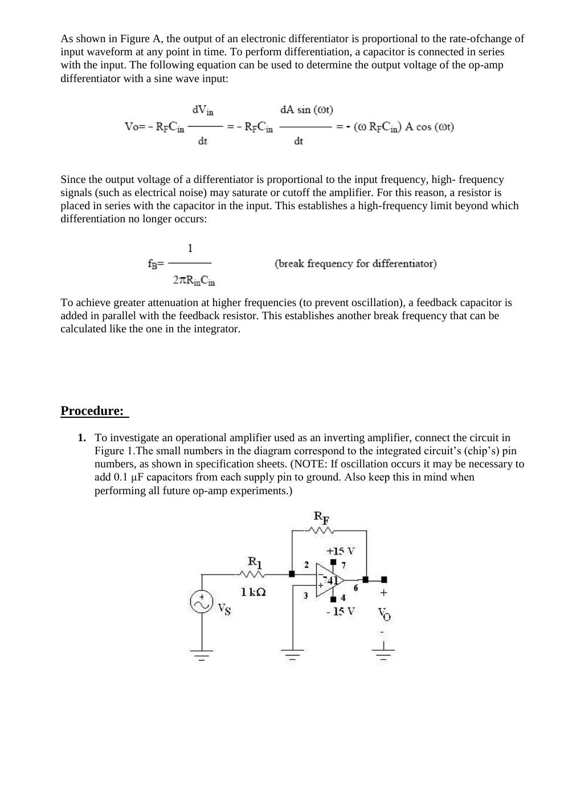
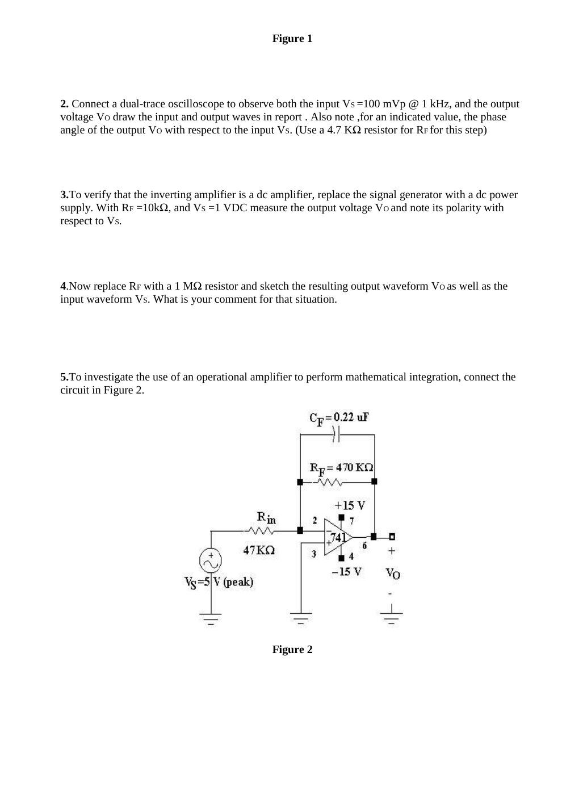
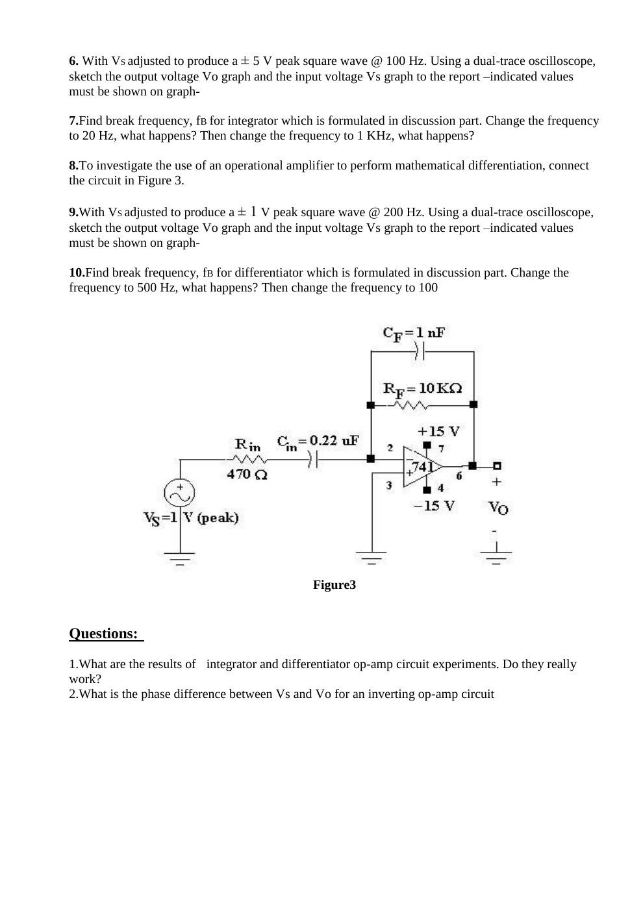
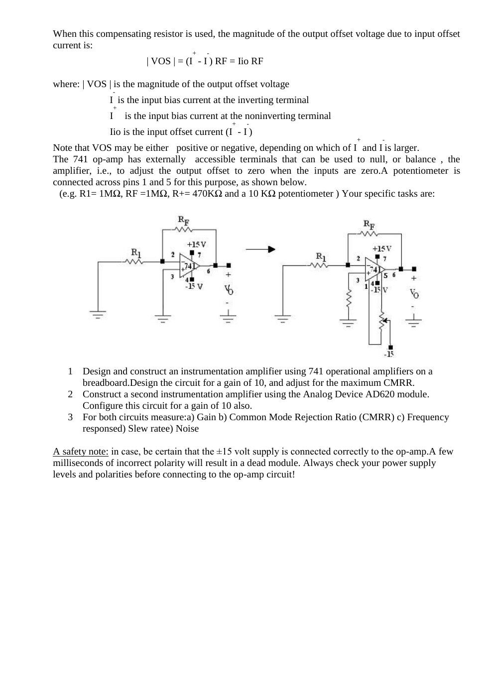
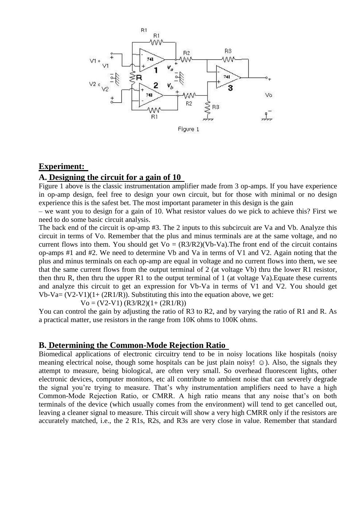

Bu yazı, EEM214 Elektronik I klasöründe saklanan **Başkent Üniversitesi EEM311 Electronics II, Experiment 9 – Operational Amplifiers** föyüdür. PDF’nin oluşturulma tarihi 9 Ekim 2012’dir; hazırlayan adı yazmıyor. İlk bölüm eviren yükselteç, integratör ve türev alıcıyı; ikinci bölüm op-amp karakteristiklerini ve enstrümantasyon yükselteçlerini kapsar. İngilizce yönergeler metne aktarıldı; üstverisi temizlenen 12 sayfalık PDF yazının sonunda indirilebilir.

## Inverting amplifier, integrator and differentiator

**Objectives:** Demonstrate an inverting amplifier and the use of operational amplifiers for integration and differentiation.

An ideal op-amp has infinite open-loop gain and input resistance. Negative feedback sets the closed-loop gain. For an inverting amplifier with input resistance R₁ and feedback resistance R_F:

A_v = −R_F/R₁.

An integrator uses a feedback capacitor. A resistor in parallel with the capacitor limits DC gain and prevents a small DC input or offset from driving the output to a supply limit. The handout writes:

V_out = −[1/(R_in C_F)]∫V_in dt.

For a sine input A sin(ωt), it prints −A cos(ωt)/(ωR_in C_F).

*Not: Son eşitliğin işareti kaynakta hatalıdır. Önündeki eksi işaretiyle birlikte integral alınırsa sabit terim dışında +A cos(ωt)/(ωR_in C_F) elde edilir.*

Integration requires frequencies well above **f_B = 1/(2πR_F C_F)**. A differentiator uses an input capacitor:

V_out = −R_F C_in·dV_in/dt = −ωR_F C_in A cos(ωt).

A series input resistor limits high-frequency differentiation at **f_B = 1/(2πR_in C_in)**. A parallel feedback capacitor provides another high-frequency limit and reduces the tendency to oscillate. A square-wave input produces approximately a triangle at an integrator and edge pulses at a differentiator.

## Procedure: Inverting amplifier

Use a 741 with ±15 V supplies and **R₁ = 1 kΩ**. If oscillation occurs, the handout suggests adding 0.1 µF supply bypass capacitors from each supply pin to ground.

1. For R_F = 4.7 kΩ, apply a **100 mV peak, 1 kHz sine**. Observe and sketch input and output; record their phase difference.
1. Replace the generator with **1 V DC** and set R_F = 10 kΩ. Record the output voltage and polarity to verify DC amplification.
1. Set R_F = 1 MΩ, sketch the input and output and comment on the result.

## Procedure: Integration and differentiation

### Integrator

Use R_in = **47 kΩ**, R_F = **470 kΩ**, C_F = **0.22 µF** and ±15 V supplies.

1. Apply a **±5 V peak, 100 Hz square wave**. Draw both signals and label amplitudes and times.
1. Calculate the break frequency.
1. Change the frequency first to **20 Hz**, then **1 kHz**; describe what happens.

### Differentiator

Use R_in = **470 Ω**, C_in = **0.22 µF**, R_F = **10 kΩ**, C_F = **1 nF** and ±15 V supplies.

1. Apply a **±1 V peak, 200 Hz square wave** and sketch input/output with their values.
1. Calculate the break frequency; change to **500 Hz**, then “100” as written in the source.
1. Discuss whether the integrator and differentiator actually perform the intended operations. State the input/output phase difference of the inverting amplifier.

*Not: Son frekansın birimi föyde eksiktir; bağlam Hz olduğunu düşündürür. Verilen elemanlarla integratörün kırılma frekansı yaklaşık 1.54 Hz, türev alıcının giriş RC sınırı 1.54 kHz ve geri besleme RC sınırı 15.9 kHz’dir.*

### Equipment and reporting

741 or equivalent, ±15 V and variable DC supplies, signal generator, dual-trace oscilloscope; resistors 1 MΩ, 4.7 kΩ, 10 kΩ, 1 kΩ, 47 kΩ, 470 kΩ and 470 Ω; capacitors 1 nF and 0.22 µF. A blank report page provides axes for every waveform and spaces for observations. The handout cites *Electronic Devices and Circuits*, fifth edition, Section 10-1.

## Op-amp characteristics and instrumentation amplifiers

The second experiment examines **bandwidth, slew rate, common-mode rejection ratio, offset voltage and noise**. Equipment is to be declared to the teaching assistant at least one hour before the experiment; the source allows groups of at most three and refers students to the LM741 and AD620 specifications.

### Bandwidth and slew rate

The closed-loop bandwidth decreases as gain increases. The given relationships are:

- f_T = BW_CL/β, with β = R₁/(R₁ + R_F).
- Slew rate S = ΔV/Δt.
- Maximum sinusoidal frequency without slew-rate distortion: f_S,max = S/(2πK), where K is output peak amplitude.

### Output offset

Input offset voltage and mismatched input bias currents cause output offset. A resistor at the noninverting input helps compensate the bias-current contribution:

R_C = R₁ ∥ R_F.

With this compensation, the handout writes **|V_OS| = (I⁺ − I⁻)R_F = I_io R_F**, and notes that the sign depends on which bias current is greater. The 741’s pins 1 and 5 permit offset nulling with a potentiometer. The example uses R₁ = R_F = 1 MΩ, R₊ = 470 kΩ and a 10 kΩ potentiometer.

*Not: Mutlak değerle yazılan ofset büyüklüğünde sağ taraf da |I⁺ − I⁻|R_F olarak alınmalıdır; kaynak denklemi işaretli akım farkıyla veriyor.*

## Instrumentation amplifier design

1. Build a three-op-amp instrumentation amplifier using 741s, designed for **gain 10**, and adjust for maximum CMRR.
1. Build an **AD620** instrumentation amplifier, also with gain 10.
1. Measure gain, CMRR, frequency response, slew rate and noise for both circuits.

The classic three-amplifier network gives:

- V_o = (R₃/R₂)(V_b − V_a).
- V_b − V_a = (V₂ − V₁)(1 + 2R₁/R).
- **V_o = (V₂ − V₁)(R₃/R₂)(1 + 2R₁/R).**

Use practical resistances in the **10–100 kΩ** range. Match resistor pairs carefully: ordinary tolerance may be 5%; measure several resistors and use small series corrections when needed.

## CMRR measurement

The handout defines:

- V_id = V₁ − V₂.
- V_ic = (V₁ + V₂)/2.
- V_o = A_d V_id + A_c V_ic.
- CMRR = A_d/A_c, or **20 log₁₀(A_d/A_c)** in dB.

Apply the same **4–5 V common-mode signal** to both inputs and measure the output. Then apply a small differential signal, using a divider if necessary, and adjust until the output amplitude is equal to that in the common-mode test. The source then writes **CMRR = 20 log(V_d/V_cm)**.

*Not: Eşit çıkış koşulunda A_dV_d = A_cV_cm olduğundan oran ters yazılmıştır. Doğrusu CMRR(dB) = 20 log₁₀|V_cm/V_d|’dir. Önceki kazanç türetiminde V₂−V₁, sonraki diferansiyel giriş tanımında V₁−V₂ kullanılması ayrıca işaret farkı oluşturur.*

## Frequency response, slew rate, noise and grading

- **Frequency response:** Find the frequency where output falls to 1/√2 ≈ 0.707 of its low-frequency value, the −3 dB point.
- **Slew rate:** Apply a square wave, observe input and output together and measure the output transition ΔV/Δt. Compare with the device specification.
- **Noise:** Devise and justify a measurement method. The handout points to RMS quantities, resistor thermal noise and noise figure.
- **Targets:** Gain **10 ±5%**; for the 741 version, CMRR at least **40 dB**. The source relates this to approximately 1% resistor matching.
- **Report:** Compare all measured parameters for the 741 and AD620 versions and explain unexpected results. Do not dismantle the circuit before the assistant’s check. The source permits either reporting language.

The supply note in the source asks that ±15 V levels and polarities be checked before connecting an op-amp, since reverse supply polarity can destroy it.
