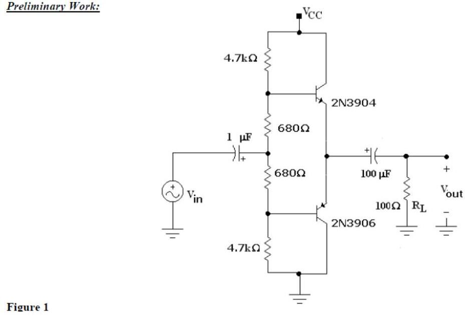
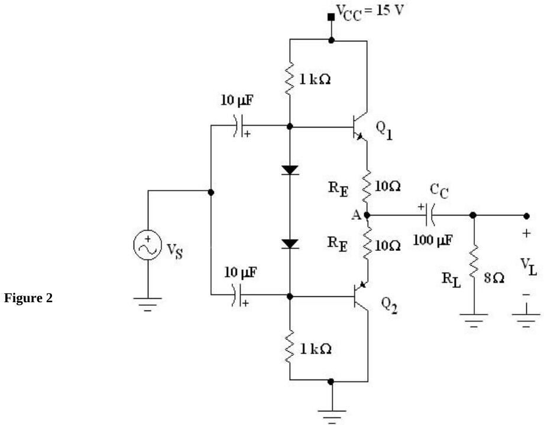
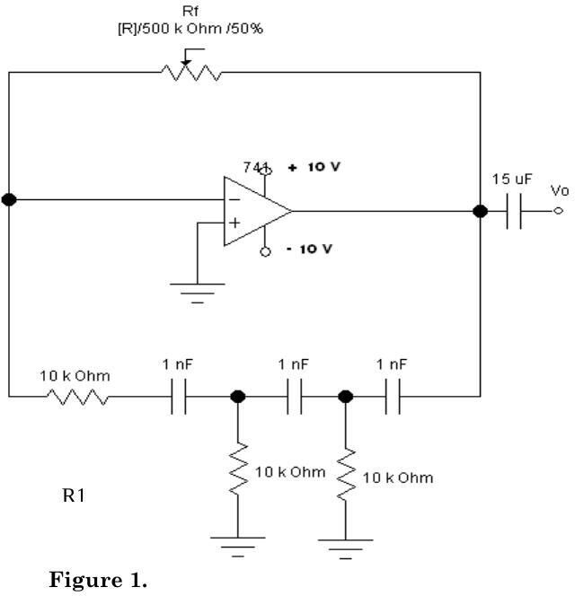

Bu yazı, EEM214 Elektronik I dersinin laboratuvar klasöründe saklanmış, aslında bir sonraki dönemin dersi **EEM 311 Electronics II**'ye ait 2012 güz dönemi föylerinden ikisini aktarıyor: **Experiment 06 – Push-Pull Amplifier** ve **Experiment 11 – RC Phase-Shift Oscillators**. Aynı klasördeki diğer iki EEM311 föyü (fark yükselteci "Introduction to Opamps" ve "Active Filters") neredeyse aynı metinlerle arşivde zaten bulunduğu için burada yalnız bağlantıları verildi: [EEM311 Deney 7–8, BJT fark yükselteci](/arsiv/eem311-deney-7-8-fark-frekans-cevabi/) ve [EEM311 Aktif Filtreler föyü](/arsiv/eem311-deney-aktif-filtreler/). Föyler İngilizce olduğu için metinleri İngilizce aktarıldı. Dört föyün PDF'i yazının sonunda ZIP olarak indirilebilir.

## Experiment 06: Push-Pull Amplifier

**Objective:** To demonstrate the use of the capacitor-coupled complementary push-pull class-AB power amplifier.

**Discussion:** Figure 2 shows how a push-pull amplifier can be constructed without a driver or an output transformer. Note the complementary (NPN and PNP) transistors Q1 and Q2: when V_S is positive, NPN Q1 conducts and PNP Q2 is cut off; when V_S is negative, Q1 is cut off and Q2 conducts. For optimum operation all components must be closely matched, in which case the DC voltage at point A is V_CC/2. The coupling capacitor C_C keeps the DC voltage from the load and eliminates the need for an output transformer; it affects the low-frequency response. The lower cut-off frequency due to C_C is f₁(C_C) = 1 / [2π(R_L + R_E)C_C].

### Preliminary work

Use a simulation program (Electronics Workbench, PSpice, etc.) to learn the main characteristics of this type of amplifier; "the most important thing in this part is evaluation of your talent in usage of a simulation program and it is easier and more fun than solving problems." Print the circuit and drawings in report form with your ID number. Figure 1: complementary 2N3904/2N3906 pair biased by a 4.7 kΩ – 680 Ω – 680 Ω – 4.7 kΩ divider, input through 1 µF, output through 100 µF to R_L = 100 Ω.

- Step 1: Construct Figure 1 and find I_C(SAT) (V_CC = 10 V).
- Step 2: Set V_CC = 5 V and apply 2 V peak-to-peak at 1 kHz; draw the output.
- Step 3: Reduce the input and V_CC to 0 V, connect a multimeter to measure I_C, then increase V_CC until I_C = 1 mA; note V_CC.
- Step 4: Measure V_BE and V_EB of the transistors.
- Step 5: Set the generator so that the output is 4 V peak-to-peak; draw the input.
- Step 6: Increase the input step by step and note when a cut-off appears at the output; measure V_out(pp) at the start of cut-off.
- Step 7: Find P_L = V_L(pp)² / (8R_L).

### Procedure

1. Connect the capacitor-coupled, complementary push-pull class-AB amplifier of Figure 2 (V_CC = 15 V, 1 kΩ bias resistors with two diodes, R_E = 10 Ω, C_C = 100 µF, R_L = 8 Ω).
1. With V_S = 3 V peak-to-peak at 1 kHz, observe V_S and V_L on a dual-trace oscilloscope and sketch them; also sketch the voltage at point A with DC coupling and record its DC level.
1. Decrease the source frequency until V_L equals 0.707 times the value in step 2; record this lower cut-off frequency f₁(C_C).

**Questions:**

1. Using the sketch of step 2, calculate the average load power. What could cause the positive and negative output amplitudes to be slightly different?
1. Calculate the theoretical f₁(C_C) and compare with the measurement. If the amplifier had to operate over the whole audio range (20 Hz – 20 kHz), what value would the output coupling capacitor need?

**Equipment:** 2N2222, 2N2907 (or equivalent), 15 V supply, signal generator, resistors 2 × 1 kΩ, 2 × 10 Ω (0.5 W), 8 Ω (0.5 W), capacitors 100 µF and 2 × 10 µF (25 V), dual-trace oscilloscope, 1N4001-type diodes. **Reference:** *Electronic Devices and Circuits*, 5th ed., Sections 14-5, 14-8, 14-9.

*Not: Föydeki formülle R_L = 8 Ω, R_E = 10 Ω ve C_C = 100 µF için f₁(C_C) = 1/(2π × 18 Ω × 100 µF) ≈ 88 Hz bulunur; alt kesimin 20 Hz olması için C_C ≈ 1/(2π × 18 × 20) ≈ 440 µF gerekir.*

## Experiment 11: RC Phase-Shift Oscillators

**Theory:** Oscillators can be built using op-amps with feedback that phase-shifts the output by 180°. In a phase-shift oscillator three resistor–capacitor sections are used and the oscillation frequency is f = 1 / (2π√6·RC). For the circuit to oscillate the op-amp gain must have a magnitude of 29.

**Preliminary work:** Construct the circuit of Figure 1 (in simulation) and record the output waveform.

**Procedure:**

1. Construct Figure 1 with R_f = 500 kΩ potentiometer, R1 = 22 kΩ, R = 100 kΩ and C = 1 nF; measure and record the resistor values.
1. Record the output waveform; adjust R_f for the maximum undistorted output V_o and record R_f.
1. Measure the time for one cycle.
1. Determine the frequency.
1. Replace the capacitors with C = 10 nF and repeat steps 3–4.
1. Calculate the theoretical frequency.
1. Compare the measured and calculated frequencies for both capacitors.

**Equipment:** 741 op-amp, two DC supplies (±10 V), signal generator, resistors 22 kΩ and 2 × 100 kΩ, 500 kΩ potentiometer, capacitors 15 µF, 3 × 1 nF, 3 × 10 nF. **Reference:** Boylestad & Nashelsky, *Electronic Devices and Circuit Theory*, 6th ed. The last page is a report form (R_f, T, f, T₂, f₂, calculated frequencies, comments).

*Not: Prosedürdeki R = 100 kΩ ve C = 1 nF ile f = 1/(2π√6 × 100 kΩ × 1 nF) ≈ 650 Hz, C = 10 nF ile ≈ 65 Hz bulunur. Şekilde ise faz kaydırma ağındaki dirençler 10 kΩ olarak çizilmiş; bu değerle frekanslar on kat büyük olur.*

## İndirme

ZIP dosyasında dört EEM311 föyünün PDF'i bulunuyor: push-pull yükselteç, RC faz kaydırmalı osilatör, BJT fark yükselteci ("Introduction to Opamps", 2012) ve aktif filtreler.
