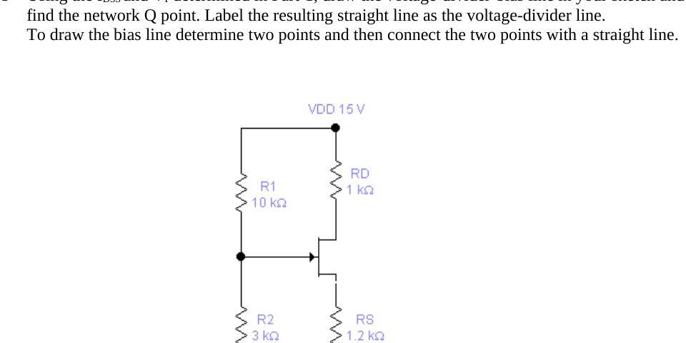
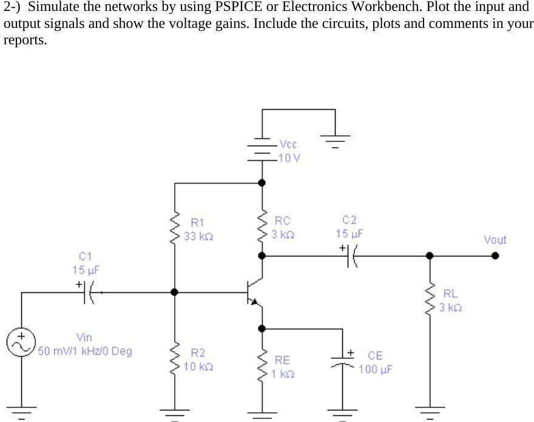

This post brings together three handouts (Experiments 4, 5 and 6) from the 2003 spring semester of the Başkent University **EEM 214 Electronics** laboratory, along with the preliminary work and reports prepared by a student during the same semester. The reports are a friend's work; the name and student number have been removed. The same semester's Experiment 2 (LED and Zener diode) and Laboratory 3 (BJT) handouts are in the archive in a separate post. The handouts and the reports, with personal information redacted, can be downloaded as a ZIP at the end of the post.

## Experiment 4: JFET Bias Circuits (handout)

**Objective:** To analyze the fixed and voltage-divider bias JFET networks.

### Preliminary work

1. Find R2 to set V_DQ = 6 V (I_DSS = 4.5 mA, V_P = −6 V). Circuit: V_DD = 18 V, a voltage divider consisting of R1 = 500 kΩ and R2, R_D = 6 kΩ, R_S = 0.5 kΩ; the lower end of the divider is connected to −4.8 V.
1. Find V_DQ, V_CQ and the mode of the transistors (I_DSS = 12 mA, V_P = −6 V, V_BE = 0.6 V, β = 180). Circuit: V_DD = 16 V, a structure in which a JFET and a BJT are stacked (cascode-like); R1 = 82 kΩ, R2 = 24 kΩ divider, R_D = 2.7 kΩ, 1 MΩ between the JFET gate and the BJT base, R_S = 1.6 kΩ.

### Part 1: Fixed-bias network

V_GS is set with an independent DC source: V_DD = 15 V, R_D = 1 kΩ, and the gate voltage is taken from a 5 kΩ potentiometer connected to a −9 V source.

- a. Construct the network of Figure 1. Insert the measured value of R_D.
- b. Set V_GS = 0 V and measure V_RD. Calculate I_D = V_RD / R_D. Since V_GS = 0 V the resulting drain current is the saturation value I_DSS.
- c. Make V_GS more and more negative until V_RD = 1 mV (I_D = 1 µA). The resulting V_GS is the pinch-off voltage V_P.
- d. Using I_DSS and V_P, sketch the transfer curve (I_D vs V_GS).
- e. If V_GS = −1 V, determine I_DQ from the curve.
- f. Set V_GS = −1 V in the network, measure V_RD and calculate I_DQ.
- g. Compare the measured and calculated values of I_DQ.

### Part 2: Voltage-divider bias network

V_G = R2·V_DD / (R1 + R2) and V_GS = V_G − I_D·R_S. Circuit: V_DD = 15 V, R1 = 10 kΩ, R2 = 3 kΩ, R_D = 1 kΩ, R_S = 1.2 kΩ.

- a. Construct the network of Figure 2 and insert the measured resistor values.
- b. Using I_DSS and V_P from Part 1, draw the voltage-divider bias line on the transfer curve and find the Q point.
- c. Calculate the Q point (I_DQ, V_GSQ).
- d. Calculate the theoretical values of V_D, V_S and V_DS.
- e. Measure V_GSQ, V_D, V_S and V_DS.
- f. Calculate the percent difference: % difference = |V_meas − V_calc| / |V_calc| × 100%.
- g. Calculate I_DQ = (V_DD − V_D) / R_D from the measured voltages and compare with step c.

## Experiments 5 and 6: Small-signal analysis of BJT and FET networks (handout)

Experiment 5 was a PSpice study (due May 26): "Calculate the voltage gains of the networks as a function of the parameters β, I_DSS and V_P. Show all your steps. Express the types of these amplifiers. Simulate the networks by using PSPICE or Electronics Workbench. Plot the input and output signals and show the voltage gains." In Experiment 6 the same circuits were built in the laboratory: "Construct the networks. Observe the input and output signals and show the voltage gains."

- **BJT amplifier:** V_CC = 10 V, R1 = 33 kΩ, R2 = 10 kΩ, R_C = 3 kΩ, R_E = 1 kΩ (bypassed with C_E = 100 µF), R_L = 3 kΩ, C1 = C2 = 15 µF, input 50 mV, 1 kHz.
- **JFET amplifier:** V_DD = 10 V, R_G = 1 MΩ, R_D = 2.4 kΩ, R_S = 510 Ω (C_S = 100 µF), R_L = 10 kΩ, C1 = C2 = 15 µF, input 100 mV.

## Student reports

### Experiment 1: Instrument and measurement

Purpose: to learn the instruments to be used in the experiments, how to measure peak, peak-to-peak, frequency and period with an oscilloscope, and how to check a diode with an ohmmeter. A 4 V peak, 50 Hz sine wave was applied from the function generator: from 2 V/div and 4 divisions, V_pp = 8 V; from 5 ms/div and 4 divisions, T = 0.02 s and f = 50 Hz were found; the multimeter read 0.205 V. In the resistive circuit, the node voltages were measured as 10 V and 6.6 V with the oscilloscope and 10.131 V and 6.798 V with the multimeter ("the multimeter provides more precise measurement"). In the diode circuit, V_A − V_B ≈ 0.56 V was found at the peak; in the circuit with a capacitor, the capacitor was observed to discharge through 10 kΩ during the negative half-cycle.

*Note: The RMS value of a sine wave with a 4 V peak should be 4/√2 ≈ 2.83 V; the 0.205 V written in the report, and the ratio V_rms/V_p = 0.0512 calculated from it, are not correct (the expected ratio is ≈ 0.707). The measurement was most likely made on the wrong range.*

### Experiment 2: Light emitting and Zener diodes

In the preliminary work, the clipper circuit of Experiment 2 (R1 = 1.5 kΩ, R2 = 1.5 kΩ + battery, R3 = 0.5 kΩ) was drawn by simulation. Measurements in the report:

- Point where the LED first emits light: V_D = 1.814 V, V_R = 0.024 V, I_D = 0.24 mA; good brightness: V_D = 2.156 V, V_R = 1.403 V, I_D = 14.03 mA.

| E (V) | 0.027 | 1.113 | 2.068 | 3.107 | 4.100 | 5.084 | 6.101 |
|---|---|---|---|---|---|---|---|
| V_D (V) | 0.026 | 1.112 | 1.895 | 2.085 | 2.238 | 2.389 | 2.545 |
| I_D (mA) | 0.01 | 0.01 | 1.17 | 10.20 | 18.59 | 26.91 | 35.53 |

- In the Zener diode, no current flowed until E ≈ 10 V; for E = 10.11, 11.10, 12.13, 13.08, 14.06, 15.07 V, V_Z = 9.91, 10.19, 10.46, 10.71, 10.97, 11.19 V and I_Z = 1.89, 8.87, 16.13, 23.06, 30.32, 37.7 mA were measured. Conclusion: V_Z ≈ 10 V.

*Note: From the measurements, in the linear region R_Z ≈ (11.19 − 9.91) V / (37.7 − 1.89) mA ≈ 36 Ω.*

### Laboratory 3: BJT preliminary work and report

In the preliminary work, two circuits were solved. In the fixed-base circuit (6 V base source, 3.3 kΩ emitter, 4.7 kΩ collector, 10 V), I_B = 5.3 / (3300·101) = 15.9 µA and I_C = 1.59 mA were found from the base–emitter loop; since the saturation current I_C(sat) = 10 / (4.7k + 3.3k) = 1.25 mA is smaller than this, the **transistor is in saturation**. In the divider circuit (15 V, 100 kΩ / 50 kΩ, 5 kΩ, 3 kΩ), with the Thevenin equivalent V_th = 5 V, R_th = 33.3 kΩ, the **transistor is in the active region**. The report itself consists only of the blank template of the tables (Table 8.1–8.3) from the handout.

*Note: In the preliminary work, I_C = 100·I_B = 1.5 mA is written; 100 × 15.9 µA = 1.59 mA. The result (saturation) does not change.*

### Experiment 4: JFET bias circuits report

- Fixed bias: at V_GS = 0 V, V_RD = 14.48 V, i.e. **I_DSS = 14.48 mA**; the point where V_RD = 1 mV gives **V_P = −3.6 V**.
- For V_GS = −1 V, I_DQ = 10.40 mA was calculated from the curve, and in the measurement V_RD = 13.40 V, I_DQ = 13.40 mA was found.
- Voltage-divider bias: V_G = 15·3/13 = 3.46 V, V_GS = 3.46 − 1200·I_D; from the Shockley equation, **I_DQ = 4.25 mA, V_GSQ = −1.648 V**; V_D = 10.75 V, V_S = 5.1 V, V_DS = 5.65 V (calculated).

| | Calculated | Measured | % difference |
|---|---|---|---|
| V_GSQ | −1.648 V | −1.736 V | 5.34 |
| V_D | 10.75 V | 10.685 V | 0.60 |
| V_S | 5.1 V | 5.321 V | 4.33 |
| V_DS | 5.65 V | 5.364 V | 5.06 |

With the measured V_D, I_DQ = (15 − 10.685) / 1000 = 4.315 mA, a difference of 1.52%.

*Note: With I_DSS = 14.48 mA and V_P = −3.6 V, the Shockley equation for V_GS = −1 V gives I_D = 14.48·(1 − 1/3.6)² ≈ 7.55 mA; the 10.40 mA value read from the curve in the report and the measured 13.40 mA are quite far from this value. The result of the voltage-divider part (4.25 mA, −1.65 V), on the other hand, is consistent with the equations.*

### Experiment 6: Small-signal analysis report

At a 50 mV input the BJT amplifier went into saturation, so the input was reduced to 10 mV: V_o(pp) = 1.75 V, V_i(pp) = 20 mV, **A_V = 87.5**. In the second circuit, for V_i(pp) = 100 mV, V_o(pp) = 4.8 V, **A_V = 48** was measured.

## Download

The ZIP file contains the Word files of the three handouts (foyler/) and redacted PDF copies of the student's seven preliminary works/reports (raporlar/).
