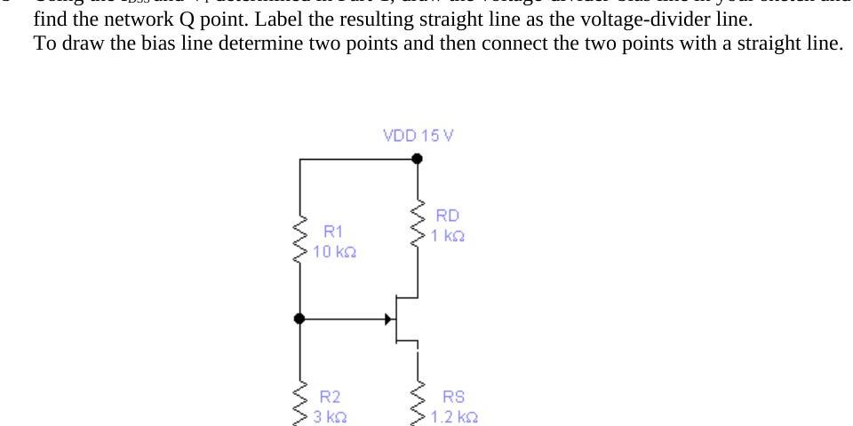
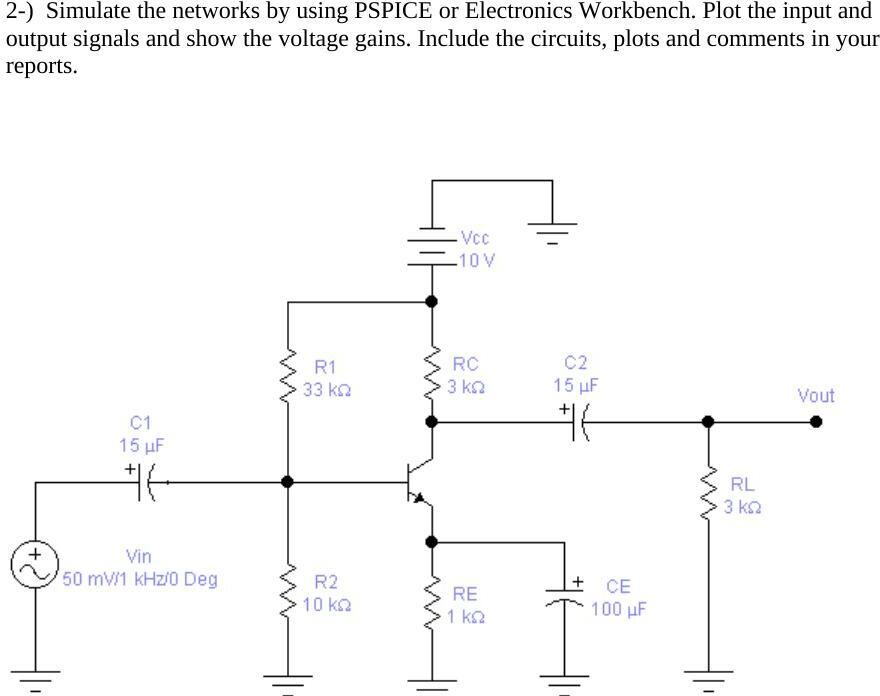

Bu yazı, Başkent Üniversitesi **EEM 214 Electronics** laboratuvarının 2003 bahar dönemine ait üç föyünü (Experiment 4, 5 ve 6) ve aynı dönemde bir öğrencinin hazırladığı ön çalışma ile raporları bir araya getiriyor. Raporlar bir arkadaşın çalışması; ad ve öğrenci numarası çıkarıldı. Aynı dönemin Experiment 2 (LED ve Zener diyot) ve Laboratory 3 (BJT) föyleri arşivde ayrı bir yazıda bulunuyor. Föyler ve kişisel bilgileri kapatılmış raporlar yazının sonunda ZIP olarak indirilebilir.

## Experiment 4: JFET Bias Circuits (föy)

**Objective:** To analyze the fixed and voltage-divider bias JFET networks.

### Preliminary work

1. Find R2 to set V_DQ = 6 V (I_DSS = 4.5 mA, V_P = −6 V). Devre: V_DD = 18 V, R1 = 500 kΩ ve R2'den oluşan gerilim bölücü, R_D = 6 kΩ, R_S = 0.5 kΩ; bölücünün alt ucu −4.8 V'a bağlı.
1. Find V_DQ, V_CQ and the mode of the transistors (I_DSS = 12 mA, V_P = −6 V, V_BE = 0.6 V, β = 180). Devre: V_DD = 16 V, JFET ile BJT'nin üst üste bağlandığı (kaskod benzeri) yapı; R1 = 82 kΩ, R2 = 24 kΩ bölücü, R_D = 2.7 kΩ, JFET kapısı ile BJT bazı arasında 1 MΩ, R_S = 1.6 kΩ.

### Part 1: Fixed-bias network

V_GS bağımsız bir DC kaynakla ayarlanır: V_DD = 15 V, R_D = 1 kΩ, kapı gerilimi −9 V kaynağa bağlı 5 kΩ potansiyometreden alınır.

- a. Construct the network of Figure 1. Insert the measured value of R_D.
- b. Set V_GS = 0 V and measure V_RD. Calculate I_D = V_RD / R_D. Since V_GS = 0 V the resulting drain current is the saturation value I_DSS.
- c. Make V_GS more and more negative until V_RD = 1 mV (I_D = 1 µA). The resulting V_GS is the pinch-off voltage V_P.
- d. Using I_DSS and V_P, sketch the transfer curve (I_D vs V_GS).
- e. If V_GS = −1 V, determine I_DQ from the curve.
- f. Set V_GS = −1 V in the network, measure V_RD and calculate I_DQ.
- g. Compare the measured and calculated values of I_DQ.

### Part 2: Voltage-divider bias network

V_G = R2·V_DD / (R1 + R2) ve V_GS = V_G − I_D·R_S. Devre: V_DD = 15 V, R1 = 10 kΩ, R2 = 3 kΩ, R_D = 1 kΩ, R_S = 1.2 kΩ.

- a. Construct the network of Figure 2 and insert the measured resistor values.
- b. Using I_DSS and V_P from Part 1, draw the voltage-divider bias line on the transfer curve and find the Q point.
- c. Calculate the Q point (I_DQ, V_GSQ).
- d. Calculate the theoretical values of V_D, V_S and V_DS.
- e. Measure V_GSQ, V_D, V_S and V_DS.
- f. Calculate the percent difference: % difference = |V_meas − V_calc| / |V_calc| × 100%.
- g. Calculate I_DQ = (V_DD − V_D) / R_D from the measured voltages and compare with step c.

## Experiment 5 ve 6: Small-signal analysis of BJT and FET networks (föy)

Experiment 5 bir PSpice çalışmasıydı (teslim: 26 Mayıs): "Calculate the voltage gains of the networks as a function of the parameters β, I_DSS and V_P. Show all your steps. Express the types of these amplifiers. Simulate the networks by using PSPICE or Electronics Workbench. Plot the input and output signals and show the voltage gains." Experiment 6'da aynı devreler laboratuvarda kuruldu: "Construct the networks. Observe the input and output signals and show the voltage gains."

- **BJT yükselteci:** V_CC = 10 V, R1 = 33 kΩ, R2 = 10 kΩ, R_C = 3 kΩ, R_E = 1 kΩ (C_E = 100 µF ile köprülenmiş), R_L = 3 kΩ, C1 = C2 = 15 µF, giriş 50 mV, 1 kHz.
- **JFET yükselteci:** V_DD = 10 V, R_G = 1 MΩ, R_D = 2.4 kΩ, R_S = 510 Ω (C_S = 100 µF), R_L = 10 kΩ, C1 = C2 = 15 µF, giriş 100 mV.

## Öğrenci raporları

### Deney 1: Instrument and measurement

Amaç: deneylerde kullanılacak aletleri, osiloskopla tepe, tepeden tepeye, frekans ve periyot ölçmeyi ve diyodun ohmmetreyle kontrolünü öğrenmek. Fonksiyon üretecinden 4 V tepe, 50 Hz sinüs verildi: 2 V/div ve 4 bölmeden V_pp = 8 V, 5 ms/div ve 4 bölmeden T = 0.02 s, f = 50 Hz bulundu; multimetre 0.205 V gösterdi. Dirençli devrede düğüm gerilimleri osiloskopla 10 V ve 6.6 V, multimetreyle 10.131 V ve 6.798 V ölçüldü ("multimetre daha hassas ölçüm sağlar"). Diyotlu devrede tepe noktasında V_A − V_B ≈ 0.56 V bulundu; kondansatörlü devrede negatif yarı periyotta kondansatörün 10 kΩ üzerinden boşaldığı gözlendi.

*Not: 4 V tepe değerli sinüsün etkin değeri 4/√2 ≈ 2.83 V olmalıdır; raporda yazılan 0.205 V ve buna göre hesaplanan V_rms/V_p = 0.0512 oranı doğru değildir (beklenen oran ≈ 0.707). Ölçüm büyük olasılıkla yanlış kademede yapılmış.*

### Deney 2: Light emitting and Zener diodes

Ön çalışmada Experiment 2'deki kırpıcı devresi (R1 = 1.5 kΩ, R2 = 1.5 kΩ + batarya, R3 = 0.5 kΩ) simülasyonla çizildi. Raporun ölçümleri:

- LED'in ilk ışık verdiği nokta: V_D = 1.814 V, V_R = 0.024 V, I_D = 0.24 mA; iyi parlaklık: V_D = 2.156 V, V_R = 1.403 V, I_D = 14.03 mA.

| E (V) | 0.027 | 1.113 | 2.068 | 3.107 | 4.100 | 5.084 | 6.101 |
|---|---|---|---|---|---|---|---|
| V_D (V) | 0.026 | 1.112 | 1.895 | 2.085 | 2.238 | 2.389 | 2.545 |
| I_D (mA) | 0.01 | 0.01 | 1.17 | 10.20 | 18.59 | 26.91 | 35.53 |

- Zener diyotta E ≈ 10 V'a kadar akım akmadı; E = 10.11, 11.10, 12.13, 13.08, 14.06, 15.07 V için V_Z = 9.91, 10.19, 10.46, 10.71, 10.97, 11.19 V ve I_Z = 1.89, 8.87, 16.13, 23.06, 30.32, 37.7 mA ölçüldü. Sonuç: V_Z ≈ 10 V.

*Not: Ölçümlere göre doğrusal bölgede R_Z ≈ (11.19 − 9.91) V / (37.7 − 1.89) mA ≈ 36 Ω çıkar.*

### Laboratory 3: BJT ön çalışması ve rapor

Ön çalışmada iki devre çözüldü. Sabit bazlı devrede (6 V baz kaynağı, 3.3 kΩ emetör, 4.7 kΩ kolektör, 10 V) baz–emetör çevriminden I_B = 5.3 / (3300·101) = 15.9 µA ve I_C = 1.59 mA bulundu; doyma akımı I_C(sat) = 10 / (4.7k + 3.3k) = 1.25 mA bundan küçük olduğundan **transistör doyumda**. Bölücülü devrede (15 V, 100 kΩ / 50 kΩ, 5 kΩ, 3 kΩ) Thevenin eşdeğeri V_th = 5 V, R_th = 33.3 kΩ ile **transistör aktif bölgede**. Raporun kendisi föydeki tabloların (Table 8.1–8.3) boş şablonundan ibaret.

*Not: Ön çalışmada I_C = 100·I_B = 1.5 mA yazılmış; 100 × 15.9 µA = 1.59 mA'dir. Sonuç (doyum) değişmez.*

### Experiment 4: JFET bias circuits raporu

- Sabit kutuplama: V_GS = 0 V'ta V_RD = 14.48 V, yani **I_DSS = 14.48 mA**; V_RD = 1 mV olduğu nokta **V_P = −3.6 V**.
- V_GS = −1 V için eğriden I_DQ = 10.40 mA hesaplanmış, ölçümde V_RD = 13.40 V, I_DQ = 13.40 mA bulunmuş.
- Gerilim bölücü kutuplama: V_G = 15·3/13 = 3.46 V, V_GS = 3.46 − 1200·I_D; Shockley denklemiyle **I_DQ = 4.25 mA, V_GSQ = −1.648 V**; V_D = 10.75 V, V_S = 5.1 V, V_DS = 5.65 V (hesap).

| | Hesaplanan | Ölçülen | % fark |
|---|---|---|---|
| V_GSQ | −1.648 V | −1.736 V | 5.34 |
| V_D | 10.75 V | 10.685 V | 0.60 |
| V_S | 5.1 V | 5.321 V | 4.33 |
| V_DS | 5.65 V | 5.364 V | 5.06 |

Ölçülen V_D ile I_DQ = (15 − 10.685) / 1000 = 4.315 mA, fark %1.52.

*Not: I_DSS = 14.48 mA ve V_P = −3.6 V ile V_GS = −1 V için Shockley denklemi I_D = 14.48·(1 − 1/3.6)² ≈ 7.55 mA verir; raporda eğriden okunan 10.40 mA değeri ve ölçülen 13.40 mA bu değerden oldukça uzak. Gerilim bölücü kısmının sonucu (4.25 mA, −1.65 V) ise denklemlerle tutarlı.*

### Experiment 6: Small-signal analysis raporu

50 mV girişte BJT yükselteci doyuma girdiği için giriş 10 mV'a düşürüldü: V_o(pp) = 1.75 V, V_i(pp) = 20 mV, **A_V = 87.5**. İkinci devrede V_i(pp) = 100 mV için V_o(pp) = 4.8 V, **A_V = 48** ölçüldü.

## İndirme

ZIP dosyasında üç föyün Word dosyaları (foyler/) ve öğrencinin yedi ön çalışma/raporunun kişisel bilgileri kapatılmış PDF kopyaları (raporlar/) bulunuyor.
