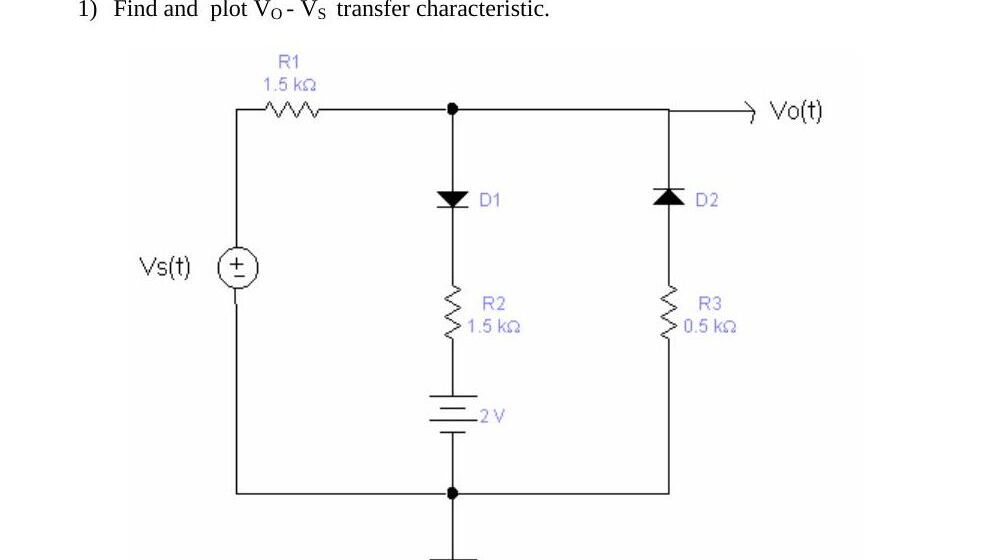
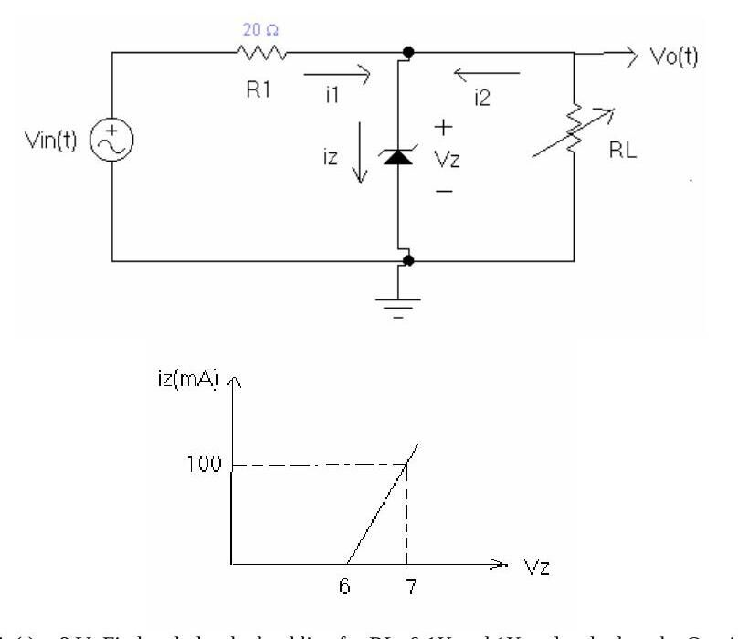
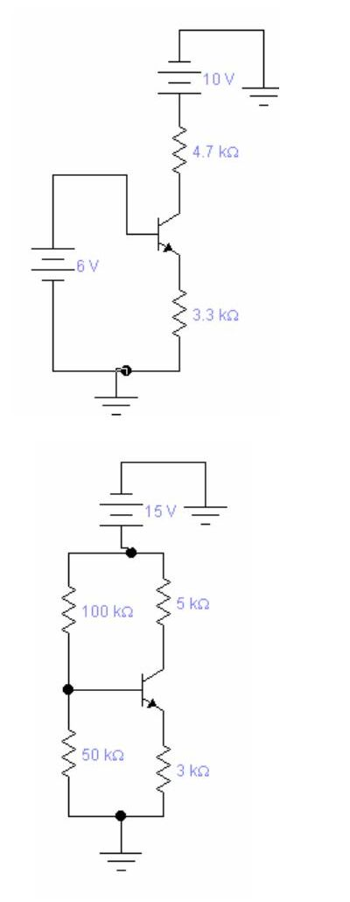

Bu yazı, Başkent Üniversitesi Elektrik-Elektronik Mühendisliği Bölümü **EEM 214 Electronics** laboratuvarının 2003 bahar dönemine ait iki föyünü içeriyor: **Experiment-2: Light Emitting and Zener Diodes** (Mart 2003) ve **Laboratory #3** BJT deneyinin ön çalışma sayfası (Mart 2003). İkinci föyün deney adımları bir laboratuvar kitabından taranmış sayfalardan oluştuğu için yalnızca bölümün kendi hazırladığı ön çalışma ve rapor soruları aktarıldı. Föyler İngilizce; metin aslına sadık kalınarak verildi. Orijinal dosyalar yazının sonunda ZIP olarak indirilebilir.

Aynı dersin daha yeni (2012 sonrası) Deney 1 ve Deney 2 föyleri arşivde ayrı yazılar olarak bulunuyor.

## Experiment 2: Light Emitting and Zener Diodes

**Objective:** To become familiar with the characteristics and use of a light-emitting diode (LED) and Zener diode.

### Preliminary work

**1)** Find and plot the V_O – V_S transfer characteristic of the circuit below: V_s(t) feeds the output node through R1 = 1.5 kΩ; from the output node to ground there are two branches, D1 in series with R2 = 1.5 kΩ and a 2 V battery, and D2 (reversed) in series with R3 = 0.5 kΩ.

**2)** In the Zener regulator below, V_in(t) is applied through R1 = 20 Ω to a Zener diode in parallel with a variable load R_L. The Zener i–v characteristic is piecewise linear: i_z = 0 below 6 V and rises linearly to 100 mA at V_z = 7 V.

- a) V_in(t) = 8 V. Find and plot the load line for R_L = 0.1 kΩ and 1 kΩ and calculate the Q point (i_z, V_z).
- b) Let V_in(t) = 8 + V_r·cos(ωt), I_Zmax = 100 mA. Determine the maximum value of V_r for proper operation for all possible values of R_L between 0.1 kΩ and 1 kΩ.

### Part 1: LED characteristics

Figure 1: a variable DC supply E, an LED and a resistor R = 100 Ω in series.

- a. Construct the circuit of Fig. 1. Initially set the supply to 0 V and record the measured value of the resistor R.
- b. Increase the supply voltage E until "first light" is noticed. Record V_D and V_R using the DMM and calculate I_D = V_R / R_meas.
- c. Continue to increase E until "good brightness" is first established. Do not overload the circuit and possibly damage the LED by raising the voltage beyond this level. Record V_D, V_R and calculate I_D.
- d. Set the DC supply to the levels in Table 1 and measure both V_D and V_R; calculate I_D.

**Table 1**

| E (V) | 0 | 1 | 2 | 3 | 4 | 5 | 6 |
|---|---|---|---|---|---|---|---|
| V_D (V) | | | | | | | |
| V_R (V) | | | | | | | |
| I_D = V_R / R_meas (mA) | | | | | | | |

- e. Using the data of Table 1, sketch the curve of I_D versus V_D.
- f. Draw a light dashed horizontal line at the current required for "good brightness" and a vertical line at its intersection with the curve; the V_D found should be close to the value of Part 1(c). Shade the region below the I_D line and left of the V_D line as the region to be avoided if good brightness is to be obtained, and label the remaining region "good brightness".

### Part 2: Zener diode characteristics

Figure 2: a variable DC supply E, a resistor R = 100 Ω and a Zener diode (reverse biased) in series.

- a. Construct the circuit of Fig. 2, set the supply to 0 V and record the measured value of R.
- b. Set E to the values in Table 2 and measure V_Z and V_R (use the millivolt range of the DMM for low values).
- c. Calculate the Zener current I_Z = V_R / R_meas in mA at each level of E.
- d. Since the Zener region is in the third quadrant of the diode characteristic, place a (−) sign in front of each I_Z and V_Z and plot the data.
- e. For the linear region that drops from the V_Z axis, what is the average value of V_Z? In other words, for all practical purposes, what is V_Z for this Zener diode?
- f. Estimate the average resistance R_Z of the Zener diode in the linear region.
- g. Using the results of e and f, establish the Zener diode equivalent circuit for the "on" linear region.

**Table 2:** E = 0, 1, 2, …, 15 V; rows V_Z (V), V_R (V), I_Z = V_R / R_meas (mA).

## Laboratory #3: BJT characteristics (preliminary work and exercises)

**Preliminary work 1)** Find the mode of these transistors (active, cut-off, saturation). If they are in active mode find the Q-points of the transistors (β = 100, V_BE = 0.7 V).

- Circuit 1: NPN transistor, 4.7 kΩ collector resistor to a 10 V supply, base driven directly by a 6 V source, 3.3 kΩ emitter resistor to ground.
- Circuit 2: NPN transistor with voltage-divider bias from 15 V: 100 kΩ (to the supply) and 50 kΩ (to ground) at the base, 5 kΩ collector resistor and 3 kΩ emitter resistor.

Deneyin kendisi (transistör uçlarının ve tipinin DMM'nin diyot kademesiyle belirlenmesi, 1 MΩ ve 5 kΩ potansiyometrelerle I_B = 10–50 µA için kolektör karakteristiklerinin çıkarılması, α ve β'nın hesaplanması; Table 8.1–8.3, Figure 8.1–8.3) bir laboratuvar kitabından taranmış sayfalardan oluşuyor; bu sayfalar yayınlanmadı.

**Exercises (will be included in your reports)**

1. Find the average value of β using the data of Table 8.3, that is, the sum of the β values divided by the number of values. Where on the characteristics did the average value of β typically occur? Is it reasonable to use this value of β for the transistor for most applications?
1. Determine the average value of V_BE using the data of Table 8.3. Is it reasonable to use the 0.7 V level in the analysis of BJT transistor networks where the actual value is unknown?

## İndirme

ZIP dosyasında Experiment-2 föyünün PDF'i (EEM214_D2.pdf) ve Laboratory #3 föyünün yalnızca ön çalışma sayfası (EEM214_D3_PRE.pdf) bulunuyor.
