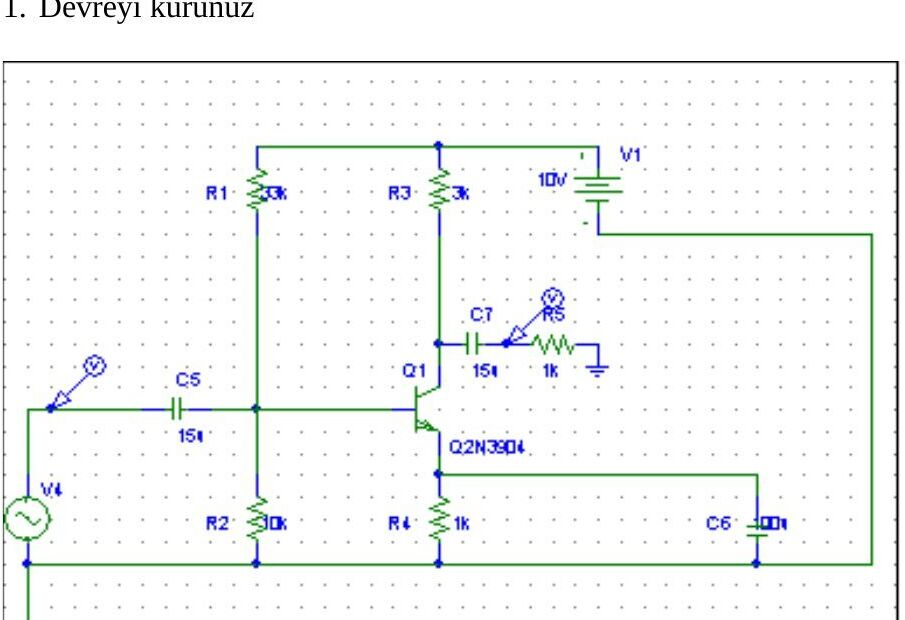

This post brings together five experiment reports from the spring 2004 term of the Başkent University **EEM-214 Electronics Laboratory**, prepared by a friend, along with the two Turkish lab handouts from that term (Experiment 4 and Experiment 5). Names and student numbers in the reports and handouts have been redacted. Most of the reports consist of measurement tables and oscilloscope/PSpice plots; the main measurements and results are given below as text. PDF copies with personal information redacted are available for download as a ZIP at the end of the post.

## Experiment 1: Light-Emitting and Zener Diodes

**LED characteristics** (R_meas = 101.25 Ω): At the moment the LED first emitted light, V_D = 1.791 V, V_R = 0.165 V, I_D = 1.630 mA; at good brightness, V_D = 2.136 V, V_R = 1.405 V, I_D = 13.88 mA.

| E (V) | 0 | 1 | 2 | 3 | 4 | 5 | 6 |
|---|---|---|---|---|---|---|---|
| V_D (V) | 0.07 | 1.05 | 1.89 | 2.07 | 2.19 | 2.32 | 2.42 |
| V_R (V) | 0 | 0 | 0.16 | 1.01 | 1.84 | 2.73 | 3.64 |
| I_D (mA) | 0 | 0 | 1.6 | 10.1 | 18.4 | 27.3 | 36.4 |

**Zener characteristics:** No current flowed in the range E = 0–9 V. For E = 10, 11, 12, 13, 14, 15 V, V_Z = 9.94, 10.16, 10.35, 10.56, 10.80, 10.93 V and I_Z = 0.89, 8.69, 15.7, 23.6, 31.3, 39.2 mA were measured; V_Z ≈ 10 V (measured 9.94 V).

*Note: The report gives r_av = ΔI_Z / ΔV_Z = 22.91 / 0.62 = 0.027 Ω; resistance is found as ΔV/ΔI, so r_av = 0.62 V / 22.91 mA ≈ 27 Ω.*

**Zener regulator** (R = 987.8 Ω, R_L = 976.2 Ω, V_Z = 7.526 V): With R_L = 1 kΩ, V_L = 7.507 V, I_R = 7.62 mA, I_L = 7.69 mA, i.e. the Zener draws almost no current (no regulation). With R_L = 2.2 kΩ, V_L = 9.934 V, I_R = 5 mA, I_L = 4.5 mA, I_Z = 0.5 mA.

## Experiment 2: Half-Wave and Full-Wave Rectifiers

The diode threshold voltage was found to be V_T = 0.57 V. In the half-wave rectifier with the 1N4148 (1 kHz, oscilloscope 2 V/div, 500 µs/div), the DC value of the output was 1.102 V measured and 1.09 V calculated (error 1.2%). In the second circuit, measured across the diode, V_DC was 0.886 V measured and 1.02 V calculated (error 13%); the downward shift of about 0.6 V is caused by the diode's conduction voltage. In the final circuit with the voltage divider, the output shows the diode voltage while the diode is conducting and half of the input while it is cut off; when the diode is reversed, only the polarity changes.

## Experiment 3: BJT type, terminals and collector characteristics

In measurements made with the diode range, 645.3 and 658.4 were read between terminals 2–1 and 2–3, and 0 in the other directions: **base 2, collector 1, emitter 3; npn, silicon**. For the collector characteristics, R_B = 330 kΩ, R_C = 1 kΩ, and 1 MΩ and 5 kΩ potentiometers were used; I_C and V_BE were measured at I_B = 10, 20, 30, 40, 50 µA while sweeping V_CE = 2–16 V.

| I_B (µA) | I_C range (mA) | V_BE (V) | β range |
|---|---|---|---|
| 10 | 1.112–1.196 | 0.644–0.652 | 111.2–119.6 |
| 20 | 2.326–2.496 | 0.664–0.672 | 116.3–124.8 |
| 30 | 3.532–3.615 | 0.678–0.686 | 117.7–120.5 |
| 40 | 4.751–4.963 | 0.688–0.695 | 118.8–124.1 |
| 50 | 5.948–6.129 | 0.697–0.703 | 119.0–122.6 |

α ≈ 0.991–0.992. The largest β = 124.8 (I_C = 2.496 mA, V_CE = 14 V), the smallest β = 111.2 (I_C = 1.112 mA, V_CE = 2 V); β generally increases with V_CE and I_C.

## Experiment 4: Common-emitter and common-base transistor amplifiers

Formulas given in the handout: r_e = 26 mV / I_E(mA); for common-emitter, A_v = −R_C / (R_E + r_e), and if R_E is bypassed, A_v = −R_C / r_e; Z_i = R1 ∥ R2 ∥ β(R_E + r_e), and if bypassed, Z_i = R1 ∥ R2 ∥ βr_e; Z_o = R_C; for common-base, A_v = R_C / r_e. Circuit: 10 V, R1 = 33 kΩ, R2 = 10 kΩ, R_C = 3 kΩ, R_E = 1 kΩ, 2N3904, 15 µF coupling capacitors.

Measurements in the report: V_B = 2.28 V, V_E = 1.62 V, V_C = 4.90 V, I_E = 1.52 mA (calculated) and 1.62 mA (measured); r_e = 17.11 Ω and 16.05 Ω. With a 20 mV rms, 1 kHz input, V_o = 3.79 V; β = 177; Z_i ≈ 2.08 kΩ (V_i = 12.3 mV measured with a 1 kΩ series resistor); unloaded V_o = 584 mV(pp), 480 mV with a 3 kΩ load; Z_o = R_C = 3 kΩ. In the common-base circuit, V_E = 1.65 V, I_E = 1.65 mA, r_e = 15.75 Ω.

*Note: The report gives the voltage gain as −R_E/(R_E + r_e) ≈ −0.05 and, for the common-base case, 3k/15.75 = 0.2. For the bypassed common-emitter the gain should be −R_C/r_e = −3000/17.11 ≈ −175, and for common-base R_C/r_e = 3000/15.75 ≈ 190; the measured 3.79 V / 20 mV ≈ 190 is also consistent with this magnitude.*

## Experiment 5: Common-source JFET amplifier

Handout steps: with no source resistor, V_D is measured and I_D = I_DSS is calculated; with R_S connected, V_GS and V_D are measured and V_P is found from the Shockley equation; the DC bias is calculated and the transfer curve is plotted; the circuit is built and the measurements are compared; finally, the AC voltage gain is measured with a 100 mV peak, 1 kHz input.

Results in the report: from V_D = 4.2 V, **I_DSS = 12 mA**; with R_S = 1 kΩ, from V_GS = −2.7 V and V_D = 8.3 V, **V_P = −6 V**. The calculated Q point is I_D = 3.5 mA, V_GS = −2.18 V, V_D = 10 − 3.5 mA × 2.2 kΩ = 2.3 V; measured V_S = 1.55 V, V_D = 2.52 V, V_GS = −1.58 V, I_D = 1.55 / 0.47k = 3.3 mA.

## Download

The ZIP file contains PDF copies, with personal information redacted, of the two Turkish lab handouts from 2004 (Experiments 4 and 5) and the five reports.
