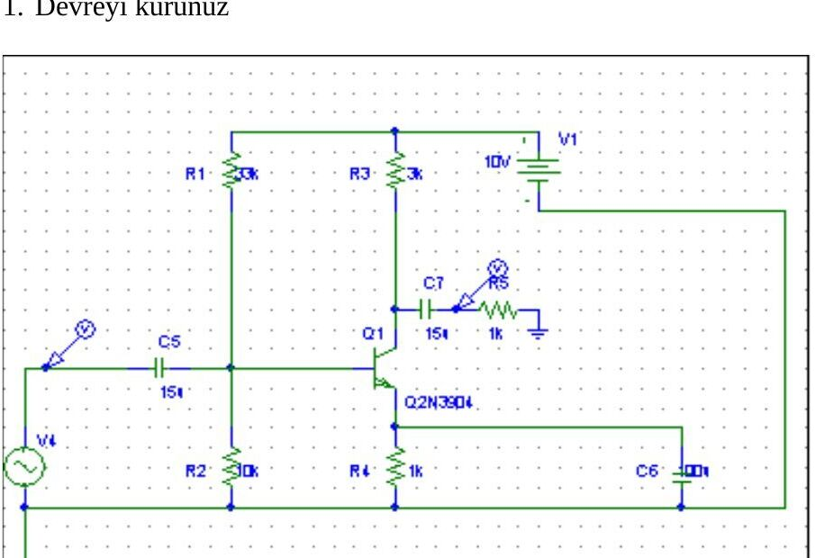

Bu yazı, Başkent Üniversitesi **EEM-214 Elektronik Laboratuvarı**'nın 2004 bahar dönemine ait, bir arkadaşın hazırladığı beş deney raporunu ve o dönemin iki Türkçe föyünü (Deney 4 ve Deney 5) bir araya getiriyor. Raporlarda ve föyde geçen ad ve öğrenci numaraları kapatıldı. Raporların büyük kısmı ölçüm tabloları ve osiloskop/PSpice çizimlerinden oluşuyor; aşağıda ana ölçümler ve sonuçlar metin olarak verildi. Kişisel bilgileri kapatılmış PDF kopyaları yazının sonunda ZIP olarak indirilebilir.

## Deney 1: Light-Emitting and Zener Diodes

**LED karakteristiği** (R_meas = 101.25 Ω): LED'in ilk ışık verdiği anda V_D = 1.791 V, V_R = 0.165 V, I_D = 1.630 mA; iyi parlaklıkta V_D = 2.136 V, V_R = 1.405 V, I_D = 13.88 mA.

| E (V) | 0 | 1 | 2 | 3 | 4 | 5 | 6 |
|---|---|---|---|---|---|---|---|
| V_D (V) | 0.07 | 1.05 | 1.89 | 2.07 | 2.19 | 2.32 | 2.42 |
| V_R (V) | 0 | 0 | 0.16 | 1.01 | 1.84 | 2.73 | 3.64 |
| I_D (mA) | 0 | 0 | 1.6 | 10.1 | 18.4 | 27.3 | 36.4 |

**Zener karakteristiği:** E = 0–9 V aralığında akım akmadı. E = 10, 11, 12, 13, 14, 15 V için V_Z = 9.94, 10.16, 10.35, 10.56, 10.80, 10.93 V ve I_Z = 0.89, 8.69, 15.7, 23.6, 31.3, 39.2 mA ölçüldü; V_Z ≈ 10 V (ölçülen 9.94 V).

*Not: Raporda r_av = ΔI_Z / ΔV_Z = 22.91 / 0.62 = 0.027 Ω yazılmış; direnç ΔV/ΔI ile bulunur: r_av = 0.62 V / 22.91 mA ≈ 27 Ω.*

**Zener regülatörü** (R = 987.8 Ω, R_L = 976.2 Ω, V_Z = 7.526 V): R_L = 1 kΩ iken V_L = 7.507 V, I_R = 7.62 mA, I_L = 7.69 mA, yani Zener neredeyse akım çekmiyor (regülasyon yok). R_L = 2.2 kΩ yapılınca V_L = 9.934 V, I_R = 5 mA, I_L = 4.5 mA, I_Z = 0.5 mA.

## Deney 2: Yarım Dalga ve Tam Dalga Doğrultucu

Diyot eşik gerilimi V_T = 0.57 V bulundu. 1N4148'li yarım dalga doğrultucuda (1 kHz, osiloskop 2 V/div, 500 µs/div) çıkışın DC değeri ölçümde 1.102 V, hesapta 1.09 V (hata %1.2). Diyot üzerinden ölçülen ikinci devrede V_DC ölçülen 0.886 V, hesaplanan 1.02 V (hata %13); yaklaşık 0.6 V'luk aşağı kayma diyotun iletim geriliminden kaynaklanıyor. Gerilim bölücülü son devrede diyot iletimdeyken çıkışta diyot gerilimi, kesimdeyken girişin yarısı görülüyor; diyot ters çevrilince yalnız polarite değişiyor.

## Deney 3: BJT tipi, uçları ve kolektör karakteristikleri

Diyot kademesiyle yapılan ölçümlerde 2–1 ve 2–3 uçları arasında 645.3 ve 658.4 okundu, diğer yönlerde 0: **baz 2, kolektör 1, emetör 3; npn, silisyum**. Kolektör karakteristikleri için R_B = 330 kΩ, R_C = 1 kΩ, 1 MΩ ve 5 kΩ potansiyometrelerle I_B = 10, 20, 30, 40, 50 µA'de V_CE = 2–16 V taranarak I_C ve V_BE ölçüldü.

| I_B (µA) | I_C aralığı (mA) | V_BE (V) | β aralığı |
|---|---|---|---|
| 10 | 1.112–1.196 | 0.644–0.652 | 111.2–119.6 |
| 20 | 2.326–2.496 | 0.664–0.672 | 116.3–124.8 |
| 30 | 3.532–3.615 | 0.678–0.686 | 117.7–120.5 |
| 40 | 4.751–4.963 | 0.688–0.695 | 118.8–124.1 |
| 50 | 5.948–6.129 | 0.697–0.703 | 119.0–122.6 |

α ≈ 0.991–0.992. En büyük β = 124.8 (I_C = 2.496 mA, V_CE = 14 V), en küçük β = 111.2 (I_C = 1.112 mA, V_CE = 2 V); β genel olarak V_CE ve I_C ile artıyor.

## Deney 4: Ortak emetörlü ve ortak bazlı transistör yükselteçleri

Föyde verilen formüller: r_e = 26 mV / I_E(mA); ortak emetör için A_v = −R_C / (R_E + r_e), R_E köprülenmişse A_v = −R_C / r_e; Z_i = R1 ∥ R2 ∥ β(R_E + r_e), köprülüyse Z_i = R1 ∥ R2 ∥ βr_e; Z_o = R_C; ortak baz için A_v = R_C / r_e. Devre: 10 V, R1 = 33 kΩ, R2 = 10 kΩ, R_C = 3 kΩ, R_E = 1 kΩ, 2N3904, 15 µF kuplaj kondansatörleri.

Rapordaki ölçümler: V_B = 2.28 V, V_E = 1.62 V, V_C = 4.90 V, I_E = 1.52 mA (hesap) ve 1.62 mA (ölçüm); r_e = 17.11 Ω ve 16.05 Ω. 20 mV rms, 1 kHz girişte V_o = 3.79 V; β = 177; Z_i ≈ 2.08 kΩ (1 kΩ seri dirençle ölçülen V_i = 12.3 mV); yüksüz V_o = 584 mV(pp), 3 kΩ yükle 480 mV; Z_o = R_C = 3 kΩ. Ortak bazlı devrede V_E = 1.65 V, I_E = 1.65 mA, r_e = 15.75 Ω.

*Not: Raporda gerilim kazancı −R_E/(R_E + r_e) ≈ −0.05 ve ortak baz için 3k/15.75 = 0.2 olarak yazılmış. Köprülü ortak emetörde kazanç −R_C/r_e = −3000/17.11 ≈ −175, ortak bazda R_C/r_e = 3000/15.75 ≈ 190 olmalıdır; ölçülen 3.79 V / 20 mV ≈ 190 değeri de bu büyüklükle uyumlu.*

## Deney 5: Ortak kaynaklı (common-source) JFET yükselteci

Föyün adımları: kaynak direnci olmadan V_D ölçülüp I_D = I_DSS hesaplanır; R_S bağlanıp V_GS ve V_D ölçülerek Shockley denkleminden V_P bulunur; DC kutuplama hesaplanıp transfer eğrisi çizilir; devre kurulup ölçümler karşılaştırılır; son olarak 100 mV tepe, 1 kHz girişle AC gerilim kazancı ölçülür.

Rapordaki sonuçlar: V_D = 4.2 V'tan **I_DSS = 12 mA**; R_S = 1 kΩ ile V_GS = −2.7 V, V_D = 8.3 V'tan **V_P = −6 V**. Hesaplanan Q noktası I_D = 3.5 mA, V_GS = −2.18 V, V_D = 10 − 3.5 mA × 2.2 kΩ = 2.3 V; ölçülen V_S = 1.55 V, V_D = 2.52 V, V_GS = −1.58 V, I_D = 1.55 / 0.47k = 3.3 mA.

## İndirme

ZIP dosyasında 2004 dönemine ait iki Türkçe föyün (Deney 4 ve 5) ve beş raporun kişisel bilgileri kapatılmış PDF kopyaları bulunuyor.
