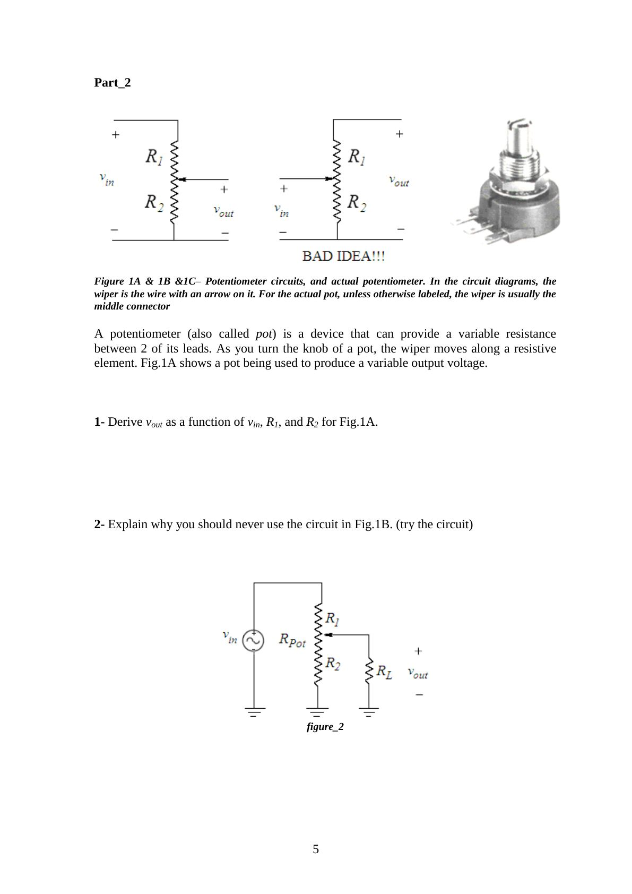

Bu yazı, Başkent Üniversitesi **EEM214 Elektronik I** laboratuvarının *Experiment I: Oscilloscopes, DMM, Function Generator, Potentiometer* deney föyüdür (2012). Dönemin ilk deneyinde laboratuvar cihazları tanıtılıyor ve bir potansiyometre devresi kuruluyor. Föy İngilizce olduğu için metin de İngilizce aktarıldı; potansiyometre devrelerinin şekli sayfa görseliyle verildi. Föyün orijinal PDF'i yazının sonunda indirilebilir.

## Aim

The aim of this experiment is to gain some experience in the use of the digital oscilloscope, DMM and function generators. Try to become comfortable using the oscilloscope, DMM and function generators as they will be used often in this lab, and they are important instruments in electronics diagnostics. You will also wire up a breadboard circuit that uses a potentiometer to control the voltage across a resistor.

## Supplementary notes for the experiment

The **oscilloscope** is used to measure and view voltage as a function of time. A voltage waveform such as v(t) = a·sin(ωt) will appear on the scope's screen much like you would plot it on a piece of paper. The voltage at which the trace begins is adjusted with the trigger level. The duration of the waveform that appears on the screen is determined by the sweep rate (or time scale) of the scope.

A **function generator** is a device that produces voltage waveforms such as sine, square and triangle waves, all with variable amplitude, frequency and offset. A function generator is often used to provide an input signal to the oscilloscope. For example, it can produce a voltage of the form

v(t) = v_offset + a·sin(ωt)

where the amplitude a, the frequency ω and the offset v_offset are all adjustable.

A **DMM** is a device used to measure voltage, resistance, current and other circuit characteristics. Readings are displayed on a digital LCD panel.

**Preliminary work:** read the experiment.

## Experimental work – Part 1

1. a) Connect the function generator output to the oscilloscope channel 1 input using BNC connectors. Set the function generator to output a sine wave at about 100 Hz. Press the Auto-scale button on the scope: the scope measures the maximum and minimum values of the signal and sets the screen scaling to match. Display the peak-to-peak voltage by pressing Voltage and then Vp-p (the Source option for the voltage measurement must be CH1). Plot the trace and label it with the voltage and time scales. b) Adjust the function generator to output a 2 Vpp sine wave at 100 Hz with no offset (DC offset button in). Make sure the Probe setting on the scope is 1 (some probes divide the voltage by 10; with those, the setting should be 10X) and the coupling is DC. Plot the trace with voltage and time scales.
1. Using the utilities on the scope, obtain and record v_max, v_min, v_p-p, v_avg, period, frequency and v_rms. Using the DMM, obtain v_rms.
1. Turn the Volts/Div, Sec/Div and position dials on the scope. Does the Volts/Div dial change the amplitude of the sine wave? Does the Sec/Div dial change its frequency? Does the position dial add a constant voltage to the signal? What do these dials do?
1. Adjust the sine wave amplitude to 1 Vpp at 200 Hz. Plot the trace on the same plot as in step 1, using the same voltage/time scales.
1. With the voltage scale at 2 V/div, maximize the sine wave amplitude on the function generator. Why can't the peak-to-peak voltage be read?
1. Change the trigger from channel 1 to 2. What happened to the sine wave? Change it back to 1. Why does it do this? Hint: think about what the scope must do to make a sine wave appear without moving (rolling) across the screen.
1. Offset the sine wave by pulling the DC offset button on the function generator and adjusting the dial. What does the trace do? Set the coupling to AC (under channel 1). Now what does the trace do when adjusting the DC offset? What is the purpose of AC coupling?
1. Remove the DC offset and get the function generator to output square and then triangle waves. Plot the traces in one plot.
1. Get the function generator to output a constant voltage. With the analog function generators you can do this by getting all of the wave buttons to stay popped out by half pushing one of them. Push out DC offset and adjust the dial to change the constant voltage. Adjust it to 5 V and plot the trace with the voltage scale at 5 V/div.

## Experimental work – Part 2: Potentiometer

A potentiometer (also called a pot) is a device that can provide a variable resistance between 2 of its leads. As you turn the knob, the wiper moves along a resistive element. Figure 1A shows a pot being used to produce a variable output voltage. In the circuit diagrams the wiper is the wire with an arrow on it; on an actual pot, unless otherwise labeled, the wiper is usually the middle connector.

1. Derive v_out as a function of v_in, R1 and R2 for Fig. 1A.
1. Explain why you should never use the circuit in Fig. 1B (try the circuit).
1. Measure and record resistor values using a DMM. Then wire the circuit in Fig. 2 on the breadboard (R_Pot = 5 kΩ). Apply a sine wave input of 10 V peak at 1 kHz. With R_L = ∞ (open circuit), measure the peak value of v_out, R1 and R2 in 3 potentiometer positions (full clockwise, center, full counter-clockwise). Repeat the measurement with R_L = 150 Ω.
1. Are the measured values of v_out the same as the expected values? Explain briefly. (Hint: are the measured values of R1 and R2 the same as the expected values?)

| Position | R1 | R2 | v_out (R_L = ∞) | v_out (R_L = 150 Ω) |
|---|---|---|---|---|
| Full clockwise | | | | |
| Center | | | | |
| Full counter-clockwise | | | | |

## Lab instruments and components

- **Instruments:** breadboard, oscilloscope, signal generator, multimeter, DC power supply
- **Components:** 1 × 5 kΩ potentiometer, 1 × 150 Ω resistor
