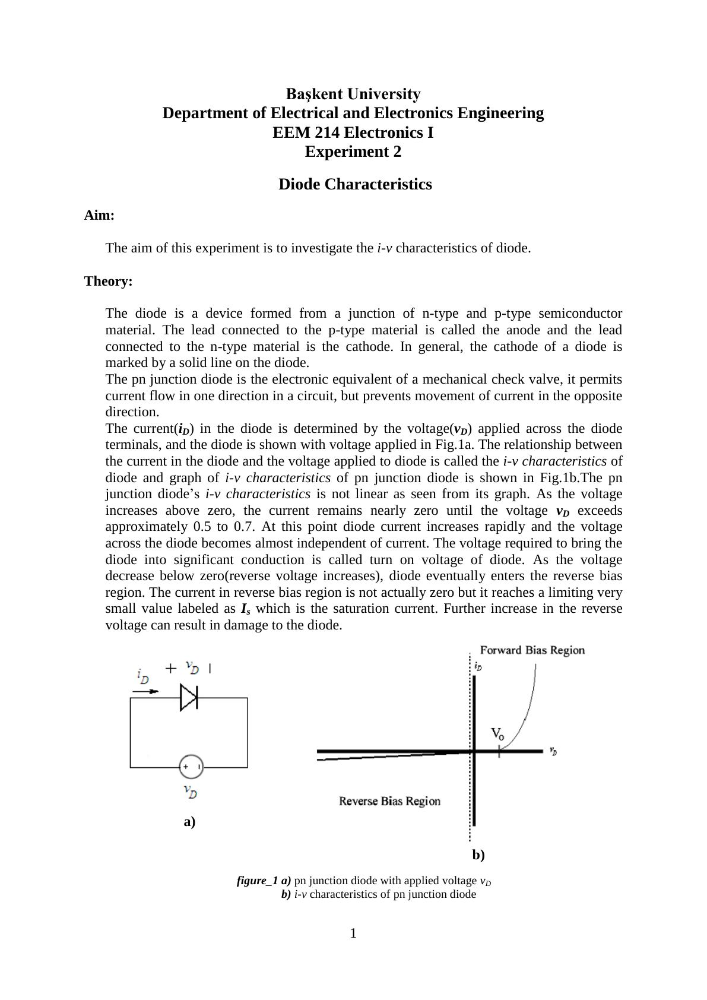
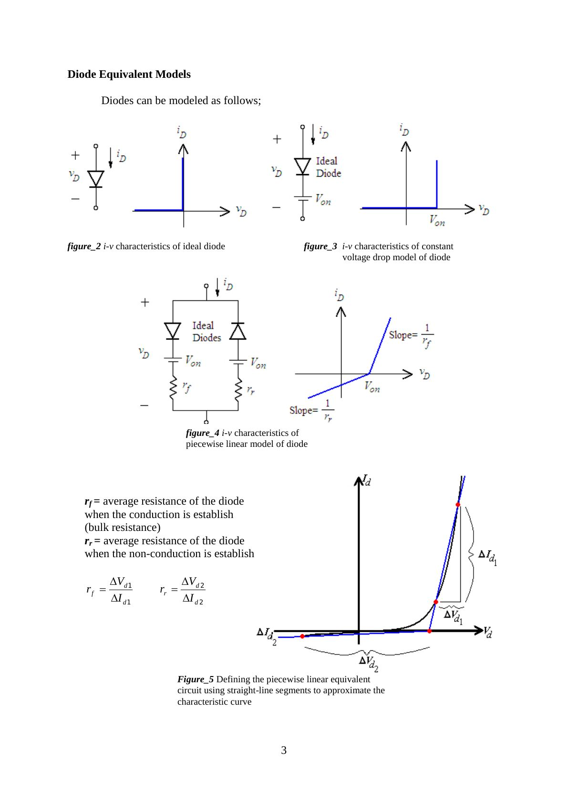
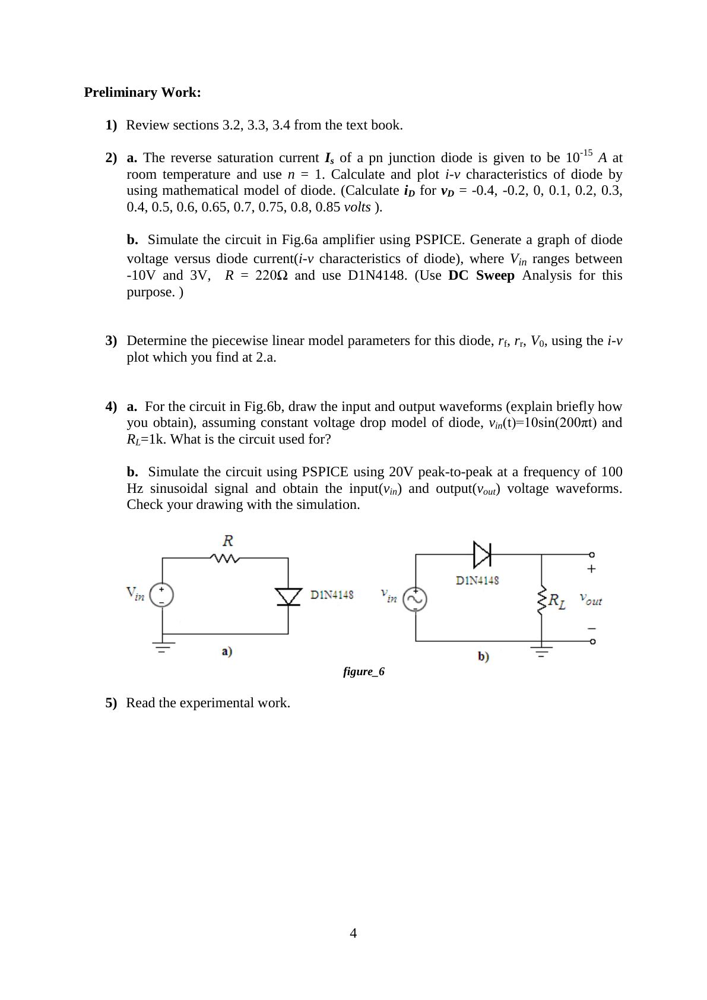
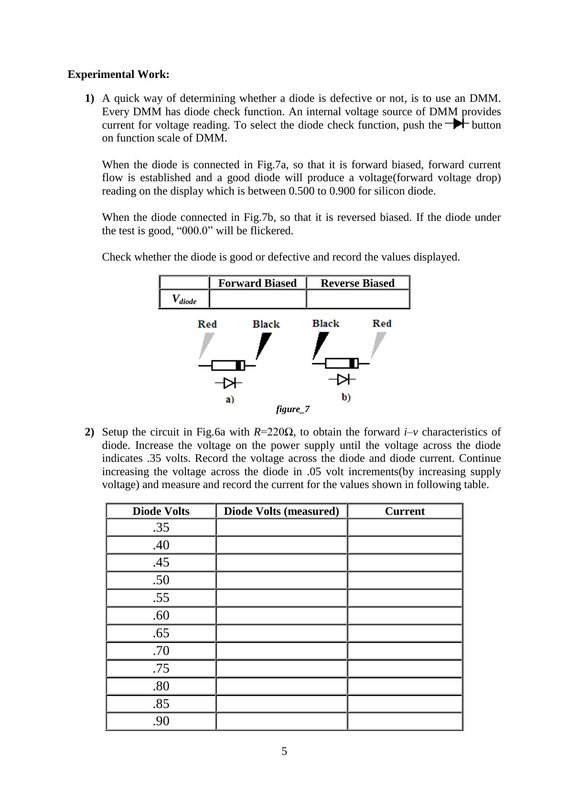

Bu yazı, Başkent Üniversitesi **EEM214 Elektronik I** laboratuvarının *Experiment 2: Diode Characteristics* deney föyüdür (Mart 2012). Föyde kısa bir teori bölümü, PSPICE benzetimi içeren bir ön çalışma ve 1N4148 diyotla yapılan ölçümler var. Föy İngilizce olduğu için metin de İngilizce aktarıldı; şekiller sayfa görselleriyle verildi. Föyün orijinal PDF'i yazının sonunda indirilebilir.

## Aim

The aim of this experiment is to investigate the i-v characteristics of the diode.

## Theory

The diode is a device formed from a junction of n-type and p-type semiconductor material. The lead connected to the p-type material is called the anode and the lead connected to the n-type material is the cathode. In general, the cathode of a diode is marked by a solid line on the diode. The pn junction diode is the electronic equivalent of a mechanical check valve: it permits current flow in one direction in a circuit, but prevents movement of current in the opposite direction.

The current i_D in the diode is determined by the voltage v_D applied across its terminals (Fig. 1a). The relationship between them is called the i-v characteristics of the diode (Fig. 1b), and it is not linear. As the voltage increases above zero, the current remains nearly zero until v_D exceeds approximately 0.5 to 0.7 V. At this point the diode current increases rapidly and the voltage across the diode becomes almost independent of current. The voltage required to bring the diode into significant conduction is called the turn-on voltage. As the voltage decreases below zero (reverse voltage increases), the diode enters the reverse bias region. The current there is not actually zero but reaches a limiting, very small value I_s, the saturation current. Further increase in the reverse voltage can result in damage to the diode.

### Mathematical model

i_D = I_s·(e^(v_D/ηV_T) − 1)

- I_s is the reverse saturation current; its value is constant for a specific diode and usually very small, since virtually no current flows in the reverse direction.
- η (n) is a constant whose value ranges from 1 to 2 depending on the material of the diode.
- V_T is the thermal equivalent voltage, V_T = kT/q, where k is Boltzmann's constant (1.38×10⁻²³ J/K), T is the temperature in kelvins and q is the electronic charge (1.6×10⁻¹⁹ C). At room temperature V_T is usually taken as 26 mV.
- v_D is the applied voltage between the terminals and i_D is the diode current.

There are two operation regions, forward and reverse bias; the zero bias condition v_D = 0 V is the boundary between them.

- For v_D < 0 the diode is reverse biased. Only a very small reverse leakage current flows, small enough that we usually think of the diode as non-conducting (off): i_D = I_s·(e^(v_D/ηV_T) − 1) ≅ −I_s.
- For v_D > 0 the diode is forward biased and a large current can be present: i_D = I_s·(e^(v_D/ηV_T) − 1) ≅ I_s·e^(v_D/ηV_T).

### Diode equivalent models

Diodes can be modeled as an ideal diode (Fig. 2), with the constant voltage drop model (an ideal diode in series with V_on, Fig. 3) or with the piecewise linear model (Fig. 4), where

- r_f = average resistance of the diode when conduction is established (bulk resistance), r_f = ΔV_d1/ΔI_d1
- r_r = average resistance of the diode in non-conduction, r_r = ΔV_d2/ΔI_d2

Figure 5 shows how the piecewise linear equivalent circuit is defined by approximating the characteristic curve with straight-line segments.

## Preliminary work

1. Review sections 3.2, 3.3 and 3.4 of the textbook.
1. a) The reverse saturation current I_s of a pn junction diode is 10⁻¹⁵ A at room temperature; use n = 1. Calculate and plot the i-v characteristics using the mathematical model (calculate i_D for v_D = −0.4, −0.2, 0, 0.1, 0.2, 0.3, 0.4, 0.5, 0.6, 0.65, 0.7, 0.75, 0.8, 0.85 V). b) Simulate the circuit in Fig. 6a using PSPICE. Generate a graph of diode voltage versus diode current, where V_in ranges between −10 V and 3 V, R = 220 Ω and the diode is D1N4148 (use DC Sweep analysis).
1. Determine the piecewise linear model parameters r_f, r_r and V_0 of this diode using the i-v plot from 2a.
1. a) For the circuit in Fig. 6b, draw the input and output waveforms (explain briefly how you obtain them), assuming the constant voltage drop model, v_in(t) = 10·sin(200πt) and R_L = 1 kΩ. What is the circuit used for? b) Simulate the circuit in PSPICE with a 20 V peak-to-peak, 100 Hz sinusoidal input and obtain v_in and v_out. Check your drawing against the simulation.
1. Read the experimental work.

## Experimental work

1. A quick way of determining whether a diode is defective is to use the DMM's diode check function, in which an internal voltage source of the DMM provides the current for the reading. When the diode is forward biased (Fig. 7a), a good silicon diode produces a forward voltage drop reading between 0.500 and 0.900. When it is reverse biased (Fig. 7b), a good diode makes "000.0" flicker. Check whether the diode is good or defective and record the displayed values.
1. Set up the circuit in Fig. 6a with R = 220 Ω to obtain the forward i-v characteristics. Increase the supply voltage until the diode voltage is 0.35 V; record the diode voltage and current. Continue in 0.05 V steps up to 0.90 V (0.35, 0.40, …, 0.90 V), measuring and recording the current each time.
1. In the circuit of Fig. 6a, change the series resistor to 1 MΩ to obtain the reverse i-v characteristics. At very low current it is often better to measure the voltage across a known resistor than to attempt a direct current measurement. Measure the resistor voltage and calculate the diode current and voltage for source voltages of 0, −1, −2, −3, −4, −5, −10, −15, −20 and −25 V (all values negative).
1. Plot the i-v characteristics of the diode on millimetric paper and clearly indicate the regions (Excel may be used).
1. Set up the circuit in Fig. 6b with a 100 Hz, 5 V peak-to-peak sinusoidal input and R_L = 1 kΩ. Observe and plot v_in and v_out on the oscilloscope and explain the differences between them.

## Lab instruments and components

- **Instruments:** breadboard, oscilloscope, signal generator, multimeter, DC power supply
- **Components:** 220 Ω, 1N4148, 1 MΩ, 1 kΩ

The last page of the sheet is an "Experiment Results" form with the diode check readings, the forward (0.35–0.90 V) and reverse (0 to −25 V) measurement tables, and fields for the student's name, number and signature.
