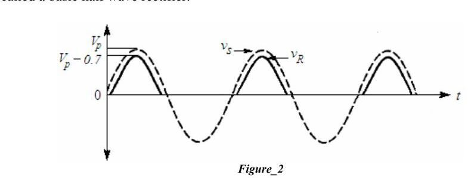
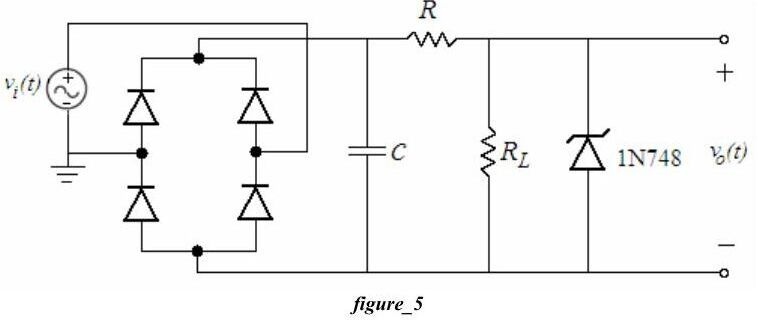

This post contains the **Experiment 4: Diode Rectifier Circuits** lab sheet (February 2006; the department web addresses appear on the sheet pages) of the Başkent University **EEM 214 Electronics I** laboratory, together with student preliminary work and reports prepared for this experiment in different years. The student work belongs to friends; names and student numbers have been redacted. Since the lab sheet is in English, the text has been reproduced in English. A password-free copy of the lab sheet and the reports with personal information redacted are available as a ZIP at the end of the post.

## Lab Sheet: Experiment 4 – Diode Rectifier Circuits

**Aim:** The purpose of this experiment is to become familiar with the use of diodes for rectifying an AC input signal.

### Theory

Basic rectifier circuits convert AC input voltage to pulsating DC output voltage. Then, with a filter added to the circuit, the AC component of the waveform is eliminated and a nearly constant DC output voltage is produced. There are two types of rectifier, namely half-wave and full-wave. Each type can be uncontrolled, half-controlled or fully controlled: an uncontrolled rectifier uses diodes, a fully controlled rectifier uses thyristors and a half-controlled rectifier uses both.

**Half-wave rectifier.** In practice the half-wave rectifier is used most often in low-power applications, because the average current in the supply will not be zero. While its practical applications are limited, its analysis is important for understanding more complicated circuits such as full-wave rectifiers.

In the forward-bias region i_D is exponentially related to v_D; the steepness of the curve means a large range of current variation can be obtained with a narrow range of voltage. The constant-voltage-drop model with v_on = 0.7 V is assumed. In the basic circuit (source v_S, diode, resistor R) the output v_R cannot be negative, since that would require a negative diode current. When the diode conducts, v_D ≈ 0.7 V and from KVL v_R = v_S − v_D. For a sinusoidal v_S the negative half cycles are cut off and the positive half cycles appear at the output lowered by about 0.7 V.

**Average and RMS values:** V_avg = V_DC = (1/T)∫₀ᵀ V(t) dt, V_rms = √[(1/T)∫₀ᵀ V(t)² dt].

**Full-wave rectifier.** Its objective is the same, but it has fundamental advantages: the average current in the AC source is zero, the average (DC) output voltage is higher than in the half-wave case, and the output has inherently less ripple.

### Preliminary work

1. Review sections 3.13–3.16 of the textbook.
1. a) For the half-wave rectifier of Fig. 3a draw the input and output waveforms, assuming the constant-voltage-drop model, v_i(t) = 5 sin(200πt) and R_L = 1 kΩ. Simulate with PSpice: input and output on the same plot, diode current on a separate plot, and the DC (average) and RMS values of the output using "add trace". b) Repeat for the circuit with capacitive load in Fig. 3b (C = 10 µF, R_L = 1 kΩ) and find the PIV rating of the diode. c) Compare Fig. 3a and 3b according to diode currents and output RMS values.
1. a) Do the same for the full-wave bridge rectifier of Fig. 4a and calculate the DC and RMS values of the output. b) Repeat for the bridge with capacitive load (Fig. 4b, C = 10 µF, R_L = 1 kΩ) and find the PIV ratings.
1. Compare Fig. 3b and Fig. 4b according to PIV ratings, diode currents and complexity.
1. Read the experiment.

**Design problem:** For the bridge rectifier with capacitive load (Fig. 4b), v_i(t) = 10 sin(200πt) and C = 100 µF, the peak-to-peak ripple V_r is required to be less than 1% of the peak output voltage. Determine R_L, draw the output voltage and compute its DC value; verify with PSpice by measuring the ripple.

 resistive load, b) capacitive load")

 resistive load, b) capacitive load")

### Experimental work

1. a) Set up Fig. 3a with a 100 Hz, 10 V peak-to-peak sinusoid and R_L = 1 kΩ. Plot input and output, compare their peak values and measure the DC and RMS output. b) Set up Fig. 3b (C = 10 µF): measure DC and RMS output, the ripple frequency and the peak-to-peak ripple; repeat with C = 1 µF and comment.
1. a), b) Repeat the same measurements for the bridge rectifier of Fig. 4a and 4b (C = 10 µF and 1 µF).
1. In a half- or full-wave rectifier with capacitive load, how can you improve the ripple if the output resistance is constant?
1. Set up Fig. 5 with a 100 Hz, 20 V peak-to-peak input, C = 22 µF, R = 100 Ω, R_L = 1 kΩ. a) Disconnect the Zener diode; measure the DC output and the peak-to-peak ripple. b) Connect the Zener diode (1N748) and repeat. c) Briefly explain what the circuit is used for.

**Lab instruments:** breadboard, oscilloscope, signal generator, multimeter. **Components:** 4 × 1N4148, 1N748, 10 µF, 22 µF, 1 µF, 100 Ω, 1 kΩ.

## Student Work

**Preliminary work (2006 and 2014):** In the PSpice preliminary work of four different students, the circuits of Fig. 3a/3b and 4a/4b were simulated with v_i(t) = 5 sin(200πt); input–output waveforms, diode currents, and AVG/RMS traces were plotted. In the 2014 preliminary work the experiment number appears as 3 (that year the rectifier experiment was third in the sequence).

**Measurements in the 2006 report** (100 Hz, 10 V peak-to-peak input, R_L = 1 kΩ):

| Circuit | V_out-DC | V_out-RMS | f_ripple | V_ripple(pp) |
|---|---|---|---|---|
| Half-wave, resistive | 1.315 V | 1.615 V | – | – |
| Half-wave, C = 10 µF | 2.527 V | 0.648 V | 101.6 Hz | 2.08 V |
| Half-wave, C = 1 µF | 1.327 V | 1.465 V | 100.8 Hz | 3.92 V |
| Bridge, resistive | 2.007 V | 1.296 V | – | – |
| Bridge, C = 10 µF | 2.927 V | 0.289 V | 201.6 Hz | 1.04 V |
| Bridge, C = 1 µF | 2.185 V | 1.083 V | 201.6 Hz | 3.04 V |
| Fig. 5, without Zener | 6.46 V | – | – | 0.8 V |
| Fig. 5, with Zener | 3.24 V | – | – | 0.48 V |

The ripple frequency equals the input frequency (100 Hz) for the half-wave circuit and twice that (200 Hz) for the bridge; a larger capacitor reduces the ripple markedly.

*Note: For a 5 V peak input, with the constant 0.7 V drop model the average of the half-wave output is expected to be (5 − 0.7)/π ≈ 1.37 V, and for the bridge 2·(5 − 1.4)/π ≈ 2.29 V; the measured 1.315 V and 2.007 V are close to these values. The RMS values in the table are most likely from the oscilloscope's RMS measurement showing only the AC component (AC coupled), since they come out smaller than the averages.*

**2008 report:** The measurement tables were left blank; the PSpice outputs (waveforms, diode currents, AVG and RMS) for the half-wave, capacitive-load, and bridge circuits are provided.

## Download

The ZIP file contains the lab sheet PDF with its password removed (Experiment4.pdf) and redacted PDF copies of eight preliminary works/reports from 2006, 2008, and 2014.
