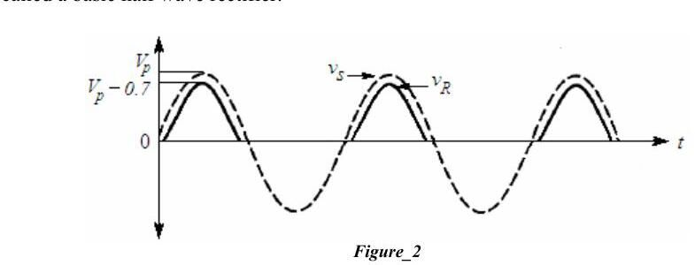
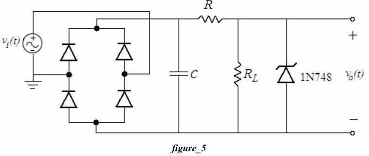

Bu yazı, Başkent Üniversitesi **EEM 214 Electronics I** laboratuvarının **Experiment 4: Diode Rectifier Circuits** föyünü (Şubat 2006, föy sayfalarında bölüm web adresleri yer alıyor) ve bu deney için farklı yıllarda hazırlanmış öğrenci ön çalışma ve raporlarını içeriyor. Öğrenci çalışmaları arkadaşların; ad ve öğrenci numaraları kapatıldı. Föy İngilizce olduğu için metni İngilizce aktarıldı. Föyün parolasız kopyası ve kişisel bilgileri kapatılmış raporlar yazının sonunda ZIP olarak indirilebilir.

## Föy: Experiment 4 – Diode Rectifier Circuits

**Aim:** The purpose of this experiment is to become familiar with the use of diodes for rectifying an AC input signal.

### Theory

Basic rectifier circuits convert AC input voltage to pulsating DC output voltage. Then, with a filter added to the circuit, the AC component of the waveform is eliminated and a nearly constant DC output voltage is produced. There are two types of rectifier, namely half-wave and full-wave. Each type can be uncontrolled, half-controlled or fully controlled: an uncontrolled rectifier uses diodes, a fully controlled rectifier uses thyristors and a half-controlled rectifier uses both.

**Half-wave rectifier.** In practice the half-wave rectifier is used most often in low-power applications, because the average current in the supply will not be zero. While its practical applications are limited, its analysis is important for understanding more complicated circuits such as full-wave rectifiers.

In the forward-bias region i_D is exponentially related to v_D; the steepness of the curve means a large range of current variation can be obtained with a narrow range of voltage. The constant-voltage-drop model with v_on = 0.7 V is assumed. In the basic circuit (source v_S, diode, resistor R) the output v_R cannot be negative, since that would require a negative diode current. When the diode conducts, v_D ≈ 0.7 V and from KVL v_R = v_S − v_D. For a sinusoidal v_S the negative half cycles are cut off and the positive half cycles appear at the output lowered by about 0.7 V.

**Average and RMS values:** V_avg = V_DC = (1/T)∫₀ᵀ V(t) dt, V_rms = √[(1/T)∫₀ᵀ V(t)² dt].

**Full-wave rectifier.** Its objective is the same, but it has fundamental advantages: the average current in the AC source is zero, the average (DC) output voltage is higher than in the half-wave case, and the output has inherently less ripple.

### Preliminary work

1. Review sections 3.13–3.16 of the textbook.
1. a) For the half-wave rectifier of Fig. 3a draw the input and output waveforms, assuming the constant-voltage-drop model, v_i(t) = 5 sin(200πt) and R_L = 1 kΩ. Simulate with PSpice: input and output on the same plot, diode current on a separate plot, and the DC (average) and RMS values of the output using "add trace". b) Repeat for the circuit with capacitive load in Fig. 3b (C = 10 µF, R_L = 1 kΩ) and find the PIV rating of the diode. c) Compare Fig. 3a and 3b according to diode currents and output RMS values.
1. a) Do the same for the full-wave bridge rectifier of Fig. 4a and calculate the DC and RMS values of the output. b) Repeat for the bridge with capacitive load (Fig. 4b, C = 10 µF, R_L = 1 kΩ) and find the PIV ratings.
1. Compare Fig. 3b and Fig. 4b according to PIV ratings, diode currents and complexity.
1. Read the experiment.

**Design problem:** For the bridge rectifier with capacitive load (Fig. 4b), v_i(t) = 10 sin(200πt) and C = 100 µF, the peak-to-peak ripple V_r is required to be less than 1% of the peak output voltage. Determine R_L, draw the output voltage and compute its DC value; verify with PSpice by measuring the ripple.

 dirençli, b) kapasitif yüklü")

 dirençli, b) kapasitif yüklü")

### Experimental work

1. a) Set up Fig. 3a with a 100 Hz, 10 V peak-to-peak sinusoid and R_L = 1 kΩ. Plot input and output, compare their peak values and measure the DC and RMS output. b) Set up Fig. 3b (C = 10 µF): measure DC and RMS output, the ripple frequency and the peak-to-peak ripple; repeat with C = 1 µF and comment.
1. a), b) Repeat the same measurements for the bridge rectifier of Fig. 4a and 4b (C = 10 µF and 1 µF).
1. In a half- or full-wave rectifier with capacitive load, how can you improve the ripple if the output resistance is constant?
1. Set up Fig. 5 with a 100 Hz, 20 V peak-to-peak input, C = 22 µF, R = 100 Ω, R_L = 1 kΩ. a) Disconnect the Zener diode; measure the DC output and the peak-to-peak ripple. b) Connect the Zener diode (1N748) and repeat. c) Briefly explain what the circuit is used for.

**Lab instruments:** breadboard, oscilloscope, signal generator, multimeter. **Components:** 4 × 1N4148, 1N748, 10 µF, 22 µF, 1 µF, 100 Ω, 1 kΩ.

## Öğrenci çalışmaları

**Ön çalışmalar (2006 ve 2014):** Dört ayrı öğrencinin PSpice ön çalışmalarında Fig. 3a/3b ve 4a/4b devreleri v_i(t) = 5 sin(200πt) ile simüle edilmiş; giriş–çıkış dalga şekilleri, diyot akımları ve AVG/RMS izleri çizilmiş. 2014'teki ön çalışmada deney numarası 3 olarak geçiyor (o yıl doğrultucu deneyi üçüncü sıradaydı).

**2006 raporundaki ölçümler** (100 Hz, 10 V tepeden tepeye giriş, R_L = 1 kΩ):

| Devre | V_out-DC | V_out-RMS | f_ripple | V_ripple(pp) |
|---|---|---|---|---|
| Yarım dalga, dirençli | 1.315 V | 1.615 V | – | – |
| Yarım dalga, C = 10 µF | 2.527 V | 0.648 V | 101.6 Hz | 2.08 V |
| Yarım dalga, C = 1 µF | 1.327 V | 1.465 V | 100.8 Hz | 3.92 V |
| Köprü, dirençli | 2.007 V | 1.296 V | – | – |
| Köprü, C = 10 µF | 2.927 V | 0.289 V | 201.6 Hz | 1.04 V |
| Köprü, C = 1 µF | 2.185 V | 1.083 V | 201.6 Hz | 3.04 V |
| Fig. 5, Zener'siz | 6.46 V | – | – | 0.8 V |
| Fig. 5, Zener'li | 3.24 V | – | – | 0.48 V |

Ripple frekansı yarım dalgada giriş frekansına (100 Hz), köprüde iki katına (200 Hz) eşit; büyük kondansatör ripple'ı belirgin biçimde azaltıyor.

*Not: 5 V tepe değerli girişte sabit 0.7 V düşüm modeliyle yarım dalga çıkışının ortalaması (5 − 0.7)/π ≈ 1.37 V, köprüde 2·(5 − 1.4)/π ≈ 2.29 V beklenir; ölçülen 1.315 V ve 2.007 V bu değerlere yakın. Tablodaki RMS değerleri, ortalamadan küçük çıktıkları için büyük olasılıkla osiloskobun yalnız AC bileşeni gösteren (AC kuplajlı) RMS ölçümü.*

**2008 raporu:** Ölçüm tabloları boş bırakılmış; yarım dalga, kapasitif yüklü ve köprü devrelerinin PSpice çıktıları (dalga şekilleri, diyot akımları, AVG ve RMS) verilmiş.

## İndirme

ZIP dosyasında föyün parolası kaldırılmış PDF'i (Experiment4.pdf) ile 2006, 2008 ve 2014 yıllarına ait sekiz ön çalışma/raporun kişisel bilgileri kapatılmış PDF kopyaları bulunuyor.
