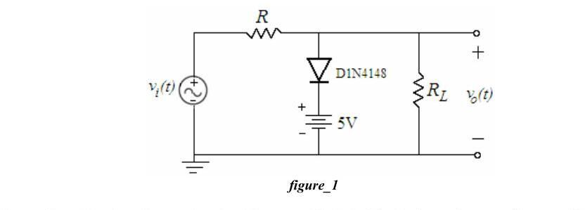
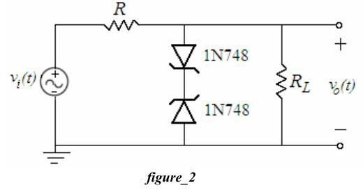
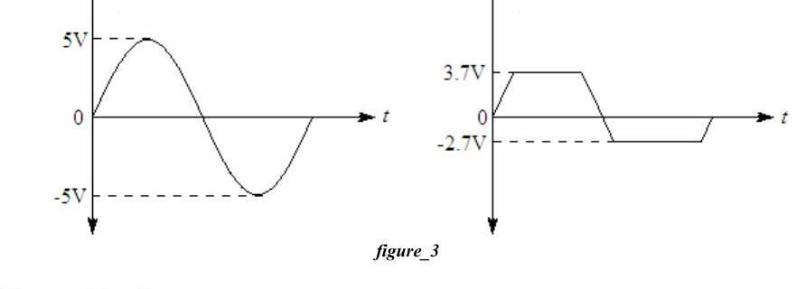
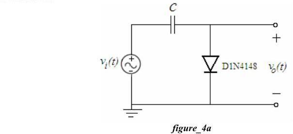
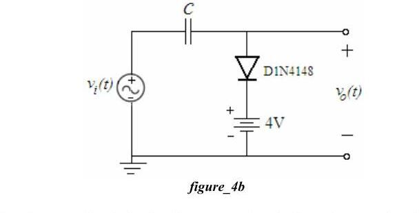
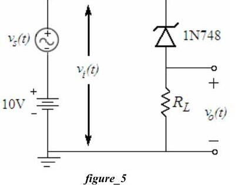
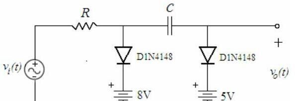

This post brings together the lab sheet (February 2006) for **Experiment 5: Diode Clipping & Clamping Circuits** of the Başkent University **EEM 214 Electronics I** laboratory, along with student pre-lab work and reports prepared for this experiment between 2005 and 2014. Most of the student work belongs to friends; names and student numbers have been redacted. Among it is a one-page solution prepared by Hasan Can Öztürk in 2013 (student number redacted). Since the lab sheet is in English, its text is carried over in English. A password-free copy of the lab sheet and the student work can be downloaded as a ZIP at the end of the post.

## Lab Sheet: Experiment 5 – Diode Clipping & Clamping Circuits

**Aim:** The purpose of this experiment is to investigate the application of diodes in clipping and clamping circuits.

**Theory:** In addition to their use as rectifiers and voltage regulators, diodes are frequently used in wave-shaping circuits, detectors, protection circuits and switching circuits. Two widely used applications are investigated: diode limiter (clipper) circuits and diode clamping (DC restorer) circuits. Clipping circuits prevent a waveform from exceeding some particular limit, either negative or positive; this is achieved by realizing that when a diode is conducting, its voltage drop is constant and nearly equal to 0.7 V. Clamping circuits shift the DC level of a waveform: when a signal passes through a capacitor its DC component is blocked, and a clamping circuit can restore the DC level, which is why these circuits are sometimes called DC restorers.

### Preliminary work

1. Review section 3.19 of the textbook.
1. a) For the clipper of Fig. 1 draw input and output on the same plot, using the constant-voltage-drop model, v_i(t) = 10 sin(200πt), R = 1 kΩ and R_L = 47 kΩ. Simulate in PSpice; vary the DC voltage and explain its effect. Are the minimum values of input and output the same? Why? b) Reverse the diode, replace the positive supply with a negative one and repeat.
1. a) For the clipper with Zener diodes of Fig. 2 draw the input, the output and the voltage across each Zener (same source and resistors) and simulate. b) Reverse both Zeners; does the output change? Why?
1. **Design:** Using the constant-voltage-drop diode model, resistors and batteries, design a circuit that produces the clipped output of Fig. 3 (a 5 V peak sine clipped at +3.7 V and −2.7 V); verify with PSpice.
1. a) For the clamper of Fig. 4a (v_i(t) = 10 sin(200πt), C = 1 µF) draw input and output; what is the DC value of the output? Obtain the average with PSpice "add trace". b) Do the same for Fig. 4b (C = 47 µF, 4 V battery in series with the diode) and vary the DC voltage. c) Reverse the diode in Fig. 4b and repeat.
1. For the clamper with Zener diode of Fig. 5 (v_s(t) = 2 sin(200πt) on top of 10 V DC, 1N748, R_L = 1 kΩ) draw input and output and simulate.
1. Read the experimental work.

### Experimental work

1. a) Set up Fig. 1 with a 100 Hz, 20 V peak-to-peak input, R = 1 kΩ, R_L = 47 kΩ; plot input and output (DC coupling). b) Reverse the diode, use a negative DC supply and repeat. Does the output change? Why?
1. a) Set up Fig. 2 with the same input; plot the input, the output and the Zener voltages. b) Reverse the upper Zener and repeat; do the output and the Zener voltages change? Why?
1. Set up the circuit designed in preliminary part 4 with a 100 Hz, 10 V peak-to-peak input and plot input and output.
1. a) Set up Fig. 4a (100 Hz, 20 V peak-to-peak, C = 1 µF). b) Set up Fig. 4b (C = 47 µF). c) Reverse the diode, use a negative DC supply and repeat 4b.
1. Set up Fig. 5 with a 100 Hz, 4 V peak-to-peak input with 10 V DC offset and R = 1 kΩ. Indicate the DC levels and peak values of the AC components. What happens when the peak input increases? (Hint: consider V_peak > V_DC − V_Z.)
1. Set up Fig. 6 with a 100 Hz, 20 V peak-to-peak input, R = 1 kΩ, C = 1 µF. a) Vary each DC voltage separately and explain the effect. b) Obtain the transfer characteristic v_out vs v_in on the oscilloscope (X-Y mode).

**Lab instruments:** breadboard, oscilloscope, signal generator, DC power supply. **Components:** 2 × 1N4148, 2 × 1N748, 47 µF, 1 µF, 1 kΩ, 47 kΩ.

## Student Work

### Solutions in the Pre-Lab Work (2006)

- **Fig. 1:** v_o(t) is clipped at (5 V + V_diode) = 5 + 0.7 = **5.7 V**; while v_i < 5.7 V, D1 is off and v_o = v_i·R_L/(R_L + R) = v_i·47/48. For this reason, the minimum values of the input and output are not exactly the same. When the diode and the source are reversed, the output is clipped at −5.7 V.
- **Fig. 2:** The Zener voltage of the 1N748 is 3.9 V. During the positive half-cycle one Zener conducts like an ordinary diode while the other limits the voltage; the output is clipped at V_Z + V_diode = 3.9 + 0.7 = **±4.6 V**, and in between v_o = v_i·47/48. When both Zeners are reversed, the output does not change; only the signs of the Zener voltages are inverted.
- **Design (Fig. 3):** Two diode–battery branches are sufficient: on the positive side a 3 V battery + diode (3 + 0.7 = 3.7 V), on the negative side a 2 V battery + reversed diode (−2 − 0.7 = −2.7 V). The PSpice simulation gives the required waveform.
- **Fig. 4a:** During the first quarter-period C charges to V_p; since there is no resistor, it does not discharge, and the output oscillates around −V_p + V_diode. DC value: −10 + 0.7 = **−9.3 V**.
- **Fig. 4b:** D1 conducts when v_i > 4 + 0.7 = 4.7 V; the capacitor charges to 10 − 4 − 0.7 = 5.3 V and the output becomes v_i − 5.3 V.
- **Fig. 5:** The input swings between 8 and 12 V; since the Zener is always in regulation, v_o(t) = 10 − v_s(t) − V_Z was written using KVL.

*Note: Since v_s(t) and the 10 V source in the figure are in series and in the same direction, it should be v_i(t) = 10 + v_s(t) and v_o(t) = v_i(t) − V_Z = 10 + v_s(t) − 3.9 V; the output is the input shifted down by 3.9 V (between 6.1 and 8.1 V).*

In the other pre-lab works (2005, 2006, 2008, 2012 and 2014) the same circuits were simulated with PSpice; in the 2014 pre-lab the experiment number appears as 4 (that year the clipper/clamper experiment was fourth in the sequence). Hasan Can Öztürk's one-page work from 2013 shows the transfer characteristic of a clipper circuit plotted with a PSpice DC sweep (line segments with a slope close to 1, with a horizontal clipping region in the middle).

### Reports

- **2006 report:** The measurements are given as oscilloscope plots; it is stated that when the diode and the DC source are reversed, the diode conducts for v_in < −5.7 V, and when they are not reversed, for v_in > 5.7 V, and that these values are the sum of the diode and DC source voltages.
- **2008 report (Turkish):** It explains that in Fig. 1 the branch containing the diode and the source starts conducting at 5 + 0.7 V and holds the load voltage at that value; that when reversed, the clipping occurs in the negative half-cycle; that in the Zener circuit the two Zeners clip at V_Z; that in the design, clipping at 3.7 V and −2.7 V was obtained with 3 V and 2 V sources; and that in the clamper the capacitor shifts the DC level of the signal and the source added to the diode sets the shift level.

## Download

The ZIP file contains the password-removed PDF of the lab sheet (Experiment5.pdf) and redacted PDF copies of thirteen pre-lab works/reports, organized into folders by year.
