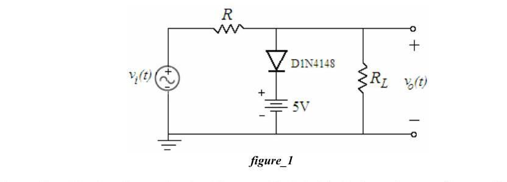
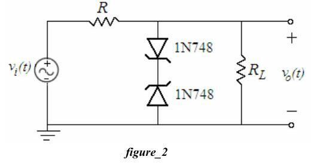
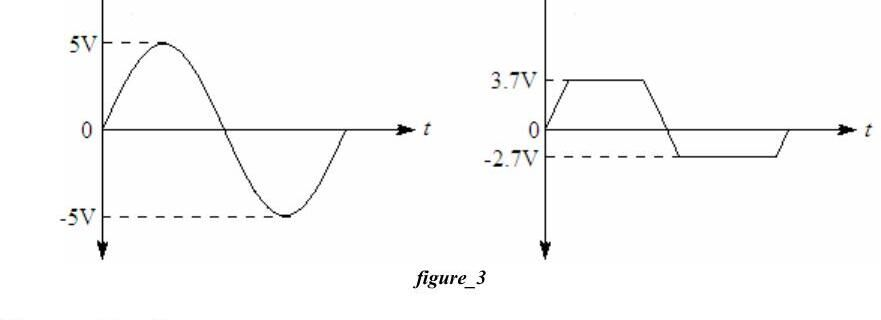
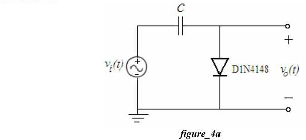
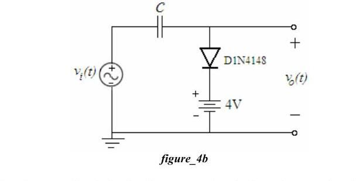
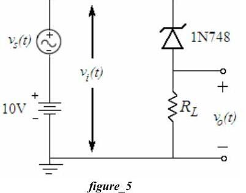
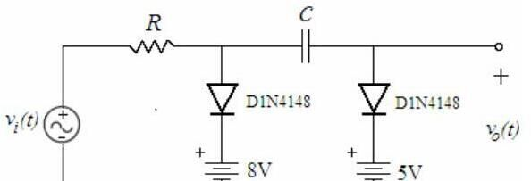

Bu yazı, Başkent Üniversitesi **EEM 214 Electronics I** laboratuvarının **Experiment 5: Diode Clipping & Clamping Circuits** föyünü (Şubat 2006) ve bu deney için 2005–2014 arasında hazırlanmış öğrenci ön çalışma ve raporlarını bir araya getiriyor. Öğrenci çalışmalarının çoğu arkadaşlara ait, ad ve öğrenci numaraları kapatıldı; aralarında Hasan Can Öztürk'ün 2013'te hazırladığı tek sayfalık bir çözüm de var (numarası kapatıldı). Föy İngilizce olduğu için metni İngilizce aktarıldı. Föyün parolasız kopyası ve öğrenci çalışmaları yazının sonunda ZIP olarak indirilebilir.

## Föy: Experiment 5 – Diode Clipping & Clamping Circuits

**Aim:** The purpose of this experiment is to investigate the application of diodes in clipping and clamping circuits.

**Theory:** In addition to their use as rectifiers and voltage regulators, diodes are frequently used in wave-shaping circuits, detectors, protection circuits and switching circuits. Two widely used applications are investigated: diode limiter (clipper) circuits and diode clamping (DC restorer) circuits. Clipping circuits prevent a waveform from exceeding some particular limit, either negative or positive; this is achieved by realizing that when a diode is conducting, its voltage drop is constant and nearly equal to 0.7 V. Clamping circuits shift the DC level of a waveform: when a signal passes through a capacitor its DC component is blocked, and a clamping circuit can restore the DC level, which is why these circuits are sometimes called DC restorers.

### Preliminary work

1. Review section 3.19 of the textbook.
1. a) For the clipper of Fig. 1 draw input and output on the same plot, using the constant-voltage-drop model, v_i(t) = 10 sin(200πt), R = 1 kΩ and R_L = 47 kΩ. Simulate in PSpice; vary the DC voltage and explain its effect. Are the minimum values of input and output the same? Why? b) Reverse the diode, replace the positive supply with a negative one and repeat.
1. a) For the clipper with Zener diodes of Fig. 2 draw the input, the output and the voltage across each Zener (same source and resistors) and simulate. b) Reverse both Zeners; does the output change? Why?
1. **Design:** Using the constant-voltage-drop diode model, resistors and batteries, design a circuit that produces the clipped output of Fig. 3 (a 5 V peak sine clipped at +3.7 V and −2.7 V); verify with PSpice.
1. a) For the clamper of Fig. 4a (v_i(t) = 10 sin(200πt), C = 1 µF) draw input and output; what is the DC value of the output? Obtain the average with PSpice "add trace". b) Do the same for Fig. 4b (C = 47 µF, 4 V battery in series with the diode) and vary the DC voltage. c) Reverse the diode in Fig. 4b and repeat.
1. For the clamper with Zener diode of Fig. 5 (v_s(t) = 2 sin(200πt) on top of 10 V DC, 1N748, R_L = 1 kΩ) draw input and output and simulate.
1. Read the experimental work.

### Experimental work

1. a) Set up Fig. 1 with a 100 Hz, 20 V peak-to-peak input, R = 1 kΩ, R_L = 47 kΩ; plot input and output (DC coupling). b) Reverse the diode, use a negative DC supply and repeat. Does the output change? Why?
1. a) Set up Fig. 2 with the same input; plot the input, the output and the Zener voltages. b) Reverse the upper Zener and repeat; do the output and the Zener voltages change? Why?
1. Set up the circuit designed in preliminary part 4 with a 100 Hz, 10 V peak-to-peak input and plot input and output.
1. a) Set up Fig. 4a (100 Hz, 20 V peak-to-peak, C = 1 µF). b) Set up Fig. 4b (C = 47 µF). c) Reverse the diode, use a negative DC supply and repeat 4b.
1. Set up Fig. 5 with a 100 Hz, 4 V peak-to-peak input with 10 V DC offset and R = 1 kΩ. Indicate the DC levels and peak values of the AC components. What happens when the peak input increases? (Hint: consider V_peak > V_DC − V_Z.)
1. Set up Fig. 6 with a 100 Hz, 20 V peak-to-peak input, R = 1 kΩ, C = 1 µF. a) Vary each DC voltage separately and explain the effect. b) Obtain the transfer characteristic v_out vs v_in on the oscilloscope (X-Y mode).

**Lab instruments:** breadboard, oscilloscope, signal generator, DC power supply. **Components:** 2 × 1N4148, 2 × 1N748, 47 µF, 1 µF, 1 kΩ, 47 kΩ.

## Öğrenci çalışmaları

### Ön çalışmalardaki çözümler (2006)

- **Fig. 1:** v_o(t), (5 V + V_diode) = 5 + 0.7 = **5.7 V**'ta kırpılır; v_i < 5.7 V iken D1 kapalıdır ve v_o = v_i·R_L/(R_L + R) = v_i·47/48 olur. Bu yüzden giriş ve çıkışın minimum değerleri tam aynı değildir. Diyot ve kaynak ters çevrilince çıkış −5.7 V'ta kırpılır.
- **Fig. 2:** 1N748'in Zener gerilimi 3.9 V'tur. Pozitif yarım periyotta bir Zener normal diyot gibi iletir, diğeri gerilimi sınırlar; çıkış V_Z + V_diode = 3.9 + 0.7 = **±4.6 V**'ta kırpılır, arada v_o = v_i·47/48. Zener'lerin ikisi birden ters çevrilince çıkış değişmez, yalnız Zener gerilimlerinin işaretleri ters döner.
- **Tasarım (Fig. 3):** İki diyot–batarya kolu yeterli: pozitif tarafta 3 V batarya + diyot (3 + 0.7 = 3.7 V), negatif tarafta 2 V batarya + ters diyot (−2 − 0.7 = −2.7 V). PSpice simülasyonu istenen dalga şeklini veriyor.
- **Fig. 4a:** İlk çeyrek periyotta C, V_p'ye şarj olur; direnç olmadığı için boşalmaz ve çıkış −V_p + V_diode etrafında salınır. DC değer −10 + 0.7 = **−9.3 V**.
- **Fig. 4b:** D1, v_i > 4 + 0.7 = 4.7 V olduğunda iletir; kondansatör 10 − 4 − 0.7 = 5.3 V'a şarj olur ve çıkış v_i − 5.3 V olur.
- **Fig. 5:** Giriş 8–12 V arasında salınır; Zener sürekli regülasyonda olduğundan KVL ile v_o(t) = 10 − v_s(t) − V_Z yazılmış.

*Not: Şekilde v_s(t) ile 10 V kaynak seri ve aynı yönde olduğundan v_i(t) = 10 + v_s(t) ve v_o(t) = v_i(t) − V_Z = 10 + v_s(t) − 3.9 V olmalıdır; çıkış, girişin 3.9 V aşağı kaydırılmış hâlidir (6.1–8.1 V arası).*

Diğer ön çalışmalarda (2005, 2006, 2008, 2012 ve 2014) aynı devreler PSpice ile simüle edilmiş; 2014'teki ön çalışmada deney numarası 4 olarak geçiyor (o yıl kırpıcı/kenetleyici deneyi dördüncü sıradaydı). Hasan Can Öztürk'ün 2013 tarihli tek sayfası bir kırpıcı devresinin PSpice DC sweep ile çizilmiş transfer karakteristiğini (ortada yatay kırpma bölgesi olan, eğimi 1'e yakın doğru parçaları) gösteriyor.

### Raporlar

- **2006 raporu:** Ölçümler osiloskop çizimleri olarak verilmiş; diyot ve DC kaynak ters çevrildiğinde diyotun v_in < −5.7 V için, çevrilmediğinde v_in > 5.7 V için iletimde olduğu, bu değerlerin diyot ve DC kaynak gerilimlerinin toplamı olduğu belirtilmiş.
- **2008 raporu (Türkçe):** Fig. 1'de diyot ve kaynağın bulunduğu kolun 5 + 0.7 V'ta iletime geçerek yük gerilimini o değerde tuttuğu; ters bağlandığında kırpmanın negatif yarım periyotta olduğu; Zener'li devrede iki Zener'in V_Z'de kırptığı; tasarımda 3 V ve 2 V'luk kaynaklarla 3.7 V ve −2.7 V kırpma elde edildiği; kenetleyicide kondansatörün sinyalin DC seviyesini kaydırdığı ve diyota eklenen kaynağın kaydırma seviyesini ayarladığı anlatılıyor.

## İndirme

ZIP dosyasında föyün parolası kaldırılmış PDF'i (Experiment5.pdf) ve yıllara göre klasörlenmiş on üç ön çalışma/raporun kişisel bilgileri kapatılmış PDF kopyaları bulunuyor.
