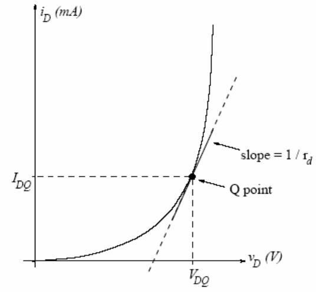
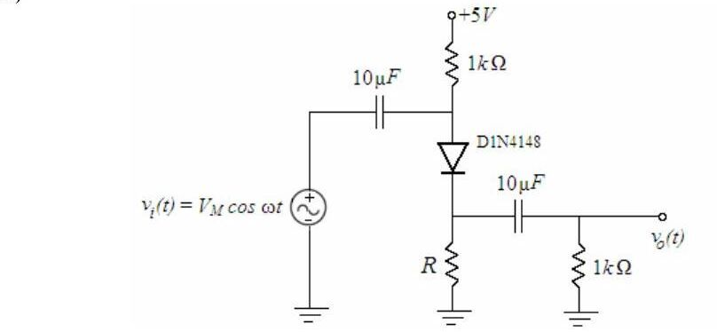

Bu yazı, Başkent Üniversitesi **EEM 214 Electronics I** laboratuvarının **Experiment 6: Small-Signal Analysis of Diode Circuits** föyünü (Şubat 2006) ve bu deney için hazırlanmış üç öğrenci raporunu içeriyor. Raporlar arkadaşların çalışması; ad ve öğrenci numaraları kapatıldı. Föy İngilizce olduğu için metni İngilizce aktarıldı. Föyün parolasız kopyası ve raporlar yazının sonunda ZIP olarak indirilebilir. Konunun kuramı için [Ders 4 – Diyot ve Diyot Modelleri](/arsiv/eem214-ders-04-diyot-modelleri/) yazısına da bakılabilir.

## Föy: Experiment 6 – Small-Signal Analysis of Diode Circuits

**Aim:** The aim of this experiment is to investigate the small-signal AC model of the diode and the usage of that model in a circuit.

### Theory

For a forward-biased diode the small-signal resistance is r_d = nV_T / I_DQ, where V_T is the thermal voltage, n is the ideality factor and I_DQ is the quiescent (DC) diode current. The i–v characteristic of a pn junction diode is i_D = I_S·[e^(v_D/nV_T) − 1], with 1 ≤ n ≤ 2. By definition the small-signal resistance is the inverse of the slope of this curve at the Q-point:

1/r_d = d/dv_D [I_S·(e^(v_D/nV_T) − 1)] evaluated at v_D = V_DQ = I_S·e^(V_DQ/nV_T) / nV_T ≅ I_DQ / nV_T,

since i_DQ ≅ I_S·e^(V_DQ/nV_T) for a forward-biased diode.

The small-signal AC model is a linear approximation to the exponential i–v curve around a DC operating point in the forward-bias region. It may be used if (i) the diode is biased to a DC Q-point in the forward-bias region and (ii) the AC component of the diode voltage is small relative to nV_T. The Q-point can be found numerically or with a piecewise-linear model; AC variations around it are then approximately linear and the diode can be modeled as a resistor equal to the inverse slope at the Q-point. The model begins to break down if the AC voltage across the diode exceeds nV_T; distortion due to the diode nonlinearity then becomes noticeable.

### Preliminary work

**1)** Review Section 13.4 of the textbook.

**2)** In the circuit below (+5 V supply through 1 kΩ to the anode of a D1N4148, cathode to ground through R, input v_i(t) = V_M cos ωt coupled through 10 µF to the anode, output taken through 10 µF across a 1 kΩ load), perform the following for R = 3.9 kΩ and R = 56 kΩ. Coupling capacitors are short circuits at the operating frequency, v_d << nV_T, and n = 2 for the 1N4148.

- a) Find I_DQ using a piecewise-linear model with V_γ = 0.6 V and forward resistance r = 20 Ω.
- b) Determine r_d and draw the small-signal AC model.
- c) Find the output as a function of the input and the small-signal gain A_v = v_o/v_i.
- d) Approximately determine the largest input amplitude V_M for which the small-signal approximation works (v_d ≈ nV_T).

**3) Design problem:** Determine R so that the small-signal gain is A_v = 0.70 ± 0.03 (0.67 < A_v < 0.73), with DC diode current less than 3 mA, using standard resistor values. Simulate with PSpice (D1N4148, VSIN source): compare the DC Q-point with your design, then use time-domain analysis with V_M = 20 mV and f = 2 kHz to find the gain; increase V_M up to 500 mV and comment.

**4)** Read the experimental work.

### Experimental work

**1)** Construct the circuit with R = 3.9 kΩ (electrolytic capacitors, positive terminal toward the DC supply). Set the generator to 2 kHz sine, 100 mV peak-to-peak (V_M = 50 mV); use normal triggering and adjust the trigger level carefully.

- a) With the generator off, measure the DC drop across the 1 kΩ resistor connected to the supply; find I_DQ and check the bias. Measure V_DQ.
- b) With the generator on, record input and output on two channels and measure the gain; compare with the preliminary work.
- c) Increase V_M until distortion appears at the output and note V_M.
- d) Return to V_M = 50 mV, use XY mode to record the input–output graph, and increase the input to see where the linear approximation breaks down.

**2)** Repeat part 1 for R = 56 kΩ and compare.

**3)** Repeat for the designed R (V_M = 20 mV). Does the circuit meet A_v = 0.70 ± 0.03? If not, redesign. Then increase the input to 1 V peak-to-peak (V_M = 500 mV) and compare the output with PSpice.

**Components:** 1N4148, 56 kΩ, 3.9 kΩ, 2 × 1 kΩ, 2 × 10 µF.

## Öğrenci raporları

| | Rapor A (2006) | Rapor B (2006) | 2008 raporu |
|---|---|---|---|
| 1 kΩ üzerindeki DC düşüm, R = 3.9 kΩ | 982 mV | 0.9277 V | 30.91 mV |
| V_DQ, R = 3.9 kΩ | 606 mV | 0.6042 V | 0.615 V |
| 1 kΩ üzerindeki DC düşüm, R = 56 kΩ | 203 mV | 0.1890 V | 3.82 |
| V_DQ, R = 56 kΩ | 490 mV | 0.4901 V | 0.493 V |
| Bozulmanın başladığı V_M, R = 3.9 kΩ | 680 mV | 910 mV | 800 mV |
| Bozulmanın başladığı V_M, R = 56 kΩ | 32 mV | 176 mV | 446 mV |

Rapor A'da tasarlanan üçüncü devre için 1 kΩ üzerinde 232 mV, V_DQ = 506 mV ve bozulma başlangıcı V_M = 88 mV ölçülmüş. Rapor B'de ölçülen kazançlar: R = 3.9 kΩ için A_v = 82 mV / 100 mV = **0.82** (ön çalışmada 0.947 hesaplanmış), R = 56 kΩ için A_v = 58 mV / 100 mV = **0.58**. Raporlarda giriş–çıkış dalga şekilleri ve XY modundaki v_out–v_in grafikleri çizim olarak verilmiş.

*Not: Ön çalışmadaki parçalı doğrusal modelle R = 3.9 kΩ için I_DQ = (5 − 0.6) / (1 k + 3.9 k + 20) ≈ 0.89 mA, r_d = 2·25.9 mV / 0.89 mA ≈ 58 Ω ve A_v = (R ∥ 1 k) / (r_d + R ∥ 1 k) ≈ 796 / 854 ≈ 0.93 bulunur. R = 56 kΩ için I_DQ ≈ 0.077 mA, r_d ≈ 670 Ω ve A_v ≈ 0.59 çıkar; ölçülen 0.58 ile uyumludur. 2008 raporundaki 30.91 mV değeri (0.031 mA'e karşılık gelir) beklenen yaklaşık 0.9 mA ile uyuşmuyor, birim ya da ölçüm hatası olabilir.*

## İndirme

ZIP dosyasında föyün parolası kaldırılmış PDF'i (Experiment6.pdf) ve üç raporun kişisel bilgileri kapatılmış PDF kopyaları bulunuyor.
