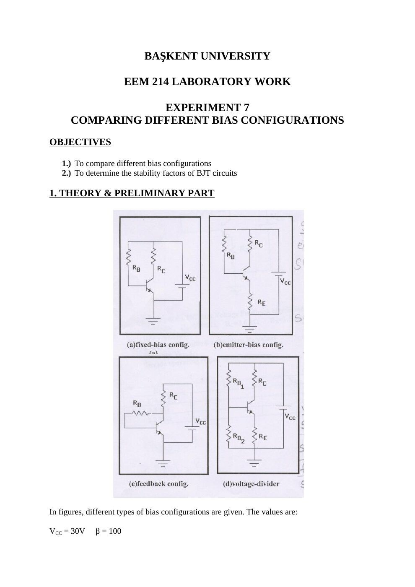
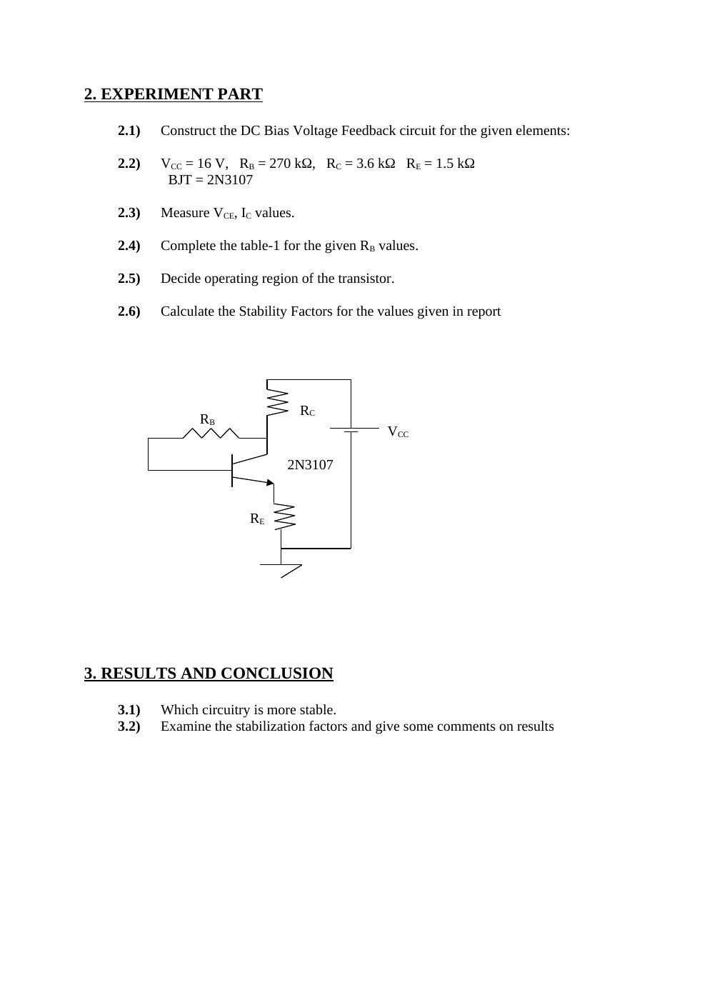
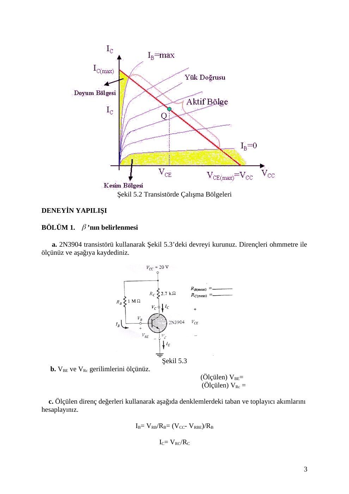
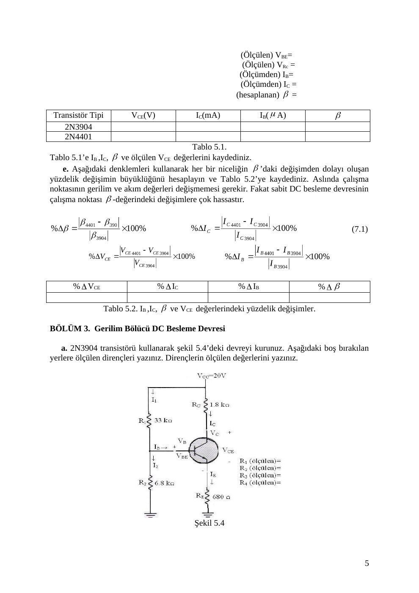

This post brings together two lab handouts found in the EEM214 Electronics I folder: the Başkent University-titled **Experiment 7 – Comparing Different Bias Configurations** and the Turkish **Experiment 5 – DC Operating Conditions of a BJT Transistor with Voltage-Divider or Fixed Bias**, whose author/institution is not stated. The documents are undated; the source copies are dated March 2015. Two PDFs converted from Word documents, with metadata removed, can be downloaded as a ZIP at the end of the post.

*This content belongs to a third-party source; it is shared for archival and nostalgic purposes, with attribution. It will be removed at the request of the rights holder.*

## Experiment 7: Comparing different bias configurations

**Objectives:** Compare different bias configurations and determine the stability factors of BJT circuits.

### Theory and preliminary work

The four arrangements are fixed bias, emitter bias, feedback bias, and voltage-divider bias. Given:

- V_CC = 30 V, β = 100
- R_B = 470 kΩ, R_C = 4.7 kΩ
- R_E1 = 1.2 kΩ, R_B2 = 5.6 kΩ

Find I_B and V_CE for all configurations. Calculate S(I_CO) and S(V_BE), identify the most stable configuration and explain why.

The formulas printed in the handout are:

| Configuration | S(V_BE) | S(I_CO) |
|---|---|---|
| Emitter bias | −β/[R_B + (β + 1)R_E] | (β + 1)(1 + R_B/R_E)/[(β + 1) + R_B/R_E] |
| Fixed bias | −β/R_B | β + 1 |
| Voltage divider | −β/[R_th + (β + 1)R_E] | (β + 1)(1 + R_th/R_E)/[(β + 1) + R_th/R_E] |
| Feedback bias | −β/[R_B + (β + 1)R_C] | (β + 1)(1 + R_B/R_C)/[(β + 1) + R_B/R_C] |

Here S(V_BE) is introduced as ΔI_C/ΔV_BE. R_th denotes the equivalent base resistance of the voltage divider.

### Experiment and report

Construct the DC bias voltage-feedback circuit with **V_CC = 16 V, R_B = 270 kΩ, R_C = 3.6 kΩ, R_E = 1.5 kΩ and BJT = 2N3107**, as printed in the source. Measure I_C and V_CE, identify the operating region and calculate stability factors.

| R_B | I_C | V_CE | Operating region |
|---|---|---|---|
| 270 kΩ | | | |
| 1.5 kΩ | | | |
| 2.2 kΩ | | | |

Record h_FE and compute S(V_BE) and S(I_CO) for every row. Compare stability and comment on the results.

*Note: The 1.5 kΩ and 2.2 kΩ values in the report are written in the R_B column in the source; they have been kept as they are so as not to confuse them with the other resistors in the preliminary work and the experiment.*

## Turkish Experiment 5: Fixed bias and voltage divider

**Objective:** To determine the operating conditions of a BJT in fixed DC bias and voltage-divider circuits; to compare how much the operating point shifts when the transistor is replaced.

**Materials:** DMM, DC voltage source; 680 Ω, 2.7 kΩ, 1.8 kΩ, 6.8 kΩ, 33 kΩ and 1 MΩ resistors; 2N3904 and 2N4401 transistors or equivalents.

### Theoretical background

The handout describes the active, cutoff and saturation regions. In the active region, the emitter-base junction is forward biased and the collector-base junction is reverse biased. The intersection of the output characteristic with the load line is the **Q operating point**. To reduce distortion in amplification, the Q point is required to be chosen suitably within the active region.

In fixed bias, a change in β can shift the operating point. In the voltage-divider connection with an emitter resistor, feedback reduces this dependence.

*Note: The handout uses the term "termination region" for the cutoff region. The expression "independent of β" is an approximate design assumption; it does not mean complete independence in every voltage-divider circuit.*

### Parts 1–2: β and fixed bias

1. Build Figure 5.3 with the 2N3904 and measure the resistors. In the figure, V_CC = 20 V, R_B = 1 MΩ and R_C = 2.7 kΩ.
1. Measure V_BE and V_RC. Calculate I_B = (V_CC − V_BE)/R_B, I_C = V_RC/R_C and β = I_C/I_B.
1. Because R_B is large, do not find I_B by measuring V_RB directly across the resistor, owing to the loading effect of the multimeter.
1. Using the measured β, the resistances and V_BE, calculate the theoretical I_B, I_C and node voltages; compare them with those found from the measurements.
1. Without changing the other elements of the circuit, install a 2N4401 in place of the 2N3904; repeat the same measurements.

| Transistor | V_CE (V) | I_C (mA) | I_B (µA) | β |
|---|---|---|---|---|
| 2N3904 | | | | |
| 2N4401 | | | | |

Calculate the percentage change for each quantity. In the handout, for example:

%Δβ = [(β_final − β_initial)/β_initial] × 100

The same operation is applied to V_CE, I_C and I_B.

### Part 3: Voltage-divider bias

In Figure 5.4, V_CC = 20 V, R_1 = 33 kΩ, R_2 = 6.8 kΩ, R_C = 1.8 kΩ and R_E = 680 Ω are used. Measure the resistors and calculate I_B, I_C, I_E, V_B, V_E and V_C for the 2N3904.

Power up the circuit and measure V_E, V_C, V_B and V_CE. I_1 = V_R1/R_1 and I_2 = V_R2/R_2 are found from the voltages across the divider resistors; I_B, I_C and I_E are calculated using Kirchhoff's current law. Compare the theoretical and measured values.

Repeat the same measurements with the 2N4401. Record the percentage changes of I_B, I_C, β and V_CE for the two transistors.

### Part 4 and evaluation questions

Perform a DC analysis of the two circuits with Electronics Workbench and compare it with the experiment.

1. Find the collector saturation current of each circuit. Explain the effect of β on this current.
1. When the transistor is changed, does the Q point move closer to saturation or to cutoff?
1. For fixed bias and the voltage divider, compare the ratios %ΔI_C/%Δβ, %ΔV_CE/%Δβ and %ΔI_B/%Δβ.
1. Determine the design with the smaller ratio **S(β) = %ΔI_C/%Δβ**.
1. Express I_B and I_C in terms of the circuit elements for fixed bias. For the divider, carry out the same analysis assuming I_1 ≈ I_2 and that these currents are much larger than I_B; explain the difference in β sensitivity.

*Note: In the Turkish handout, V_B is listed twice in some voltage lists; in addition, the Figure 7.3/7.4 references in the last part do not match the earlier Figure 5.3/5.4 numbering. The source PDF has been preserved; the relevant circuits are referred to here by name.*
