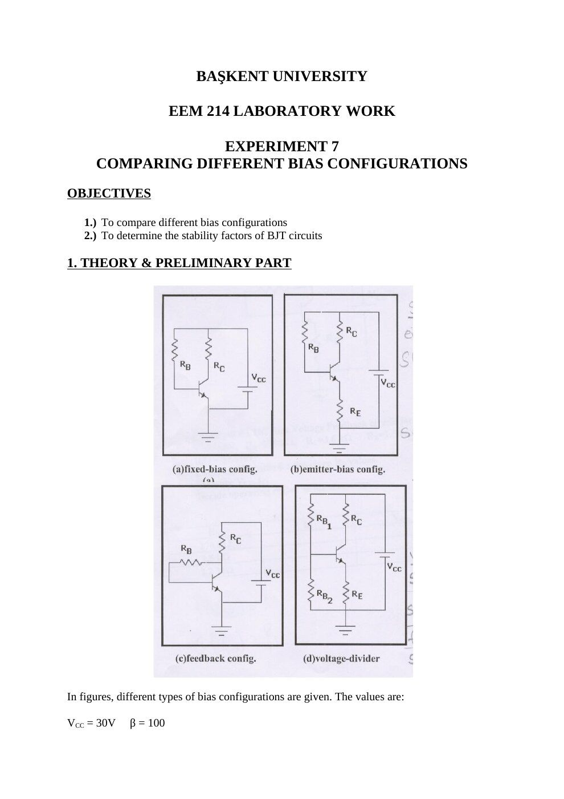
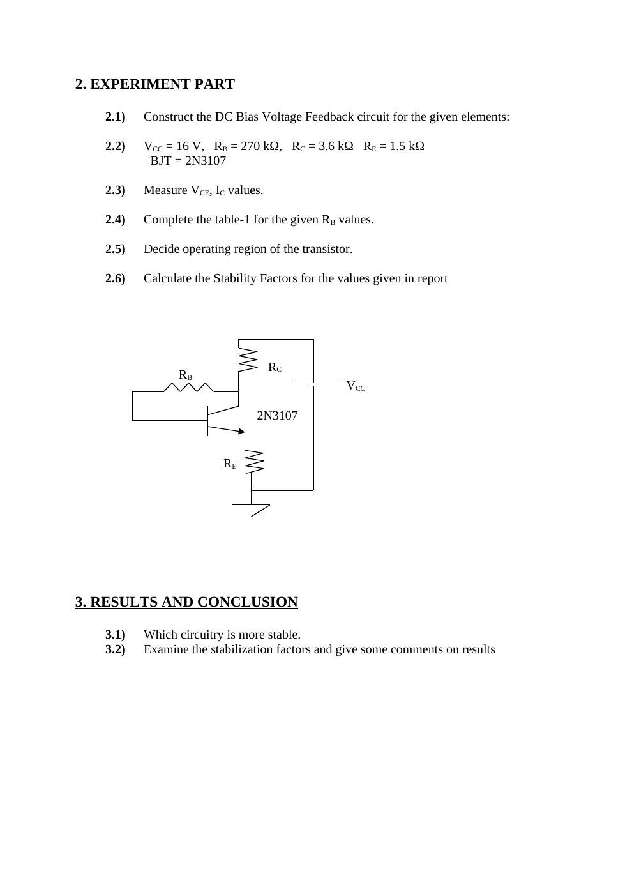
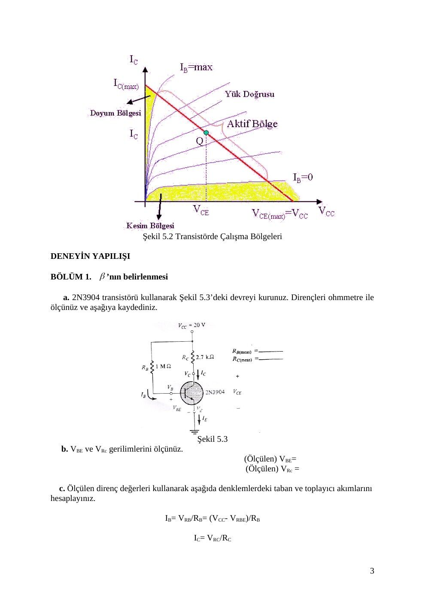
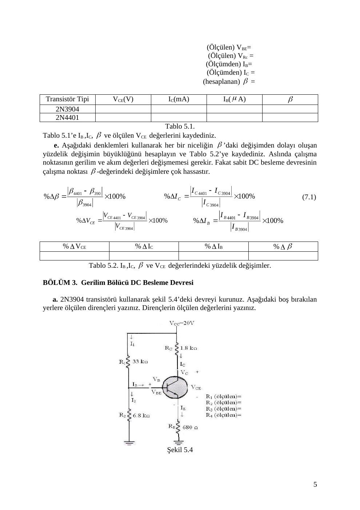

Bu yazı, EEM214 Elektronik I klasöründe bulunan iki deney föyünü bir araya getiriyor: Başkent Üniversitesi başlıklı **Experiment 7 – Comparing Different Bias Configurations** ve yazarı/kurumu belirtilmemiş Türkçe **Deney 5 – Bir BJT Transistörün Gerilim Bölücü veya Sabit Beslemede DC Çalışma Koşulları**. Belgelerde tarih yoktur; kaynak kopyaları Mart 2015 tarihlidir. Word belgelerinden çevrilen, üstverileri temizlenen iki PDF yazının sonunda ZIP olarak indirilebilir.

*Bu içerik üçüncü taraf bir kaynağa aittir; arşiv ve nostalji amacıyla kaynak belirtilerek paylaşılmıştır. Hak sahibinin talebi hâlinde kaldırılır.*

## Experiment 7: Comparing different bias configurations

**Objectives:** Compare different bias configurations and determine the stability factors of BJT circuits.

### Theory and preliminary work

The four arrangements are fixed bias, emitter bias, feedback bias, and voltage-divider bias. Given:

- V_CC = 30 V, β = 100
- R_B = 470 kΩ, R_C = 4.7 kΩ
- R_E1 = 1.2 kΩ, R_B2 = 5.6 kΩ

Find I_B and V_CE for all configurations. Calculate S(I_CO) and S(V_BE), identify the most stable configuration and explain why.

The formulas printed in the handout are:

| Configuration | S(V_BE) | S(I_CO) |
|---|---|---|
| Emitter bias | −β/[R_B + (β + 1)R_E] | (β + 1)(1 + R_B/R_E)/[(β + 1) + R_B/R_E] |
| Fixed bias | −β/R_B | β + 1 |
| Voltage divider | −β/[R_th + (β + 1)R_E] | (β + 1)(1 + R_th/R_E)/[(β + 1) + R_th/R_E] |
| Feedback bias | −β/[R_B + (β + 1)R_C] | (β + 1)(1 + R_B/R_C)/[(β + 1) + R_B/R_C] |

Here S(V_BE) is introduced as ΔI_C/ΔV_BE. R_th denotes the equivalent base resistance of the voltage divider.

### Experiment and report

Construct the DC bias voltage-feedback circuit with **V_CC = 16 V, R_B = 270 kΩ, R_C = 3.6 kΩ, R_E = 1.5 kΩ and BJT = 2N3107**, as printed in the source. Measure I_C and V_CE, identify the operating region and calculate stability factors.

| R_B | I_C | V_CE | Operating region |
|---|---|---|---|
| 270 kΩ | | | |
| 1.5 kΩ | | | |
| 2.2 kΩ | | | |

Record h_FE and compute S(V_BE) and S(I_CO) for every row. Compare stability and comment on the results.

*Not: Rapordaki 1.5 kΩ ve 2.2 kΩ değerleri kaynakta R_B sütununda yazılıdır; ön çalışma ve deneydeki diğer dirençlerle karıştırılmaması için aynen korundu.*

## Türkçe Deney 5: Sabit besleme ve gerilim bölücü

**Amaç:** BJT’nin sabit DC besleme ve gerilim bölücülü devrelerde çalışma koşullarını belirlemek; transistör değiştirildiğinde çalışma noktasının ne kadar kaydığını karşılaştırmak.

**Malzemeler:** DMM, DC gerilim kaynağı; 680 Ω, 2.7 kΩ, 1.8 kΩ, 6.8 kΩ, 33 kΩ ve 1 MΩ dirençler; 2N3904 ve 2N4401 transistörler veya denkleri.

### Teorik bilgi

Föy aktif, kesim ve doyum bölgelerini anlatır. Aktif bölgede emetör-baz eklemi ileri, kolektör-baz eklemi ters kutuplanır. Çıkış karakteristiği ile yük doğrusunun kesişimi **Q çalışma noktasıdır**. Yükseltmede bozulmayı azaltmak için Q noktasının uygun aktif bölge içinde seçilmesi istenir.

Sabit beslemede β değişimi çalışma noktasını kaydırabilir. Gerilim bölücülü, emetör dirençli bağlantıda geri besleme bu bağımlılığı azaltır.

*Not: Föy kesim bölgesi için “sonlanma bölgesi” terimini kullanıyor. “β’dan bağımsız” ifadesi yaklaşık bir tasarım kabulüdür; her gerilim bölücülü devrede tam bağımsızlık anlamına gelmez.*

### Bölüm 1–2: β ve sabit besleme

1. 2N3904 ile Şekil 5.3’ü kurup dirençleri ölçün. Şekilde V_CC = 20 V, R_B = 1 MΩ ve R_C = 2.7 kΩ’dur.
1. V_BE ve V_RC’yi ölçün. I_B = (V_CC − V_BE)/R_B, I_C = V_RC/R_C ve β = I_C/I_B hesaplayın.
1. R_B büyük olduğundan multimetrenin yükleme etkisi nedeniyle V_RB’yi doğrudan direnç üzerinden ölçerek I_B bulmayın.
1. Ölçülen β, dirençler ve V_BE ile teorik I_B, I_C ve düğüm gerilimlerini hesaplayın; ölçümden bulunanlarla karşılaştırın.
1. Devrenin diğer elemanlarını değiştirmeden 2N3904 yerine 2N4401 takın; aynı ölçümleri tekrarlayın.

| Transistör | V_CE (V) | I_C (mA) | I_B (µA) | β |
|---|---|---|---|---|
| 2N3904 | | | | |
| 2N4401 | | | | |

Her nicelik için yüzde değişimi hesaplayın. Föyde örneğin:

%Δβ = [(β_son − β_ilk)/β_ilk] × 100

Aynı işlem V_CE, I_C ve I_B için uygulanır.

### Bölüm 3: Gerilim bölücü besleme

Şekil 5.4’te V_CC = 20 V, R_1 = 33 kΩ, R_2 = 6.8 kΩ, R_C = 1.8 kΩ ve R_E = 680 Ω kullanılır. Dirençleri ölçüp 2N3904 için I_B, I_C, I_E, V_B, V_E ve V_C’yi hesaplayın.

Devreyi çalıştırıp V_E, V_C, V_B ve V_CE’yi ölçün. Bölücü dirençlerindeki gerilimlerle I_1 = V_R1/R_1 ve I_2 = V_R2/R_2 bulunur; Kirchhoff akım yasasıyla I_B, I_C ve I_E hesaplanır. Teorik ve ölçülen değerleri karşılaştırın.

2N4401 ile aynı ölçümleri tekrarlayın. İki transistör için I_B, I_C, β ve V_CE’nin yüzde değişimlerini kaydedin.

### Bölüm 4 ve değerlendirme soruları

Elektronik Workbench ile iki devrenin DC analizini yapıp deneyle karşılaştırın.

1. Her devrenin kolektör doyma akımını bulun. β’nın bu akıma etkisini açıklayın.
1. Transistör değişince Q noktası doyuma mı kesime mi yaklaşıyor?
1. Sabit besleme ve gerilim bölücü için %ΔI_C/%Δβ, %ΔV_CE/%Δβ ve %ΔI_B/%Δβ oranlarını karşılaştırın.
1. **S(β) = %ΔI_C/%Δβ** oranı daha küçük olan tasarımı belirleyin.
1. Sabit besleme için I_B ve I_C’yi elemanlar cinsinden ifade edin. Bölücüde I_1 ≈ I_2 ve bu akımlar I_B’den çok büyükken aynı analizi yapın; β duyarlılığı farkını açıklayın.

*Not: Türkçe föyde bazı gerilim listelerinde V_B iki kez yazılıyor; ayrıca son bölümün Şekil 7.3/7.4 atıfları önceki Şekil 5.3/5.4 numaralarıyla uyuşmuyor. Kaynak PDF korunmuş, burada ilgili devreler adlarıyla belirtilmiştir.*
