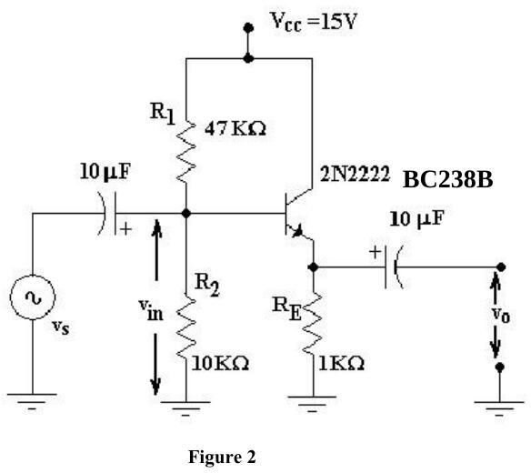
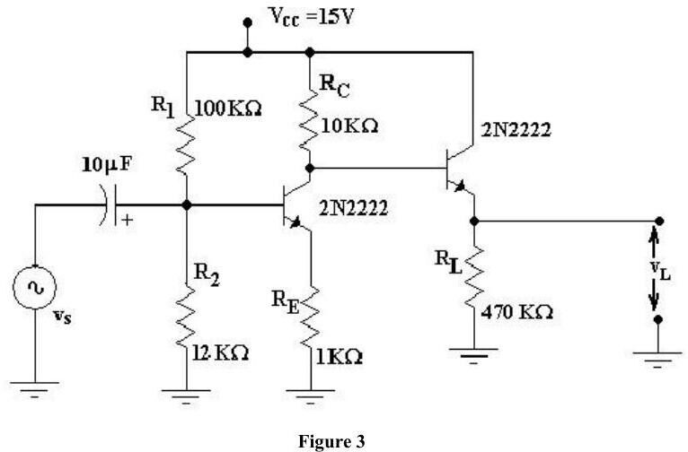
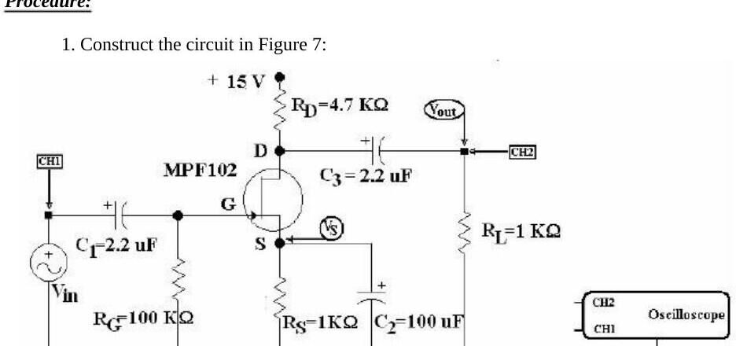

Bu yazı, Başkent Üniversitesi **EEM 214 Electronics I** laboratuvarının iki yükselteç föyünü bir araya getiriyor: **Common-Collector (Emitter Follower) Amplifier** (2012'de Experiment 8, 2014'te aynı metinle Experiment 9) ve **Common-Source JFET Amplifier** (2013, Experiment 10). Föyler İngilizce olduğu için metinleri İngilizce aktarıldı; denklemlerin bir kısmı föyde görsel olarak yer aldığı için okunabildiği kadarıyla yazıldı. Föylerin orijinal dosyaları yazının sonunda ZIP olarak indirilebilir.

## Common-Collector (Emitter Follower) Amplifier

**Objectives:**

1. To measure the open-circuit voltage gain, input resistance and output resistance of the common-collector amplifier.
1. To demonstrate the use of the common-collector as a buffer between a high impedance source and a low impedance load.

**Theory:** The common-collector or emitter-follower amplifier is an important small-signal configuration of the BJT. It has very high input resistance, high current gain, very small output resistance and approximately unity voltage gain. The high input and low output resistance make it an ideal buffer between a high impedance source and a low impedance load; a buffer is any circuit that keeps the source from being affected by a load. For example, a common-emitter amplifier with a 10 kΩ output resistance could not provide much voltage gain to a 50 Ω load. In the small-signal equivalent circuit the current-controlled current source points down, as in the common-emitter amplifier, but the load is in parallel with the emitter resistor, so the output is in phase with the input. The open-circuit gain A_V, input resistance r_in and output resistance r_out are found from this equivalent circuit.

### Preliminary work

1. Find the DC operating point of the circuit in Figure 2.
1. Establish its small-signal equivalent circuit.
1. Find the formulae of the open-circuit voltage gain A_V1, the input resistance r_in and the output resistance r_out.
1. Calculate A_V1, r_in and r_out for the circuit in Figure 2.

### Experimental work

1. Construct the circuit in Figure 2.
1. Set the signal generator to 10 kHz so that v_O = 0.1 V peak-to-peak; measure v_in (including its phase relative to v_O) to calculate A_V1.
1. To measure r_out, connect a 200 Ω potentiometer as a rheostat between the output coupling capacitor and ground and adjust it until v_O is 50 mV peak-to-peak (half the normal output). By the voltage divider rule, its resistance equals r_out.
1. To measure r_in, insert a 50 kΩ potentiometer in series between the input coupling capacitor and the generator and adjust it until v_O = 50 mV peak-to-peak. Its resistance minus the generator's internal resistance r_s equals r_in.
1. To demonstrate buffering a low impedance load from the high output resistance of a common-emitter stage, connect Figure 3; the emitter follower is biased directly by the common-emitter collector voltage, so no extra coupling capacitors or divider resistors are needed.
1. Set V_in = 0.1 V peak-to-peak at 10 kHz and measure V_L to calculate the source-to-load gain V_L/V_S.
1. Why do we adjust the potentiometer to half of the normal output when measuring input and output resistances?
1. What is r_s, the internal resistance of the signal generator? Measure it.
1. Compare the calculated and measured r_in and r_out for Figure 2.
1. How can the emitter follower be biased as in step 5? Explain the reason of biasing.
1. Is there any noticeable effect of the emitter follower in Figure 3 on V_L/V_S? How much?
1. What is the function of an emitter follower in a circuit?
1. Obtain PSpice results for Figures 2 and 3 and compare with the experiment.

**Equipment:** 2 × BC238B, 15 V supply, signal generator, resistors 100 kΩ, 47 kΩ, 12 kΩ, 10 kΩ, 1 kΩ, 470 Ω, 2 × 10 µF (25 V), potentiometers 50 kΩ and 200 Ω, dual-channel oscilloscope. Föyün son sayfası V_in, A_V1, R_out, R_in, V_L, A_V2 = V_L/V_S ve R_s için sonuç tablosu.

## Common-Source JFET Amplifier

**Aim:** To evaluate the common-source amplifier using the small-signal equivalent model and to learn what affects the voltage gain.

**Theory:** In a self-biased n-channel JFET with an AC source capacitively coupled to the gate, R_G keeps the gate at about 0 V DC (since I_GSS is extremely small) and its large value (usually several megohms) prevents loading of the signal source. The bias voltage is created by the drop across R_S, and the bypass capacitor keeps the source at AC ground. The signal swings V_GS above and below its Q-point value, so I_D swings in phase with v_gs; the drain voltage swings 180° out of phase. This can be shown on both the transfer characteristic and the drain characteristics with the load line.

The small-signal model is identical to the MOSFET's, with g_m = g_m0·(1 − V_GS/V_P) = (2I_DSS/|V_P|)·(1 − V_GS/V_P), g_m0 = −2I_DSS/V_P and r_O = |V_A|/I_D. At high frequencies C_gs and C_gd (both depletion capacitances; typically C_gs = 1–3 pF, C_gd = 0.1–0.5 pF, f_T = 20–100 MHz) are added. With R_S bypassed A_V = g_m(R_D ∥ R_L); without bypass A_V = g_m·R_d/(1 + g_m·R_S) with R_d = R_D ∥ R_L.

n-channel JFET characteristics: cut-off for V_GS ≤ V_P (i_D = 0); triode region for V_P ≤ V_GS ≤ 0 and V_DS ≤ V_GS − V_P with i_D = I_DSS[2(1 − V_GS/V_P)(V_DS/−V_P) − (V_DS/V_P)²]; saturation (pinch-off) for V_DS ≥ V_GS − V_P with i_D = I_DSS(1 − V_GS/V_P)²(1 + λV_DS), where λ = 1/V_A.

### Preliminary work

- **A.** Find I_D, V_GS, V_DS and g_m for the circuit of Figure 7 and fill Table 1 for comparison with measurements.
- **B.** For an n-channel JFET with V_P = −4 V and I_DSS = 10 mA (infinite output resistance in pinch-off unless stated): 1) for V_GS = −2 V, find the minimum V_DS for pinch-off and i_D at V_DS = 3 V; 2) for small V_DS, find r_DS at V_GS = 0 V and −3 V; 3) with V_A = 100 V, find r_O at 1 mA, 2.5 mA and 10 mA.
- **C.** 1) The JFET in Figure 5 has V_P = −3 V, I_DSS = 9 mA, λ = 0; find all resistors so that V_G = 5 V, I_D = 4 mA, V_D = 11 V, with 0.05 mA in the voltage divider. 2) With a capacitively coupled input, a large source bypass capacitor and output taken from the drain (Figure 6), calculate g_m, r_O (V_A = 100 V), R_i, A_V = v_O/v_i and R_O.

### Procedure

1. Construct the circuit in Figure 7.
1. Measure I_D, V_GS and V_DS, find g_m and compare with the calculated values (Table 1).
1. Apply a 5 kHz, 0.5 V peak-to-peak signal as V_in, observe V_out and find the voltage gain.
1. Measure the AC voltage at the source and comment.
1. Reduce R_L and find the gain.
1. Reduce the capacitor and find the gain ("Never ask 'which capacitor?'").
1. Draw all V_in and V_out graphs and indicate phase differences.

**Equipment:** MPF102 (or equivalent), 15 V supply, capacitors 2 × 2.2 µF and 100 µF, resistors 2 × 1 kΩ, 4.7 kΩ, 100 kΩ, oscilloscope. **References:** Sedra & Smith, *Microelectronic Circuits*, 4th ed.; Floyd, *Electronic Devices*, 3rd ed.

*Not: Föyde sabit kutuplama dışı (R_S'li) devre için verilen akım ifadesi I_D = 2I_DSS[(R_S·g_m0 + 1) − (2R_S·g_m0 + 1)^½]/(R_S·g_m0)² biçiminde okunuyor.*

## İndirme

ZIP dosyasında ortak kolektör föyünün 2012 PDF'i ve 2014 Word sürümü ile ortak kaynaklı JFET föyünün Word dosyası bulunuyor.
