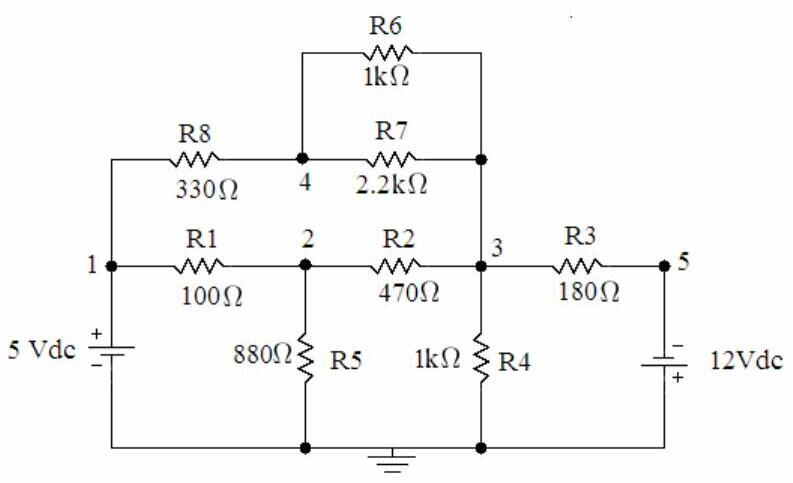
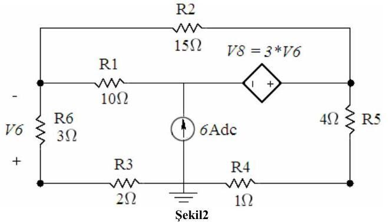
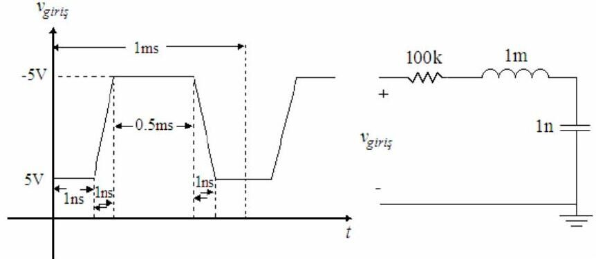

This post brings together the **PSpice Exercise** handout (March 2008) given to introduce PSpice in the Başkent University **EEM 214 Electronics I** course, the **How to add an Include File** note distributed in the laboratory, and a Turkish, screenshot-based PSpice usage note prepared by a student in 2012. The documents can be downloaded as a ZIP at the end of the post.

## PSpice Exercise (2008)

### 1. Bias point and transient analysis

Draw the schematic of the circuit in Figure 1 using the "OrCAD Capture" program. Make sure the ground symbol is named **"0"** for the simulation to run.

- a. In PSpice/New Simulation Profile, select **Bias Point** as the "analysis type" and run the simulation.
- b. Using the "I" and "V" buttons in OrCAD Capture, find and note the currents through the elements and the node voltages.
- c. With PSpice/Edit Simulation Profile, change the analysis type to **Time Domain (Transient)**; choose a run time of 10 s and a step of 10 ms, and observe the variation of the element voltages with voltage probes.

### 2. DC sweep

Draw the circuit in Figure 2 (containing a dependent voltage source V8 = 3·V6 and a 6 A independent current source) and create a new simulation profile. Analysis type: **DC Sweep**; "sweep variable": the independent current source; linear sweep: from −6 A to +6 A in 0.5 A steps. Obtain the variations of V_R3 and V_R4 in the "PSpice A/D" window.

### 3. Transient analysis with a square wave

Draw the circuit in Figure 3 (a series RLC of 100 kΩ – 1 mH – 1 nF, driven at the input by a ±5 V pulse with a 1 ms period and rise and fall times of 1 ns).

- a. Analysis type: **Time Domain (Transient)**; choose the run time and step size appropriately for the input square wave. Observe the capacitor voltage separately for R = 100 kΩ, 2 kΩ and 68 Ω.
- b. Set the input signal period to PER = 0.01 ms and the pulse width to PW = 0.005 ms, and repeat for the same three resistor values.

### 4. Parametric AC sweep

Draw the circuit in Figure 4 (V_in = 10 V, R_f = 4 Ω, C_f = 2.0 µF in series, with L_f = 127 µH at the output). Analysis type: **AC Sweep/Noise**, with the option **Parametric Sweep**; "sweep variable": R_f, linear from 4 Ω to 8 Ω in steps of 2 Ω. Input source: VAC (ACMAG = 10 V); AC sweep logarithmic, start 100 Hz (it can never be 0 Hz), end 1 MHz, 1000 points per decade. Obtain the frequency response (DB(v_out/v_in)) for R_f = 4, 6 and 8 Ω in the same "Probe Window".

")

*Note: This circuit is a series RLC high-pass filter; its resonant frequency is f₀ = 1/(2π√(L_f·C_f)) = 1/(2π√(127 µH × 2 µF)) ≈ 10 kHz, and the peak at resonance flattens as R_f increases.*

### Required in the report

1. Show the results obtained in 1.a and 1.b on the OrCAD Capture schematic.
1. Give the element voltages from 1.c in a table, and give the variations of V_R1, V_R2, V_R3 as graphs.
1. Give the V_R3 and V_R4 graphs obtained in 2.
1. Give the variation of the capacitor voltage for the three resistor values in 3.a and 3.b as graphs.
1. In question 4, give the frequency responses for the three resistor values.

## How to add an Include File

Include files are like header files in C: they are used to add any valid SPICE code (netlist, stimulus, model) to the simulation. The syntax is `.INC "<filename>"`; with this line, the contents of the file are added to the SPICE input.

- From the main menu, select **PSpice → New Simulation Profile** (or edit the existing profile) and switch to the **Libraries** tab.
- Locate the model file (for example `diode.lib`) with **Browse**. Important: by default the file dialog shows only files with the `.inc` extension; unless "all files" is selected, `.lib` files will not be visible.
- Add it with **Add as Global**.

To add a library (.olb): select **Place → Part**, then **Add New Library**, and choose and add the relevant `.olb` file (for example `diode.olb`). This method was used in the laboratory to add the BC238B, CD4007 and the diode models provided with the handouts.

## A student's PSpice usage note (2012)

A short note prepared by a student with screenshots describes the following steps: giving the project a name with File → New → Project and selecting **Create a blank project**; building the circuit; creating a profile with PSpice → **New Simulation** and entering the duration in the "Run to time" field; in the window that opens, selecting the desired graph with **Trace → Add Trace**, and using **Plot → Add Plot to Window** for another graph; pressing the run (play) button on the circuit screen if the window does not open; copying the graphs with **Window → Copy to Clipboard**; and, after the simulation, using the V, I, P buttons on the circuit to view voltages, currents and powers.

## Download

The ZIP file contains the PDF of the PSpice Exercise handout, the "How to add an Include File" Word document, and a PDF copy of the student's usage note.
